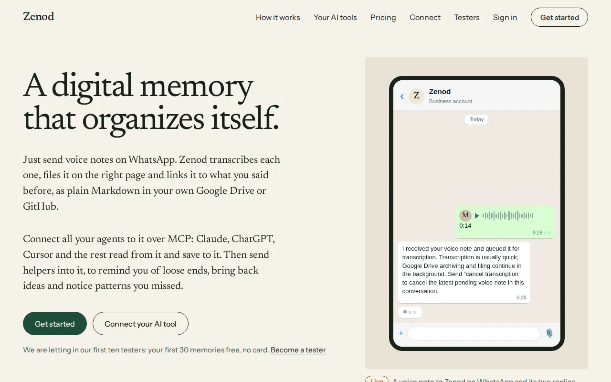
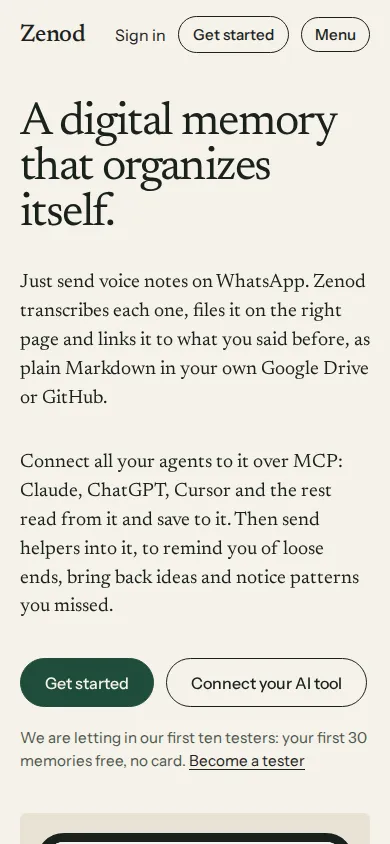

Card for EPIC-25 E25-S3, run run_d0305769-6f50-49ca-bb46-57b5e02099f3. Code PR #1691, merge 1a62d8e0.
Evidence: [e25-s3-2026-11-18](../evidence/e25-s3-2026-11-18.md).
Gate: [e25-s3-gate-2026-11-18](../evidence/e25-s3-gate-2026-11-18.md). Promoted 3ec90ca to 1a62d8e (06:09Z), then to e86c6e3 with the fake Drive URL removed (PR #1692, 07:07Z), run run_3e247651-5416-4cc3-976c-c46ebff55c4e.

