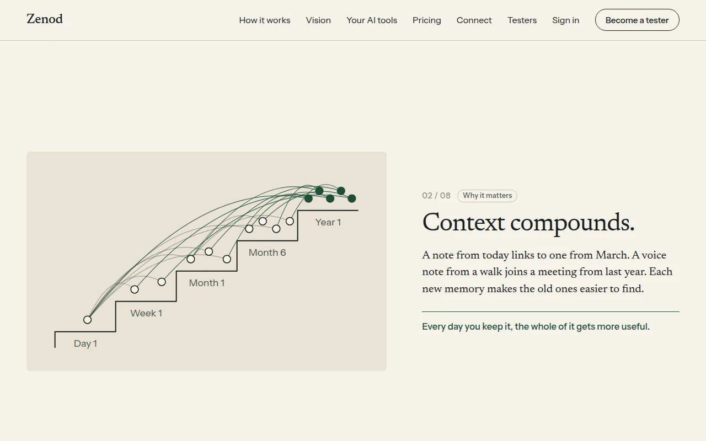
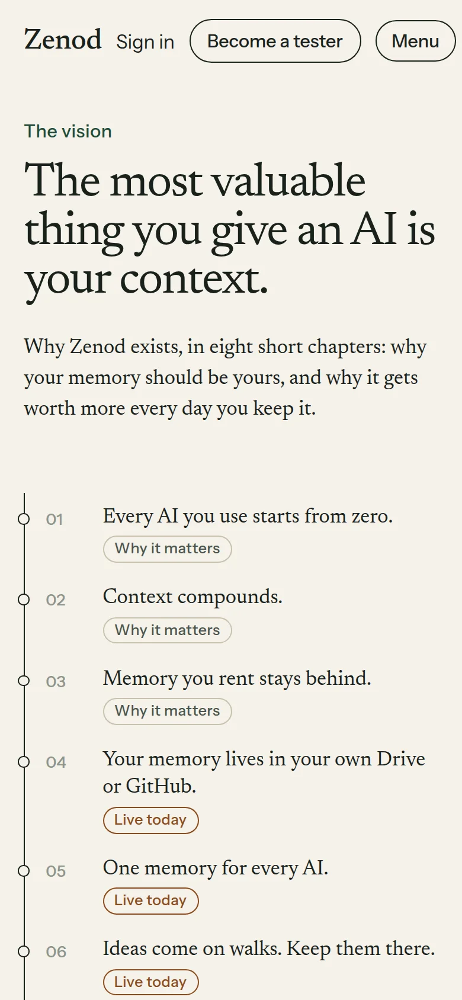
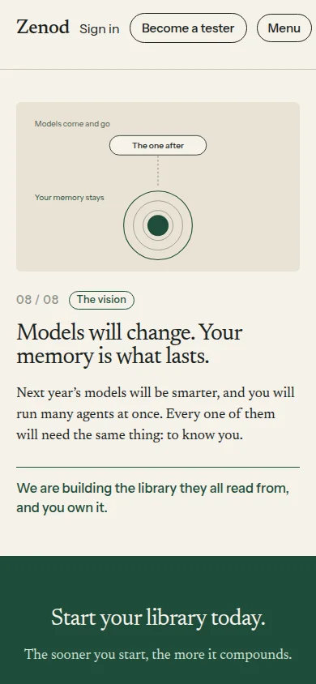

Card for EPIC-25 E25-S5, run run_c533527c-469d-492a-a416-11a20e0bb3ef. Code PR [#1767](https://github.com/zenod-ai/zenod/pull/1767).

The eight chapters: every AI starts from zero · context compounds · memory you rent stays behind (why it matters) · your memory lives in your own Drive or GitHub · one memory for every AI · ideas come on walks · your memory starts working for you (live today) · models will change, your memory is what lasts (the vision).

