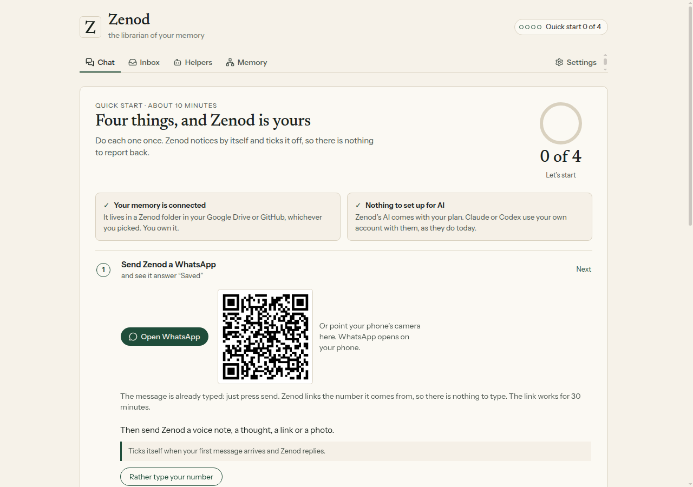
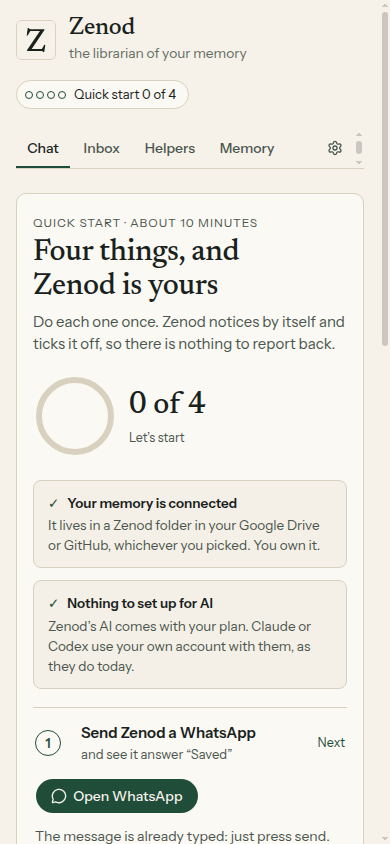
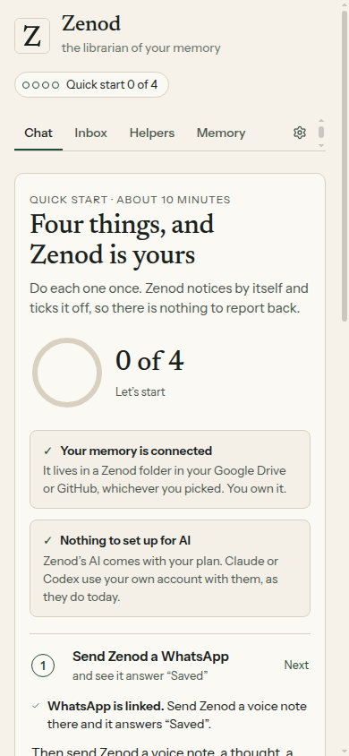
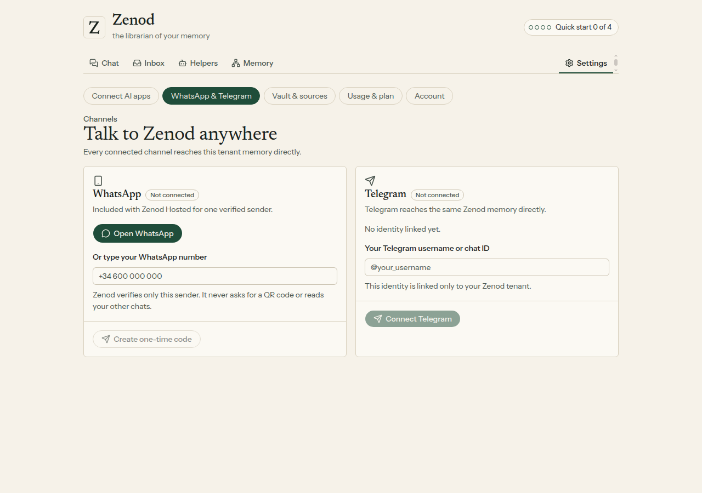

Card for EPIC-7 E7-S16, run run_25bab4a6-55ae-4541-a5f4-7c6a6f4fe2ba. Code PR #1710, merge 07ba61d6. Phylax live on sha-07ba61d since 2026-11-19T20:48Z, production Zenod promoted to 07ba61d at 2026-11-19T21:20:47Z (gate passed).
Evidence: [e7-s16-2026-11-19](../evidence/e7-s16-2026-11-19.md).

