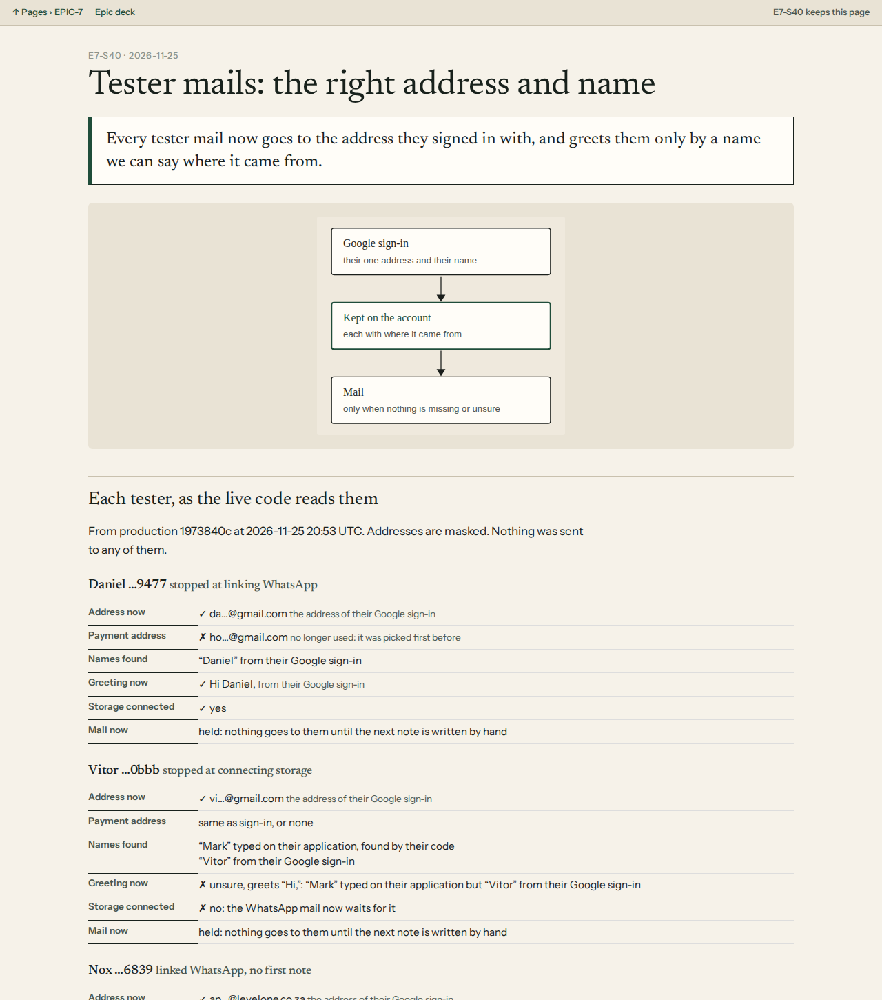
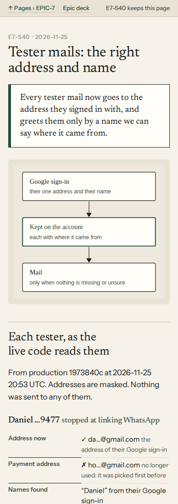

Card for EPIC-7 E7-S40, run run_324dc728-b3f7-45b3-875f-7fad7d678322. Code: PR [#1768](https://github.com/zenod-ai/zenod/pull/1768) (sign-in address first, name joined by the redeemed code, Google name kept, next-day WhatsApp mail waits for storage, send.py passes gmail_send's facts and holds anything missing or unsure) and PR [#1770](https://github.com/zenod-ai/zenod/pull/1770) (one kept address per person, the Google sign-in one, per his "Yes: Zenod fixes sign-up next").

Why the decision: Vitor typed "Mark" and Google says "Vitor"; Nox typed "Nox" and Google says "Level" (a company account). Today both get "Hi," and are held. A yes would trust the typed name over Google's.

The three testers are on the sender's hold list (vps3 `~/.local/state/zenod-tester-thanks/hold.json`) until agent_team E105-S306 writes their next note.

