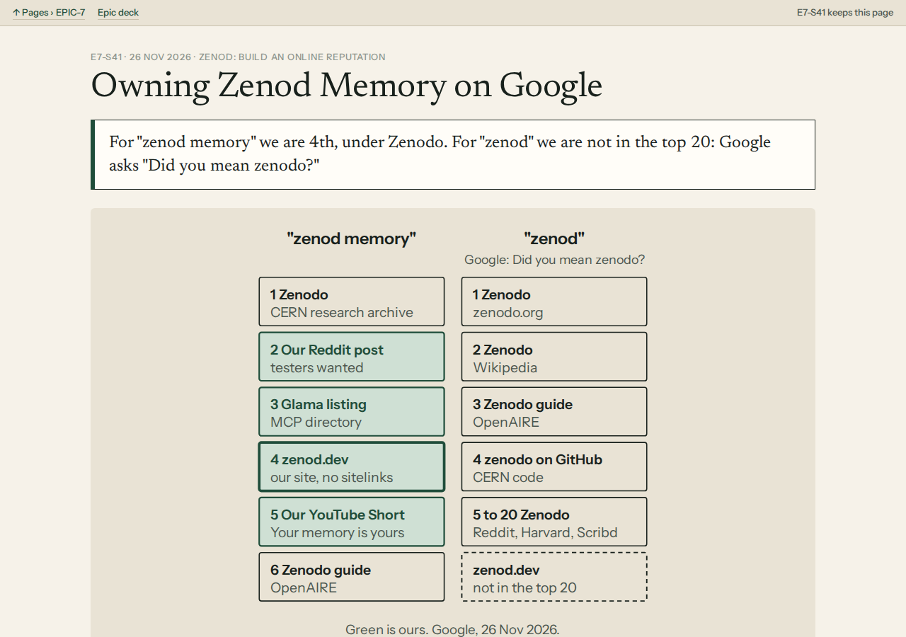

Card for EPIC-7 E7-S41, run run_8029ae52-0fcd-494d-bfc3-eb10792b6537, under Zenod: Build an online reputation (EPIC-28).

His words reached the team through the EpicSocial desk (dx_14fea8f1, 25 Nov 23:56Z): "And then how can we own Znode in Google and Znode memory? Do we have a plan for that?" The same note said "say Zenod memory, not Zenod", which is why step 1 puts that name on every title.

Read through the team browser's Google search, signed out, from vps3 in Germany, 26 Nov about 00:10Z. Ten searches, no accounts, nothing posted.

The three steps that need him: Enable on Search Console (ask E46-A42, Mac ticket E46-S68, waiting since 18 Nov), a yes on new directory listings (EPIC-28 R-S2), and outside articles under his name (Show HN, dev.to, Product Hunt).

