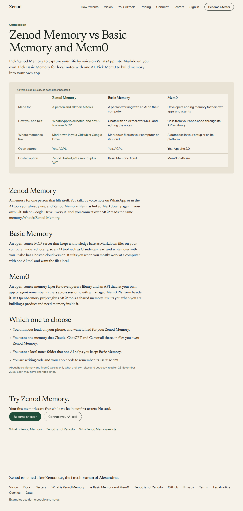
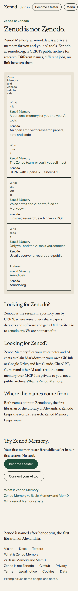
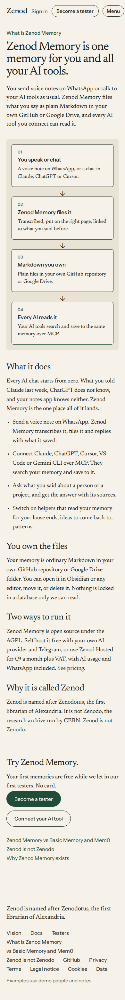

Card for EPIC-7 E7-S42, run run_4a165287-df09-4011-8116-3dc666ea6ff5, under Zenod: Build an online reputation, the team steps 1a, 1b, 1c, 1d and 4a of the E7-S41 plan.

PR #1775 (wt/e7-s42). Before and after:

| | Before | After |
|---|---|---|
| Titles | none said Zenod Memory | every page says Zenod Memory |
| HTML | 2 to 3 KB script shells, no heading | each page prerendered, headings and words in the HTML |
| /pricing | home title, pointed Google to home, not in sitemap | its own title and canonical, in the sitemap |
| Home description | 370 characters | 139 characters |
| Profiles record | none | one Organization "Zenod Memory" naming GitHub, Glama, YouTube, X and LinkedIn |
| New pages | none | /zenod-memory, /zenod-vs-basic-memory-mem0, /zenod-vs-zenodo |

Facts about Basic Memory and Mem0 come only from their own sites and code, read 26 Nov 2026, with no prices of theirs. Nothing was posted elsewhere.

