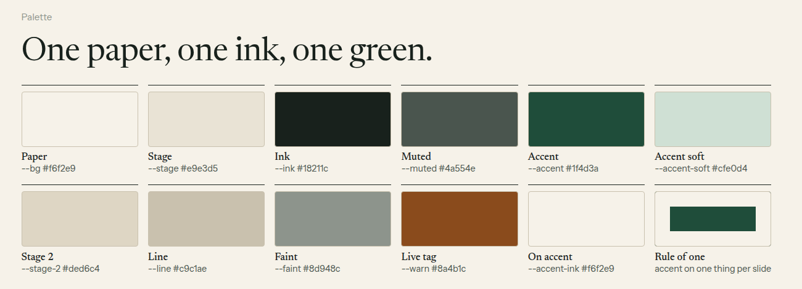
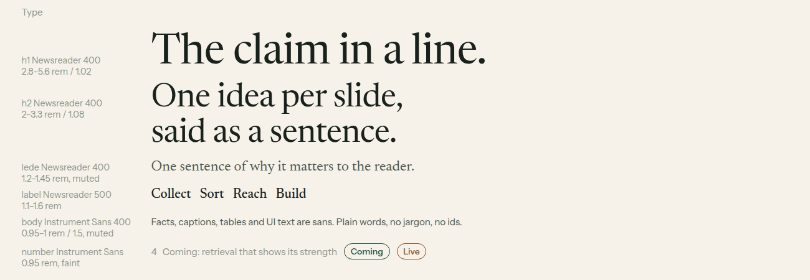
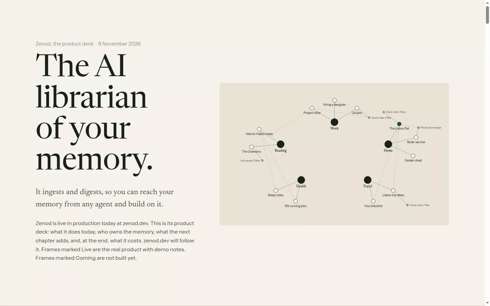
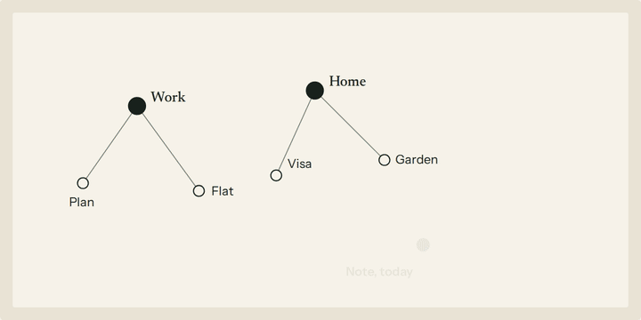
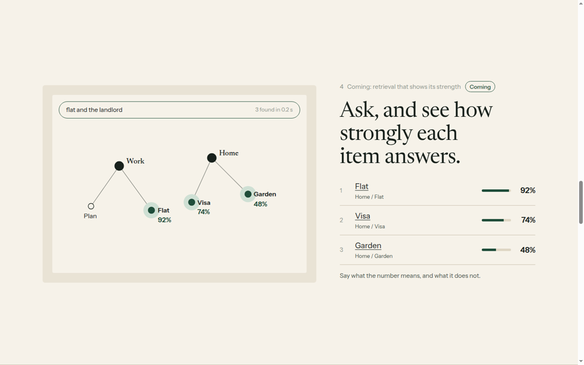

# Paper deck: a design language for decks and pages

The look of the Zenod product deck (http://vps3.taild81fbb.ts.net:8912/, source [vision-deck.html](vision-deck.html), EPIC-12 P1), written down so any project can make a deck or a page in it. Jordi on round 3 (E12-A4, 8 Nov 2026): "I love the animations and I love the style … if we could promote it as being design style that we use internally more generally." Zenod is the worked example throughout; the rules are brand-neutral, and a brand changes only the tokens.

Starter kit: [design-kit/](design-kit/) (one HTML template, `paper.css`, `scenes.js`; copy the folder). Specimen source: [design-language/specimen.html](design-language/specimen.html).

In one line: **warm paper, one ink, one deep green, a book serif for what you claim and a plain sans for what you prove, one idea per screen, real screens on a flat stage, and small looping scenes that show the product doing the one thing the slide says.**

## Palette

| Token | Value | Use |
|---|---|---|
| `--bg` paper | `#f6f2e9` | the ground of every slide, and the inside of a screen |
| `--stage` | `#e9e3d5` | the flat stage a screenshot, mockup or phone sits on |
| `--stage-2` | `#ded6c4` | bar tracks, a second stage step |
| `--ink` | `#18211c` | headings, body ink, the one heavy rule under a table head or a column row |
| `--muted` | `#4a554e` | sans body, captions, ledes |
| `--faint` | `#8d948c` | slide numbers, hints, log nodes |
| `--line` | `#c9c1ae` | hairlines between rows and slides |
| `--accent` | `#1f4d3a` | the one colour: the focus, links in a scene, the closing band |
| `--accent-soft` | `#cfe0d4` | halos and soft fills of the focus, lede text on the band |
| `--accent-ink` | `#f6f2e9` | text on the accent |
| `--warn` | `#8a4b1c` | only the "Live" tag (what exists today) |

Rule of one: the accent goes on one thing per slide (the node that answers, the chosen plan, the "me" bubble), and fills a whole slide only once, at the close. No gradients, no shadows (the chosen card uses an inset 1 px accent ring, not a shadow), no glow, no second accent. Product screens keep their own colours inside the stage (the WhatsApp scene uses WhatsApp's greens and greys) because they are evidence, not decoration.

These are the same values as zenod.dev's paper landing (`apps/site/src/paper.css`, `--pp-*`), so the deck and the site already read as one.

## Type

Two families, both OFL, loaded from Google Fonts in the kit (self-host them for offline or production use):

- **Newsreader** (serif, optical sizes 6–72), weights 400 and 500: everything that claims. `h1` 400, `clamp(2.8rem, 6.4vw, 5.6rem)`, line-height 1.02, max 14ch. `h2` 400, `clamp(2rem, 3.8vw, 3.3rem)`, 1.08, max 22ch. Lede 400, `clamp(1.2rem, 1.8vw, 1.45rem)`, muted, max 40ch. Labels and column heads 500, 1.1–1.6rem. Big numbers (a price) 400, `clamp(2.4rem, 4vw, 3.3rem)`, letter-spacing −0.02em. Headings −0.015em and `text-wrap: balance`.
- **Instrument Sans**, weights 400, 500 and 600: everything that proves. Body, facts, tables, captions and UI text 0.95–1rem at 1.5, muted; slide numbers 0.95rem faint; tags 500 0.875rem; percentages 600.
- Page body is Newsreader 1.1875rem/1.55 so a stray paragraph still reads like a book.

Sentence case everywhere. Headings are full sentences that state the claim ("Ask, and see how strongly each memory answers."), never a topic. No monospace, no tracked capitals, no eyebrow above the heading: the small sans line above it is a number plus a plain phrase ("9  Coming: retrieval that shows its strength").

## Layout and spacing

- **One idea per slide.** Each slide is at least one screen tall (`min-height: 100svh`), vertically centred, scroll-snapped (`proximity`), with a hairline between slides. Arrow keys and Page Up/Down step one slide.
- **Measure:** content max `76rem`, side edge `clamp(1.25rem, 4vw, 3rem)`, slide padding `4.5rem` top, `4rem` bottom.
- **Grid:** a 12-column feel used in a few fixed shapes: a 5/7 split (words left, figure right) or 7/5 reversed, gap `clamp(2rem, 4vw, 4rem)`; four or three equal columns under one ink rule; a full-width figure under the heading. Below 900 px every grid becomes one column (four columns become two).
- **Rules, not boxes:** structure comes from a 1 px ink rule over a column row or under a table head and 1 px `--line` hairlines between items. Boxes appear only for a stage (radius 6 px, padding `clamp(0.75rem, 2vw, 1.5rem)`), a screen inside it (radius 4 px), a plan card (radius 6 px) and pills (tags, the query field).
- Words per slide: about 80–140. More is two slides.

## Slide patterns

The Zenod deck uses these, in this order; the kit has one of each.

1. **Cover:** the claim as `h1`, one lede sentence, a small meta paragraph saying what the deck is and what Live and Coming mean, the signature figure (the memory graph) on a stage at right.
2. **The spine:** the product in four verbs under one ink rule (Ingest, Digest, Access, Build on it), each with a Live and a Coming line.
3. **Live screen:** split; facts list left, a real screen or a scene right, caption under it starting "Live." or "Coming.".
4. **Two screens:** the heading, then two stages side by side.
5. **Today against next:** a ruled table, serif first column.
6. **Coming scenes:** a mockup of the next feature as a looping scene.
7. **Plan:** numbered steps in a ruled list (number in serif accent, what, how you check it, effort).
8. **Risks:** two or three columns of a bold serif label and one sans paragraph.
9. **Price, near the end:** three cards at most, the chosen one with the accent ring. Jordi asked for pricing at the end, after the product (E12-A4), so it comes after what the product does and before the ask.
10. **Close:** the only full-accent slide; what we propose next and how the reader will check it, one box, one action.
11. **Foot:** one sans line of sources: which frames are real, which are demo data, where each figure comes from.

Tags: `Live` (warn border) for what runs today, `Coming` (accent border) for what does not exist yet. Every product claim on a slide is one or the other.

## Animation

Scenes show the product doing the slide's one claim, then loop. The deck has three: the WhatsApp voice note getting Zenod's real replies, a memory joining the graph, and a question lighting up five memories with their strengths ([GIFs in the round 3 evidence](../evidence/epic12-p1-2026-11-07.md#round-3-2026-11-08-run_d975c8b2-5486-40f0-95a6-7458070ad7ba)).

**How they are built.** Plain HTML and CSS plus one small script ([design-kit/scenes.js](design-kit/scenes.js), about 90 lines, no library). A scene is an element with `class="scene"` and `data-len` (the loop in ms). Each step inside carries `data-at` (ms into the loop); the script adds `.go` at that time and CSS defines what `.go` looks like. `data-off` removes `.go` again (typing dots), `data-type` types a query letter by letter, `data-p` counts a percentage up. SVG graphs are static markup (generated by `build.py` in the deck, hand-written in the kit); the scene only toggles classes on nodes and lines.

**Timing and easing.**

| Move | Duration | Easing |
|---|---|---|
| A step appears (bubble, list row, panel line) | 450 ms, opacity 0→1 and 8 px up | `ease` |
| Typing dots before a reply | 1.3–1.6 s on screen, dots cycle 1 s, staggered 150 ms | `ease` |
| Query typing | 45 ms a letter, from 300 ms | linear |
| A link draws itself | 900 ms, `stroke-dashoffset` from the line's length to 0 | `ease` |
| A new node fades in, then a ring pulses | 600 ms; ring 1.6 s, scale 0.4→1.6, repeating | `ease`, `ease-out` |
| A node lights up | fill 400 ms, halo 500–600 ms from scale 0.3 | `ease-out` |
| Results in rank order | one every 520 ms, row 120 ms after its node | — |
| Strength bar fills | 900 ms | `cubic-bezier(.2, .7, .2, 1)` |
| Percentage counts up | 700 ms | ease-out cubic |
| End of loop | content fades out over the last 600 ms, then replays | `ease` |

Loops run 9–14 s (deck: WhatsApp 13.5 s, graph 10.5 s, retrieval 11.5 s), long enough to read the final frame for about 3 s. Pacing follows the real product: the WhatsApp receipt comes about 2.6 s after the voice note, "Saved" about 3.4 s later.

**Loop and visibility.** A scene plays only while 35% of it is on screen (IntersectionObserver), restarts from zero each time it comes back, and rests on its final frame when off screen, so a screenshot or a print never catches a half-built frame.

**Reduced motion and no script.** With `prefers-reduced-motion: reduce`, with `?still` in the URL, or without IntersectionObserver, every scene shows its final frame and nothing moves; smooth scrolling is off too. Without the script nothing is hidden at all: CSS hides steps only under `.scene.js`, which the script adds, so the page is fully readable as static frames. Every scene has an `aria-label` that says what the animation shows.

## Screenshots and figures

- **Real screens on a flat stage.** A screenshot sits in `.shot`: `--stage` ground, 6 px radius, padding `clamp(0.75rem, 2vw, 1.5rem)`, the image at 3 px radius. No fake browser chrome, no shadows, no tilt, no device mockups except one phone frame (9 px ink border, 28 px radius) when the product is a messaging app.
- **Caption under every screen**, sans 0.88rem muted, starting with "Live." or "Coming." and saying what the screen proves.
- **Demo data only**, invented names and notes, never a real user's vault. Product wording (replies, labels) stays word for word.
- Capture at 1440×900 (deck) or the product's own width, save as WebP; the kit's `?still` URL gives clean final frames for evidence. The deck's `shoot.mjs` and `record.mjs` capture slides and scene GIFs through headless Chromium.

## Do and don't

Do:
- State the claim in the heading, prove it in sans under it.
- Put the accent on the one thing the slide is about.
- Show the product doing it: a real screen or a scene with production wording.
- Mark every claim Live or Coming, and say where each number comes from in the foot.
- Put the price after the product and before the ask.
- Check every slide at 1440×900 and at 390 px wide.

Don't:
- Gradients, shadows, glow, glass, a second accent, indigo or violet.
- Three equal cards as filler, icons or emoji as decoration, dotted grids.
- Eyebrow labels, tracked capitals, monospace, ids or jargon on a slide.
- Animation that loops without meaning, motion under reduced motion, a scene that hides content when the script fails.
- Fake browser chrome or tilted device mockups.

## How it relates to the team's existing skills

The team library in agent_team (`skills/`, installed into every agent config by the `team-skills` timer) already has three visual skills. Paper deck is their deck-and-page sibling. Whether to adopt it as a team skill is the agent_team side's decision; nothing in agent_team was changed for this.

| Skill | What it covers | How paper deck relates |
|---|---|---|
| `house-diagram-style` | static diagrams for posts and pages, 1600×900; its `paper` style is Jordi's pick (E51-A1) | Same family: warm off-white, serif headline, fine ink lines, one deep-green focus, no gradients or shadows, the title is the claim. Different values: the diagram paper uses `#F5F3EE` ground, `#1D2329` ink, `#1F5F4A` green, Fraunces and Inter; the deck uses `#f6f2e9`, `#18211c`, `#1f4d3a`, Newsreader and Instrument Sans (the zenod.dev landing). A diagram dropped onto a deck slide reads as kin. Aligning the two token sets is the obvious first step if both become team-wide. |
| `branded-shot` | a framed, on-brand screenshot for a post or card, one brand per image (`zenod` = parchment and Bodoni Z) | Paper deck's screenshot rule (flat stage, caption, no chrome) is for screens inside a deck or page; `branded-shot` is for a standalone image. Its `zenod` brand file uses the older parchment and terracotta palette from `apps/site/src/index.css`, not this paper and green; a `paper` brand file with the tokens above would let a deck's screens and its social shots match. |
| `branded-video` | vertical demo clips and HyperFrames animations from the brand file | Paper deck's scenes are in-page, CSS and a small script, looping while visible. The same storyboard (claim, then the product doing it, production wording, final frame held) carries over to a clip; the timing table above gives HyperFrames the same pace. |

If agent_team adopts it, the natural shape is a `paper-deck` team skill whose assets are this kit, with the tokens in one brand file shared with `branded-shot` and `branded-video`.

## Using the kit

Copy [design-kit/](design-kit/) into your project, open `index.html`, replace the words slide by slide, delete the patterns you do not need. Change the brand by editing only the tokens at the top of `paper.css`. See [design-kit/README.md](design-kit/README.md).
