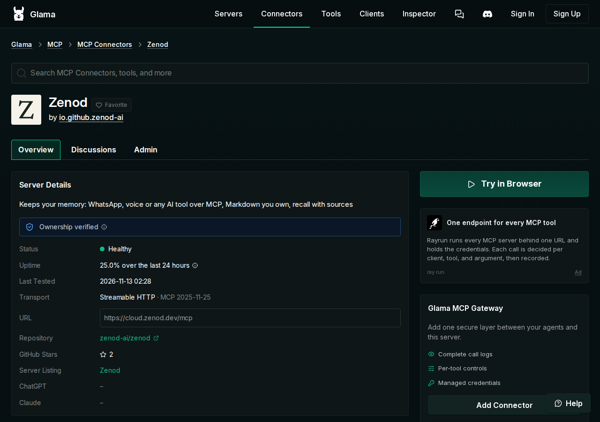
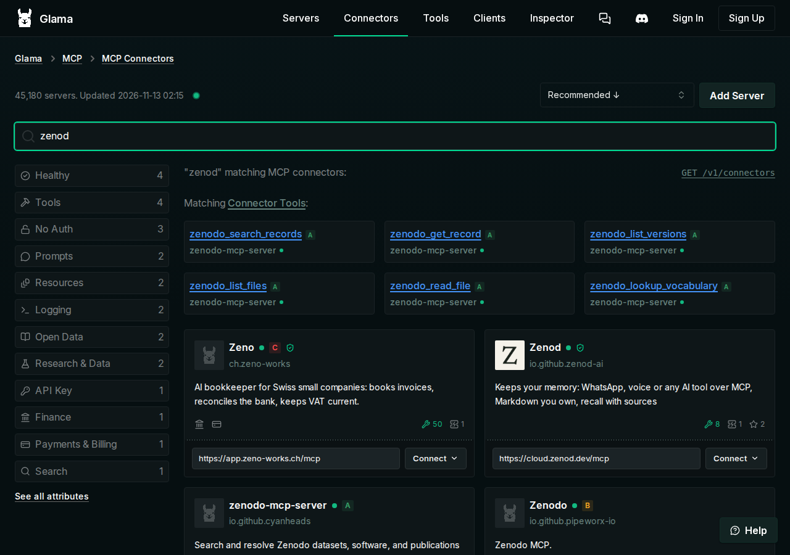
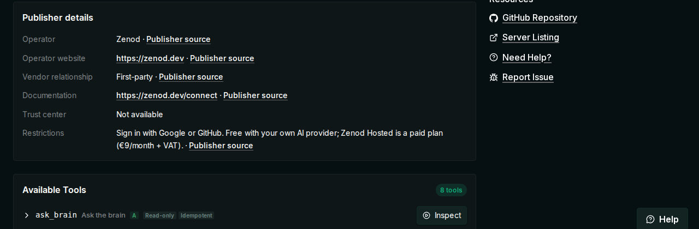
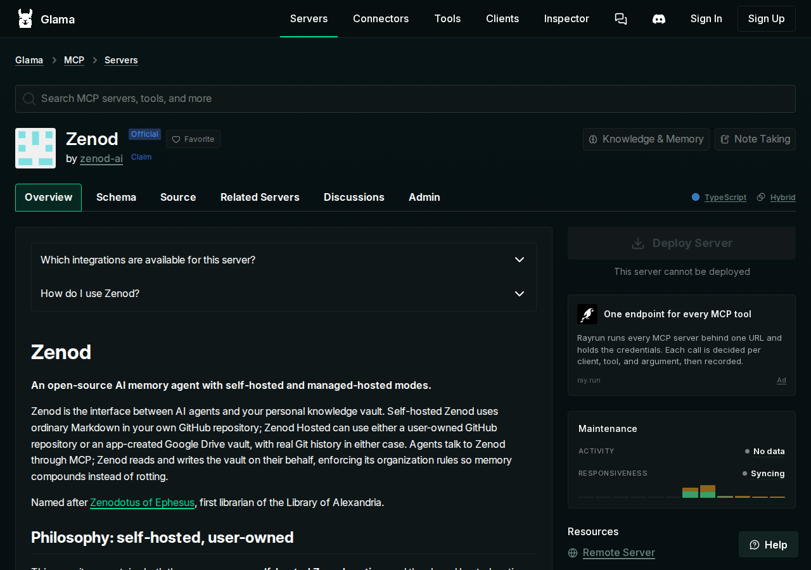

# EPIC-10 E10-S2: Glama's old page is gone and the new Zenod listing is live (2026-11-13)

**Answer:** the old Glama connector page (the one with zenod.dev written backwards) now permanently redirects (HTTP 301) to the new listing, https://glama.ai/mcp/connectors/io.github.zenod-ai/zenod. Glama search for "zenod" shows that listing as Zenod, with the Z logo, Healthy status and 8 tools, and the website is https://zenod.dev.

```
old page (backwards address) ──301──▶ new listing "Zenod" ──▶ Healthy, Z logo, zenod.dev ──▶ found by Glama search "zenod"
```

Spine: [EPIC-10](../zenod-in-every-mcp-directory-listing-spr.md) · Row E10-S2 · Run: run_1fc7ee7f-4105-4449-88d7-4e156f578d8b · Live page: http://vps3.taild81fbb.ts.net:9341/ (copy: [e10-s2-2026-11-13/index.html](e10-s2-2026-11-13/index.html))

| Check (UTC, 2026-11-13) | Result | |
|---|---|---|
| Old connector URL | `HTTP/2 301`, `location: /mcp/connectors/io.github.zenod-ai/zenod` (curl, 02:24); its `/score` subpage answers 404; the old namespace URL redirects to a namespace search that returns no connector | ✓ gone |
| Glama search "zenod" | https://glama.ai/mcp/connectors?query=zenod shows **Zenod · io.github.zenod-ai**, Z logo, Healthy dot, 8 tools, `https://cloud.zenod.dev/mcp` | ✓ |
| Listing page | Ownership verified, Status **Healthy**, last tested 02:28, Streamable HTTP · MCP 2025-11-25, Server Listing → Zenod | ✓ |
| Publisher details | Operator Zenod, website https://zenod.dev, first-party, documentation https://zenod.dev/connect, restrictions (Google or GitHub sign-in, Hosted €9/month + VAT) | ✓ |
| Repo page | https://glama.ai/mcp/servers/zenod-ai/zenod links to the new connector ("Server Listing: Zenod") | ✓ |
| Support case GLM-38 | No reply from Glama in the team mailbox yet (only the 16:40Z receipt). The outcome it asked for is now live, so no further message was sent | — |

## What the team did (02:25–02:31Z)

At 02:24Z the new listing existed but was **unclaimed and Unhealthy**: every check since 12 Nov 17:38Z had failed with `HTTP 401` because it had no test login. The E10-R11 setup was attached to the old connector, so we redid it for the new one:

1. Signed in to Glama as **Zenod Operations** (jordi+zenod-glama@zenod.dev, email code via the team mailbox).
2. **Claim:** Glama offered to verify the domain hosting the connector, `cloud.zenod.dev`. We added DNS TXT `_glama-claim.cloud.zenod.dev` (Cloudflare record `9656c84e…`, comment names E10-S2) with the existing Cloudflare token on VPS1. Ownership was verified at 02:26Z ("You now manage Zenod on Glama"). Glama re-checks it daily, so the record stays. We did not use the GitHub-org route because it needs the Glama GitHub App installed on zenod-ai.
3. **Test profile:** created a fresh static MCP token, "Glama health check io.github.zenod-ai/zenod (tools/list only)" (`zmt_…Iu0o`, id `70e99ce9…`), on the agent-owned T7 test account (operations@alpha9.io's Zenod account, never Jordi's). It was typed straight into Admin → Test profile → API Key, Bearer, and never printed. Test Connection reported **Healthy** twice at 02:28Z (535 ms, 1001 ms).
4. **Old token revoked:** `zmt_…cXL0` (id `357225f9…`) served only the old connector, which no longer exists, so we revoked it at 02:28Z.
5. **Listing details:** uploaded the Z logo (https://zenod.dev/brand/zenod-icon-512.png) as the thumbnail, published the publisher profile (as in E10-S1), and set the support contact to support@zenod.dev.

Risk and rollback: Glama holds a bearer token for the T7 test account, which holds only rehearsal notes. To undo, revoke the token at cloud.zenod.dev → Settings → Connect AI apps, or delete the test profile on Glama. Removing the DNS record `_glama-claim.cloud.zenod.dev` unclaims the listing.

## Screenshots (signed-out browser, 02:30Z)

1. Old address → new page: 
2. Glama search "zenod": 
3. Publisher details: 
4. Repo page links to the listing: 

## Notes

- The TDQS quality score showed "being calculated" at 02:30Z (the old connector scored A, 4/5, on the same 8 tools).
- The 24-hour uptime figure reads 25 % at first and rises as the hourly checks pass.
