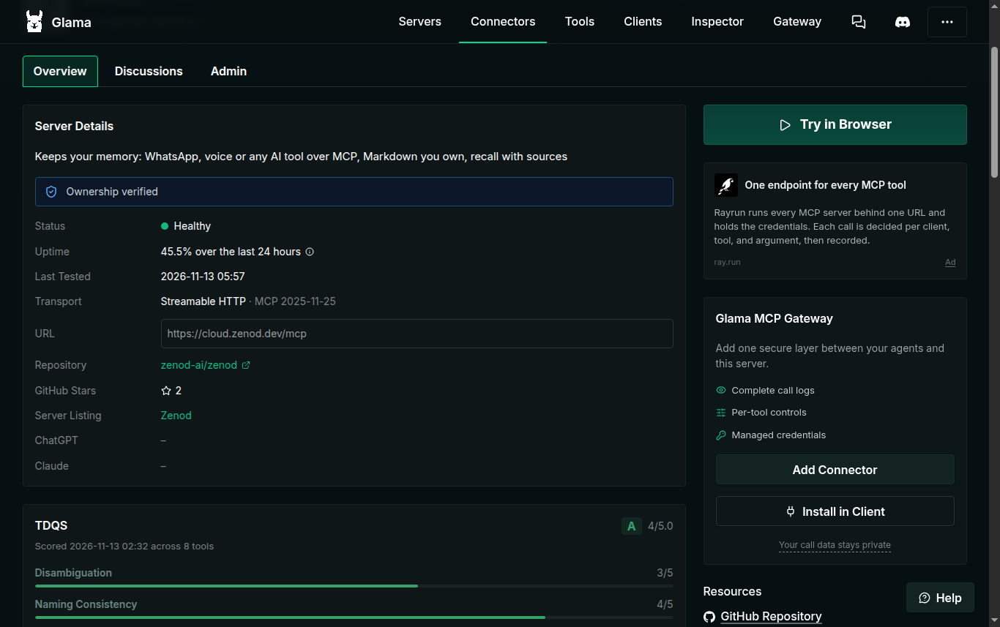
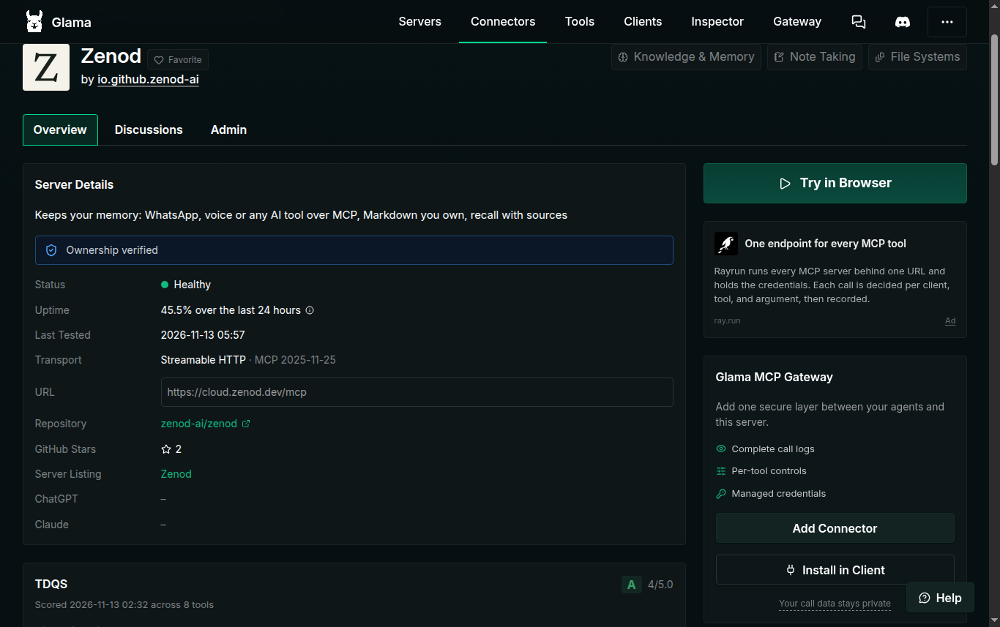

# EPIC-10 E10-S3: Glama scores the new Zenod listing A, 4/5 (2026-11-13)

**Answer:** Glama's Tool Definition Quality Score (TDQS) for https://glama.ai/mcp/connectors/io.github.zenod-ai/zenod is **A, 4/5.0**, scored 2026-11-13 02:32Z across all 8 tools: the same grade the old listing had. The goal (at least A 4/5) is met, so no fix and no rescan were needed.

```
Glama back (06:00Z) ──▶ TDQS A 4/5, 8 tools, each tool A ──▶ same as old listing ──▶ E10-S4 awesome PR can proceed
```

Spine: [EPIC-10](../zenod-in-every-mcp-directory-listing-spr.md) · Row E10-S3 · Run: run_0ee2419e-e006-4fd8-87da-8544a67ae203 · Live page: http://vps3.taild81fbb.ts.net:9367/ (copy: [e10-s3-2026-11-13/index.html](e10-s3-2026-11-13/index.html))

| Check (UTC, 2026-11-13 06:02) | Result | |
|---|---|---|
| glama.ai reachable | connector page and repo page 200 (outage of 02:51Z over) | ✓ |
| TDQS on the new listing | **A, 4/5.0**, "Scored 2026-11-13 02:32 across 8 tools" (also in page data: meanTdqs 4.3, minTdqs 3.7, coherence 3.8) | ✓ |
| Per tool | ask_brain, get_ingest_result, get_memory, get_task_result, ingest_memory, memory_cloud, search_memory, store_memory: all A | ✓ |
| Listing health | Ownership verified, Healthy, last tested 05:57Z, uptime 45.5 % over 24 h (rising since the 02:28Z claim) | ✓ |
| Fix / rescan | not needed: score meets the goal | — |

## Breakdown (Glama's words, shortened)

| Dimension | Score | What costs the point |
|---|---|---|
| Tool count | 5/5 | — eight tools is the sweet spot |
| Naming consistency | 4/5 | `ask_brain` (brain, not memory) and `memory_cloud` (no verb) break the verb_noun / "memory" pattern |
| Disambiguation | 3/5 | four read tools (ask_brain, search_memory, memory_cloud, get_memory) separated only by long prose; `get_ingest_result` is a narrow case of `get_task_result` |
| Completeness | 3/5 | no delete/forget and no update/correct tool |

Reaching 5/5 would mean renaming or merging customer tools, or adding delete and edit tools. That changes the MCP surface every connected client sees (and E10-3's approved customer tool list), so it is a product decision, parked as a follow-up, not a listing fix.

## Screenshots (signed-in operations browser, 06:02Z; the score is public)

1. TDQS A 4/5.0 under Server Details: 
2. Breakdown: 
