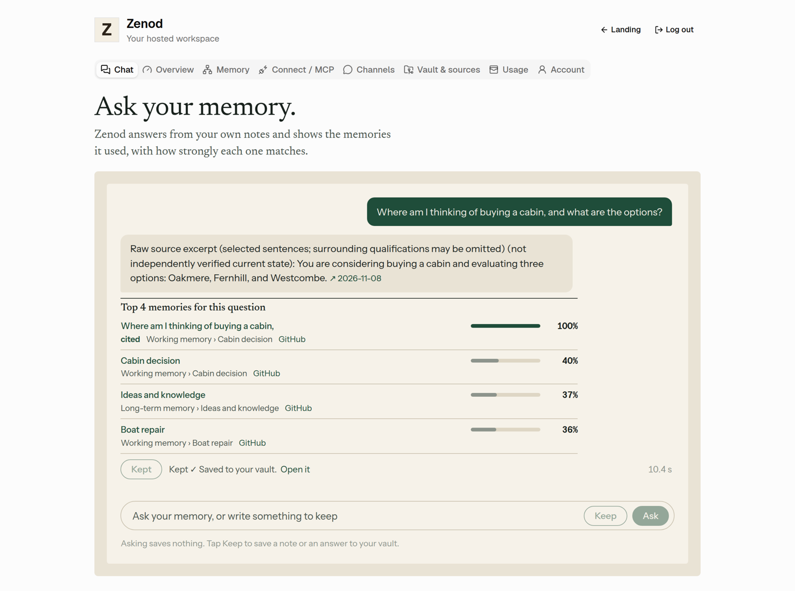
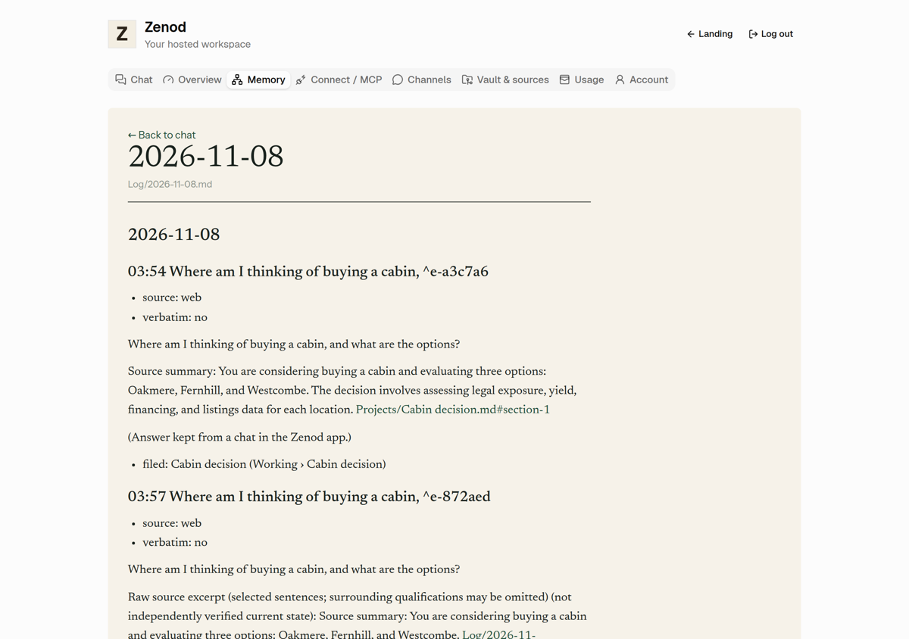
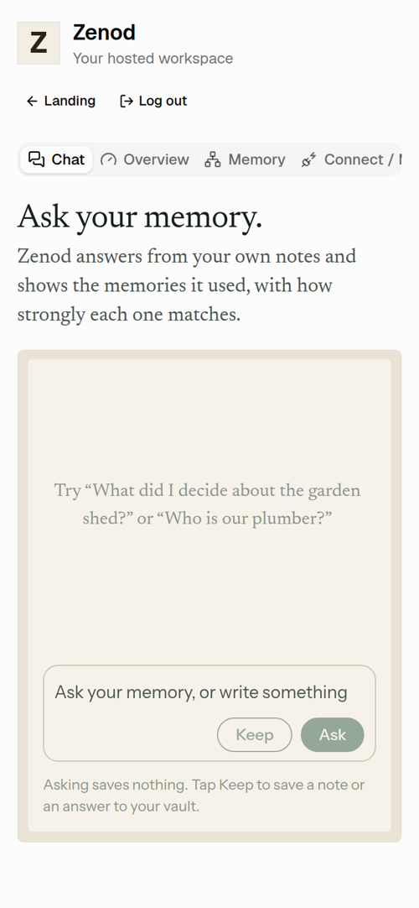

# E12-S1 evidence: cloud Zenod opens on a chat with your memory (2026-11-08)

Row: S1 in [EPIC-12](../zenod-app-chat-first-memory-graph-retrie.md) (Done means E12-1). Run: run_14791928-a13d-4a5d-9021-f472e78da9f6. PR [#1508](https://github.com/zenod-ai/zenod/pull/1508), merged as `cd597ca`.

**Evidence page (tailnet, no password):** http://vps3.taild81fbb.ts.net:8917/ (`zenod-e12-s1.service`, serves `~/artifacts/e12-s1` on VPS3).

## What shipped

- **Landing.** A hosted user who signs in with a verified vault lands on a new **Chat** tab (first in the tab row). Overview, Memory, Connect / MCP, Channels, Vault & sources, Usage and Account stay behind it. Without a verified vault the app still opens on Vault & sources, as before. Self-hosted is unchanged.
- **Answer from memory.** `POST /api/console/memory-chat` runs the read-only `engine.ask` (no store tool, no conversation history kept) next to `rankMemories` from S3a. The reply carries the answer, the top 5 memories with their match percentage, the in-app link (`/#memory?path=…`), the GitHub or Drive link and whether the answer cites it, plus any other cited sources. When the model slips on the answer protocol the chat asks once more; when Zenod still has no checked answer ("could not put a checked answer together" or "found no note that answers this directly") the chat says so in plain words next to the closest memories and offers no Keep.
- **Keep is the only save (E12-A1).** `POST /api/console/memory-keep` files a typed note, or an answer under the question it answered, through the tenant's durable `store` job (the same path as MCP `store_memory`), `source: web`, idempotent per content (a double tap files once), with no WhatsApp notice. `GET /api/console/memory-keep/:id` reports progress for the user's own keep jobs only. Recent saves label these "Zenod app".
- **Open a memory.** `GET /api/console/memory-note?path=` reads one `.md` from the signed-in user's own vault (no absolute paths, no `..`); the Memory tab shows it above the tree, with "Open in GitHub/Drive" and "Back to chat".
- **Tenant isolation, metering, caps.** Every route takes the tenant from the session only (`resolveActiveTenantForUser`). The AI allowance (EPIC-7 T3) is checked before any model call (429 with the user-facing reason, also when the cap trips mid-answer); each model call is metered on the tenant's own usage ledger by its engine; questions are capped at 2,000 characters and two chats in flight per tenant.
- **Design.** `MemoryChat` and `MemoryNoteViewer` follow the product deck's paper language (`docs/epic12/DESIGN-LANGUAGE.md`): paper, ink and one deep green, Newsreader for claims and Instrument Sans for proof (self-hosted via fontsource), ruled list of memories with strength bars, the accent on cited memories only, motion off under reduced motion.
- **Phylax bundle.** `customerLayer.ts` is shared with Phylax, whose bundle may not import the Zenod runtime: the non-answer check lives in `core/src/llm/askNonAnswer.ts` (no imports), read through the `zenod/answer-protocol` subpath and allowlisted in `scripts/assert-phylax-bundle.mjs`.

**Tests:** server `memoryChat.test.ts` (two tenants: answers and memories only from your own vault; 401/400/404; asking creates no capture job and calls no store; allowance stop before the ask and mid-answer; spend lands on the tenant's own ledger; Keep files once, in your tenant, status visible only to you; note path guard; protocol slip asked again; non-answers marked) and web `memory-chat.test.tsx` (answer, percentages and links, no keep call on ask, Keep once, typed-note Keep, retry after a failed Keep, no Keep on a non-answer, allowance message), plus navigation and onboarding updates. Locally: server 1491 pass, web 146 pass, Phylax bundle verified. CI green on `205a4df`.

## Live

| Check | Result |
|---|---|
| Deploy | publish.yml run 42445262174: ci, publish and deploy all succeeded |
| `https://cloud.zenod.dev/api/health` | `ok`, sha `cd597caf6160834990091f796c00ea6bd540a8c5`, 2026-11-08 04:24 UTC |
| Served app | the live bundle (`/assets/index-Bxf1cTIl.js`) contains the chat ("Ask your memory.", "Asking saves nothing", `/api/console/memory-chat`) |
| New routes without a session | `POST /api/console/memory-chat`, `POST /api/console/memory-keep`, `GET /api/console/memory-note` all answer 401 |
| Signed-in chat on production | **not done.** No non-Jordi hosted account with a vault exists on production; it comes with the team sign-in (E7-A15), as for S3a. Jordi's account was not used. |

## The shipped code on a demo vault

The merged code (worktree build of `205a4df`, the same tree as `cd597ca`) ran on VPS3 localhost as one hosted tenant: the real customer layer routes, a real engine and tier-0 index over the S3a demo vault (repo fixture plus 700 generated notes, 714 files, all made up), a real OpenRouter model at the library default the live service also uses (no ask model is set in production), metered and capped like production. The model calls went through a short-lived localhost relay on VPS1 that added the shared OpenRouter key from `secret run` (never printed; capped at 80 calls and 45 minutes; 35 calls used; stopped and removed afterwards). Screenshots were taken with headless Chromium at 1280×900 and 390×844.

| Check | Result |
|---|---|
| Sign in | lands on Chat, heading "Ask your memory." |
| Ask "Where am I thinking of buying a cabin, and what are the options?" | answered with its source (Oakmere, Fernhill, Westcombe), top memories 100 · 40 · 37 · 36 %, the cited one marked, 10–16 s |
| Ask "What did the Porto yards quote for the boat repair?" | "around 4,000 euros in 2023" with its source, top 5 100 · 100 · 42 · 42 · 30 %, 8 s |
| Asking saves nothing | tenant capture count unchanged after every question (0 → 0, 1 → 1) |
| Keep on an answer | capture count +1; filed and pushed as a commit to the demo vault's origin ("Considering buying a cabin…"); the next question found it as the top memory under its question |
| Metering | month-to-date spend on the tenant ledger rose with each answer and each Keep (about $0.003–0.009 per answer) |
| Memory link | opens the memory in the Memory tab with "Open in GitHub" |
| Phone width | Chat first in the tab row, composer and Keep fit |

**Known gaps (follow-ups on the row):**
- **Answer time and misses.** Answers took 8–31 s, and about one in three runs had no checked answer (the engine's strict answer contract, shared with MCP `ask_brain`; the chat now retries a protocol slip once and shows the closest memories either way). A faster, steadier ask model for the chat is proposed as a follow-up.
- **Answer wording.** Some answers keep the contract's labels ("Raw source excerpt (selected sentences…) (not independently verified current state)"); the app drops only the bare "Source summary:" label and names citation links by memory. Plainer wording would change the shared answer contract, so it is left for a follow-up.

## Rules kept

No change to WhatsApp, Telegram or MCP chat replies or behaviour (root L-6): the chat is the web app only, as Jordi asked in his own words (voice note 2026-11-07). No agent_team machinery (L-7). No secrets, env listings or API bodies printed (L-5). Production rolled by the owner-approved push-to-main path (D27).
