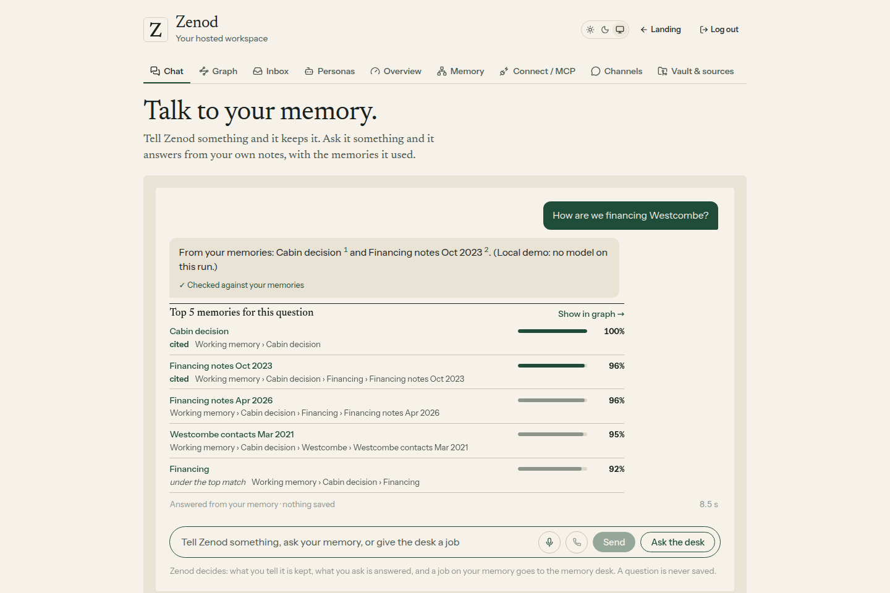
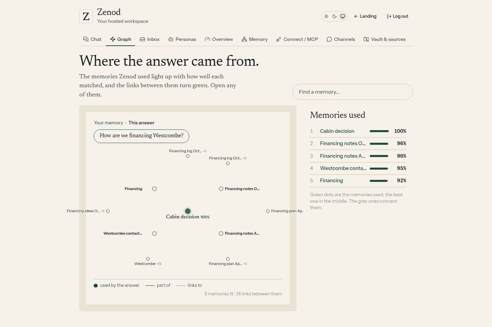
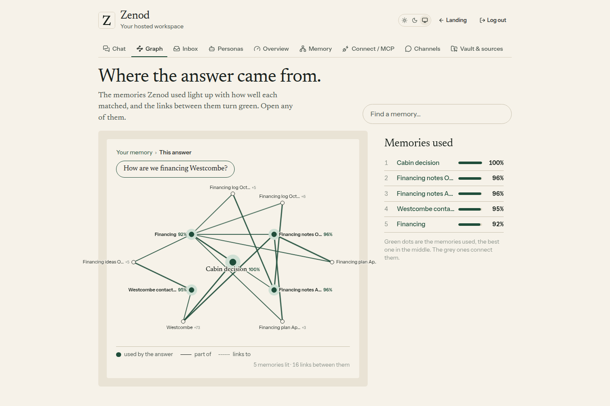
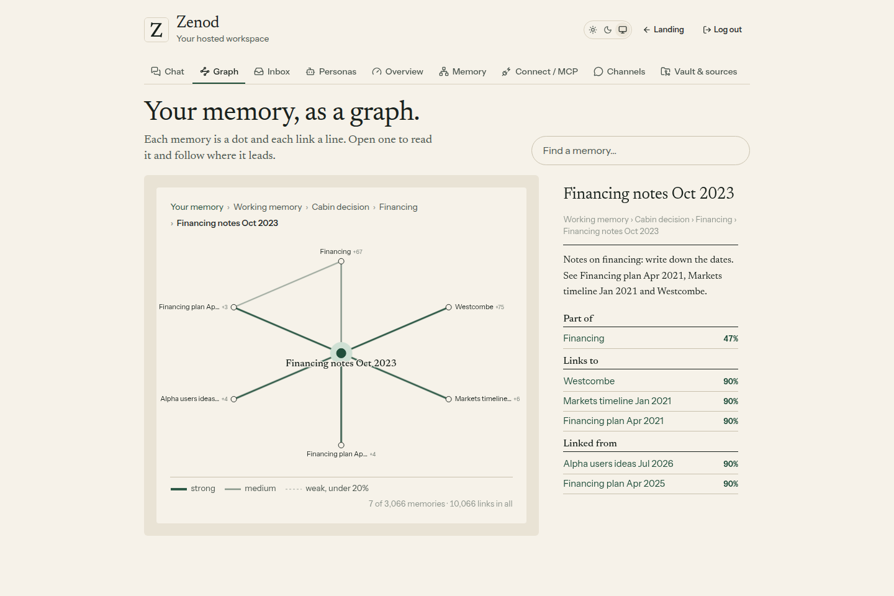
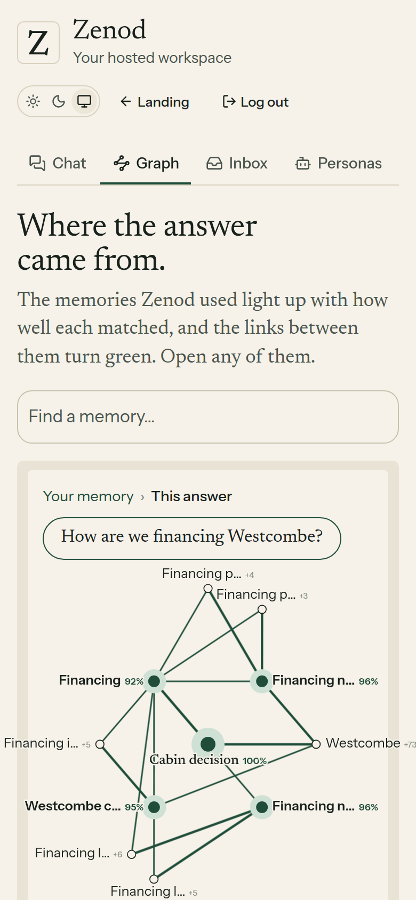

# E12-S13 evidence: answers light up in the graph (2026-11-09)

**Bottom line: works, same as built. Production `bed7d51` serves it, and the production build lights the answer's 5 memories with their percentages and 16 links between them in about 2 ms. Show in graph, open and Back all work. Memory numbers unchanged because this is a view: ingestion 93.8%, retrieval 84.9%, errors 1.6% on his real notes. $0 spend.**

Row: S13 in [EPIC-12](../zenod-app-chat-first-memory-graph-retrie.md), which also covers S3b (Done means E12-3 part 2). Built by run_7f60dca1 in PR [#1521](https://github.com/zenod-ai/zenod/pull/1521) (merged `9ef8c0c`, follow-up commit `c244a532`); checked on production and finished by run_6aae90cb-d474-455a-b107-5c793b44b3dc. No code change in this round.

**Evidence page (tailnet, no password):** http://vps3.taild81fbb.ts.net:8921/e12-s13/

## His three memory numbers

From the EPIC-15 Q2 suite (http://vps3.taild81fbb.ts.net:8921/memory-tests/, newest run 2026-11-09 06:21 UTC). S13 only draws what retrieval already returned. It changes no ingestion or ranking, so all three stay the same:

| Metric | His real notes | Demo vault | Change from S13 |
|---|---|---|---|
| Ingestion success rate | 93.8% | 95.8% | same |
| Retrieval efficiency | 84.9% | 100% | same |
| Error rate | 1.6% | 1.8% | same |

## Production

| Check | Result |
|---|---|
| `https://cloud.zenod.dev/api/health` | ok, sha `bed7d51` (2026-11-09) |
| Served app | the live bundle (`index-9V1nxTor.js`) carries "Show in graph" and the `memory-graph?lit=` call |
| Lit route without a session | `GET /api/console/memory-graph?lit=…` → 401 |
| Signed-in light-up in a production browser | not done: the agents hold no web session for a hosted account with a vault (team sign-in E7-A15), and Jordi's account was not used. The run below is the same production build. |

## The production build on the demo vault

Commit `bed7d51` (the one live) built on VPS3 and served by the harness in [e12-s13/harness](e12-s13/harness/serve.mjs): the real customer-layer routes behind a real customer session, a real engine and tier-0 index over the made-up S2 demo vault (3,066 memories, 10,066 links). **No model ran:** the answer sentence is fixed text, but the five memories and percentages are the real ranked retrieval, which is exactly what the live chat hands to Show in graph. Headless Chromium at 1440×960 and 390×844, recorded.

| Check | Result |
|---|---|
| Question | "How are we financing Westcombe?" |
| Chat | top 5: Cabin decision 100%, Financing notes Oct 2023 96%, Financing notes Apr 2026 96%, Westcombe contacts Mar 2021 95%, Financing 92%. "Show in graph →" sits above the list |
| Lit graph | all 5 lit with their percentages, best in the middle; the pages between them drawn quieter; 16 links lit ("5 memories lit · 16 links between them") |
| Speed | lit route 1.4–2.4 ms per call over 3,066 memories (5 calls, warm index) |
| Open and back | "Financing notes Oct 2023" opens in the graph with its note and neighbours; Back shows the 5 lit again |
| Phone | the same lit graph in the narrow layout |

## What shipped (from #1521)

- **Show in graph.** Every answer's memory list in the chat has a "Show in graph →" link carrying the answer's memories, best first, with their match percentages.
- **The answer, lit.** The Graph tab draws the best memory in the middle and the others around it. They turn green one after another with their percentage, then the links between them turn green. The pages that connect two or more of them are drawn quieter.
- **Each one opens.** A dot or a row opens that memory with its neighbours and note. Back returns to the lit answer.
- **Bounded.** The server sends at most 12 lit memories plus the pages between them; the route needs a session and reads only the signed-in tenant's graph.
- **Ready for EPIC-18.** Links can carry a strength and the view takes path retrieval's walks; today the lit links are the stored wikilinks and tree.

**Tests:** core `memoryGraph.test.ts`, server `memoryGraphRoute.test.ts` (401 without a session, two tenants, cap of 12), web `memory-graph.test.tsx` and `memory-chat.test.tsx`; CI green on #1521 and on every main build since.

**Known gaps:**
- **Signed-in check in a production browser**: not done (E7-A15), as above.
- **Phone label edge**: on a 390 px screen, the "+73" count beside a right-edge page ("Westcombe") is clipped by a few pixels. The name stays readable. Parked as a small follow-up.
- **Strengths and paths** wait on EPIC-18 links landing in the lit view; the plug is built and tested.

## Rules kept

No change to WhatsApp, Telegram, MCP or what chat replies say (root L-6). No agent_team machinery (L-7). No secrets, env listings or API bodies printed (L-5). No production deploy in this round. Zero OpenRouter spend.
