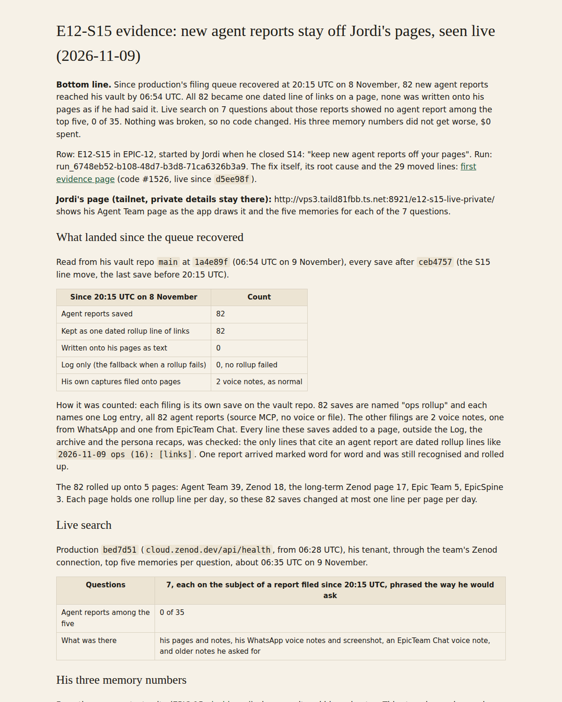

# E12-S15 evidence: new agent reports stay off Jordi's pages, seen live (2026-11-09)

**Bottom line.** Since production's filing queue recovered at 20:15 UTC on 8 November, 82 new agent reports reached his vault by 06:54 UTC. All 82 became one dated line of links on a page, none was written onto his pages as if he had said it. Live search on 7 questions about those reports showed no agent report among the top five, 0 of 35. Nothing was broken, so no code changed. His three memory numbers did not get worse, $0 spent.

Row: E12-S15 in [EPIC-12](../zenod-app-chat-first-memory-graph-retrie.md), started by Jordi when he closed S14: "keep new agent reports off your pages". Run: run_6748eb52-b108-48d7-b3d8-71ca6326b3a9. The fix itself, its root cause and the 29 moved lines: [first evidence page](http://vps3.taild81fbb.ts.net:8921/e12-s15-fix/) (code #1526, live since `d5ee98f`).

**Jordi's page (tailnet, private details stay there):** http://vps3.taild81fbb.ts.net:8921/e12-s15-live-private/ shows his Agent Team page as the app draws it and the five memories for each of the 7 questions.

## What landed since the queue recovered

Read from his vault repo `main` at `1a4e89f` (06:54 UTC on 9 November), every save after `ceb4757` (the S15 line move, the last save before 20:15 UTC).

| Since 20:15 UTC on 8 November | Count |
|---|---|
| Agent reports saved | 82 |
| Kept as one dated rollup line of links | 82 |
| Written onto his pages as text | 0 |
| Log only (the fallback when a rollup fails) | 0, no rollup failed |
| His own captures filed onto pages | 2 voice notes, as normal |

How it was counted: each filing is its own save on the vault repo. 82 saves are named "ops rollup" and each names one Log entry, all 82 agent reports (source MCP, no voice or file). The other filings are 2 voice notes, one from WhatsApp and one from EpicTeam Chat. Every line these saves added to a page, outside the Log, the archive and the persona recaps, was checked: the only lines that cite an agent report are dated rollup lines like `2026-11-09 ops (16): [links]`. One report arrived marked word for word and was still recognised and rolled up.

The 82 rolled up onto 5 pages: Agent Team 39, Zenod 18, the long-term Zenod page 17, Epic Team 5, EpicSpine 3. Each page holds one rollup line per day, so these 82 saves changed at most one line per page per day.

## Live search

Production `bed7d51` (`cloud.zenod.dev/api/health`, from 06:28 UTC), his tenant, through the team's Zenod connection, top five memories per question, about 06:35 UTC on 9 November.

| | |
|---|---|
| Questions | 7, each on the subject of a report filed since 20:15 UTC, phrased the way he would ask |
| Agent reports among the five | 0 of 35 |
| What was there | his pages and notes, his WhatsApp voice notes and screenshot, an EpicTeam Chat voice note, and older notes he asked for |

## His three memory numbers

From the memory test suite (EPIC-15, [dashboard](http://vps3.taild81fbb.ts.net:8921/memory-tests/)), demo vault and his real notes. This step changed no code, so these are the S15 code's own run, where all three stayed the same as before it, and production now. Production moved from `bed7d51` to `741737f` (page titles, no memory change) right after the live search.

| | S15 code `fd86d51` | Production `741737f`, 06:53 UTC | Change |
|---|---|---|---|
| Ingestion success | 95.8% demo, 93.8% his notes | 95.8% demo, 93.8% his notes | same |
| Retrieval efficiency | 97.4% demo, 71.7% his notes | 100% demo, 86.8% his notes | better, from later steps S16 to S20 |
| Error rate | 1.8% demo, 1.6% his notes | 1.8% demo, 1.6% his notes | same |

## The app

The private page shows the app at production's version `bed7d51` on a copy of his vault at `c6d16d2`, opened on his Agent Team page: today's 16 reports there are the single line `2026-11-09 ops (16)` and its links. The public image above is this page, because his page text is private. Not done: a screenshot from his own signed-in browser, the agents hold no web session for his account.

## Cost

$0. No model calls: vault reading, search over MCP and the free test suite only.
