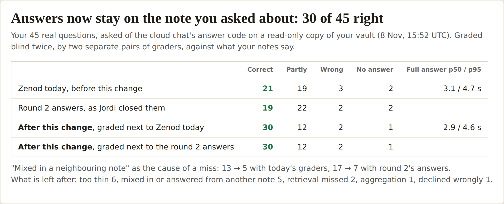

# E12-S16 evidence: chat answers stay on the note you asked about (2026-11-08)

Row: S16 in [EPIC-12](../zenod-app-chat-first-memory-graph-retrie.md), follow-up of S1b. Run: run_88153caf-e759-41da-b651-84019a2f780d. PR [#1533](https://github.com/zenod-ai/zenod/pull/1533).

**Every question, before and after (tailnet, no password, private content):** http://vps3.taild81fbb.ts.net:8918/s16/

## How the neighbouring note got in

Jordi closed S1b round 2 and started S16: the top remaining cause of wrong answers was an answer that mixed in a neighbouring note (6 of the 16 misses). The six were read end to end by rebuilding the exact prompt of each, with no model call:

- **Nothing told the model which note the question was about.** It got 16 to 20 notes as one flat numbered list. Most were topic pages that Zenod wrote, a few were his voice notes. Round 2 had asked for "every main point", so the model collected points from every note that looked related: Hell's Kitchen and São Paulo budgets for "what Airbnb prices did I want to know", an ideas pipeline next to the briefing, other probes next to the house probe.
- **The voice note looked like noise.** A Log entry's title is its capture line, `Voice note "AC8C….ogg" ingeste...`, while a topic page has a real title ("NYC Real Estate Analysis Request"). His own words read less like an answer than a page summarising nearby work.
- **The deciding part was cut.** A long voice note was read by the passages that hold the question's words. For "what did I decide about my company and accounting partner", the passages kept were about the 70% accuracy and doing the accounting himself; his actual position, later in the note and in other words, was left out.
- **The citation check could not catch it.** Each mixed-in claim cited a real quote from the note it came from, so it passed. The check verifies that a quote exists, not that its note is the one asked about.

A host-side pick of "the note the question is about" by word matching was tried first and dropped: on the 45 questions it chose the right note in only 23 cases, so it would have steered wrong as often as it helped.

## What changed (`memoryChatAnswer.ts`, `engine.answerFromMemories`)

1. **The model names the note first.** Its first line, hidden from the person, is `ABOUT [n]`: the one note about exactly what is asked (a second only for the very same thing; every note used for a time question or a question over many notes). The prompt says to answer only from those and never mix in a nearby note's points.
2. **The host enforces it.** After the quote check, a claim that rests only on notes outside the ABOUT line is removed. If that would remove everything, the ABOUT line was what was wrong and the answer stays as it was. The stream filter never shows the ABOUT line.
3. **Each note says what it is:** "your voice note", "your note" (sent from WhatsApp, Telegram, web or Drive), "note", "agent note", "topic page". A capture-line title is replaced by its kind. For "what did I say, ask, want, feel or decide", his own notes come first.
4. **The best matching note is read whole.** The note or two with one ~600-character passage that holds most of the question's words are read up to 9,000 characters instead of by passages. Not for time questions.

Still one streamed call on the same chat model (`google/gemini-3.1-flash-lite`). MCP `ask_brain` and `search_memory`, WhatsApp and Telegram replies are unchanged (root L-6).

**Tests:** core `memoryChatAnswer.test.ts` (a claim resting only on a note outside ABOUT is dropped and its other marks kept; ABOUT naming nothing used keeps the answer; NO_ANSWER after ABOUT; the ABOUT line is never streamed, prose starting "About" is; note kinds in the prompt; the whole-read pick), `answerAccuracy.test.ts` (label), server `memoryChat.test.ts` unchanged and green.

## Measured

Same method as round 2: the cloud chat's answer path built from the code, over the read-only copy of his vault at `7f35d26` (8 Nov 15:52 UTC), today pinned to 8 Nov 16:00 UTC, 45 questions from `~/zenod-eval/real-questions.jsonl`. Before is current `main` (`c45e7d8`, round 2 plus the newer ranking). Grading is blind A/B against the expected answer and source notes, done twice by separate pairs of Sonnet graders on the team subscription: once against current `main`, once against the very answers round 2 was closed on.

| On 45 real questions | Correct | Partly | Wrong | No answer | First words p50 / p95 | Full answer p50 / p95 |
|---|---|---|---|---|---|---|
| Current main | 21 | 19 | 3 | 2 | 1.3 / 2.3 s | 3.1 / 4.7 s |
| Round 2 answers, as closed | 19 | 22 | 2 | 2 | | |
| **After**, graded next to main | **30** | 12 | 2 | 1 | 1.5 / 2.0 s | 2.9 / 4.6 s |
| **After**, graded next to round 2 | **30** | 12 | 2 | 1 | | |

- **These graders are stricter than round 2's.** They gave round 2's own answers 19, where round 2's graders gave 29. The change scores 30 under both grader pairs, so the gain is +9 to +11 on the same scale.
- **"Mixed in or answered from another note" as the cause:** 13 → 5 next to main, 17 → 7 next to round 2.
- **The six round-2 cases:** Airbnb prices is fixed under both grader pairs; the accounting decision and the house probe are fixed under one. The briefing, screenshots and EpicSpine-as-doctrine answers still add points from other notes or from topic pages.
- **One loss:** "what should we work on" now names four of its five topics (correct → partly under both). "Hedging" is wrong before and after: its note is not read.
- **Demo set (round 1), no regression:** 20 of 20 checked and correct before and after (full answer p95 2.0 s before, 1.8 s after). The 5 questions the notes cannot answer were declined 5 of 5 before and after.
- **Speed:** full answer p95 4.6 s, under ~5 s. First words come about 0.2 s later at p50 because the hidden ABOUT line is written first. The after timings come from a re-run on a quiet host (load 8); a first run of the same build at load 79 gave the graded answers, its timings were discarded.
- **Cost:** input 9,600 tokens per answer against 8,800, output unchanged (about 330 tokens): about $0.0029 per answer against $0.0027.

**Model calls:** about 235 calls from this row reached OpenRouter (main and two builds on the 45, the timing re-run, demo and unanswerable sets on both, a few probes) through a capped localhost relay on VPS1 that added the shared key from `secret run` (Flash Lite only, never printed, stopped and removed afterwards). Another worker's bench reused the relay's default local port for about 190 more calls before the cap stopped it; the port was moved and the cap lowered. The shared account went from $1.06 to **$0.36** left; production shares it (E15-A3).

Counts only in the repo; questions, answers and grades stay private on VPS3.

## Live

| Check | Result |
|---|---|
| Merge | [#1533](https://github.com/zenod-ai/zenod/pull/1533), `ci` green (11m20s), merged as `dd1382e` |
| Deploy | publish.yml run 42517625914 for the merge failed in `ci` on an unrelated timing test (usage ledger, 306 ms against 250 ms on a busy runner; it passed on the PR). The next main run, 42518639063 (head `a8f529c`, which contains `dd1382e`), passed ci, publish and deploy |
| `https://cloud.zenod.dev/api/health` | `ok`, sha `a8f529ce89ea4b6d4e0ad2bc2901e5e9e1df2853`, 2026-11-08 20:33 UTC |
| Chat routes without a session | `POST /api/console/memory-chat/stream` and `POST /api/console/memory-chat` answer 401 |
| Signed-in chat on production | **not done**: no hosted account other than Jordi's has a vault, and his was not used. It comes with the team sign-in (E7-A15). Measured on the built code over a read-only copy of his vault instead |

## Rules kept

Web app chat only; WhatsApp, Telegram and MCP chat replies unchanged (root L-6). No agent_team machinery (L-7). No secrets, env listings or API bodies printed (L-5). Production rolls by the owner-approved push-to-main path (D27).
