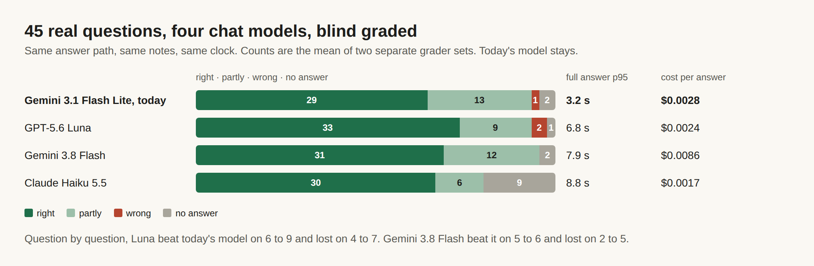

# E12-S17 evidence: a stronger chat model, measured on 45 real questions (2026-11-09)

Row: S17 in [EPIC-12](../zenod-app-chat-first-memory-graph-retrie.md), follow-up of S1b. Run: run_cd608c4e-67cf-48bf-9f2d-94a2ea7c522f. No code change, no PR.

## Bottom line

**No stronger model is clearly better, so production keeps Gemini 3.1 Flash Lite.** GPT-5.6 Luna and Gemini 3.8 Flash score 2 to 4 more right answers out of 45. Question by question, though, each wins about as many as it loses against today's model. Both take about twice as long for the full answer (p95 6.8 s and 7.9 s against 3.2 s), and Gemini 3.8 Flash costs three times as much. Claude Haiku 5.5 thinks by default, runs out of room and gives no answer on 9 of 45.

| On 45 real questions | Right | Partly | Wrong | No answer | First words p50 / p95 | Full answer p50 / p95 | Cost per answer |
|---|---|---|---|---|---|---|---|
| **Gemini 3.1 Flash Lite, today** | **30 / 28** | 12 / 14 | 1 / 1 | 2 / 2 | 1.1 / 1.7 s | 2.2 / 3.2 s | $0.0028 |
| GPT-5.6 Luna, reasoning off | 34 / 32 | 8 / 10 | 2 / 2 | 1 / 1 | 1.4 / 1.7 s | 3.8 / 6.8 s | $0.0024 |
| Gemini 3.8 Flash, minimal reasoning | 33 / 29 | 10 / 14 | 0 / 0 | 2 / 2 | 2.3 / 3.9 s | 4.5 / 7.9 s | $0.0086 |
| Claude Haiku 5.5 | 30 / 30 | 6 / 6 | 0 / 0 | 9 / 9 | 4.8 / 7.8 s | 6.1 / 8.8 s | $0.0017 |

Counts are grader set 1 / grader set 2. Times are measured through a relay on another host, so they are slower than production by the same amount for every model. Compare them with each other, not with production.

- **Question by question against today's model** (a better or worse label on the same question): Luna 6 better and 4 worse in set 1, 9 better and 7 worse in set 2. Gemini 3.8 Flash 5 better and 2 worse, then 6 better and 5 worse. Haiku 5.5 6 better and 8 worse, then 7 better and 8 worse. A gain of +2 to +4 that swaps as many questions as it fixes is not clearly better.
- **Why the stronger models are slower:** they write fuller answers (Gemini 3.8 Flash 402 output tokens against 325) and generate them more slowly. That puts the full answer above the ~5 s line in the S16 decision.
- **A plain model swap would break two of them.** The chat path allows 700 output tokens. Gemini 3.8 Flash spends about 540 of them thinking before it writes, and Haiku 5.5 writes past 700 before its quote block, so both came back with "No confident answer" in the first trial. For a fair test they ran with 1,500 tokens, and Gemini and Luna with reasoning turned down. Even so, Haiku 5.5 still used its whole budget thinking on 7 questions. Switching to either Gemini 3.8 Flash or Luna would need a small code change for the token budget and reasoning setting, as well as the model setting.
- **What still goes wrong is mostly not the model.** Today's model's misses, by grader cause over both sets: too thin 14, answered from or mixed in another note 12, declined 4. The stronger models halve "another note" (6 to 7) but keep "too thin" (8 to 16).
- **Hand check:** Luna's two wrong answers were read against the expected answers. The graders were right: one answered "yesterday" from the wrong day's notes, the other answered from a different note.

## Method

The same method as S16: the cloud chat's answer path built from production's code (`5f7aa14`), over the read-only copy of his vault at `7f35d26` with the clock pinned to 8 Nov 16:00 UTC, on the 45 questions in his real question set. Each model answered all 45 through one capped relay. Grading was blind. For each question a grader saw the expected answer, the source notes and the four answers under letters shuffled per question, and labelled each answer right, partly, wrong or no answer with the S16 rubric. Two separate sets of three Sonnet graders on the team subscription used different shuffles; they gave the same label on 41 to 45 of 45 per model. Questions, answers and grades stay private on VPS3.

## Spend

- OpenRouter balance read first: $10.22 left on the shared account. Hard cap for this row was $1, and the floor was $5.
- **Spent: $0.7576 of OpenRouter** over 195 calls. Today's model $0.136, Gemini 3.8 Flash $0.420, Claude Haiku 5.5 $0.084, GPT-5.6 Luna $0.117, including 9 smoke calls. A fifth run, Flash Lite with the larger budget, was dropped to stay under the cap. Grading cost nothing: it ran on the team subscription.
- The relay ran on VPS1 on localhost only, with the shared key put in by `secret run` and never printed. It allowed only the models under test and stopped at $0.95. It was stopped and its port closed afterwards.

## Production

Nothing switched: `cloud.zenod.dev/api/health` stays `ok` on `5f7aa14`, and the chat model is still the built-in default (no `ZENOD_MODEL_CHAT` on the hosted app). His three memory numbers are unchanged before and after, because nothing changed. On his real notes: ingestion success 93.8%, retrieval efficiency 94.3%, error rate 1.6% ([memory tests](http://vps3.taild81fbb.ts.net:8921/memory-tests/), run on `5f7aa14`). Those numbers use the free stand-in model in any case.

## Rules kept

Web chat only, no chat behaviour changed (root L-6). No secrets, env listings or API bodies printed (L-5). Production spend stayed far above the $5 floor.
