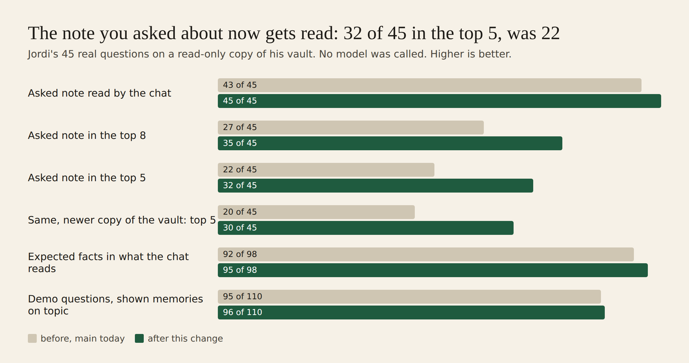

# E12-S19 and S18 evidence: the note you asked about gets read (2026-11-08)

**Better.** On Jordi's 45 real questions the chat now reads the note each question asks about **45 of 45 times (was 43)**. That note ranks in the **top 5 for 32 questions (was 22)** and in the **top 8 for 35 (was 27)**. The 31 demo questions are no worse: 96 of 110 shown memories are on topic, against 95. Measured with **no AI model at all**: zero OpenRouter spend. Whether the answers are now *right* needs graded model runs, which wait on E15-A6 (the shared OpenRouter account is nearly empty and production depends on it). That part is **not proven**.

Rows: S19 and S18 in [EPIC-12](../zenod-app-chat-first-memory-graph-retrie.md), follow-ups of S16. Run: run_7e4b0644-5f40-4d89-94d0-8b312c050bff. PR [#1541](https://github.com/zenod-ai/zenod/pull/1541).

## Jordi's three metrics

| Metric | Before | After |
|---|---|---|
| Ingestion success | unchanged: this change does not touch filing | unchanged |
| Retrieval efficiency: asked note in the top 5 / top 8 / read by the chat (45 questions) | 22 / 27 / 43 | **32 / 35 / 45** |
| Retrieval efficiency: expected facts present in what the chat reads | 92 of 98 | **95 of 98** |
| Error rate on retrieval: questions whose note the chat never reads | 2 of 45 (4 %) | **0 of 45** |
| Search time per question, p50 / p95, same host and load | 54 / 141 ms | 71 / 171 ms |

On a newer copy of the vault (`12961ca`, after S14 moved the agent report lines): read 42 → 44, top 5 20 → 30, top 8 25 → 35, facts 90 → 93 of 98.

## Why the note was missed

Each question was traced through the chat's own answer path with a stub in place of the model, on a read-only copy of his vault (`7f35d26`, the copy S16 used, today pinned to 8 Nov 16:00 UTC):

- **A long voice note that mentions everything tied with the one that says it.** The pick of "your own notes" scored each note by how many of the question's words it holds *anywhere*. Ten-minute June notes hold "people", "see", "first", "land", "cloud" and "Zenod" somewhere, so they tied at 100 % with the note that says them in one breath: "when you land on the cloud Zenon … the first thing you see is a chat box". BM25 then ranks long notes low.
- **Words that frame the question counted as its subject.** "they", "saying", "ask", "else", "more", "ever" and "mention" pulled in notes that share only those words.
- **The note was in Spanish.** "What did I think about the tweet saying businesses have no moats" asks about a note where he says *negocio* and *fosos*. Only "tweet" matched, so the note never came up.
- **The transcriber spells Zenod "Zenot" or "Zenon".** The ranked list did not use the respellings the own-note pick already knew.

The hedging question S16 flagged is read before and after this change: second in the read set, whole. Its miss in S16 was in the answer, not in retrieval.

## What changed

1. **The asked note.** For each of the person's own notes (never an agent's report), Zenod finds the stretch of about 90 words that holds most of the question. Each word is weighted by how rare it is, and the transcriber's spellings and a short English–Spanish word list count as the same word. A note whose best stretch holds 70 % or more of the question joins the top of the ranked list, at the best hit's percent times that share. At most two join. It is placed after the graph walk, so it never pulls in pages of its own.
2. **Framing words are dropped** from what a question is about: ever, once, mention, talk, told, says, saying, ask, asked, wanted, thought, stuff, kind, sort, maybe, else, more, they, anymore.
3. **The chat reads the asked note whole**, next to S16's whole-read pick, wherever it ranks.
4. **Answers give every point (S18).** The chat prompt now tells the model to go through the whole asked note and give every point it makes: what was said, asked, wanted or decided, the reasons, the examples and the next step named. It must never stop at the first point. Up to about 10 lines, was 8.

Still one streamed call on the same chat model. WhatsApp and Telegram replies are unchanged (root L-6). MCP `search_memory` shares the ranked list, so it gains the same asked note.

## Per question, before → after (rank in the list, ≤ 20 shown)

- Not read before, read now: **first screen** (none → 8th), **the no-moats tweet** (none → 2nd), **the house decision probe** (18th, read short → 4th, read whole).
- Up into the top 5: product names 16 → 2, persona briefing 10 → 2, screenshots and demo videos 19 → 2, the testers note 13 → 2, landing pages 10 → 3, things he dislikes on the landing pages 6/7 → 2/3, diagram skill 8 → 2, Epic Social stuck 8 → 5, binding and personas 5 → 2, Airbnb observatory 3 → 2.
- **Worse, kept honest:** "what did I want checked about the diagram skill" 7 → 9 (out of the top 8, still read). "Which stock market research did I ask for" 16/17 → 18/20 (still read). "Airbnb prices" 2 → 4 (still read whole). "Which cities should the Airbnb observatory cover" reads its note by passages instead of whole (1 of its 2 expected facts read, was 2), because another note now takes the whole-read place.

## Thin answers (S18), on recorded answers

S16's graders called 6 answers too thin. Four of them came from notes ranked 13th to 20th, which the chat read in 900 to 1,000 characters only. One now ranks 2nd and is read whole: screenshots and demo videos, 1,029 → 8,314 characters. The memory graph and hyperbola notes still rank 20th and 13th. The inbox note was already first and whole, so only the prompt change can help it. **Whether the answers are fuller is not proven:** that needs model runs and grading, which wait on E15-A6.

## Tests

`askedNote.test.ts` (new, made-up notes):
- the one-breath note beats a long note that mentions each word far apart, and joins the top two
- a Spanish note is found from the English question
- "did I ever mention", "what was that thing about" and "what did I ask about" find the shed-roof note
- an agent's report is never an asked note
- the chat reads the asked note whole although the ranked list missed it
- the prompt asks for every point

Existing memoryIndex, recentNotes, answerAccuracy, memoryChatAnswer and server suites are green. `ci` is green on #1541.

**Model calls:** none. Every measure used a stub in place of the model, and the base URL pointed at a closed local port.

## Live

| Check | Result |
|---|---|
| Merge | [#1541](https://github.com/zenod-ai/zenod/pull/1541), `ci` green (12m38s), merged as `371d883` |
| Deploy | publish.yml run 42528601627 for `371d883`: ci, publish and deploy all green |
| `https://cloud.zenod.dev/api/health` | `ok`, sha `371d883fe898fa9e7924cac9f417fa837464672e`, 2026-11-08 22:42 UTC |
| Chat routes without a session | `POST /api/console/memory-chat/stream` and `POST /api/console/memory-chat` answer 401 |
| Signed-in chat on production | **not done**: no hosted test account with a vault exists (E7-A15) |

Counts only in the repo; questions, notes and per-question results stay private on VPS3.
