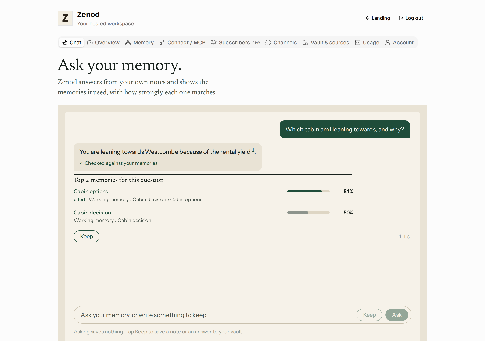
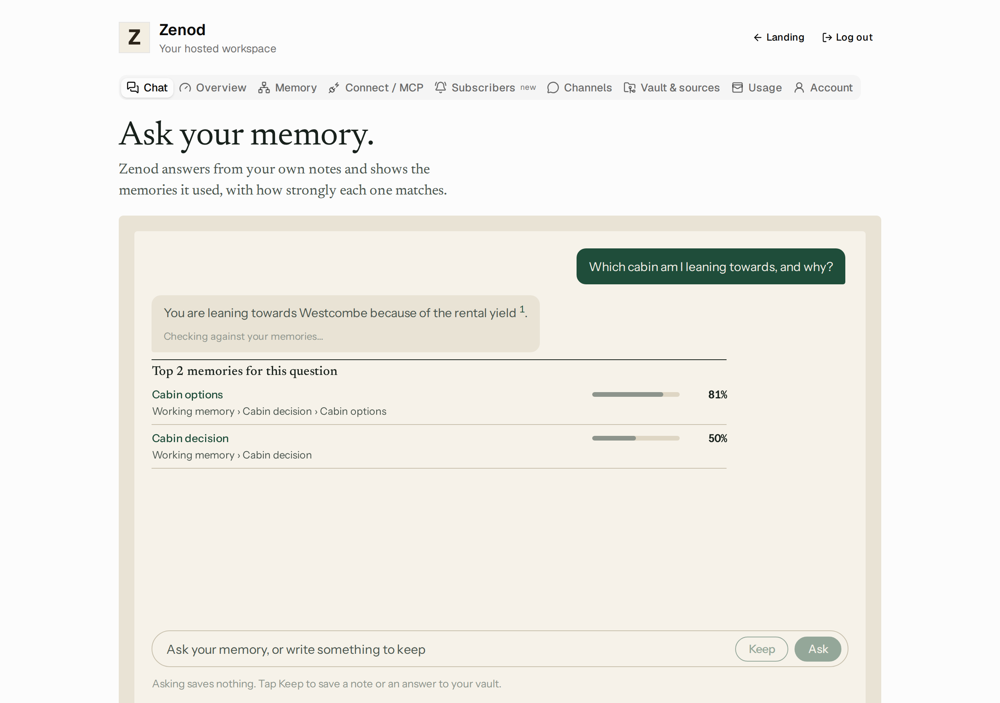
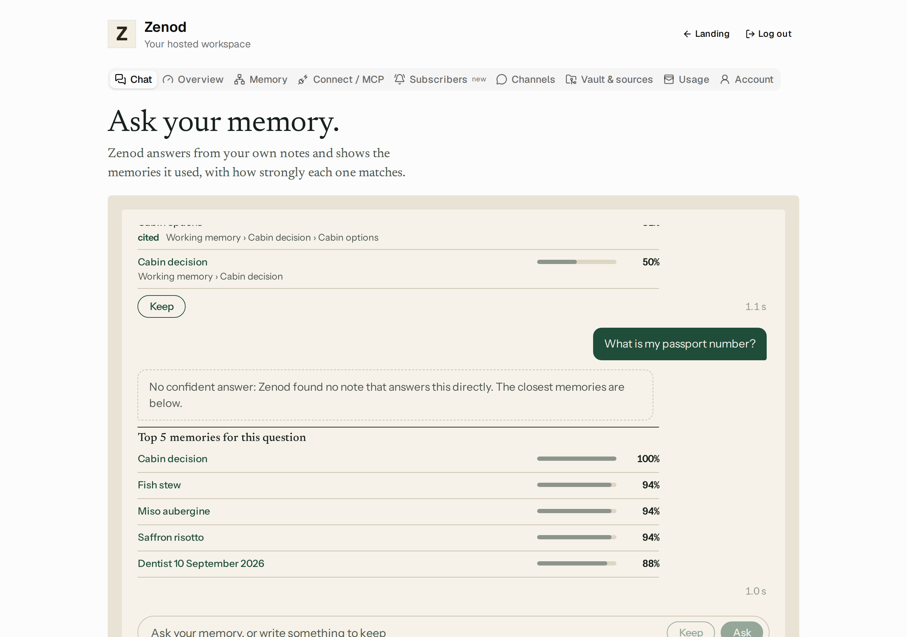
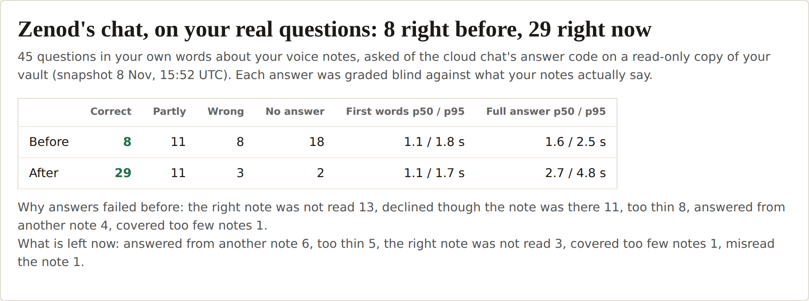

# E12-S1b evidence: the cloud chat answers in about a second, and every answer is checked (2026-11-08)

Row: S1b in [EPIC-12](../zenod-app-chat-first-memory-graph-retrie.md), follow-up of S1. Run: run_07ea1233-8b6a-4137-b2b4-6c564c1a01c9. PR [#1512](https://github.com/zenod-ai/zenod/pull/1512), merged as `20f634b`.

**Evidence page (tailnet, no password):** http://vps3.taild81fbb.ts.net:8918/ (`zenod-e12-s1b.service`, a user unit serving `~/artifacts/e12-s1b` on VPS3).

## Where the time went

S1 answered with the engine's read-only ask loop. It builds a vault briefing, then runs tool rounds, a typed support submission and retries: 1 to 3 model calls, each slow on the default `deepseek/deepseek-chat`. Retrieval was never the cost: the tier-0 index answers in about 7 ms (p95 54 ms in the bench, in-process).

## What shipped

- **One streamed call over the memories already found.** `streamAnswerFromMemory` (server `memoryChat.ts`) ranks the memories first (S3a, with S3c's percentages) and hands the top 5 to the app at once. Then `engine.answerFromMemories` reads the top 8 (an exact Log entry by its anchor, otherwise the page, about 1,800 characters each) and makes one streamed call with no tools on the chat model.
- **Every citation checked.** The model must cite memories by number and quote each one it cites word for word, or answer `NO_ANSWER`. The host checks each quote against the memory it names (`core/src/llm/memoryChatAnswer.ts`: in-order word match, or at least 90% of the quote's content words). An answer with any citation that does not check out, or with no citation, is **not shown**. The app says "No confident answer: Zenod could not check its answer against your memories, so it is not shown" and lists the closest memories. `NO_ANSWER` shows "No confident answer: Zenod found no note that answers this directly". Neither offers Keep.
- **Streaming route.** `POST /api/console/memory-chat/stream` sends NDJSON: `memories`, then `text` deltas (the prose only: the filter holds back `NO_ANSWER` and the quotes block), then `answer` with the checked result, or `error`. Session, tenant, AI allowance, question limits and the two-chats-per-tenant limit are handled exactly as on the JSON route (shared `memoryChatStart`). A cap hit mid-answer ends the stream with the allowance reason. A closed tab frees the slot. The JSON route stays, on the same fast path.
- **App.** The memories show as soon as they arrive. The answer streams in as a muted draft marked "Checking against your memories…" and is replaced by the checked answer, marked "✓ Checked against your memories". Its `[n]` citations link to the memory in the app, and cited memories are marked in the list.
- **Model.** New `model_chat` setting (`ZENOD_MODEL_CHAT`, locked while the platform key is active). The OpenRouter default is `google/gemini-3.1-flash-lite` (production sets no chat model, so the default runs). The call goes through the same metered model factory: allowance checked before the call, usage recorded as `answer` on the tenant's ledger, OpenRouter `user` set to the tenant. Engines without a streaming chat call fall back to S1's ask loop.

**Tests:** core `memoryChatAnswer.test.ts` (quote check, made-up quotes refused, stream filter, prompt, engine reads anchored Log entries, one call); server `memoryChat.test.ts` (fast path order, unchecked never shown, no memories means no model call, S3c rule for cited memories below the top 5, stream route NDJSON, 401/400/404, allowance before and mid-stream, slot released); web `memory-chat.test.tsx` (memories first, draft, checked answer with linked citations, unchecked replaced, cap hit mid-answer). CI green on #1512 (8m28s). Phylax bundle verified, with no new core inputs.

## Measured: 20 demo questions, before and after

A made-up vault (the repo's tree-vault fixture plus generated notes, 683 files, all invented, `gen_vault.py`) and 20 fixed questions with known answers (`questions.json`), run on VPS3 with `bench.mjs` through the built code. Real models over OpenRouter, reached through a short-lived localhost relay on VPS1 that added the shared key from `secret run` (never printed; capped, stopped and removed afterwards; 536 calls in total, including the model comparison). "Checked" means the path's own check passed. "Correct" means the answer also contains the expected facts.

| Path | Answers | First words p50 / p95 | Full answer p50 / p95 (max) | Checked | Correct |
|---|---|---|---|---|---|
| Before: S1's ask loop, default `deepseek-chat` | 20 | 8.4 s / 20.8 s | 8.4 s / 20.8 s (36.8 s) | 18/20 | 18/20 |
| **Now: `gemini-3.1-flash-lite`** (two sessions) | 120 | **0.8 s / 1.5 s** | **1.2 s / 2.0 s** (7.0 s) | **120/120** | **120/120** |
| Now: `claude-haiku-5.5` | 60 | 1.1 s / 1.7 s | 1.3 s / 2.0 s | 59/60 | 59/60 |
| Now, single runs of 20: `gemini-2.5-flash-lite` / `gpt-5.6-luna` / `deepseek-chat` | 20 each | 0.4 / 0.7 / 0.5 s p50 | 0.7 / 1.5 / 3.6 s p95 | 19 / 19 / 20 | 19 / 18 / 19 |

- Before had no streaming, so its first words came with the full answer. The memories also came only with the answer. Now they arrive before any model call.
- Of the two Gemini sessions, the first ran on a quiet machine (p95 first words 1.0 s, full answer 1.6 s). The second ran on the rebased build while the machine was busy (load around 9): 5 of 60 first words took 3.3–6.6 s. Both are pooled above.
- **Questions the notes cannot answer:** 5 such questions, twice per model (`unanswerable.json`): 20 of 20 were declined with "No confident answer", and none was invented.
- **Cost:** about 640 input and 45 output tokens per answer on Gemini 3.1 Flash Lite ($0.25 and $1.50 per million): about $0.0003 per answer, against $0.003–0.009 per answer measured in S1. The AI allowance and metering rules are unchanged.
- In the real chat routes (`harness.mjs`: built web app, real customer layer, demo engine; only the app-shell boot calls stubbed, as in `App.hosted-onboarding.test.tsx`), the browser saw the memories at 0.2 s, the first words at 1.0 s and the checked answer at 1.2 s.

Raw rows: `docs/evidence/e12-s1b-bench/results/`. To reproduce: `gen_vault.py` builds the vault, then `bench.mjs` runs the questions (`BENCH_PATH=s1` replays the S1 path).

## Live

| Check | Result |
|---|---|
| Deploy | publish.yml run 42450571057: ci, publish and deploy all succeeded |
| `https://cloud.zenod.dev/api/health` | `ok`, sha `20f634b3ea0968c567ef3e0afdef0b25f8c98704`, 2026-11-08 05:59 UTC |
| Served app | the live bundle (`/assets/index-B9jzql_B.js`) contains `/api/console/memory-chat/stream`, "Checking against your memories" and "Checked against your memories" |
| New route without a session | `POST /api/console/memory-chat/stream` answers 401 (and `POST /api/console/memory-chat` still answers 401) |
| Chat model on production | none is set, so the code default `google/gemini-3.1-flash-lite` runs (the same model as the bench) |
| Signed-in chat on production | **not done.** No hosted account other than Jordi's has a vault on production. It comes with the team sign-in (E7-A15), as for S1 and S3a. Jordi's account was not used. |

## Rules kept

This change is to the web app only. WhatsApp, Telegram and MCP chat replies are unchanged (root L-6), and the MCP `ask_brain` contract is untouched. No agent_team machinery (L-7). No secrets, env listings or API bodies printed (L-5). Production rolled by the owner-approved push-to-main path (D27).

## Round 2: accuracy on Jordi's real questions (2026-11-08)

Jordi relaunched S1b: "Speed is important but what about accuracy??" Run: run_6ad10161-0855-4530-a5ed-52737b9cac4c.

**Per-question page (tailnet, no password, private content):** http://vps3.taild81fbb.ts.net:8918/round2/

### Method

- **The questions.** 45 questions in Jordi's own words about his own voice notes, each with an expected answer written from the notes and the Log entries it comes from. 25 were written by this row from his voice notes, read through the Zenod MCP. 20 were written by EPIC-15 Q1 (run_ff4ff9cf). The set is shared and private: `~/zenod-eval/real-questions.jsonl` on VPS3. Kinds: 20 facts, 15 recalls, 4 time windows ("my last vn", today, yesterday, a date), 3 live questions, 2 decisions, 1 aggregation ("top five topics in the last week").
- **The system.** The cloud chat's answer path (`streamAnswerFromMemory`), built from the code. It ran over a read-only copy of his vault at `7f35d26` (8 Nov, 15:52 UTC), on production's chat model `google/gemini-3.1-flash-lite`. Nothing was written to his vault. Bench: `e12-s1b-bench/bench-real.mjs`. Before is `main` at `a5e300d`, after is this change.
- **The grading.** Blind. For each question the before and after answers were shown as A and B in random order, with the expected answer and the source notes as the truth. Two Sonnet graders split the set. Labels: correct (covers the main points), partly, wrong, no answer. Each failure got a cause. A first grading pass, by an LLM judge and then a blind pass on an earlier build, gave 10 → 33 correct, so the gain holds across graders.

### Result

| On 45 real questions | Correct | Partly | Wrong | No answer | First words p50 / p95 | Full answer p50 / p95 |
|---|---|---|---|---|---|---|
| Before (`a5e300d`) | 8 | 11 | 8 | 18 | 1.1 / 1.8 s | 1.6 / 2.5 s |
| **After** | **29** | 11 | 3 | **2** | 1.1 / 1.7 s | 2.7 / 4.8 s |

- **Causes before** (37 not correct): the right note was not read 13, declined though the note was there 11, too thin 8, answered from another note 4, covered too few notes 1.
- **Causes left** (16 not correct): answered from another note, mixing in a neighbouring note 6, too thin 5, the right note not read 3, covered too few notes 1, misread 1.
- **Demo set (round 1), no regression:** 20 of 20 checked and correct before and after (full answer p95 1.8 s both). The 5 questions the notes cannot answer were declined 5 of 5, before and after.
- **Trade-off:** first words are unchanged. The full answer is about 1 s longer at p50 and 2.3 s longer at p95, because answers now give every main point: 323 output tokens on average against 97. Input is 8,800 tokens against 6,800. Cost per answer is about $0.0027 against $0.0019 on Gemini 3.1 Flash Lite. The p95 stays under 5 s.
- **A stronger model was not measured.** A Gemini 3 Flash and Haiku 5.5 comparison was started, but the shared OpenRouter account ran into its credit limit (in-flight budget, $1.13 of $110 left after this row), so those runs are void and were dropped. Flash Lite stays, the production default.

### What changed (`memoryChat.ts`, `engine.answerFromMemories`, `memoryChatAnswer.ts`, `memoryIndex.ts`, `recentIntent.ts`)

1. **Read deeper.** The answer reads 16 ranked memories, up from 8. It also reads up to 4 of the person's own Log entries that hold the most of the question's words (`MemoryIndex.ownNotes`), never agent reports. In about a third of the misses the answering note ranked 9th to 19th, because BM25 ranks long voice notes low.
2. **Read the right part.** Ingest lines (file name, Drive links, sha, transcriber) are dropped. Each voice note's excerpt was 1,800 characters, a third of them those lines. A long note is read by the ~300-character passages that hold the question's words, in order, with "…" between. The top 3 memories get 4,500 characters, the next 7 get 1,800, the rest 1,000.
3. **Time and periods.** "last week", "this week", "the past 3 days", "last month", "on November 6", "6 Nov", "2026-11-06" and "on Friday" work next to say, talk, discuss or topic words. Before, only latest, today and yesterday did. A period lists every note the person sent in it, newest first. Each Log entry reaches the model with its capture time and the topics it was filed into, and the prompt carries today's date.
4. **Complete answers.** The prompt asked for "one to four short sentences". It now asks for every main point with its specifics, as a short list when there are several. Questions over many notes are grouped by subject.
5. **One loose quote no longer hides everything.** A citation without a quote that checks out used to make the whole answer "No confident answer" (11 declines before). Now only the claims resting on it are removed. A claim is the text up to its citation marks, kept when one of its marks checks out. The answer is shown only when at least half its claims survive. Every claim shown still cites a quote found in that note.
6. **Transcriber spellings.** Jordi says "Zenod", his transcripts say "Zenot", "Znot", "Zinot". A question word the vault knows but his voice notes (almost) never contain also matches the near spellings that recur in his voice notes: same first letter, at most two edits. This applies only to the own-notes lookup, not to the ranked list.
7. A cited note that came from the own-notes lookup shows in the app's memory list with its own percentage and link, like any cited memory.

The five shown memories (S3a/S3c ranking) and MCP `search_memory` / `ask_brain` are unchanged, apart from the new period and date windows in the ranked search. WhatsApp, Telegram and MCP chat replies are unchanged (root L-6).

**Tests:** core `answerAccuracy.test.ts` (periods, named days and weekdays; a period lists only the person's notes; own notes and transcriber spellings; passage excerpt; the engine adds the own note with capture time, topics and today), `memoryChatAnswer.test.ts` (only unchecked claims removed; mostly unchecked means not shown), server `memoryChat.test.ts` (a cited added note is shown with its percentage; an unchecked one is not).

Counts and timings: `e12-s1b-bench/round2-summary.json`. Questions, answers and grades stay private on VPS3.

### Live (round 2)

| Check | Result |
|---|---|
| Merge | [#1522](https://github.com/zenod-ai/zenod/pull/1522), `ci` green (11m30s), merged as `670e329` |
| Deploy | publish.yml run 42504542424: ci, publish and deploy all succeeded |
| `https://cloud.zenod.dev/api/health` | `ok`, sha `670e329747b2450c81a750000201ca58a8d3976e`, 2026-11-08 17:44 UTC |
| Chat routes without a session | `POST /api/console/memory-chat/stream` and `POST /api/console/memory-chat` answer 401 |
| One Send (EPIC-16 B1) | rebased on it; its Send route answers through the same `streamAnswerFromMemory`, so it gets these changes |
| Signed-in chat on production | **not done**, as in round 1: no hosted account other than Jordi's has a vault, and his was not used. Measured on the built code over a read-only copy of his vault instead |

**Cost of this round:** 1,001 model calls through a short-lived capped localhost relay on VPS1 (stopped and removed afterwards). The shared OpenRouter account had about $1.39 of $110 left when the bench started and $1.13 after. That is why the model comparison was dropped and grading moved to blind Sonnet graders on the team subscription. Production credit is EPIC-15's urgent ask E15-A3.
