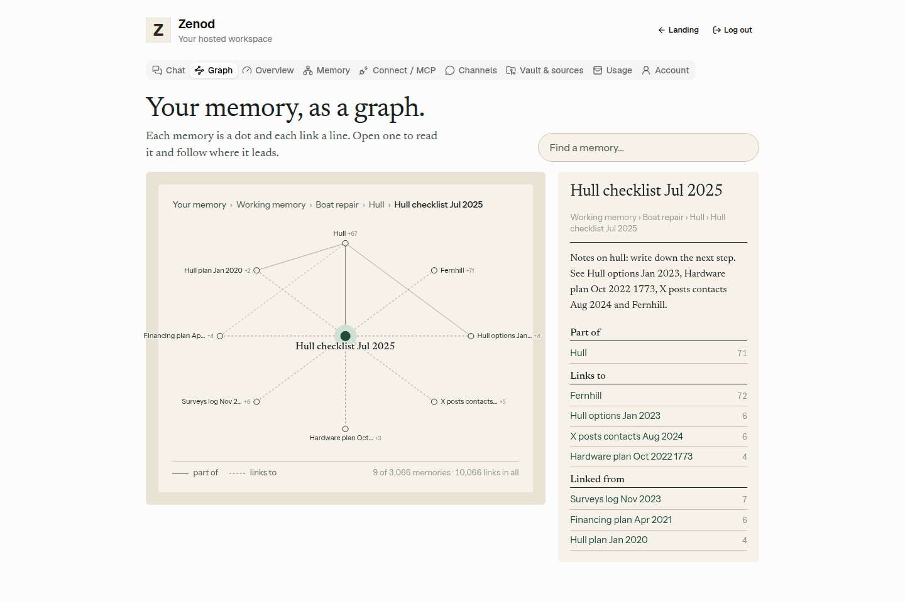
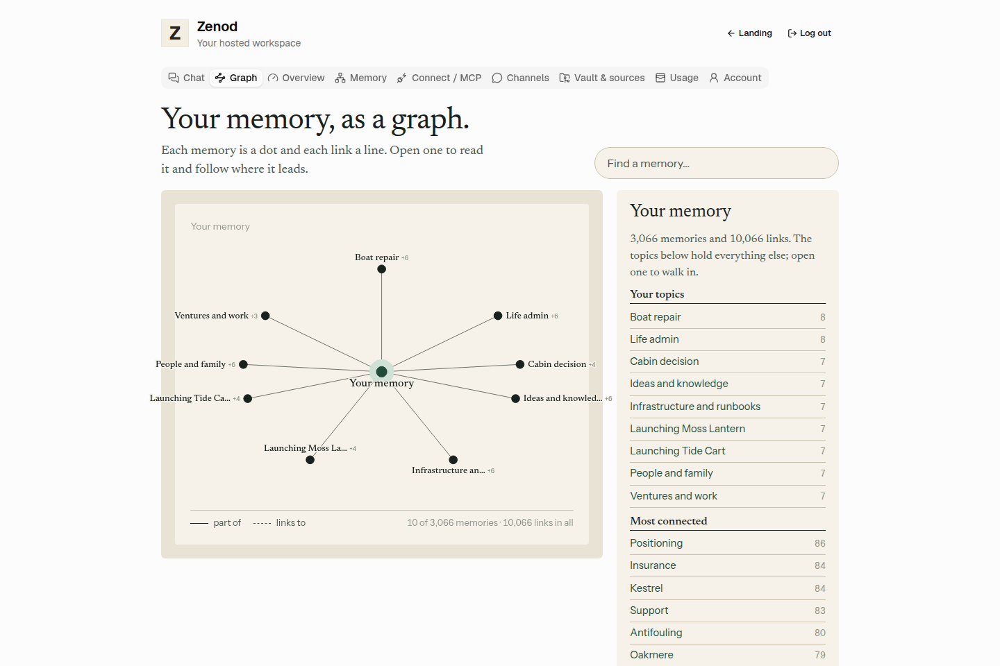
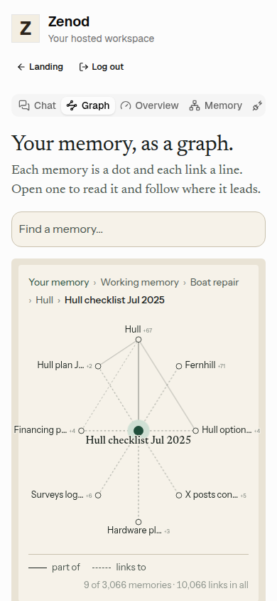

# E12-S2 evidence: your memory as a graph in cloud Zenod (2026-11-08)

Row: S2 in [EPIC-12](../zenod-app-chat-first-memory-graph-retrie.md) (Done means E12-2, the app part; the zenod.dev demo graph is S5). Run: run_3f8ec187-36c3-432b-98b1-3810f340e8fe. PR [#1514](https://github.com/zenod-ai/zenod/pull/1514), merged as `220dcc5`.

**Evidence page (tailnet, no password):** http://vps3.taild81fbb.ts.net:8919/ (`zenod-e12-s2.service`, serves `~/artifacts/e12-s2` on VPS3).

## What shipped

- **Graph tab.** Hosted users get a **Graph** tab next to Chat (`#graph`, `#graph?path=<vault path>`). It opens on the tree: "Your memory" with its Tree.md roots around it, and the busiest pages listed in the side panel. Opening a dot puts it in the middle: its parent above (solid ink), links to the right and what links to it on the left (dashed), children below. The panel shows where it sits, the note itself, and every neighbour as a link (Part of, Inside it, Links to, Linked from, with "and N more, not drawn"). Back retraces the walk; the crumb returns to the whole memory. The search box uses S3a ranked retrieval (match percentages) and jumps to the memory; a raw Log entry opens in the Memory tab instead (evidence, not a node).
- **Stored per tenant, incremental.** The tier-0 index (`memory-index.sqlite`, per tenant, beside the vault) gains an `edges` table: each page's wikilinks and its `parent:`, and Tree.md's roots, stored per file and replaced when that file changes. Targets resolve at read time, Obsidian style (full path, then name), so links written before a page existed connect when it lands. Schema 1 → 2: each tenant's index rebuilds once on first use after the deploy. The built graph is cached in memory until the next sync changes something.
- **Large vaults.** The client gets one neighbourhood (21 dots by default, 120 at most), filled round-robin over parent, links, children and backlinks so a hub's backlinks never hide its parent, with counts of what was left out; each dot's small number is how many neighbours it hides.
- **Route.** `GET /api/console/memory-graph[?path=]` needs a customer session, takes the tenant from the session only, runs no model, 404s a path that is not in your own graph.
- **Design.** The deck's paper language (`docs/epic12/DESIGN-LANGUAGE.md`): paper and ink, one deep green on the opened memory with its halo, ink dots for topics, solid tree lines, dashed links that fade in, tree lines that draw themselves, dots that glide to their new place; a narrow layout on phones; motion off under reduced motion.

**Tests:** core `memoryGraph.test.ts` (link resolution by path then name, tree and links read from a vault, incremental add and remove, hub cap with counts, 4,000 notes, tenant stamp), server `memoryGraphRoute.test.ts` (401 without a session, 404 without an account, two tenants each see only their own graph, another tenant's page is 404), web `memory-graph.test.tsx` (overview, open, follow, crumbs, search jump, Log hit to the Memory tab, empty state, layout). CI green on `1fcbb43`.

## Live

| Check | Result |
|---|---|
| Deploy | publish.yml run 42452691873: ci, publish and deploy all succeeded (deploy done 06:17 UTC) |
| `https://cloud.zenod.dev/api/health` | `ok`, sha `220dcc5a7dc79c85ed4eb896d26f48bddefc9e56`, 2026-11-08 06:17 UTC |
| Served app | the live bundle (`/assets/index-2OsrIPWs.js`) contains the graph ("Your memory, as a graph", "Find a memory", `/api/console/memory-graph`) |
| New route without a session | `GET /api/console/memory-graph` and `?path=…` both answer 401 |
| Signed-in graph on production | **not done.** No non-Jordi hosted account with a vault exists on production; it comes with the team sign-in (E7-A15), as for S1 and S3a. Jordi's account was not used. |

## The shipped code on a demo vault

The merged tree ran on VPS3 localhost: the real customer-layer routes behind a real customer session, a real engine and tier-0 index over a made-up vault (the repo's `tree-vault` fixture plus 3,000 generated notes under 54 topic pages, 3,066 memories and 10,066 links), serving the built web app. Screens with headless Chromium at 1440×960 and 390×844.

| Check | Result |
|---|---|
| Overview | "Your memory" with its 9 topics; panel lists topics and the most connected memories; totals 3,066 memories, 10,066 links |
| Open, follow, back | topic → child note → a link → Back returns to the note; crumb returns to the overview |
| Search jump | "Westcombe financing": 5 matches 100 · 97 · 96 · 95 · 57 %, choosing one moves the graph to it |
| Speed, warm | 10 views: mean 4 ms, max 16 ms (server time, localhost) |
| Speed, cold | first view 15.6 s: engine open plus the one-time index rebuild with links for 3,068 files; every tenant pays this once after the deploy (Jordi-sized vaults, ~730 rows, a few seconds) |
| No session | 401 |

**Known gaps:**
- **Signed-in check on production** not done: no non-Jordi hosted account with a vault exists; it comes with E7-A15, as for S1 and S3a. Jordi's account was not used.
- **One-time first load** per tenant after the deploy, while the index rebuilds with links (also slows that tenant's first search once).
- Labels are cut to 18 characters on the ring (full title on hover, in the panel and the crumbs).

## Rules kept

No change to WhatsApp, Telegram, MCP or chat replies (root L-6). No agent_team machinery (L-7). No secrets, env listings or API bodies printed (L-5). Production rolled by the owner-approved push-to-main path (D27).
