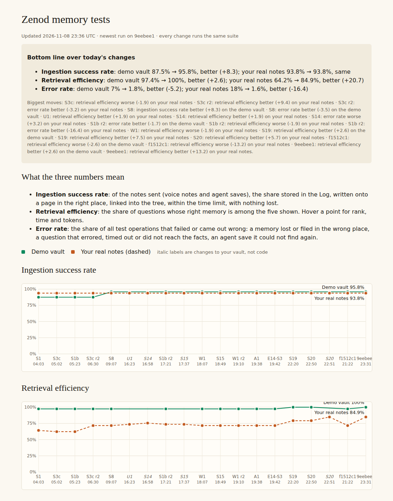

# E12-S20 evidence: every voice note linked to its topics (2026-11-08)

**Better. Voice notes on Jordi's vault that no topic page holds: 17 → 6. The 6 left are all deliberate: 5 test recordings with nothing to file, and 1 long personal note that no branch of his tree is about. Rescued points now land on their subject's branch: on his 19 new links, 16 are on the right branch, against 11 for the old placement. His three numbers on his real notes: retrieval efficiency 79.2% → 84.9% (3 more questions find their note, all about notes this step linked), ingestion 93.8% and error rate 1.6% unchanged. The demo vault is unchanged at 95.8%, 100% and 1.8%. Zero OpenRouter spend.**

(S3c counted 21 of 72 on the vault of 8 November 00:36 UTC. On today's vault, `c52bf1a`, the same counter reads 17 of 78: S14 and S15 changed pages, and six newer notes are all linked.)

Row S20 in [EPIC-12](../zenod-app-chat-first-memory-graph-retrie.md), follow-up of S3c. Run: run_3191b691-bb66-4af2-b514-a10abd79998d. Code: [PR #1543](https://github.com/zenod-ai/zenod/pull/1543), merged as `9eebee1`. Vault: commit `01ef521` on his vault repo `main`, a normal fast-forward from `c52bf1a`.

**Jordi's page (tailnet, private details stay there):** http://vps3.taild81fbb.ts.net:8921/e12-s20-private/ lists each linked note: the point and his words, where it now sits, where the old code would have put it, and whether the branch is right. **Dashboard:** http://vps3.taild81fbb.ts.net:8921/memory-tests/ (points "S20" and the italic "S20", which is his vault).

## The three numbers

Same suite and stand-in model as EPIC-15 Q2. Both runs use the same vault revision, so only the code differs. Then the code stays the same and only the vault changes.

| Change | Ingestion: demo · his notes | Retrieval: demo · his notes | Errors: demo · his notes |
|---|---|---|---|
| Before: main `806d1f6`, his vault `c52bf1a` | 95.8% · 93.8% | 100% · 79.2% (42 of 53) | 1.8% · 1.6% |
| S20 code, same vault | 95.8% · 93.8% | 100% · 79.2% | 1.8% · 1.6% |
| S20 code, his vault after the backfill `01ef521` | – · 93.8% | – · **84.9% (45 of 53)** | – · 1.6% |

- **Retrieval on his notes:** 3 questions now find their note (two about the Z-score and VIX research request of 6 November, one more) and 3 more move to first place (the landing-page note among them). All six are about notes this step linked.
- **Ingestion is flat by construction:** the suite files new notes through the stand-in model, which never triggers a reconcile rejection. So the rescue path this step changed never runs there. Its effect is measured on his own rescued points below. The one demo miss is the stand-in filing a tyre-pressure fact on the wrong page, which is ordinary filing and not a rescue.

## Voice notes with no topic link

| | Count on `c52bf1a` (before) | After `01ef521` |
|---|---|---|
| His voice notes | 78 | 78 |
| No topic page holds them (S3c's counter) | **17** | **6** |
| … of which test recordings ("say banana", "the unique phrase is…") | 5 | 5, nothing to file |
| … of which real notes | 12 | 1, a long personal note with no fitting branch |

## Why notes ended with no topic link

Traced through each note's filing receipt (Inbox and Archive):

1. **Filed before topic filing ran on them (7):** six June Drive uploads (two recordings, uploaded 4 and 2 times) and one September WhatsApp note have no receipt at all.
2. **Filing stopped on the reconcile (5, 1 to 6 November, before S8):** every point ended `pending`. The causes were a validation failure, an unassigned idea, a page write failure, or a rejection of the chosen page. Nothing retried them. The 1 November receipt was archived unfiled by the one-off tree migration that evening. The other four waited for the weekly sweep, which only acts on receipts at least 7 days old. Even then it would have made one leaf from the whole note, placed by word overlap.
3. **Test recordings (5):** two had filings that already said "evidence only". Three had no receipt.

The wrong-branch cause of S8 ("rescued leaves hang under a top-level branch picked by word overlap") came from the rescue throwing away the organiser's own choice of page. On his notes, word overlap put points about Zenod's landing pages under "Family" and "Anthropic Engineers".

## What changed (PR #1543)

- **Right branch for rescued points.** A point the filing cannot write now hangs on the branch of the page the organiser chose for it, as a leaf under that page's parent. A page the reconciler rejected as another subject is not used. The re-route's own pick is used instead, and word overlap only when neither exists. This is the live filing path, so new notes in production use it.
- **The weekly sweep files a stuck receipt point by point.** Each point becomes its own leaf, in the person's words, on its own branch. Receipts kept as evidence only are archived instead of becoming leaves.
- **A repair command:** `zenod tree link-notes` lists the voice notes no topic page holds, with or without receipts in Inbox and Archive. `--apply` links each point as a provisional leaf. Near-identical uploads of the same recording share one leaf. It writes new files only and never commits.
- **Honest counts in the memory index (schema 6, one rebuild per tenant):** a point rescued onto a leaf no longer counts as half filed (8 → 3 on `c52bf1a`), and a test recording its filing kept as evidence is not counted as unlinked.
- **Tests:** 6 for the repair command and the sweep, 1 engine case and 1 index case. The engine case fails on the old code, which put the point under "Ventures and work", and passes on the new code, which puts it under its subject's branch. CI is green, with the full core suite and the demo memory suite. WhatsApp and Telegram replies are unchanged (root L-6).

## The backfill on his vault

| | |
|---|---|
| Vault commit | `01ef521` on `main`, from `c52bf1a`, no force-push |
| Undo | `git revert 01ef521` (also: tag `pre-e12-s20-2026-11-08`, bundle `vault-pre-e12-s20.bundle` on VPS3) |
| Made with | `zenod tree link-notes --apply --skip <the 3 test recordings without a receipt, the personal note>` |
| Written | 15 new provisional pages under `Notes/`, holding 19 links for 11 notes. Each quotes his words verbatim and cites the note |
| Touched | nothing else: no existing page, Log entry or receipt changed. Lint errors 71 before and 71 after (all old), new pages lint-clean, tree errors 0 |

**Right branch, judged by the worker on the private page:** does the top-level branch name what the point is about? New placement: 16 right, 2 wrong, 1 unclear. Old placement for the same points: 11 right, 7 wrong, 1 unclear. On the 13 points that came from receipts, the new placement gets 10 right and the old 5. The 2 still wrong are a stock-market research request: his tree has no branch for it, so both versions guess.

## What is not proven

- **Live filing of a new note through the fixed rescue:** production files with a live model, and a rescue happens only when the reconciler fails. Nothing was sent to production to force one. ✗ until one happens.
- **Half-filed notes:** reading archived receipts too, 30 of his notes still have points that were understood and never written: 119 points in all, mostly September and October filings. They already link to some topic, so they were left alone. `--partial` would add 119 provisional pages to his tree, which is his call (follow-up below).
- **The index's half-filed count reads 7 after the backfill (3 before):** four of the linked notes still have their old receipts in the Inbox. The weekly sweep archives them, and it now finds those leaves already in place and writes no duplicate.

## Production

PR #1543 merged as `9eebee1`. Publish run 42533779406 ran ci, publish and deploy, all green. Live `cloud.zenod.dev/api/health` has reported sha `9eebee1` since 2026-11-08 23:29 UTC. The suite's own nightly script then measured that live build on the backfilled vault for the dashboard. Production reads the backfilled vault on its next idle pull, the same path as S14.
