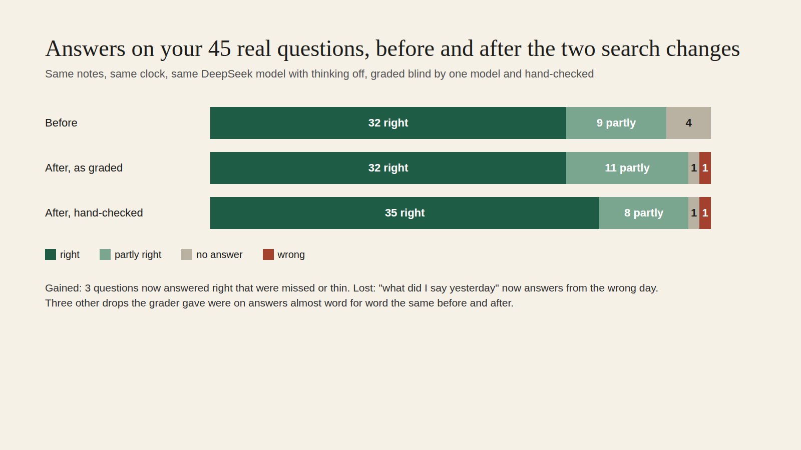

# E12-S21 grading: answers before and after S18 and S19 (2026-11-10)

**Same, slightly better.** On Jordi's 45 real questions both versions give **32 right answers as graded**. After the change Zenod declines far less often: **4 no-answers became 1**. The hand check of 8 answers finds **3 real gains and 1 real loss**:

- Gains: the first-screen question, the tweet about moats and the screenshots question were missed or thin before. They are now answered right.
- Loss: "what did I say yesterday" now answers from the wrong day.
- Noise: the other three drops the grader gave were on answers almost word for word the same before and after.

Counted that way, right answers go from **32 to 35 of 45**.

Rows: S21 in [EPIC-12](../zenod-app-chat-first-memory-graph-retrie.md), with S22 folded in. Run: run_c050db5e-72b2-4aa6-b8be-f46747421bd4. Key: the DeepSeek test key from Jordi's answer to E15-A7, served by `secret run` since EPIC-2-A47.

## Counts per version, as graded blind

| Grade | Before (a8f529c, S16 live) | After (371d883, S18 and S19 live) |
|---|---|---|
| Right | 32 | 32 |
| Partly right | 9 | 11 |
| No answer | 4 | 1 |
| Wrong | 0 | 1 |
| Shown as an answer | 41 of 45 | 44 of 45 |
| Answer time, p50 | 2.9 s | 3.5 s |

The grader's reasons for answers that were not fully right shift the same way:
- "declined wrongly" fell from 4 to 1.
- "answered from the wrong note first" rose from 5 to 9.

So the change makes Zenod answer more often. A few of those answers now blend in a neighbouring note. Five of the after answers reached the 700-token answer limit, against none before.

## Jordi's three numbers

This change touches retrieval only. Ingestion is not affected.

| Number | Before | After |
|---|---|---|
| Ingestion success | unchanged | unchanged |
| Retrieval efficiency: answers right, graded / hand-checked | 32 of 45 | 32 / 35 of 45 |
| Error rate: wrong or no answer | 4 of 45 (8.9%) | 2 of 45 (4.4%) |

## Method

- **Answers.** Both builds answered the same 45 questions on the same read-only copy of his vault (`7f35d26`), with the clock pinned to 8 Nov 16:00 UTC. The answer model was DeepSeek Flash, called through a capped relay on VPS3 that holds the key in memory only.
- **Grading.** Blind A/B grading with the S16 rubric on DeepSeek Flash. The A/B order was shuffled per question with a fixed seed. There were 0 retries.
- **Hand check.** 8 of 45 were checked by hand: the 7 that moved, plus one that stayed partly right.
- **Run 1 was discarded.** It ran with DeepSeek's thinking on, and most answers spent all 700 output tokens thinking. That gave 31 and 34 no-answers. Production turns thinking off for DeepSeek, so run 2 did the same for both versions. Run 1 is kept on VPS3 as history.
- **Private data.** Per-question answers stay private on VPS3 (`~/s21/`).

## Spend

| What | DeepSeek | OpenRouter |
|---|---|---|
| Run 1, thinking on, discarded | $0.164 | $0 |
| Run 2, the grading above | $0.149 | $0 |
| **S21 total** | **$0.314** (cap $0.45) | **$0** |
