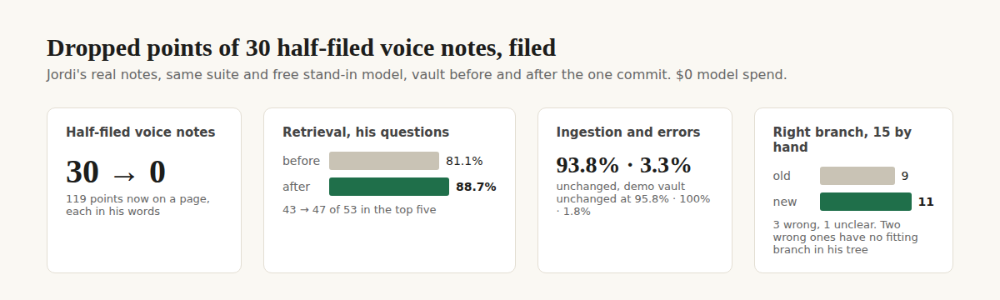

# E12-S23 evidence: the dropped points of half-filed voice notes, filed (2026-11-09)

**Better. The 119 points that 30 of Jordi's voice notes understood but never wrote down are now each on a page of his tree, in his own words, citing the note: half-filed notes 30 → 0, in one commit he can undo. On his real notes, retrieval went from 81.1% to 88.7% (43 → 47 of 53 questions find their note in the top five). Ingestion (93.8%) and error rate (3.3%) are unchanged, and the demo vault is unchanged. On 15 points checked by hand, 11 sit on the right branch, against 9 for the code before this step. Zero OpenRouter spend.**

Row S23 in [EPIC-12](../zenod-app-chat-first-memory-graph-retrie.md), follow-up of S20. Run: run_8bba2eac-556c-41e6-acb8-7c1c3ae93a94. Code: [PR #1545](https://github.com/zenod-ai/zenod/pull/1545), merged as `8ccd55a`. Vault: commit `c963e23` on his vault repo `main`, a normal fast-forward from `542ac6b`.

**Jordi's page (tailnet, private details stay there):** http://vps3.taild81fbb.ts.net:8921/e12-s23-private/ lists all 119 points: his words, the page they now sit on, where the old code would have put them, and the 15 hand checks.

## The three numbers

Same suite and free stand-in model as EPIC-15 Q2. The first two rows use the same vault, so only the code differs. The last row keeps the code and changes only the vault.

| Change | Ingestion: demo · his notes | Retrieval: demo · his notes | Errors: demo · his notes |
|---|---|---|---|
| Before: main `60176a6` (production `9eebee1` gives the same), his vault `542ac6b` | 95.8% · 93.8% | 100% · 81.1% (43 of 53) | 1.8% · 3.3% |
| S23 code, same vault | 95.8% · 93.8% | 100% · 81.1% | 1.8% · 3.3% |
| S23 code, his vault after the commit `c963e23` | – · 93.8% | – · **88.7% (47 of 53)** | – · 3.3% |

- **Retrieval on his notes:** 4 questions now find their note (the first screen, the hyperbola, the testers and one more). 4 move up, among them the feed question from third to first. 9 drop one to three places but stay in the top five, because the new pages now compete for those places. MRR 0.65 → 0.68.
- **His numbers moved since S20** (84.9% and 1.6% on the vault of 8 November): the vault changed in between, and the same code on today's vault reads 81.1% and 3.3%. So both runs above use today's vault.
- **Ingestion is flat by construction**, as in S20: the stand-in filing never hits the rescue path this step changed.

## What was filed

| | Before `542ac6b` | After `c963e23` |
|---|---|---|
| His voice notes | 78 | 78 |
| Half filed: some points understood and never written | **30** (119 points) | **0** |
| No topic link at all (S20's six deliberate ones: 5 test recordings with nothing to file, 1 personal note) | 4 counted by the repair command | 4, left alone |

The 119 points came from receipts in his Inbox and Archive, mostly September to November filings that stopped on a failed or rejected reconcile (validation failures 30, needs clarification 18, page write failures 16, and smaller causes).

## Why the S20 command was not enough, and the fix (PR #1545)

A dry run of `zenod tree link-notes --apply --partial` (built in S20) on a copy of his vault put about a third of the 119 points on the wrong branch:

1. **Old filings name pages that moved.** 25 points named pages that the tree migration of 1 November moved, renamed or retired, or that were never created (for example, a housing page moved to a new folder). The rescue found no such page and fell back to word overlap, which put a housing point under "Anthropic Engineers" and Bitcoin options points under "Zenod". Now the page is found by its own name, then by the page of the folder that held it. A page only in the Archive anchors nothing. This is the shared anchor rule, so live filing rescues use it too.
2. **No page chosen.** For points with no page, the note's own branches are the best guide: a half-filed note already sits on the branches its other points went to. The point goes to the best match among those, unless another branch matches at least twice as well, with a score of 4 or more.
3. **Ingest lines are not points.** Three "Unassigned source content" points began with the note's file name and artifact URL. Those lines are stripped, and the organiser's placeholder names are not used as page titles.
4. **A lost point.** Two points of one note under the same name: the second was silently dropped because the leaf already cited the note. Now it is added to the same page.

Test: a new case in `noteLinker.test.ts` covers all four. It fails on the old code and passes on the new. CI is green. WhatsApp and Telegram replies are unchanged (root L-6).

## The commit on his vault

| | |
|---|---|
| Vault commit | `c963e23` on `main`, from `542ac6b`, no force-push |
| Undo | `git revert c963e23` (also: tag `pre-e12-s23-2026-11-09`, bundle `vault-pre-e12-s23.bundle` on VPS3) |
| Made with | `zenod tree link-notes --apply --partial --skip <S20's four deliberate notes>`, PR #1545 code, no model calls |
| Written | 118 new provisional pages under `Notes/` holding 119 points. Each quotes his words verbatim (checked by script: 119 of 119 appear in the note) and cites the note |
| Touched | nothing else: 0 existing files modified or deleted. Lint errors 71 before and 71 after (all old), tree errors 0 |

Where they hang: 60 on the branch of the page their filing chose, 59 on their note's branch or by words. Zenod 56, Poly-Maker 17, Altamira2050 PatronBTC 11, Idealista 6, Agent Team 6, Housing 5, and smaller branches.

## Right branch, checked by hand

Every eighth point, 15 in all, judged by the worker on the private page: does the top-level branch name what the point is about?

| | Right | Wrong | Unclear |
|---|---|---|---|
| New placement | **11** | 3 | 1 |
| Old code (production `9eebee1`, same command) | 9 | 4 | 2 |

The 3 still wrong: a Macro Dashboard point and a stock-market research request, where his tree has no markets branch so any guess is wrong, and one "Zenot Social" point that word overlap sends to "Anthropic Engineers". Across all 119, 24 points land on a different branch than the old code would have put them.

## What is not proven

- **Jordi's own judgement of the branches:** the 15 checks are the worker's reading. ✗ until he looks at the private page.
- **A live rescue through the new anchor rule:** production files with a live model, and a rescue happens only when the reconciler fails. Nothing was sent to production to force one. ✗ until one happens.
- **118 new provisional pages:** the weekly sweep reviews provisional leaves. Whether to merge the many small Zenod leaves into fewer pages is left to it and to him.

## Production

PR #1545 merged as `8ccd55a`. Publish run 42544084563 ran ci, publish and deploy, all green. Live `cloud.zenod.dev/api/health` reports sha `8ccd55a` since 2026-11-09 01:34 UTC. Production reads the new vault commit on its next idle pull, the same path as S14 and S20.
