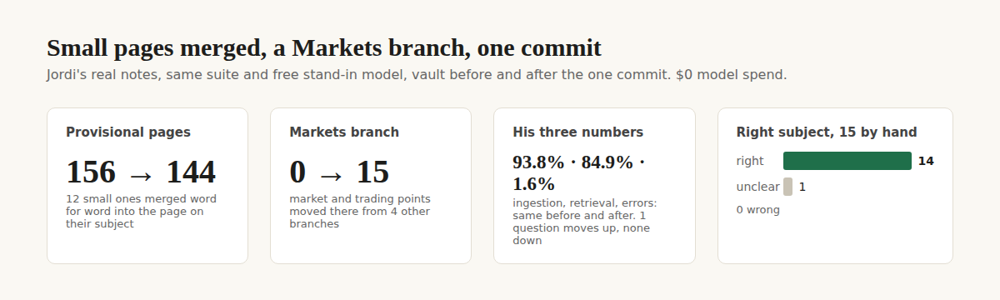
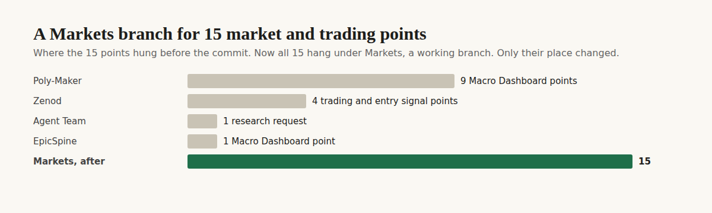

# E12-S24 and S25 evidence: small pages merged, a Markets branch (2026-11-09)

**Same, with a tidier tree. 12 of the small provisional pages that S20 and S23 left now sit, word for word, on the page about their subject (provisional pages 156 → 144), and 15 market and trading points hang under a new Markets branch, all in one commit Jordi can undo. His three numbers are unchanged on his real notes: ingestion 93.8%, retrieval 84.9% (45 of 53, MRR 0.67 → 0.68, one question up, none down), errors 1.6%. On 15 decisions checked by hand: 14 right, 1 unclear, 0 wrong. The weekly sweep now does the merge itself, and it no longer turns provisional pages into top-level branches. Zero OpenRouter spend.**

Rows S24 and S25 in [EPIC-12](../zenod-app-chat-first-memory-graph-retrie.md), follow-ups of S23. Run: run_34080622-fe3b-4693-be7a-cfc4284515ad. Code: [PR #1546](https://github.com/zenod-ai/zenod/pull/1546), merged as `5c96fda`, live since 2026-11-09 04:13 UTC. Vault: commit `aa40747` on his vault repo `main`, a normal fast-forward.

**Jordi's page (tailnet, private details stay there):** http://vps3.taild81fbb.ts.net:8921/e12-s24-private/ lists the 15 Markets points and the 12 merges in his words, with the hand check.

## The three numbers

Same suite and free stand-in model as EPIC-15 Q2 (no OpenRouter key in the environment). Rows 1 and 2 use the same vault, so only the code differs; row 3 keeps the code and changes only the vault.

| Change | Ingestion: demo · his notes | Retrieval: demo · his notes | Errors: demo · his notes |
|---|---|---|---|
| Before: production `8ccd55a`, his vault `c060e7c` | 95.8% · 93.8% | 100% · 84.9% (45 of 53) | 1.8% · 1.6% |
| S24 code `336f014`, same vault | 95.8% · 93.8% | 100% · 84.9% (45 of 53) | 1.8% · 1.6% |
| S24 code, his vault after the commit | – · 93.8% | – · **84.9% (45 of 53), MRR 0.68** | – · 1.6% |

- **Retrieval on his notes:** the 45 real questions match the before run question for question, except the question about his eight seats, which moves from second to first: the subscriptions-as-employees point now sits on the same page as the seats point. Answers read slightly less (7,997 → 7,850 tokens per question).
- **Code alone changes nothing on today's vault:** row 2 matches row 1 question for question. A first try at rows 2 and 3 ran while other jobs held the machine at load 60: filings and agent calls timed out (row 2 read ingestion 25%, errors 19.7%; row 3 two questions over 10 s). Both were rerun at low load; the rows above are the reruns.
- **His numbers moved since S23** (88.7% then): the vault changed in between and the suite's questions now read today's vault, so both rows above use today's vault.

## S24: what merged, and why only 12

A provisional page merges when it is small (at most 150 words of his words), made only of the rescue's capture blocks (nobody edited it), and on the same subject as a page beside it:

1. **Into a confirmed page**, a sibling or its own parent (never a top-level branch, which stays a hub), when that page's name covers at least half of the small page's subject words and its text reads like it. None qualified: the three candidates by title (for example a "Zenot Council" point and the Zenot Council design page) turned out to be about something else when read, and the content check rejected them.
2. **Into a sibling provisional page** when the two read alike (similarity at least 0.25) and share a subject word in their titles. 12 merged this way, into 6 pages: social posting on Reddit and X (3 into 1), test pings (3 into 1), the agent team repo, going public, the orchestrator, the Macro Dashboard PDFs, the Epic Team port plan, and the subscriptions as employees.

The other 144 stay as they are: each is either over 150 words or alone on its subject. Merging them into top-level pages such as Zenod would have made those pages long and generic, so the rule does not.

How a merge looks: the small page's capture blocks move byte for byte, citation included, under a heading with its title on the page it joins; that page lists the title as another name; the small page stays at its path as a one-line pointer (`merged-into:`), same parent and title, so every link still lands. Pointer pages leave search, the filing catalog and topic discovery. Checked by script: 12 of 12 merged pages hold every quoted line, capture heading and filing note of the page they absorbed.

## S25: a Markets branch

Bottom-up (EPIC-9 L-1): his tree had no branch for markets, so S23 put these points under Poly-Maker, Zenod, Agent Team and EpicSpine, and its hand check named two of them as wrong for that reason. Root discovery on today's vault also proposed "Macro Dashboard" and "entry signal" as roots of their own. The 15 points: the 10 Macro Dashboard points (his macro-indicator clustering, regime PDFs and Kelly allocation project), 3 research requests on market entry signals (Z-score events, the VIX), and 2 points on trading as his direction.

`Areas/Markets` is a new working branch (3 of his notes in the last 30 days). Only each point's `parent:` line and the one-line note under its title changed. Points that belong to their project stayed: the Polymarket strategy points under Poly-Maker, the Bitcoin power-law points under Altamira2050, the Idealista market point under Idealista. Root discovery keeps Markets as a working branch on the next two weekly runs (dry runs for 9 and 16 November).

## The commit on his vault

| | |
|---|---|
| Vault commit | `aa40747` on `main`, a fast-forward (rebased over four new ops-rollup commits that touch other files) |
| Undo | `git revert aa40747` (also: tag `pre-e12-s24-2026-11-09`, bundle `vault-pre-e12-s24.bundle` on VPS3) |
| Made with | the Markets move (a 15-path script), then `zenod tree merge-leaves --apply --min-age 0`, PR #1546 code, no model calls |
| Written | 1 new page (Markets), Tree.md one new line, 15 points re-parented, 6 pages gaining merged captures, 12 pointer pages |
| Touched | nothing else: no file deleted, Log and attachments untouched, no word of his rewritten. Lint errors 71 before and 71 after (all old), tree errors 0 |

## A defect closed on the way: the sweep would have scrambled his tree

Dry-running the weekly sweep's root discovery on today's vault, before any of this change, produced 20+ new top-level branches built only of S23's rescue pages ("employee", "concept", "Post", "trading, Hyperbolic and Twitter") and pulled those pages off the branches they were filed under. The next weekly sweep would have written that. Now provisional pages and pointers stay on their branch and their notes count for the nearest confirmed page above them; the same dry run gives back his own branches (Zenod, Agent Team, Epic Team, Housing, Idealista, Poly-Maker and the rest). Root ids compare the same pages, so a second sweep is a no-op.

## Tests

`treeMergeLeaves.test.ts`: merges word for word, pointer and alias, leaves big, hand-edited and fresh pages alone, the sweep reports the count, a revert restores every byte, and discovery never makes a provisional page a root or moves it (this case fails on the old code). The existing sweep idempotence test passes. CI green on PR #1546. WhatsApp and Telegram replies are unchanged (root L-6).

## What is not proven

- **Jordi's own judgement:** the 15 hand checks are the worker's reading. ✗ until he looks at the private page.
- **A real weekly sweep run with the merge:** the step ran through the CLI on his vault; the sweep itself runs on its weekly schedule. ✗ until the next sweep commit lands.

## Production

PR #1546 merged as `5c96fda`. Publish run 42558730055 ran ci, publish and deploy, all green. Live `cloud.zenod.dev/api/health` reports sha `5c96fda` since 2026-11-09 04:13 UTC. Production reads vault `aa40747` on its next idle pull, the same path as S14, S20 and S23.
