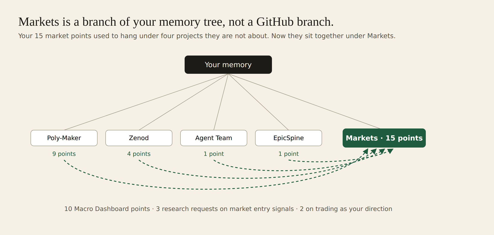

# E12-S25 iteration 2 evidence: Markets is a branch of his memory tree (2026-11-09)

**Markets is a topic group in Jordi's Zenod memory tree, not a GitHub branch. It stays: no existing branch of his tree is about markets or trading, and the 15 points had sat under four projects they are not about. Nothing moved this round, so his vault and his three numbers are unchanged (ingestion 93.8%, retrieval 84.9%, errors 1.6%). Production serves Markets with its 15 points in his Working memory, and the app's Graph tab shows it. Zero OpenRouter spend.**

Row S25 (iteration 2) in [EPIC-12](../zenod-app-chat-first-memory-graph-retrie.md). Run: run_d39b8269-f7e7-4944-966e-1e4c66cadbae. Iteration 1: [e12-s24-2026-11-09.md](e12-s24-2026-11-09.md).

**Jordi's page (tailnet, his words stay there):** http://vps3.taild81fbb.ts.net:8921/e12-s25-private/ with the answer, the diagram, the app screens and the 15 points.

## His question, answered

"Is this a branch on GitHub, or a branch on the memory tree?" The memory tree: `Areas/Markets` is a page in his vault whose children are the 15 points, listed in `Tree.md` under Working memory next to Zenod, Housing and the rest. The only GitHub trace is the vault's normal save commit `aa40747`.

"Why anything separate?" The points are about his Macro Dashboard, market entry signals and trading as a direction. With no branch for them, the filing had put them under Poly-Maker (9), Zenod (4), Agent Team (1) and EpicSpine (1).

## The decision: keep Markets

Every level-1 branch in `Tree.md` was checked against the 15 points. Poly-Maker is his Polymarket campaign, Altamira2050 is Bitcoin, Idealista is housing data; the Polymarket, Bitcoin and Idealista market points already stay with those projects. None of the others covers markets or trading in general, so no point fits an existing branch better. No vault commit this round; undo of iteration 1 stays `git revert aa40747`.

## Live where he looks

| Check | Result |
|---|---|
| Production version | `cloud.zenod.dev/api/health` sha `551bb7d`, 2026-11-09 05:04 UTC; no app code change in this row |
| Production, his account (Zenod memory MCP, read-only `get_memory Areas/Markets.md`) | placed, lineage Working memory › Markets, 15 children: the 15 points |
| App Graph tab | production build `551bb7d` over his vault as of today (`d4f479d`), run on VPS3: Markets is one of his topics (15 memories); opened, it shows 14 dots inside and its place Working memory › Markets; the 15th point is a pointer merged word for word into its twin in iteration 1, and pointer pages stay out of the graph |
| Not done | a screenshot of his own signed-in browser: the agents hold no web session for his account. The screens are the same version and vault. |

## His three numbers

EPIC-15 Q2 suite, his real notes, free stand-in model, from iteration 1 (vault unchanged since): ingestion 93.8% → 93.8%, retrieval 84.9% (45 of 53) → 84.9%, errors 1.6% → 1.6%. $0.
