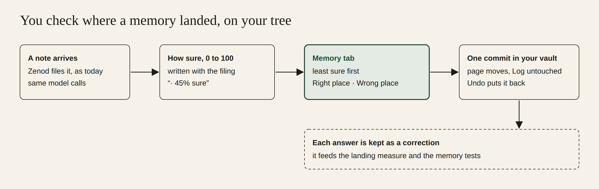
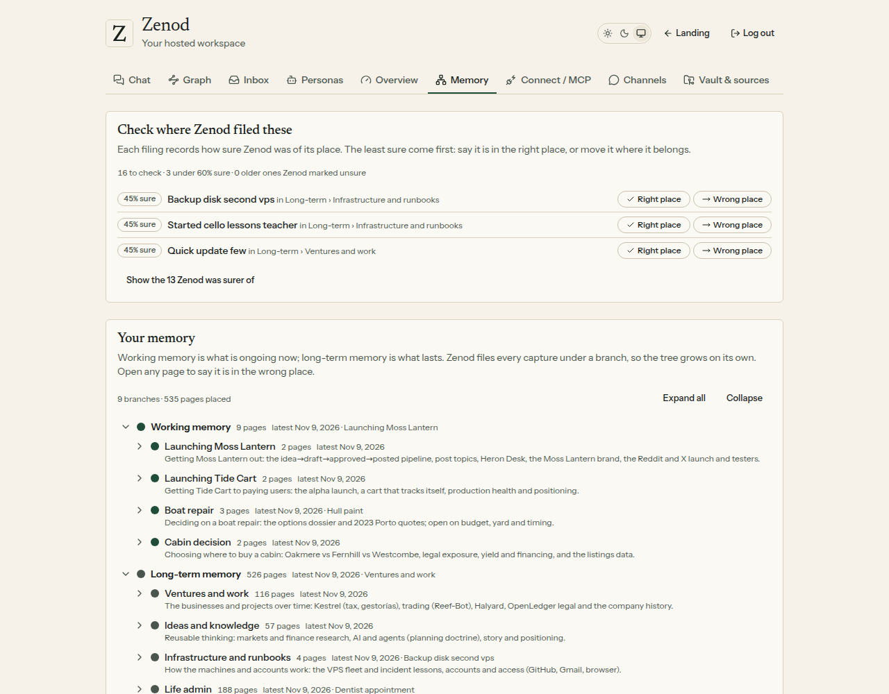
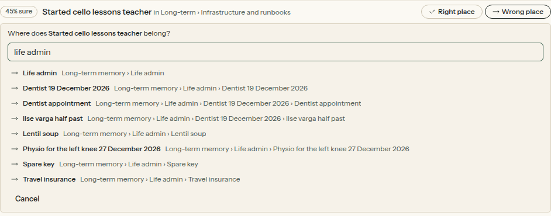
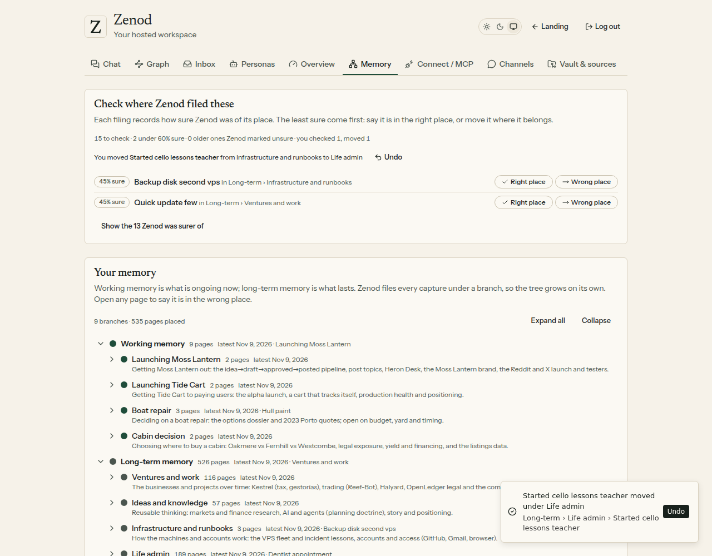
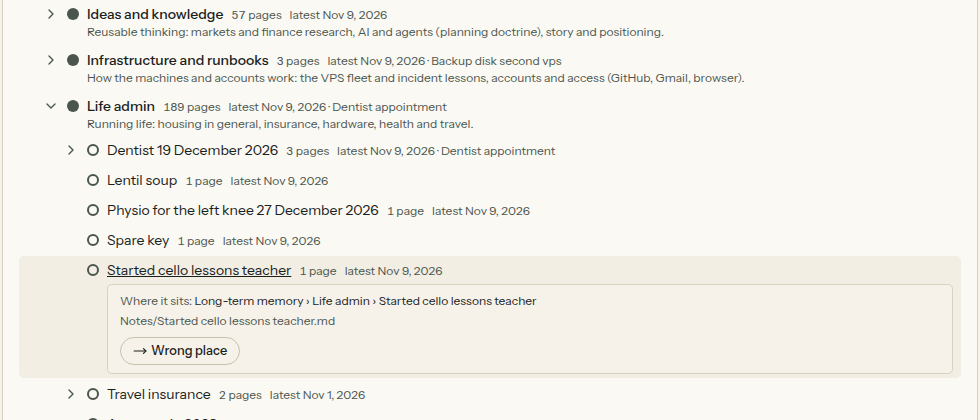
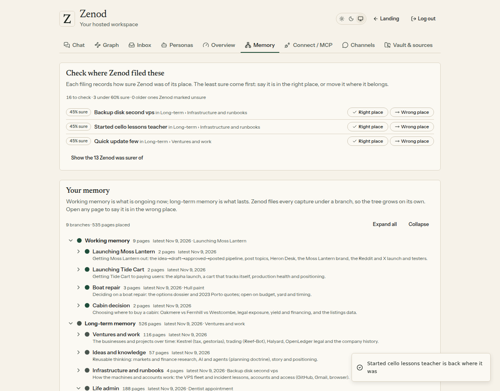
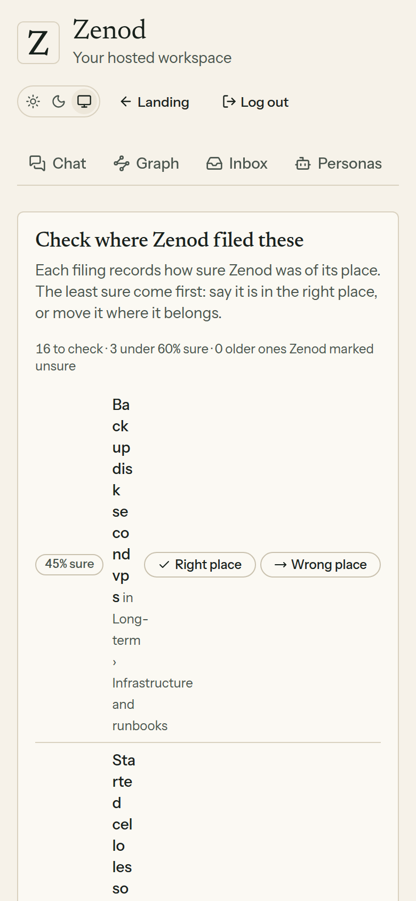

# E12-S27 evidence: check where Zenod filed things, on your tree (2026-11-09)

**Bottom line:** the Memory tab now lists the filings Zenod was least sure of first, each with "how sure, 0 to 100". **Right place** or **Wrong place** (pick where it belongs) works on that list and on any page of your tree. A move is one commit in your vault and **Undo** puts it back. Your three memory numbers are **the same** before and after: his set 93.8% · 86.8% · 1.6%, demo 95.8% · 100% · 1.8%. Model calls per run are identical (29 / 88 / 45), so the confidence costs **$0 extra**. Moving a page took **1.9 s on a copy of his 255-page tree**.

Row: S27 in [EPIC-12](../zenod-app-chat-first-memory-graph-retrie.md). Run: run_01353e3f-c09c-41fd-9383-21165b9c9348. PR [#1551](https://github.com/zenod-ai/zenod/pull/1551), merged as `9fd6e78`.

**Evidence page (tailnet, no password):** http://vps3.taild81fbb.ts.net:8921/e12-s27/ · **his own tree** (private, tailnet only): http://vps3.taild81fbb.ts.net:8921/e12-s27-private/

## Live

| Check | Result |
|---|---|
| Deploy | publish run for `bed7d51` (contains the merge `9fd6e78`) green: ci, publish, deploy; the run for `9fd6e78` itself was superseded by it |
| `https://cloud.zenod.dev/api/health` | `bed7d51`, ok, 2026-11-09 06:28Z |
| Served app | the live bundle carries "Check where Zenod filed these", "Zenod was surer of" and the undo route |
| New routes without a session | `GET /api/console/memory-review` 401 · `POST /api/console/memory-place` 401 · `POST /api/console/memory-place/undo` 401 |
| Signed-in check on production | not done with Jordi's account (see Known gaps) |

## What shipped

- **A confidence on every new filing.** Zenod writes how sure it was of the place at the end of the filing's line in the Log, for example `· 45% sure`. The Log only gains that line. The number uses only what the filing already knows: the classifier's own confidence in the page (from the call that filed it) times how the page reached the tree. Already in the tree ×1, hung on a branch matching by name ×0.85, a weak match marked provisional ×0.5, a provisional leaf because nothing fitted ×0.3. **No extra model call.**
- **Check where Zenod filed these** (Memory tab, above the tree). The least sure come first, then the older pages Zenod marked provisional before confidences existed ("not scored"). Each row has Right place and Wrong place. Wrong place opens a search over your branches and pages; a page never goes under itself. Pages Zenod was sure of stay folded under "Show the N Zenod was surer of".
- **On the tree itself.** Open any page: Wrong place, plus Right place when it is provisional. The tree still opens on its root branches; Expand all opens every level.
- **One commit, undoable.** A move is the memory desk's move (EPIC-14 S3) with the same guard: only `parent:`, `memory:` and `provisional:` change, no words, the Log is untouched, and no new tree problem may appear on the moved pages. Old problems on a page do not block it. Your move also confirms the place, so it is no longer provisional. Undo is one more commit, and a page that changed since is left alone.
- **Every answer is a correction data point.** Committed with the change, in `.brain/tree-corrections.jsonl` in the vault, in the exact shape of the S6 landing feedback records (`verdict` yes / no, `zenod_page`, `zenod_parent`, `correction`, plus `confidence`). The S6 analyser reads it as a second dataset, and a move reads as "wrong parent". The memory test suite's judged set reads it too.
- **Consistent with the rest.** Link strengths stay EPIC-18's (W1–W4); nothing new was built for them. The S6 trial page and its feedback file are unchanged. The S25 Markets branch content was not touched.

## The three numbers (EPIC-15 Q2 suite, stand-in model, no spend)

| Set | Before (production 551bb7d) | After (this change) |
|---|---|---|
| His real notes, vault ff4c453 | ingestion 93.8% · retrieval 86.8% (46/53, MRR 0.68) · errors 1.6% | **same**: 93.8% · 86.8% (46/53, MRR 0.68) · 1.6% |
| Demo vault | 95.8% · 100% (38/38, MRR 0.97) · 1.8% | **same**: 95.8% · 100% · 1.8% |
| Model calls per run (classify / compose / answer) | his 29 / 88 / 45, demo 32 / 12 / 30 | **identical** |

## On the demo vault (made up, safe to show)

The suite's 16 demo voice notes were filed through the real capture and filing path with the free stand-in model. All 20 filing lines carry a confidence: 15 at 90%, 2 at 77% and 3 at 45%. The three at 45% are the provisional ones, including "Started cello lessons" filed under Infrastructure and runbooks.

The vault after move and undo: two commits (`memory: you moved Started cello lessons teacher under Life admin`, `memory: undo move of Started cello lessons teacher`). Each changed only the page's front matter and one correction line. The page ended byte for byte as before, and the Log was untouched.

## Known gaps

- **Signed-in check on production** was not done with Jordi's account. The routes answer 401 without a session (above). The screens come from the shipped code on VPS3 copies (harness in [e12-s27/harness](e12-s27/harness/serve.mjs)).
- **His 144 older unsure pages show "not scored".** They were filed before this change. Numbers start with his next filing.
- **Calibration** of the confidence against his answers is not measured yet. It needs his Right place / Wrong place answers, which now land in the S6 dataset.

## Rules kept

No change to what Zenod says in any chat (root L-6). No agent_team machinery (L-7). No secrets, env listings or API bodies printed (L-5). His vault was not written by this work: the moves shown on the private page were made on a local copy. Production rolled by the owner-approved push-to-main path (D27).
