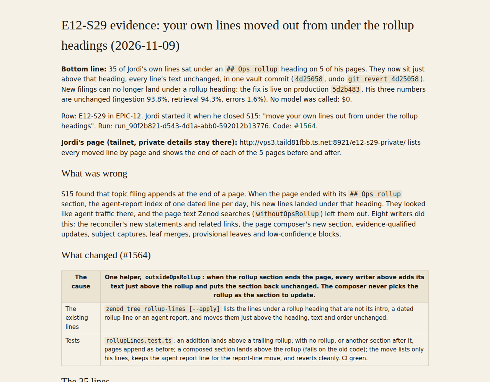

# E12-S29 evidence: your own lines moved out from under the rollup headings (2026-11-09)

**Bottom line:** 35 of Jordi's own lines sat under an `## Ops rollup` heading on 5 of his pages. They now sit just above that heading, every line's text unchanged, in one vault commit (`4d25058`, undo `git revert 4d25058`). New filings can no longer land under a rollup heading: the fix is live on production `5d2b483`. His three numbers are unchanged (ingestion 93.8%, retrieval 94.3%, errors 1.6%). No model was called: $0.

Row: E12-S29 in [EPIC-12](../zenod-app-chat-first-memory-graph-retrie.md). Jordi started it when he closed S15: "move your own lines out from under the rollup headings". Run: run_90f2b821-d543-4d1a-abb0-592012b13776. Code: [#1564](https://github.com/zenod-ai/zenod/pull/1564).

**Jordi's page (tailnet, private details stay there):** http://vps3.taild81fbb.ts.net:8921/e12-s29-private/ lists every moved line by page and shows the end of each of the 5 pages before and after.

## What was wrong

S15 found that topic filing appends at the end of a page. When the page ended with its `## Ops rollup` section, the agent-report index of one dated line per day, his new lines landed under that heading. They looked like agent traffic there, and the page text Zenod searches (`withoutOpsRollup`) left them out. Eight writers did this: the reconciler's new statements and related links, the page composer's new section, evidence-qualified updates, subject captures, leaf merges, provisional leaves and low-confidence blocks.

## What changed (#1564)

| | |
|---|---|
| The cause | One helper, `outsideOpsRollup`: when the rollup section ends the page, every writer above adds its text just above the rollup and puts the section back unchanged. The composer never picks the rollup as the section to update. |
| The existing lines | `zenod tree rollup-lines [--apply]` lists the lines under a rollup heading that are not its intro, a dated rollup line or an agent report, and moves them just above the heading, text and order unchanged. |
| Tests | `rollupLines.test.ts`: an addition lands above a trailing rollup; with no rollup, or another section after it, pages append as before; a composed section lands above the rollup (fails on the old code); the move lists only his lines, keeps the agent report line for the report-line move, and reverts cleanly. CI green. |

## The 35 lines

| | |
|---|---|
| Vault commit | `4d25058` on his vault repo `main`, a normal fast-forward from `f020464`, no force-push |
| Undo | `git revert 4d25058` (also: tag `pre-e12-s29-2026-11-09`, bundle `vault-pre-e12-s29.bundle` on VPS3) |
| Lines moved | 35 lines on 5 pages: Zenod 15, Agent Team 9, Epic Team 6, Launching Epic Social 3, EpicSpine 2. 30 cite his WhatsApp notes, 3 cite notes sent over MCP that read as his own, 2 are uncited related-links lines |
| Left alone | Every dated rollup line and the rollup intro. No agent report line was under a rollup (the S15 check `zenod tree report-lines` still finds 0) |
| Check | On each page the set of non-empty lines is the same before and after; his lines keep their order and all sit above the heading; the rollup section's own lines are unchanged. A second dry run after the move finds 0 lines |

S15 counted 21 such lines on 4 pages on 8 November; more of his notes landed under rollup headings before this fix went live.

## His three numbers (EPIC-15 Q2 suite, stand-in model, $0)

Production code `aedfcf0` on copies of his vault before and after the move, both run back to back on VPS3 under the same load.

| | Before | After |
|---|---|---|
| Ingestion success | 93.8% (15 of 16) | 93.8% (15 of 16) |
| Retrieval efficiency | 94.3% (50 of 53, MRR 0.72) | 94.3% (50 of 53, MRR 0.72) |
| Error rate | 1.6% (1 of 61) | 1.6% (1 of 61) |

A first run made while another suite loaded VPS3 timed notes out and was discarded. His 45 questions do not touch the moved lines, so the numbers stay the same. The lines now count as page text, which the live check below shows.

## Production

Merged as `85e4d4c`. Its own publish run failed to start on GitHub (0 jobs); the next merge `5d2b483` contains it and is live on `cloud.zenod.dev/api/health`. Production pulled the vault commit: `get_memory` on his EpicSpine page shows the two moved lines above the rollup heading. Live `search_memory` for "navigation sidebar focus milestones epic book", words found only in those two lines, ranks the EpicSpine page first at 100%.

