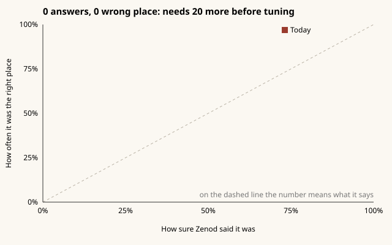
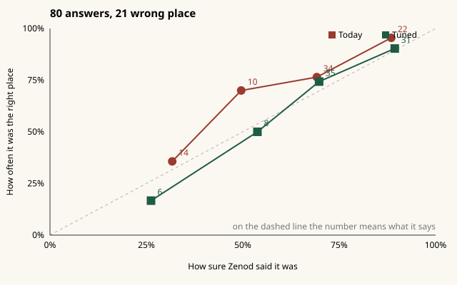

# E12-S30 evidence: does "how sure Zenod was" predict a wrong place? (2026-11-09)

**Bottom line:** not measurable yet. Your vault holds **0 Right place / Wrong place answers** so far (no answers file in it at 17:34Z, vault `f440707`). The measurement and tuning are **built and tested, ready to run**: they need **at least 20 answers, with at least 5 Wrong place and 5 Right place**. Tuning gets steady at about 60 or more. Nothing in Zenod changed, so your three numbers are **the same**: 93.8% · 94.3% · 1.6% before and after. $0, no model call.

Row: S30 in [EPIC-12](../zenod-app-chat-first-memory-graph-retrie.md), follow-up of S27. Run: run_6696aac3-4c98-4f37-b805-e51f2f66250c. PR [#1563](https://github.com/zenod-ai/zenod/pull/1563) (script only).

**Evidence page (tailnet, no password):** http://vps3.taild81fbb.ts.net:8921/e12-s30/

## Where your answers stand

| | Count |
|---|---|
| Right place / Wrong place answers in your vault | **0** (0 wrong, 0 right) |
| New filings with a confidence since S27 went live (bed7d51, 06:28Z) | 13, all today |
| ...by how sure: under 40 / 40-59 / 60-79 / 80-100 | 4 / 3 / 3 / 3 |
| Older provisional pages listed as "not scored" | 144 (they do not count: no number to check) |

Your answers so far, as the chart the check will draw:

**What to do:** open the Memory tab, "Check where Zenod filed these", and press Right place or Wrong place on about 20 of them, least sure first. The next check is on 2026-11-12.

## What the check does (scripts/feedback/calibrate-confidence.py)

1. Reads your answers from the vault (one per page: the latest, an Undo removes it). Only answers on filings that carry a number count.
2. Works out how each page reached the tree: already in it, hung on a matching branch, hung on a weak match, or a provisional leaf. It reads this from the filed line and the vault history; the number itself is the classifier's confidence times a factor for each of the four (1 · 0.85 · 0.5 · 0.3 today).
3. Measures how well the number predicts a wrong place: the wrong-place rate in each band (under 40, 40-59, 60-79, 80-100), the Brier score and log loss, the calibration error (how far "said" is from "was"), and how often a wrong place had a lower number than a right place.
4. Tunes the four factors on 70% of the answers and checks them on the other 30%. The new factors ship only when they beat today's on that held-out 30%. Otherwise today's stay.
5. Writes the result and the calibration chart. Fewer answers than needed: it says how many more.

Tested on a made-up vault (5 tests: route worked out from the vault, Undo, too few, tune, chart). It runs in about 2 seconds.

## What it will look like (made-up answers, not yours)

80 made-up answers where weakly hung pages are right more often than their number says:

| On the held-out 24 | Today's factors | Tuned |
|---|---|---|
| Log loss (lower is better) | 0.432 | 0.408 |
| Brier score (lower is better) | 0.134 | 0.123 |
| Calibration error | 16.5 points | 12.8 points |
| A wrong place had the lower number | 84% | 87% |

Tuned factors on that made-up set: in the tree 1 · hung 1 · weak 0.75 · leaf 0.3. On the same made-up data with 40 answers the held-out result flips between better and worse from one split to the next, which is why it waits for 20 at the very least and keeps today's factors unless the held-out check agrees.

## The three numbers (EPIC-15 Q2 suite, newest run 79e2c7c 17:32Z)

| Set | Before | After |
|---|---|---|
| His real notes | 93.8% · 94.3% · 1.6% | **same** (no product change) |
| Demo vault | 95.8% · 100% · 1.8% | **same** |

## Rules kept

His vault was only read. No chat change (L-6), no agent_team machinery (L-7), no secrets or API bodies printed (L-5), no model spend. The PR adds a script and its test only; the push rolls production with no change to the app.
