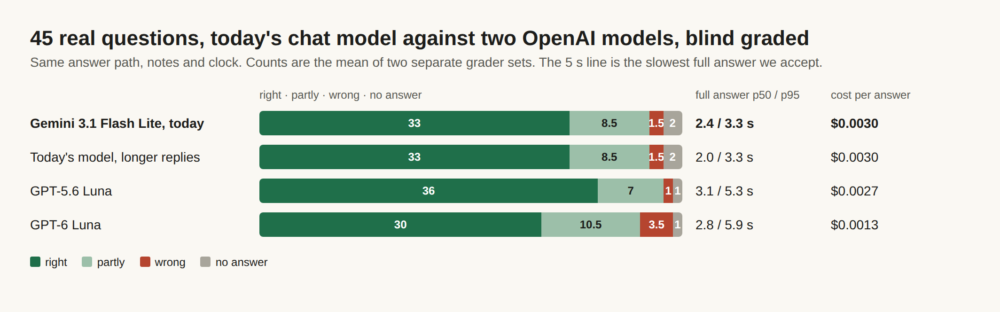

# E12-S31 evidence: the OpenAI model rechecked on the fixed answers (2026-11-09)

Row: S31 in [EPIC-12](../zenod-app-chat-first-memory-graph-retrie.md), follow-up of S17, recheck after S32. Run: run_36e48a56-8305-4efc-8e3a-9d8cdcf9f114. No code change, no PR.

## Bottom line

**No clear gain, so production keeps Gemini 3.1 Flash Lite.** GPT-5.6 Luna now gets 36 of 45 right in both grader sets, against 33 for today's model, with no more wrong answers and a lower cost per answer. But its slowest full answers take 5.3 s at p95, against 3.3 s. That crosses the ~5 s line in the accepted S1b and S16 decisions, and on one question it gives a confident wrong answer where today's model says it has no confident answer. The newer GPT-6 Luna is worse: 30 right, 3.5 wrong. A longer reply limit, 1,500 tokens against 700, changes 3 answers and no grade: the "top five topics" answers now list five topics, but the fifth is the wrong one. So the limit stays at 700 unless the model is switched. His three numbers are unchanged, since nothing changed: on his real notes, ingestion success 93.8%, retrieval efficiency 88.7% and error rate 1.6%, before and after ([memory tests](http://vps3.taild81fbb.ts.net:8921/memory-tests/), newest run on production `fa68fce`). OpenRouter spend: $0.32 of the $0.40 cap.

| On 45 real questions, S32 answer path | Right | Partly | Wrong | No answer | First words p50 / p95 | Full answer p50 / p95 | Cost per answer |
|---|---|---|---|---|---|---|---|
| **Gemini 3.1 Flash Lite, today (700 tokens)** | **33 / 33** | 9 / 8 | 1 / 2 | 2 / 2 | 1.4 / 2.2 s | 2.4 / 3.3 s | $0.0030 |
| Gemini 3.1 Flash Lite, 1,500 tokens | 33 / 33 | 9 / 8 | 1 / 2 | 2 / 2 | 1.1 / 1.6 s | 2.0 / 3.3 s | $0.0030 |
| GPT-5.6 Luna, reasoning off, 1,500 tokens | 36 / 36 | 7 / 7 | 1 / 1 | 1 / 1 | 1.3 / 1.9 s | 3.1 / 5.3 s | $0.0027 |
| GPT-6 Luna, reasoning off, 1,500 tokens | 30 / 30 | 11 / 10 | 3 / 4 | 1 / 1 | 1.3 / 2.0 s | 2.8 / 5.9 s | $0.0013 |

Counts are grader set 1 / grader set 2. The two sets gave the same label on 41 to 42 of 45 per model.

- **Question by question, GPT-5.6 Luna against today's model:** 6 better and 4 worse in set 1, 7 better and 4 worse in set 2 (S17: 6/4 and 9/7). Its wins: both "top five topics" questions, two recall questions and one question today's model got wrong. Its losses: one recall question now draws on another note in both sets, and "what did I say yesterday" goes from "no confident answer" to a wrong day in both sets.
- **Why it is not a clear gain:** the gain is real and the same in both sets, but 5 of 45 full answers take over 5 s against none for today's model. The first words come as fast (p95 1.9 s against 2.2 s), so the wait is in finishing the answer. Every time here goes through the same relay on another host, so production is faster for both models.
- **GPT-6 Luna**, the newest OpenAI fast model and half the price, writes shorter answers (194 output tokens at the median against 239 for GPT-5.6 Luna). The graders mark more of them too thin (8 to 9) and wrong. 2 better and 6 worse in set 1, 3 better and 6 worse in set 2.
- **The reply limit.** At 700 tokens, 3 of today's answers stop at the limit. At 1,500 the two "top five topics" answers name five topics instead of four, but the added topic is not one the graders expected, so both stay "partly". GPT-5.6 Luna would need the larger limit: one of its answers runs to 714 tokens. Raising the limit alone wins nothing, so it ships only with a switch.
- **What still goes wrong for today's model** (over both sets): too thin 15, declined 4, aggregation over many notes 2, another note 3. S32 brought "another note" down from 10, and "too thin" is the main cause left.

## Method

S17's and S32's harness, unchanged: the cloud chat's answer path built from production's S32 code (`0f2aad5`), over the read-only copy of his vault (`7f35d26`) with the clock pinned to 8 Nov 16:00 UTC, on the 45 questions of his real question set. Today's model at 700 tokens is S32's "after" run of the same build. The three other runs went through one capped relay: today's model at 1,500 tokens, GPT-5.6 Luna, and GPT-6 Luna, the two OpenAI fast models. The larger OpenAI models cost 8 to 10 times as much per answer and did not fit the cap. Grading was blind with S17's rubric. For each question a grader saw the expected answer, the source notes and the four answers under letters shuffled per question. Two separate sets of three Sonnet graders on the team subscription labelled each answer right, partly, wrong or no answer, with a cause. Questions, answers and grades stay private on VPS3.

## Spend

OpenRouter balance read first: $8.84 (floor $5). Spent $0.3203 over 138 calls through a localhost relay on VPS1 that allowed only the models under test and stopped at $0.38: 3 smoke calls, then 45 questions each for GPT-6 Luna ($0.058), GPT-5.6 Luna ($0.122) and today's model at 1,500 tokens ($0.140). The shared key went in through `secret run` and was never printed. The relay was stopped and its port closed afterwards. Balance after: $8.56. Grading cost nothing.

## Production

Nothing switched: `cloud.zenod.dev/api/health` is `ok` on `fa68fce`, the chat model is still the built-in default `google/gemini-3.1-flash-lite`, and the reply limit is still 700 tokens. His three numbers come from the memory test suite on `fa68fce`: 93.8% / 88.7% / 1.6% before and after. The suite uses its free stand-in model, so a chat model switch would not move them anyway. The drop in retrieval from 94.3% is S33's, from vault changes measured by S32.

## Earlier round (run_ed847a07, same day)

The first S31 run found that the fixes S17 named had not landed and did no rerun, at $0. S32 then built them (live `0f2aad5`), and this run is the recheck.
