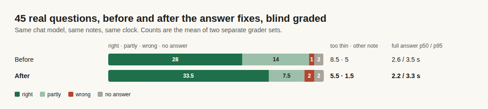

# E12-S32 evidence: fuller answers that stay on the asked note (2026-11-09)

Row: S32 in [EPIC-12](../zenod-app-chat-first-memory-graph-retrie.md), follow-up of S17; S31 waits on it. Run: run_f6e011a9-74fe-42fc-910e-410d6bdf9d22. PR [#1567](https://github.com/zenod-ai/zenod/pull/1567).

## Bottom line

**On his 45 real questions, right answers went from 29 / 27 to 32 / 35 with the same chat model, and both faults S17 found fell: too thin 17 → 11 and mixed in another note 10 → 3 (both grader sets added up).** The answer is no slower: full answer p50 2.2 s against 2.6 s, p95 3.3 s against 3.5 s on the same 20 questions under the same conditions. Two answers got worse in both grader sets: the two "top five topics" questions now fit four topics in the 700-token reply limit instead of five, and one question where the model named the wrong note first. His three numbers: ingestion success 93.8%, retrieval efficiency 94.3%, error rate 1.6% before; 93.8%, 88.7%, 3.3% after ([memory tests](http://vps3.taild81fbb.ts.net:8921/memory-tests/)). The drop comes from his vault, not this change: the old code on the new vault gives the same 93.8%, 88.7% and 3.3% (see Production). OpenRouter spend $0.35 of the $0.40 cap.

| On 45 real questions, Gemini 3.1 Flash Lite (today's model) | Right | Partly | Wrong | No answer | Too thin | Other note |
|---|---|---|---|---|---|---|
| Before: today's answer path | 29 / 27 | 13 / 15 | 1 / 1 | 2 / 2 | 9 / 8 | 5 / 5 |
| **After: this change** | **32 / 35** | **9 / 6** | 2 / 2 | 2 / 2 | **7 / 4** | **2 / 1** |

Counts are grader set 1 / grader set 2; "too thin" and "other note" are the graders' causes for answers not graded right. The two sets gave the same label on 41 (before) and 42 (after) of 45. Question by question: 6 better and 4 worse in set 1, 9 better and 2 worse in set 2.

## The causes, and the fixes

Found by replaying what the model was given for each question, at no cost (a stand-in model recorded the prompt), and by running S17's recorded model replies through the new checks.

- **Mixed in another note.** In every one of these misses the model's ABOUT line (the notes it says the question is about, S16) named neighbouring notes next to the asked one, so the S16 filter let their points through. Now, for a question about one thing, Zenod keeps one note from that line: the person's own note before a topic page or agent note when they ask what they said, the note Zenod read whole when it is one of them, else the model's first. A second note stays only when it is the same note captured twice or Zenod also read it whole. Questions about a time or over many notes keep every note named. A lead-in line left with no points ("you also said:") goes. Replayed on S17's replies, this changed only the 5 mixed answers it targets and 3 right answers, which kept the same words and lost only a duplicate citation mark.
- **Too thin, note cut short.** In 4 of the thin misses the right note was found but ranked 11th or later, or was added as the person's own note, so only 1,000 characters of it reached the model. The person's own notes are now read to at least 3,000 characters wherever they rank, at the passages that match the question. The prompt grew about 8% (median input 10.2k → 10.8k tokens).
- **Too thin, note there but the answer short.** In the other thin misses the whole note was there and the model wrote two or three points. The prompt now asks for one ABOUT note, every point the note makes as its own line (four to eight for a note that speaks of it at length), and what follows from it: the reason, the example, the next step. The line limit went from about 10 to about 12.
- **A full answer that lost its quotes.** On a first run, two long, full answers ended before their quote block, so the check hid them. The prompt now ends by naming the parts of the reply in order; on the recheck and the full run both answered.

Answer text only: the same model and settings, no new chat behaviour (root L-6). The same checked answer serves the app chat, a question asked on a channel and a call.

## What is still open

- **The 700-token reply limit.** Both "top five topics" answers use the whole limit, before and after; after, one topic fewer fits. S17 found the same limit blocks the stronger models; S31 needs a larger budget anyway, so it is S31's to raise.
- **Too thin is not gone (11)** and one answer now goes to the wrong note when the model names it first. Both are what the S31 recheck of a stronger model measures next.

## Method

S17's harness, unchanged: the cloud chat's answer path built from this branch, over the same read-only copy of his vault (`7f35d26`) with the clock pinned to 8 Nov 16:00 UTC, on the 45 questions of his real question set, today's model only. "Before" is S17's run of today's model (code `5f7aa14`; the answer path is the same on production `aedfcf0`, S31). Grading was blind with S17's rubric: for each question a grader saw the expected answer, the source notes and the two answers under letters shuffled per question, and two separate sets of three Sonnet graders on the team subscription labelled each right, partly, wrong or no answer with a cause. Times: today's code was rerun on 20 of the questions right after the full run, through the same relay, so both sides were timed under the same load. Questions, answers and grades stay private on VPS3.

## Spend

OpenRouter balance read first: $9.43 (floor $5). Spent $0.3461 over 115 calls through a localhost relay on VPS1 that allowed only today's model and stopped at $0.38: the full run, a 5-question recheck, the full run again and the 20-question timing run. The shared key went in through `secret run` and was never printed. The relay was stopped and its port closed afterwards; balance after $9.11. Grading cost nothing.

## Production

PR #1567 merged as `0f2aad5`, live on `cloud.zenod.dev` at `0f2aad5` (health ok, rolled before 19:31Z). His three numbers, from the memory test suite's own run after the roll ([memory tests](http://vps3.taild81fbb.ts.net:8921/memory-tests/)):

| | Code | Vault | Ingestion success | Retrieval efficiency | Error rate |
|---|---|---|---|---|---|
| Before | `aedfcf0` | `f362620` | 93.8% | 94.3% | 1.6% |
| After | `0f2aad5` | `71a3c5d` | 93.8% | 88.7% | 3.3% |
| Check: old code, new vault | `aedfcf0` | `71a3c5d` | 93.8% | 88.7% | 3.3% |

The old code on the new vault gives the same numbers and the same six retrieval misses, so the change is the vault, not this fix: between the two snapshots his vault took a new voice note, a new topic filing and about a dozen agent report rollups, and new notes now outrank the expected ones on three of the 53 retrieval checks (one is "my last voice note", which a newer note now answers). The suite uses its free stand-in model and this change touches only the answer text, which the three numbers do not measure. Worth a look by the Delivery manager: agent report rollups landing in his vault again (S14 moved 372 such lines off his pages).
