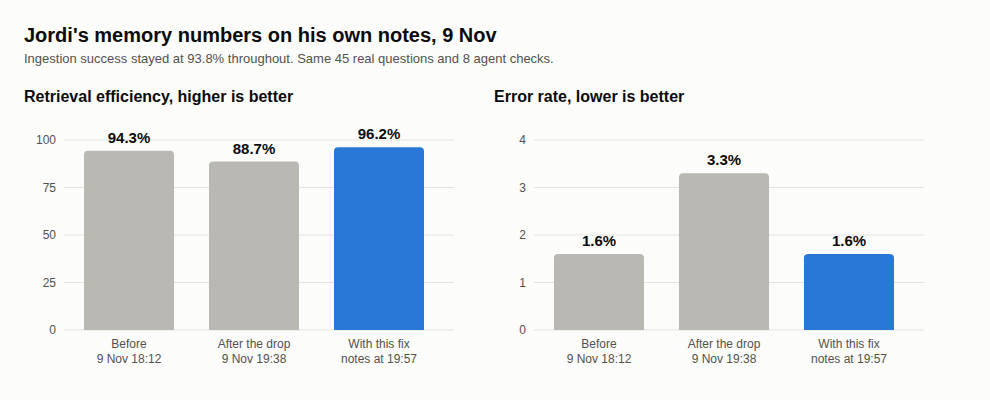

# E12-S33 evidence: his memory numbers back after the 9 Nov drop (2026-11-09)

Row: S33 in [EPIC-12](../zenod-app-chat-first-memory-graph-retrie.md), opened from S32's measurement. Run: run_4bc0d7f3-f77a-4562-92f9-22c2befb23ce. PR [#1570](https://github.com/zenod-ai/zenod/pull/1570).

## Bottom line

**His three numbers on his own notes are back and better: ingestion success 93.8%, retrieval efficiency 96.2%, error rate 1.6%, against 93.8%, 88.7%, 3.3% after the drop and 93.8%, 94.3%, 1.6% before it.** Two vault changes caused the drop. One new voice note changed the right answer to "what was in my last voice note?" (two questions), honestly: Zenod now answers with the newer note, and the suite marked that a miss because it scored a question written on 8 Nov against today's vault. One agent report tipped a tie on a third question and exposed a real defect: Zenod had stopped matching "Zenod" to the transcriber's "Zenot". Both are fixed. OpenRouter spend $0.

| On his notes (45 real questions, 8 agent checks, 8 judged filings) | Code | Vault | Ingestion success | Retrieval efficiency | Error rate |
|---|---|---|---|---|---|
| Before the drop, production run 18:12Z | `aedfcf0` | `f362620` | 93.8% | 94.3% | 1.6% |
| After the drop, production run 19:38Z | `0f2aad5` | `71a3c5d` | 93.8% | 88.7% | 3.3% |
| Today's code on today's vault, run alone | `0f2aad5` | `465b357` | 93.8% | 88.7% | 1.6% |
| **With this fix, same vault, run alone** | **#1570** | **`465b357`** | **93.8%** | **96.2%** | **1.6%** |
| **Production after the roll, suite's own run** | **`aa46d5e`** | **`2fb2b73`** | **93.8%** | **96.2%** | **1.6%** |

PR #1570 merged as `f97e479` and is live on `cloud.zenod.dev` at `aa46d5e` (health ok, rolled about 21:45Z). The suite's own run after the roll, on an even newer vault, is on the [memory tests](http://vps3.taild81fbb.ts.net:8921/memory-tests/) dashboard.

## What the bisect found

Every vault commit between the two production runs (`f362620..465b357`, 25 commits) was replayed with the same code (`0f2aad5`) on the four questions that changed, at no cost (the suite's free stand-in model).

| Vault commit | What it was | Questions it changed |
|---|---|---|
| `4d25058` | S29 line moves | none |
| `636d495` | one agent report filed on the Zenod page | the Twitter handle question fell from rank 5 out of the top 5 |
| `6376fcb` | E15-S2 private marks | none |
| `c40c411` | a new voice note at 19:07Z | both "what was in my last voice note?" questions |
| `96df95a` and later | new filings | "what did I talk about today?" went in and out of having its facts read, as new notes landed |

The S24/S25 merges (`aa40747`) and the 8 Nov filings landed before 18:12Z; the run then still measured 94.3%, so they are not the cause.

## The causes, and the fixes

- **"My last voice note" changed honestly.** The question set was written on 8 Nov at 16:00 (vault `7f35d26`). Zenod answers "last" with the newest note, and since 19:07Z on 9 Nov that is a newer one, which is right. The suite now asks questions that ask by time (as Zenod's own time words read them: last, today, yesterday, a named day or week) on the vault revision and at the moment their `asOf` names; every other question still runs on today's vault. This also fixes "yesterday", which broke at each midnight because the suite used the real clock, so 43 of 45 questions now hit against 42 before the drop.
- **The transcriber's spelling was lost.** His transcripts spell the product "Zenot" in 17 voice notes and "Zenod" in 14. Zenod adds the transcriber's spelling to a question word only when he has (almost) never said that word; once some transcripts spelt "Zenod" right, every Zenod question lost the "Zenot" notes. The 8 Nov note holding the Twitter handle change ranked below the top 8 and the question hung on a page that cites it, tied at rank 5. Now a word he does say also gets a spelling he says at least as often, one letter away and written on under half as many pages. The note is 4th and the page citing it 2nd. This helps every question naming Zenod in chat, on channels and over MCP.

Still missing, as before the drop: "what did I send on November 6?" and one recall question (`rq08`). They are follow-ups, not part of this regression.

## Method

The EPIC-15 Q2 suite (`scripts/memory-eval/run.mjs`) on throwaway copies of his vault taken with `git archive` from the read-only clone, never pushed; the clone's history was not touched. Headline runs ran one at a time: six parallel runs on a loaded VPS3 hit the suite's time limits and were used only for question-by-question comparison. Demo suite with the fix: 95.8%, 100%, 1.8%, the same as production. A new unit test fails on the old code and passes on the new. Questions, answers and notes stay private on VPS3.

## Spend

$0: the stand-in model throughout, no OpenRouter or DeepSeek calls.
