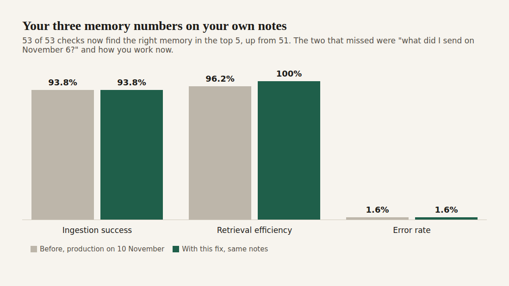

# E12-S35 evidence: a named day and how he works now are found again (2026-11-10)

Row: S35 in [EPIC-12](../zenod-app-chat-first-memory-graph-retrie.md), follow-up of S33. Runs: run_1fee9bbd-f708-45ff-8a9c-aa030a343e9a (fix), run_67d1e1a0-aaa4-4eff-8ba1-a9cd43ebf28e (live check). PR [#1574](https://github.com/zenod-ai/zenod/pull/1574) merged `30034ff`.

## Bottom line

**Live on production `d94ef24` (health checked 2026-11-10 04:03Z, it contains the fix `30034ff`), his three numbers on his own notes are ingestion success 93.8%, retrieval efficiency 100%, error rate 1.6%, against 93.8%, 96.2%, 1.6% before the fix.** The [memory tests](http://vps3.taild81fbb.ts.net:8921/memory-tests/) dashboard has measured 100% on every production build since the fix rolled (`30034ff` 01:58Z, `24a9f34` 03:01Z, `d94ef24` 04:11Z). The only two checks that still missed now find their note: "what did I send on November 6?" (2nd) and "How am I working now, from my laptop or somewhere else?" (3rd). No other question moved. OpenRouter spend $0.

| On his notes (45 real questions, 8 agent checks, 8 judged filings) | Code | Vault | Ingestion success | Retrieval efficiency | Error rate |
|---|---|---|---|---|---|
| Production, suite's own run 00:29Z | `bdf3228` | `15b4a85` | 93.8% | 96.2% (51/53) | 1.6% |
| **With this fix, same vault** | **#1574** | **`15b4a85`** | **93.8%** | **100% (53/53)** | **1.6%** |
| **Production after the roll, suite's own run 04:11Z** | **`d94ef24`** | **`0cb1d30`** | **93.8%** | **100% (53/53)** | **1.6%** |

Demo suite with the fix and on production `d94ef24`: 95.8%, 100%, 1.8%, unchanged.

## Why each one missed, and the fix

- **A named day was answered like "my last note".** The date itself was read right (November 6 → 2026-11-06). But a day was answered the way "what was in my last vn?" is: the newest note of that day, then the pages it was filed into. On 6 November he sent seven notes, so the newest one and three of its pages filled the top 5 and the two long notes that held most of what he sent that day never showed. Now a day asked as a whole lists that day's notes, the ones that say the most first; a quick test message says less about a day than a long note. A question for one note ("yesterday's vn", "the voice note on November 4") and a day with a single note keep the old answer: the note and where it was filed.
- **Named days in both his languages.** Besides "November 6", "6 Nov", "6 de noviembre", "2026-11-06", "on Friday" and "el viernes", Zenod now reads "the day before yesterday", "anteayer", "antier", "3 days ago", "hace 3 días", "on the 6th", "el día 6" and "1ro de noviembre". His notes are in English and Spanish.
- **rq08: "somewhere" was taken as the subject.** In "from my laptop or somewhere else?" the word "somewhere" counted as a topic word, so pages about places ranked first, and the note that answers it (it holds the question's other words in one passage) fell under the bar for being lifted to the top. "else" was already treated as filler since S19; now the open place and person words are too, in English and Spanish (somewhere, anywhere, someone, anyone, nothing, algo, alguien, nada, nadie, otro, otra). The note is 3rd and held whole by the answer.

## Method

The EPIC-15 Q2 suite (`scripts/memory-eval/run.mjs`) on a throwaway copy of his vault `15b4a85`, the same revision production's own run used, with the free stand-in model; time questions on their `asOf` vault and moment, as since S33. Run alone (VPS3 load around 19, so the median wait per question, 763 ms against 302 ms, and filing times are not comparable; the dashboard's run after the roll is). Three new unit tests fail on the old code and pass on the new; the existing recent-note, asked-note, memory index and chat tests pass. Questions, answers and notes stay private on VPS3.

## Spend

$0: the stand-in model throughout, no OpenRouter or DeepSeek calls.
