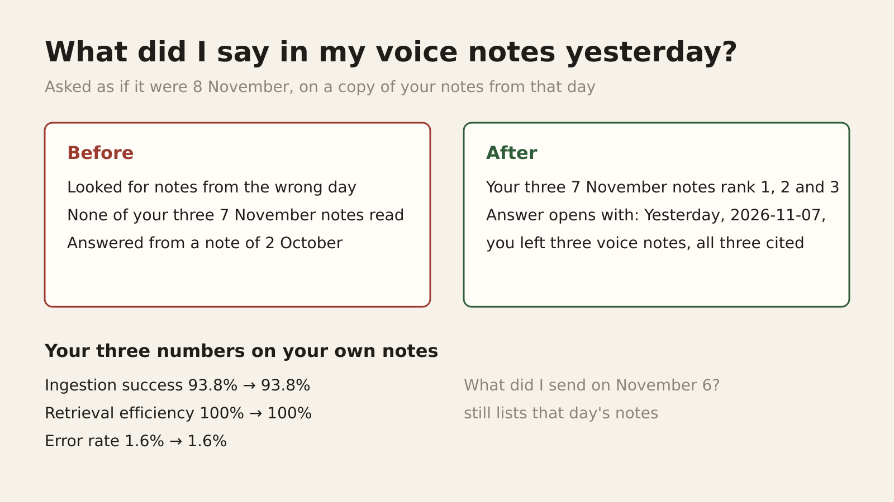

# E12-S36 evidence: "what did I say yesterday" answers from the right day again (2026-11-10)

Row: S36 in [EPIC-12](../zenod-app-chat-first-memory-graph-retrie.md), follow-up of S21. Run: run_dd7c09b0-2f0c-4144-a40f-d9f2b61affdf. PR [#1602](https://github.com/zenod-ai/zenod/pull/1602) merged `d09287d`.

**Fixed. Asked as if it were 8 November, "what did I say in my voice notes yesterday?" now reads his three 7 November notes first and the answer begins "Yesterday (2026-11-07) you left three voice notes", citing all three. Before the fix none of the three were read and the answer came from a 2 October note. His three numbers do not move: ingestion success 93.8% → 93.8%, retrieval efficiency 100% → 100%, error rate 1.6% → 1.6%. "What did I send on November 6?" still lists that day's notes.** Live on production `e1b560e` (it contains `d09287d`; health ok at 21:25Z). On production both clocks are the wall clock, so live answers already used one day; the fix makes the day the same wherever Zenod's time is set.

## Which day it picked, and why

Not the timezone, and not the S35 named-day parser. The day comes from two clocks that disagreed:

- The answer is told the engine's day: in the S21 bench, 8 November, pinned so the question has one right answer.
- The memory index, which picks the notes, was opened without that clock and used the wall clock. S21 ran on 10 November, so the index looked for 9 November. The vault copy from 8 November has no notes that day, so the time search found nothing and the question fell back to the word search, where "said" and "voice notes" matched a long 2 October note.

The fix gives the index the engine's clock (one line). On production both clocks are the wall clock, so a live answer gives the same day before and after; anything that sets Zenod's time, the S21 bench and replays, now uses one day for both. So the loss S21 saw was the bench and the code disagreeing, and the loss is gone.

The whole system reads days in UTC, as the Log files are named. A question asked after 18:00 in Mexico City is already the next day in UTC. That is a separate question and was not changed here: see the row's follow-ups.

## Before and after

| His question, S21 bench, his vault as of 8 Nov, engine at 8 Nov 16:00 UTC | His three 7 Nov notes | Answer |
|---|---|---|
| Production `9ee1440`, before | none read | from a 2 October note, as S21 graded it wrong |
| With the fix `78458d7` | ranked 1, 2, 3, all three cited | "Yesterday (2026-11-07) you left three voice notes" |

| His three numbers, EPIC-15 Q2 suite on his notes | Code | Vault | Ingestion success | Retrieval efficiency | Error rate |
|---|---|---|---|---|---|
| Production, suite's own run 20:13Z | `9ee1440` | `32dadeb` | 93.8% | 100% (53/53) | 1.6% |
| **With the fix, same vault** | **`78458d7`** | **`32dadeb`** | **93.8%** | **100% (53/53)** | **1.6%** |

The Q2 suite already pins every clock at a question's moment (S33), so it never saw this defect and its numbers do not move, as expected. A first run of the suite on the fix overlapped a load spike on VPS3 (load near 100) and six filings hit the suite's 180 s timeout (ingestion 56.3%); rerun at normal load it gave the row above. The fix does not touch filing.

## Method

- **The test on his real question** (`packages/core/test/recentNotes.test.ts`): made-up notes on 2 October, 6 and 7 November; engine at 8 November. "What did I say in my voice notes yesterday?" reads the two 7 November notes first and not the 2 October one; "what did I send on November 6?" lists both 6 November notes. The first fails on the old code and passes on the new. Core tests and the type check pass; CI green on #1602.
- **The chat path**: S21's bench (`~/s21/bench.mjs` on VPS3) on his vault `7f35d26` with the engine at 8 Nov 16:00 UTC, his question only, first with the free stand-in model on production's build and on the fix, then once with DeepSeek Flash on the fix for the answer text. The answer and his notes stay private on VPS3.
- **His three numbers**: the EPIC-15 Q2 suite (`scripts/memory-eval/run.mjs`) on a throwaway copy of vault `32dadeb`, the revision production's own 20:13Z run used, free stand-in model.

## Spend

DeepSeek $0.0007 for the one live answer, on the zenod-tests key S21 used (its relay ledger $0.3135 → $0.3142, under S21's $0.45 cap). OpenRouter $0.
