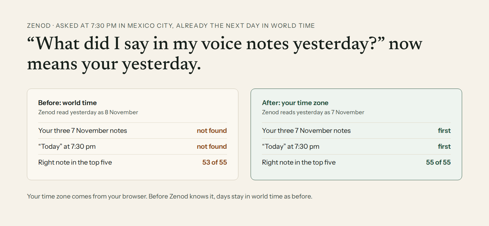

# E12-S38 evidence: day questions are answered in your own time zone (2026-11-11)

Row: S38 in [EPIC-12](../zenod-app-chat-first-memory-graph-retrie.md), follow-up of S36. Run: run_42341d02-5b1c-44f4-9a00-cea8157ea470. PR [#1614](https://github.com/zenod-ai/zenod/pull/1614) merged `289a26a`.

**Fixed. Asked at 7:30 pm in Mexico City on 8 November, when UTC was already 9 November, "what did I say in my voice notes yesterday?" now reads your three 7 November notes first. Before, it read 8 November and missed all three. "What did I talk about in my voice notes today?" at the same moment now reads that afternoon's notes first, where before it found none. Your three numbers on the standard question set, with these two evening questions added: ingestion success 93.8% → 93.8%, retrieval efficiency 96.4% (53/55) → 100% (55/55), error rate 3.2% → 1.6%.** Live on production `289a26a` (health ok at 01:56Z on 11 November). Zenod learns your time zone the first time you ask a question in the web app after this roll. Until then, and for MCP before that first question, days stay UTC as before.

## What was wrong

S36 put the index and the answer on one clock. That clock read days in UTC, and Log files are named by their UTC day. Mexico City is six hours behind UTC, so from 18:00 there it is already tomorrow in UTC, and an evening question about "yesterday" or "today" picked the wrong day:

- The question parser turned "yesterday" into the UTC day before.
- The memory index took a day as the one Log file with that UTC name. A Mexico City day is the evening of one file and the start of the next.
- The answer was told today's date and the time in UTC, and each note's time in UTC.

## The fix

- **Where Zenod learns your zone.** Nothing stored one before. The web app now sends the browser's time zone (`America/Mexico_City`) with each question. The server keeps it as your account's time zone setting, so the MCP search and every other memory answer read the same days.
- **Day words.** "today", "tonight", "this morning", "yesterday", "the day before yesterday", "last Tuesday", "3 days ago", "last week" and named dates are read on your own clock.
- **The index.** A day is the span between its two local midnights. The index reads each entry's clock in the two UTC files that span covers.
- **The answer.** It is told your date and time ("2026-11-10 (Tuesday), now 19:00 America/Mexico_City") and each note's time in your zone.
- **Safe default.** Until Zenod knows your zone, days stay UTC, exactly as before. Filing, page format, the tree and the index format are unchanged (engine freeze, E22-A5: this is the fix for the wrong answer he reported).

## Numbers

| EPIC-15 Q2 suite, his vault `97ee4d7`, free stand-in model | Code | Ingestion success | Retrieval efficiency | Error rate |
|---|---|---|---|---|
| Production, before | `d62d69e` | 93.8% (15/16) | 96.4% (53/55) | 3.2% (2/63) |
| **With the fix** | **`3b53ac6`** (merged as `289a26a`) | **93.8% (15/16)** | **100% (55/55)** | **1.6% (1/63)** |

The two new rows account for the whole difference. On production's code both miss: neither has the right note in the top five, and "today" has none of its facts in the answer's reading. With the fix both are at rank 1 with their facts. The other 53 questions are unchanged, including S36's "yesterday" and "November 6", which are pinned at 16:00 UTC, the same day in both zones. The one remaining error is the filing miss every nightly has.

## The two new questions

Added to his standard question set (private, on VPS3), each pinned to the moment and the vault as they were, with `asOf.timeZone`:

| Row | His question | Asked at | Right notes |
|---|---|---|---|
| s38-yesterday-evening | what did I say in my voice notes yesterday? | 8 Nov 19:30 Mexico City (9 Nov 01:30 UTC), vault `b728acc` | his three 7 Nov voice notes |
| s38-today-evening | what did I talk about in my voice notes today? | same | his three 8 Nov afternoon voice notes |

The suite runner now reads `asOf.timeZone` and opens the engine in that zone (`scripts/memory-eval/run.mjs`), so later evening rows can be added the same way.

## Method

- **The test** (`packages/core/test/localDay.test.ts`): made-up notes, clock pinned at 19:00 Mexico City on 10 Nov (01:00 UTC on 11 Nov). "Yesterday" returns 9 Nov's two notes across two UTC files, "today" returns 10 Nov's two, "last Tuesday" goes back a week (it is still Tuesday there), and the TODAY line and note times are in his zone. Without a zone, the UTC days are unchanged. It fails on the old code and passes on the new. The S36 and S1b time tests and the web chat tests pass. CI green on #1614.
- **His numbers**: `scripts/memory-eval/run.mjs --dataset private` on a throwaway copy of vault `97ee4d7` (the latest nightly's), free stand-in model, production's build `d62d69e` and then the fix, both on the new suite runner. Nothing was written to the nightly history.

## Spend

DeepSeek $0, OpenRouter $0: the stand-in model answers the suite.
