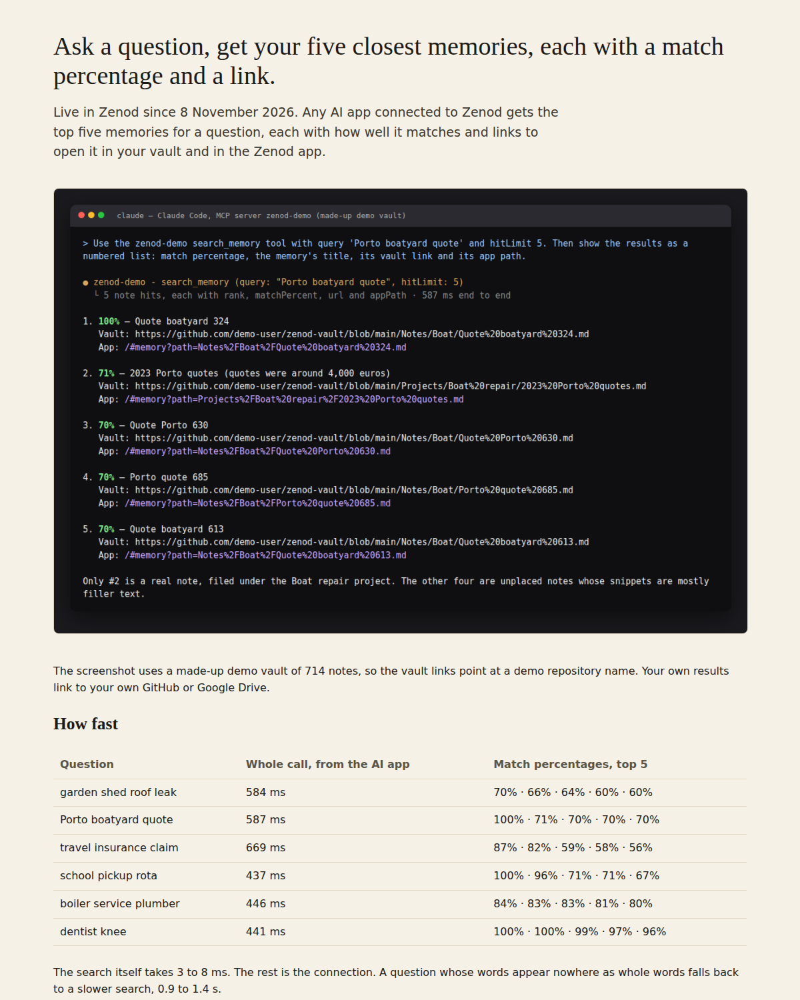
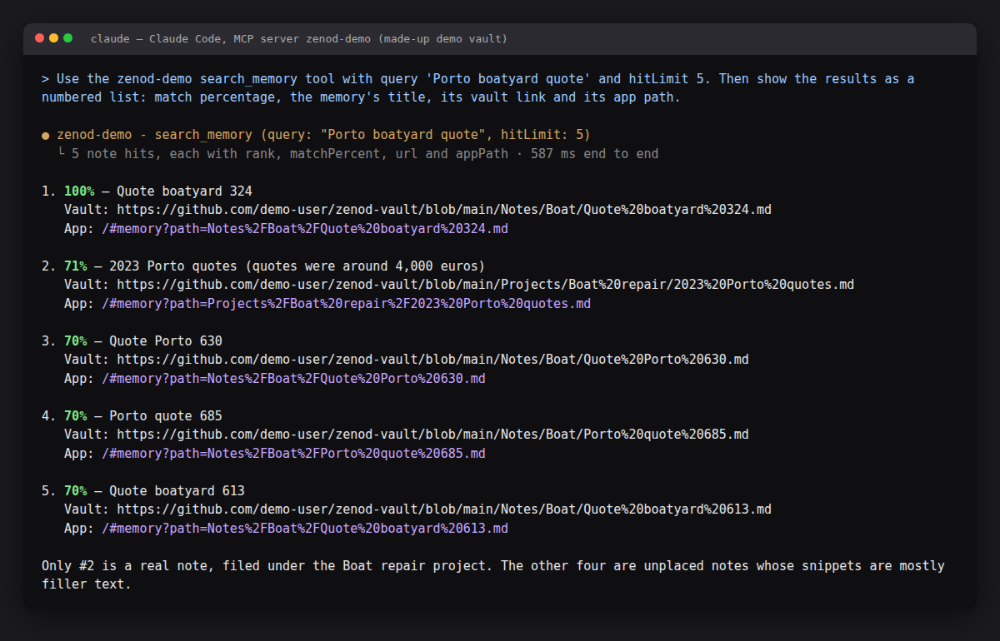

# E12-S3a evidence: ranked retrieval with a match percentage and links (2026-11-08)

Row: S3a in [EPIC-12](../zenod-app-chat-first-memory-graph-retrie.md) (Done means E12-3, part 1). Run: run_4477c7b0-c100-4a81-9668-9b2544edc4dc. PR [#1505](https://github.com/zenod-ai/zenod/pull/1505), merged as `9e45917`.

**Evidence page (tailnet, no password):** http://vps3.taild81fbb.ts.net:8916/ (`zenod-e12-s3a.service`, serves `~/artifacts/e12-s3a` on VPS3).

## What shipped

- `search_memory` note hits gain `rank`, `matchPercent` (integer 1–100) and `appPath`. Every earlier field (`path`, `snippet`, `score`, `url`, `provider`, `githubUrl`, `treePath`, `placement`, `lineage`, `evidenceRefs`) is unchanged, so existing MCP clients keep working. The text line keeps its shape and adds `N% match` and an `app:` line. A new optional input, `hitLimit` (1–20, default 20), returns only the top N. No new tool, so the seven-tool listing and the directory entries stay as they are. The description describes and does not instruct (E10-R1); the hosted tool-surface snapshot was updated with it.
- **Match percentage** (`packages/core/src/vault/matchPercent.ts`): `round(100 × (coverage + strength) / 2)`. Coverage is the share of the question's content words the memory contains, each weighted by its BM25 idf, using the same FTS5 matching as the search. Strength is the BM25 score divided by the best hit's score. The value is clamped to 1–100 and kept monotonic down the list, so a hit never reads higher than the one above it. It is relative to this question, not a probability. The BM25 ranking itself is unchanged, so the E9-5a eval (top 5, 10 of 10) still holds. The scan fallback has no coverage figure and uses strength alone.
- **Links:** `url` is the memory in the vault (GitHub or Google Drive, as before). `appPath` is `/#memory?path=<vault path>`, and the web app now opens its Memory tab for `#memory…` hashes.
- **Web API for S1/S3b:** `GET /api/console/memory-search?q=&limit=` (hosted; tenant comes from the session only, like `/api/console/memory-tree`) and `GET /api/memory/search` (self-hosted). Both return `{query, tier, ms, results:[{rank, path, title, snippet, matchPercent, url, provider, appPath, treePath, kind}]}`, top 5 by default.
- **Tests:** percentage arithmetic, idf weighting, monotonic cap, coverage terms excluding aliases; index percentages (best full match reads 100); a latency guard (top 5 over 1,500 notes, p95 under 250 ms); link building; MCP back-compat (exact earlier fields plus the new ones), `hitLimit`, and output-schema validation; console route tenant isolation, 401, 400 and 404. CI green on `49cb30f`.

## Live

| Check | Result |
|---|---|
| Deploy | publish.yml run 42438059305: ci, publish and deploy all succeeded |
| `https://cloud.zenod.dev/api/health` | `ok`, sha `9e4591727b89a0b8f5488f12cec629e0f393e1ab`, 2026-11-08 02:57 UTC |
| Real MCP call, production, test account | **not done.** No non-Jordi account with a vault exists on production. The control-plane token that made the EPIC-7 T3 synthetic tenant is per-app, and `secret run` refuses it outside `zenod-mt`. A test account comes with the team sign-in (E7-A15). Jordi's account was not used. |

## Real MCP call on the shipped code (demo vault)

The same code at `49cb30f` (identical tree to the merge `9e45917`) ran the self-hosted server (`createApp` + `Runtime`, real engine and tier-0 index) on VPS3 localhost. Its vault was made up: the repo's `tree-vault` test fixture plus 700 generated notes, 714 files and 721 index rows, about the size of Jordi's vault (~730 rows). Claude Code connected to it as an MCP client over HTTP and called `search_memory` with `hitLimit: 5`:

Whole-call times below were measured from a fresh MCP client (connect, initialize, call, close) on the same host:

| Question | Whole call (ms) | Top 5 match % |
|---|---|---|
| garden shed roof leak | 584 | 70 · 66 · 64 · 60 · 60 |
| Porto boatyard quote | 587 | 100 · 71 · 70 · 70 · 70 |
| travel insurance claim | 669 | 87 · 82 · 59 · 58 · 56 |
| school pickup rota | 437 | 100 · 96 · 71 · 71 · 67 |
| boiler service plumber | 446 | 84 · 83 · 83 · 81 · 80 |
| dentist knee | 441 | 100 · 100 · 99 · 97 · 96 |

On the server, the index search took 3.2–7.2 ms per question. **Known gap:** a question with no whole-word match in the index (e.g. "warm up", "orto") falls back to the older substring scan, which took 0.24–0.72 s on the server and 0.9–1.4 s for the whole call. It is proposed as a follow-up on the row. Word questions stay well under 1 s.

## Rules kept

No chat, WhatsApp or reply change (root L-6); no agent_team machinery (L-7); no secrets, env listings or API bodies printed (L-5); production rolled by the owner-approved push-to-main path (D27).
