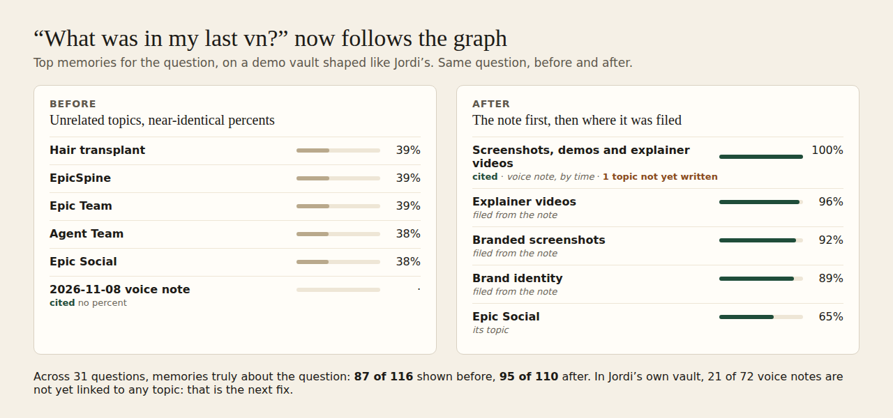

# E12-S3c evidence: match percentages that mean something (2026-11-08)

Row: S3c in [EPIC-12](../zenod-app-chat-first-memory-graph-retrie.md). Trigger: Jordi on the live Chat tab asked about using EpicSpine as a doctrine. "Top 5 memories" showed Agent Team, Epic Team, Hair transplant, Travel and EpicSpine, all at 61 %, while the memory the answer cited (a 2026-11-08 Log entry) sat below as a sixth row with no percentage.

## Cause (verified, not assumed)

1. **The tree path is indexed and matched.** Every page carries its lineage (`Long-term memory › Travel`, `Working memory › Epic Team`) in the `lineage` column (BM25 weight 5). A question with the word "memory" in it matched every page by that path alone, so unrelated topic pages tied on the same score.
2. **Strength was relative to the best hit.** `(coverage + strength) / 2` with `strength = score / topScore`: tied hits each get strength 1.0, so even a coverage of about 0.22 reads 61 %. The best hit of a weak question always read high.
3. **Generic words were searched.** "memory", "remember", "use", "notes", "know" and similar words were treated as content words.
4. **The cited memory was outside the top 5.** The chat asked for 5 ranked hits only and showed any other citation in a separate row without a percentage. A Log entry also carries a 0.5 rank factor.

Reproduced on a demo vault: the S3a/S1 714-note made-up vault (`/tmp/s3a-live/vault`) plus five pages shaped like Jordi's (Agent Team, Epic Team, Hair transplant, Travel, EpicSpine under their tree roots) and a 2026-11-08 Log entry. Jordi's own vault was not used. The exact 61 % tie needs his vault, but "how does my memory work" (question 21) shows the same mechanism: five unrelated roots tied at 98 to 100 %.

## Fix

- `packages/core/src/vault/memoryIndex.ts`: generic words (memory, remember, note, know, use, work, and similar, English and Spanish) are dropped from the query like stop words unless the question has nothing else; a question made only of them has its percentages scaled to 30 %. The candidate pool grows from `limit × 3` to at least 40, **coverage is measured on content columns only** (title, aliases, summary, body; not the tree path), hits that match only on the tree path or hold under a quarter of the best hit's coverage are dropped. If every candidate is tree-path-only the list is kept (reading about 1 %) rather than returned empty.
- `packages/core/src/vault/matchPercent.ts`: `matchPercent = round(100 × coverage × (1 + strength) / 2)`. A hit never reads higher than the share of the question it holds; ties on a weak match read weak; the best hit with every word still reads 100.
- `packages/server/src/memoryChat.ts` (minimal): the chat ranks 20, shows the top 5 plus any memory the answer cites that ranked lower, each with its own percentage and the "cited" mark. `apps/web/src/components/memory-chat.tsx`: heading reads "Memories for this question" when more than 5 rows show. WhatsApp, Telegram and MCP chat replies are unchanged (root L-6); `search_memory` shares the ranking and percentages, with the same fields.

## Before and after (21 questions, top 5 with percent)

Index search on the demo vault, `MemoryIndex.search(q, 5)`. Jordi-shaped question first. Worst single search: 13 ms before, 11 ms after (budget 1 s).

| # | Question | Before (top 5, percent) | After |
|---|---|---|---|
| 1 | We are going to use EpicSpine as a doctrine for how we work, what does that mean for my memory? | EpicSpine 66; EpicSpine doctrine 66; Ideas and knowledge 44; Epic Team 37; Agent Team 37 | EpicSpine 50; EpicSpine doctrine 50; Ideas and knowledge 47 |
| 2 | Should we adopt Epic Spine as our doctrine? | EpicSpine doctrine 85; EpicSpine 45; Epic Team 45; Ideas and knowledge 44 | EpicSpine doctrine 69; EpicSpine 17; Epic Team 17; Ideas and knowledge 17 |
| 3 | garden shed roof leak | Shed roof 318 70; Timer leak 205 66; Hedge shed 208 64; Compost leak 35 60; Lawn leak 87 60 | Shed roof 318 39; Timer leak 205 37; Hedge shed 208 36; Compost leak 35 35; Lawn leak 87 35 |
| 4 | Porto boatyard quote | Quote boatyard 324 100; 2023 Porto quotes 71; Quote Porto 630 70; Porto quote 685 70; Quote boatyard 613 70 | Quote boatyard 324 100; 2023 Porto quotes 57; Quote Porto 630 57; Porto quote 685 57; Quote boatyard 613 57 |
| 5 | travel insurance claim | Travel insurance 86; Life admin 81; Insurance claim 539 62; Insurance claim 194 61; Insurance itinerary 645 59 | Travel insurance 73; Life admin 69; Insurance claim 539 46; Insurance claim 194 46; Insurance itinerary 645 44 |
| 6 | school pickup rota | School rota 649 100; Rota dinner 672 96; Pickup rota 95 71; Pickup rota 383 71; School rota 326 67 | School rota 649 100; Rota dinner 672 96; Pickup rota 95 59; Pickup rota 383 59; School rota 326 55 |
| 7 | boiler service plumber | Boiler service 117 84; Service boiler 435 83; Boiler service 418 83; Boiler electricity 401 81; Plumber boiler 127 80 | Boiler service 117 69; Service boiler 435 68; Boiler service 418 68; Boiler electricity 401 67; Plumber boiler 127 64 |
| 8 | dentist knee | Knee dentist 561 100; Dentist knee 528 100; Dentist knee 39 99; Vaccine dentist 190 97; Vaccine knee 350 96 | Knee dentist 561 100; Dentist knee 528 100; Dentist knee 39 99; Vaccine dentist 190 97; Vaccine knee 350 96 |
| 9 | What do I remember about the cabin decision? | Cabin decision 99; Agent Team 39; Lessons birthday 93 1; Birthday camp 277 1; Quote engine 301 1 | Cabin decision 100; Agent Team 32 |
| 10 | which memories mention my family | People and family 64 | People and family 44 |
| 11 | how do I use my notes for the boat repair | Boat repair 71; 2023 Porto quotes 68; People and family 42; Boat repair quotes from Porto 42; Travel 35 | Boat repair 100; 2023 Porto quotes 98; Boat repair quotes from Porto 75; Boatyard antifouling 559 25; Boatyard winter 143 25 |
| 12 | what did I decide about Oakmere vs Fernhill | Cabin decision 85 | Cabin decision 70 |
| 13 | tell me about the agent team | Agent Team 100; Epic Team 96; Ideas and knowledge 46 | Agent Team 100; Epic Team 96; Ideas and knowledge 35 |
| 14 | what is my plan for the hair transplant | Hair transplant 100; Tax filing 576 1; Hotel train 64 1; Kickoff invoice 574 1; Kickoff contract 626 1 | Hair transplant 99 |
| 15 | where do I keep my memory of the trips | Travel 77; Travel insurance 75; EpicSpine 29; Epic Team 29; Agent Team 29 | Travel 42; Travel insurance 41 |
| 16 | what's the status of Moss Lantern launch | Launching Moss Lantern 85; Launching Tide Cart 26 | Launching Moss Lantern 69; Launching Tide Cart 14 |
| 17 | how much was the Porto quote | 2023 Porto quotes 72; Quote Porto 630 70; Porto quote 685 70; Porto mooring 222 66; Boat repair 66 | 2023 Porto quotes 100; Quote Porto 630 99; Porto quote 685 99; Porto mooring 222 94; Boat repair 94 |
| 18 | what do I know about insurance | Ideas and knowledge 83; Travel insurance 43; Lisbon insurance 640 42; Insurance Lisbon 647 41; Insurance itinerary 113 41 | Travel insurance 100; Lisbon insurance 640 98; Insurance Lisbon 647 98; Insurance itinerary 113 98; Insurance claim 539 98 |
| 19 | remind me about the doctor appointment | Dentist doctor 388 58; Knee doctor 59 58; Dentist doctor 216 58; Doctor vaccine 412 58; Knee doctor 195 58 | Dentist doctor 388 28; Knee doctor 59 28; Dentist doctor 216 28; Doctor vaccine 412 28; Knee doctor 195 28 |
| 20 | how does my memory work | Epic Team 100; Agent Team 100; Ventures and work 100; Boat repair 99; Cabin decision 98 | Epic Team 30; Agent Team 30; Ventures and work 30; Boat repair 30; Cabin decision 30 |
| 21 | what are we going to do about the tide cart alpha | Launching Tide Cart 87; EpicSpine doctrine 20 | Launching Tide Cart 100 |

Reading the table: question 1 and 2 no longer list Hair transplant, Travel or other pages that matched only a path or the word "memory"; the Log entry that carries the doctrine sentence ranks and reads on its own percentage; weak questions (3, 20) read 30 to 40 % even for their best hit instead of 60 to 70 %; question 21 (all generic words) reads 30 % instead of a tie at 100 %. Where a question has strong matches (5, 6, 7, 14, 17) the best hit still reads 100.

Known limits: "Epic Spine" (two words) does not match the one-word page "EpicSpine" (question 2: the page reads 17 %, below the Log entry that spells it the same way); proposed as a follow-up (join adjacent words as an alias clause). The scan fallback (no whole-word match) still uses strength alone.

## Tests

- `packages/core/test/matchPercent.test.ts`: new arithmetic (coverage leads, 0.22 coverage reads 22 %), and an index test that Travel and Hair transplant do not appear for a question with "memory" and EpicSpine, the Log entry does, and an all-generic question reads at most 30 %. Latency guard (1,500 rows, p95 under 250 ms) unchanged and passing.
- `packages/server/test/memoryChat.test.ts`: a cited memory ranked 8th appears in the list with its own percentage and `cited: true`, and not again as "also cited".
- Locally (relevant files only): core `matchPercent` and `memoryIndex` 18 pass; server `rankedMemory`, `mcp`, `memoryChat` pass; web `memory-chat.test.tsx` 7 pass.

## Round 2 (2026-11-08): "what was in my last vn?" follows the graph

Trigger: Jordi relaunched S3c from the live cloud chat. He asked "what was in my last vn?". The answer was right (it summarised his latest voice note), but "Top 5 memories" showed Agent Team, Epic Team, Hair transplant, Travel and EpicSpine, all at 22 %, each a top-level tree page, while the voice note the answer cited sat below as "cited" with no percent. His words: "makes no sense yet all numbers the same, it's like it doesn't know how last vn connectd with its major topics". The same day he relaunched S1b: "quality of 5 shown memories is still low. It's like we haven't built the graph well." Both are handled here.

**Live:** merged in [#1516](https://github.com/zenod-ai/zenod/pull/1516) as `b83dfbf` (CI green), rolled by publish.yml; `cloud.zenod.dev/api/health` reports sha `b83dfbf` at 2026-11-08 06:49 UTC; the live chat bundle (`index-CM9bkk9H.js`) carries "not yet linked to topics", "voice note, by time", "filed from the note" and "under the top match"; the chat route answers 401 without a session. Not done: the signed-in check on Jordi's own account is his (no other hosted account with a vault exists, E7-A15).

### Cause

1. **The question has no subject words.** "last" and "vn" are in no memory, so word search ranked whatever pages happened to say "last" (the five roots each had it once). With nearly the same coverage they read nearly the same percent.
2. **The index knew nothing about time or about how a note was filed.** A Log entry carried no "voice note" or "who sent it" mark, and the edges from the S2 graph held only page links and tree parents: the links from a note to the pages that cite it, and its filing receipt, were not stored.
3. **The cited note had no percent** because the answer came from the ask fallback, whose citations outside the ranked list were shown as a plain "also cited" row.
4. **Tree roots could match by being roots**: a root row's body was its group heading ("Long-term memory").

### Fix (PR [#1516](https://github.com/zenod-ai/zenod/pull/1516))

- `packages/core/src/vault/recentIntent.ts`: reads a recent-note question (last / latest / yesterday's / today's / this morning's voice note, vn, audio, "what did I say about X today", the Spanish forms). "last week" or "last time" do not count.
- `packages/core/src/vault/memoryIndex.ts` (schema 3, rebuilt once on open): Log rows carry who sent them and whether they are voice notes (`content-type: voice_note`/`audio`, or an older "Voice note …" entry). New stored edges: page → note citations, filing receipt → pages written and pages only planned, note → wikilinks. A recent-note question ranks the person's latest voice notes by time (agent reports and typed notes excluded): the latest reads 100 % (or its share of the topic, when the question names one), each older note half the one before. After the latest note come the pages it was filed into, each at the note's percent times its connection: cited 0.80, written by the filing 0.78, linked 0.72, +0.03 per further tie, +0.01 per tree level, plus up to 0.12 for how much of the note the page's citing lines hold. Then their tree parents (0.60). A note tied to no page is flagged `unlinked`; topics its filing planned but never wrote are counted. `noteLinks()` counts voice notes not linked to topics.
- Other questions: when the best hit is a page at 60 % or more, up to two pages under it or linked from it join at its percent times 0.50 (under) or 0.45 (link), +0.02 per note filed into them, so its own topic outranks pages sharing only a word. Root rows no longer carry their group heading; agent reports rank below the person's notes on the same match; "voice", "vn", "audio" name the kind of capture, not the subject.
- Cited memories: `matchFor(question, paths)` gives any cited memory its own percent; the chat places it in rank order with "cited" (`packages/server/src/memoryChat.ts`). The answer carries the voice-note link count when a note is shown.
- App (`apps/web/src/components/memory-chat.tsx`): each memory says why it is there ("voice note, by time", "filed from the note", "its topic", "under the top match") and an unlinked note reads "not yet linked to topics · N of your M voice notes are not". MCP `search_memory` output is unchanged; WhatsApp and Telegram replies are unchanged (root L-6).

### Before and after: "what was in my last vn?"

Demo vault: the round 1 vault (714 made-up notes plus the Jordi-shaped pages) plus a case mirroring his: the latest voice note about screenshots, branding and Epic Social, filed into Branded screenshots, Explainer videos and Brand identity (a fourth topic, Animations, planned and never written), an older voice note filed into Travel, a voice note filed nowhere, an agent deploy note and a typed note. The five roots each say "last" once. Fixture: `packages/core/test/fixtures/lastVoiceNoteVault.ts`.

| | Top 5 | On topic |
|---|---|---|
| Before | Hair transplant 39, EpicSpine 39, Epic Team 39, Agent Team 38, Epic Social 38; the voice note "cited", no percent | 1 of 5 |
| After | the voice note 100 (cited, "1 topic not yet written"), Explainer videos 96, Branded screenshots 92, Brand identity 89 (each "filed from the note"), Epic Social 65 ("its topic") | 5 of 5 |

On a read-only clone of Jordi's vault (snapshot 2026-11-08 00:36 UTC, index outside the vault, only counts read): the same question shows his latest voice note at 100 % and the four pages it was filed into at 85 to 87 %.

### Quality of the five shown memories (S1b feedback)

The measure: of the memories shown (up to five), how many are truly about the question. "Truly about" is mechanical so it can be re-run: the memory's own words or tree place name the question's subject words, listed per question in the eval script (for example "Porto" and "quote", or "tide cart"). 31 questions: the 21 from round 1 plus 10 everyday questions about recent topics.

| | On topic | Off topic | Shown |
|---|---|---|---|
| Before (live 07238de code) | 87 | 29 | 116 |
| After | 95 | 15 | 110 |

The recent-note questions moved most: "what was in my last vn?" 1/5 to 5/5, "yesterday's voice note" 0/2 to 2/2, "latest voice note about Epic Social" 3/5 to 4/4, "voice note about the garden fence" 1/3 to 1/1, "what's the plan for Epic Social" 2/5 to 3/5. None of the 21 round 1 questions got worse (20 unchanged; "how does my memory work" drops from five unrelated roots at 30 % to three at 14 to 15 %). Worst single search 14 ms.

Where the 15 off-topic hits come from: words shared with unrelated pages (7: "team", "launch", and "epic" as the start of EpicSpine, Epic Team and Epic Social), the broad "Ideas and knowledge" page matching "doctrine" or "agents" (3), the strictness of the measure (2: a leak note without "shed", a boatyard quote without "Porto"), and a question nothing in the vault is about (3: "how does my memory work"). None comes from the graph in the demo vault, whose filings are complete by construction.

**Where the cause is the graph itself (S8):** in Jordi's vault, **21 of his 72 voice notes are not linked to any topic page** (no page cites them, no filing receipt wrote one), and 4 more stopped half way (topics planned, never written). Five of the 21 are from 2026-11-06 and 2026-11-07. For those notes the chat can show the note by time and flag it, but has no topics to follow: that gap is S8's.

Full table: [round 2 results](#round-2-results-31-questions).

### Tests

- `packages/core/test/recentNotes.test.ts` (12): intent reading (English, Spanish, "last time" excluded), voice detection, connection weights; "what was in my last vn?" on the fixture (note first at 100, three filed pages 80 to 99 with distinct percents, roots gone, agent and typed notes excluded, list reads top-down); parents and older notes; yesterday and today windows; topic-scoped pages; children of a clear best hit; "voice note" as a type; `matchFor`; `noteLinks` counts.
- `packages/server/test/memoryChat.test.ts`: a cited memory outside the ranked list gets its percent and rank place, `alsoCited` empty; the link count is added only when a note ranked by time is shown.
- Locally: core `recentNotes`, `memoryIndex`, `matchPercent`, `treeDiscover`, `memoryGraph` pass (the 4,000-note graph timing test times out on this host under load 24, on unmodified `main` too); server `memoryChat`, `mcp` 97 pass; web 165 pass; tool output schemas unchanged.

### Round 2 results (31 questions)

Index search, top 5 with percent; ✗ marks a memory not about the question.

| # | Question | Before: on topic, top 5 | After: on topic, top 5 |
|---|---|---|---|
| 1 | We are going to use EpicSpine as a doctrine for how we work, what does that mean for my memory? | 2/3: EpicSpine doctrine 100; EpicSpine 43; Ideas and knowledge 41 ✗ | 2/3: EpicSpine doctrine 100; EpicSpine 43; Ideas and knowledge 41 ✗ |
| 2 | Should we adopt Epic Spine as our doctrine? | 2/5: EpicSpine 43; EpicSpine doctrine 43; Ideas and knowledge 16 ✗; Epic Team 13 ✗; Epic Social 13 ✗ | 2/5: EpicSpine 43; EpicSpine doctrine 43; Ideas and knowledge 16 ✗; Epic Team 13 ✗; Epic Social 13 ✗ |
| 3 | garden shed roof leak | 4/5: Shed roof 318 42; Timer leak 205 39; Hedge shed 208 39; Compost leak 35 37; Lawn leak 87 37 ✗ | 4/5: Shed roof 318 42; Timer leak 205 39; Hedge shed 208 39; Compost leak 35 37; Lawn leak 87 37 ✗ |
| 4 | Porto boatyard quote | 4/5: Quote boatyard 324 100; 2023 Porto quotes 58; Quote Porto 630 57; Porto quote 685 57; Quote boatyard 613 57 ✗ | 4/5: Quote boatyard 324 100; 2023 Porto quotes 58; Quote Porto 630 57; Porto quote 685 57; Quote boatyard 613 57 ✗ |
| 5 | travel insurance claim | 5/5: Travel insurance 73; Life admin 69; Insurance claim 539 47; Insurance claim 194 46; Insurance itinerary 645 45 | 5/5: Travel insurance 73; Life admin 69; Insurance claim 539 47; Insurance claim 194 46; Insurance itinerary 645 45 |
| 6 | school pickup rota | 5/5: School rota 649 100; Rota dinner 672 96; Pickup rota 95 59; Pickup rota 383 59; School rota 326 55 | 5/5: School rota 649 100; Rota dinner 672 96; Pickup rota 95 59; Pickup rota 383 59; School rota 326 55 |
| 7 | boiler service plumber | 5/5: Boiler service 117 69; Service boiler 435 68; Boiler service 418 68; Plumber boiler 127 64; Boiler electricity 401 64 | 5/5: Boiler service 117 69; Service boiler 435 68; Boiler service 418 68; Plumber boiler 127 64; Boiler electricity 401 64 |
| 8 | dentist knee | 5/5: Knee dentist 561 100; Dentist knee 528 100; Dentist knee 39 99; Vaccine dentist 190 97; Vaccine knee 350 96 | 5/5: Knee dentist 561 100; Dentist knee 528 100; Dentist knee 39 99; Vaccine dentist 190 97; Vaccine knee 350 96 |
| 9 | What do I remember about the cabin decision? | 1/1: Cabin decision 100 | 1/1: Cabin decision 100 |
| 10 | which memories mention my family | 1/1: People and family 44 | 1/1: People and family 44 |
| 11 | how do I use my notes for the boat repair | 5/5: Boat repair 100; 2023 Porto quotes 98; Boat repair quotes from Porto 75; Boatyard antifouling 559 25; Boatyard winter 143 25 | 5/5: Boat repair 100; 2023 Porto quotes 98; Boat repair quotes from Porto 75; Boatyard antifouling 559 25; Boatyard winter 143 25 |
| 12 | what did I decide about Oakmere vs Fernhill | 1/1: Cabin decision 70 | 1/1: Cabin decision 70 |
| 13 | tell me about the agent team | 1/3: Agent Team 100; Epic Team 37 ✗; Ideas and knowledge 36 ✗ | 1/3: Agent Team 100; Epic Team 37 ✗; Ideas and knowledge 36 ✗ |
| 14 | what is my plan for the hair transplant | 1/1: Hair transplant 99 | 1/1: Hair transplant 99 |
| 15 | where do I keep my memory of the trips | 2/2: Travel 42; Travel insurance 41 | 2/2: Travel 42; Travel insurance 41 |
| 16 | what's the status of Moss Lantern launch | 1/3: Launching Moss Lantern 69; Launching Tide Cart 14 ✗; Epic Social 12 ✗ | 1/3: Launching Moss Lantern 69; Launching Tide Cart 14 ✗; Epic Social 12 ✗ |
| 17 | how much was the Porto quote | 5/5: 2023 Porto quotes 100; Quote Porto 630 99; Porto quote 685 99; Porto mooring 222 94; Boat repair 94 | 5/5: 2023 Porto quotes 100; Quote Porto 630 99; Porto quote 685 99; Porto mooring 222 94; Boat repair 94 |
| 18 | what do I know about insurance | 5/5: Travel insurance 100; Lisbon insurance 640 98; Insurance Lisbon 647 98; Insurance itinerary 113 98; Insurance claim 539 97 | 5/5: Travel insurance 100; Lisbon insurance 640 98; Insurance Lisbon 647 98; Insurance itinerary 113 98; Insurance claim 539 97 |
| 19 | remind me about the doctor appointment | 5/5: Dentist doctor 388 28; Knee doctor 59 28; Dentist doctor 216 28; Doctor vaccine 412 28; Knee doctor 195 28 | 5/5: Dentist doctor 388 28; Knee doctor 59 28; Dentist doctor 216 28; Doctor vaccine 412 28; Knee doctor 195 28 |
| 20 | how does my memory work | 0/5: Epic Team 30 ✗; Agent Team 30 ✗; Ventures and work 30 ✗; Epic Social 30 ✗; Boat repair 30 ✗ | 0/3: Ventures and work 15 ✗; Infrastructure and runbooks 14 ✗; EpicSpine 14 ✗ |
| 21 | what are we going to do about the tide cart alpha | 1/1: Launching Tide Cart 100 | 1/1: Launching Tide Cart 100 |
| 22 | what was in my last vn? | 1/5: Hair transplant 39 ✗; EpicSpine 39 ✗; Epic Team 39 ✗; Agent Team 38 ✗; Epic Social 38 | 5/5: Screenshots, demos and explain 100; Explainer videos 96; Branded screenshots 92; Brand identity 89; Epic Social 65 |
| 23 | what did I say about explainer videos today | 2/3: Explainer videos 60; Screenshots, demos and explain 44; Epic Social 20 ✗ | 2/2: Screenshots, demos and explain 100; Explainer videos 96 |
| 24 | what was in yesterday's voice note? | 0/2: Explainer videos 44 ✗; Screenshots, demos and explain 31 ✗ | 2/2: Train to the coast 100; Travel 92 |
| 25 | what did I say about screenshots | 4/4: Branded screenshots 100; Epic Social 95; Brand identity 81; Screenshots, demos and explain 75 | 4/4: Branded screenshots 100; Epic Social 95; Brand identity 81; Screenshots, demos and explain 75 |
| 26 | what's the plan for Epic Social | 2/5: Epic Social 99; zenod-social, EPIC-12 deploy n 73 ✗; EpicSpine 33 ✗; Epic Team 33 ✗; Screenshots, demos and explain 33 | 3/5: Epic Social 99; Branded screenshots 51; Explainer videos 51; EpicSpine 33 ✗; Epic Team 33 ✗ |
| 27 | how should my screenshots look | 4/4: Branded screenshots 100; Epic Social 95; Brand identity 81; Screenshots, demos and explain 75 | 4/4: Branded screenshots 100; Epic Social 95; Brand identity 81; Screenshots, demos and explain 75 |
| 28 | when should I book the train to the coast | 5/5: Travel 100; Train to the coast 84; Hotel train 253 24; Itinerary train 65 24; Train insurance 36 24 | 5/5: Travel 100; Train to the coast 84; Hotel train 253 24; Itinerary train 65 24; Train insurance 36 24 |
| 29 | what did I say about the brand | 4/4: Brand identity 100; Branded screenshots 99; Launching Moss Lantern 93; Screenshots, demos and explain 72 | 4/4: Brand identity 100; Branded screenshots 99; Launching Moss Lantern 93; Screenshots, demos and explain 72 |
| 30 | what was my voice note about the garden fence | 1/3: A thought about the garden fen 69; Explainer videos 25 ✗; Screenshots, demos and explain 19 ✗ | 1/1: A thought about the garden fen 100 |
| 31 | what did I say in my latest voice note about Epic Social | 3/5: Explainer videos 25; Epic Social 25; Screenshots, demos and explain 25; zenod-social, EPIC-12 deploy n 25 ✗; EpicSpine 13 ✗ | 4/4: Screenshots, demos and explain 100; Explainer videos 96; Branded screenshots 92; Epic Social 65 |
