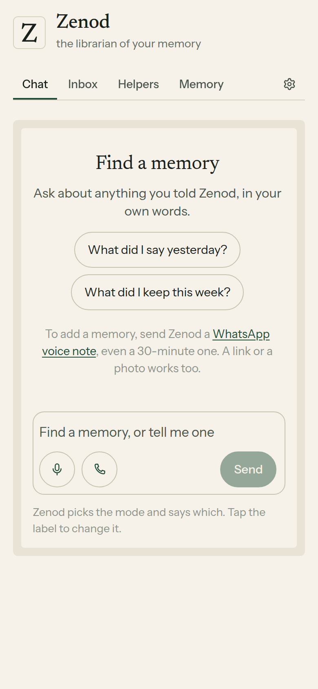

# E12-S40: Zenod on a phone leads with finding a memory, live (2026-11-18)

Row: S40 in [EPIC-12](../zenod-app-chat-first-memory-graph-retrie.md). Run: run_d7a4c02b-675e-40d9-a767-35353e42acc6. Evidence page (tailnet): http://vps3.taild81fbb.ts.net:8921/e12-s40/ (serves `~/zenod-evidence-pages/e12-s40/`, registered in agent_team docs/pages/registry.json `1ed333aee`). Source: Jordi vn_e1aa5d65, 18 Nov 17:27Z: "It has like a button that is kind of randomly in the middle, hanging out of nowhere ... Make it more about the retrieval. Like, can you, you can look for a memory".

**Bottom line.** On a phone the chat opens on "Find a memory" with two one-tap questions and an add-a-memory line that leads with a WhatsApp voice note (even 30 minutes), then a link or a photo. The call button sits beside the microphone at the left, Send at the right. Live on production `ed5f2fb` since 18 Nov 19:17:07Z.

## What shipped

- [#1701](https://github.com/zenod-ai/zenod/pull/1701), merged `ed5f2fb` (CI green). `apps/web/src/components/memory-chat.tsx`, `index.css`, one constant in `lib/memory-chat.ts`, tests. Web UI only: filing and retrieval untouched (freeze to 24 Nov).
- Cause of the floating button: at 640 px and under the composer wraps; the voice and call buttons both carried `margin-left: auto`, so the call button landed alone mid-row. Now the box takes the first line, microphone and call sit left, Send right, 44 px touch targets.
- First screen: "Find a memory", "Ask about anything you told Zenod, in your own words.", buttons What did I say yesterday? and What did I keep this week? (one tap asks), and "To add a memory, send Zenod a WhatsApp voice note, even a 30-minute one. A link or a photo works too." (link to Settings › Channels). Box placeholder: "Find a memory, or tell me one".
- Laptop: one row, microphone, call, box, Send; the first screen centred above it.
- Tests: memory-chat 18 pass (2 new: first screen and control order; one tap asks), web suite 42 files pass, tsc clean.

## Proof on production, 390 and 1280 px

Promote gate (this worker, `scripts/promote-production.sh --sha ed5f2fb`): staging healthy, question set demo 96 / 100 / 1.7, real-note set 100 / 91.2 / 1.6, passed; production `ed5f2fb` since 19:17:07Z (previous `ada4e0f`; undo `--rollback`). A first run of the gate was cut off by the worker's own time limit after the demo set, before production was touched.

The test account could not be signed in: its Google session has expired. The screenshots are production's own page and bundle from cloud.zenod.dev in headless Chromium with the API answered by a demo memory (same method as E14-S47): [390 after](e12-s40/01-live-390.png) · [1280 after](e12-s40/02-live-1280.png) · [390 before, `ada4e0f`](e12-s40/00-before-390.png).

## Not done here

- The two first-screen questions are fixed text, not drawn from the tester's own notes.
- WhatsApp setup itself is unchanged; the link opens the existing Channels screen.
