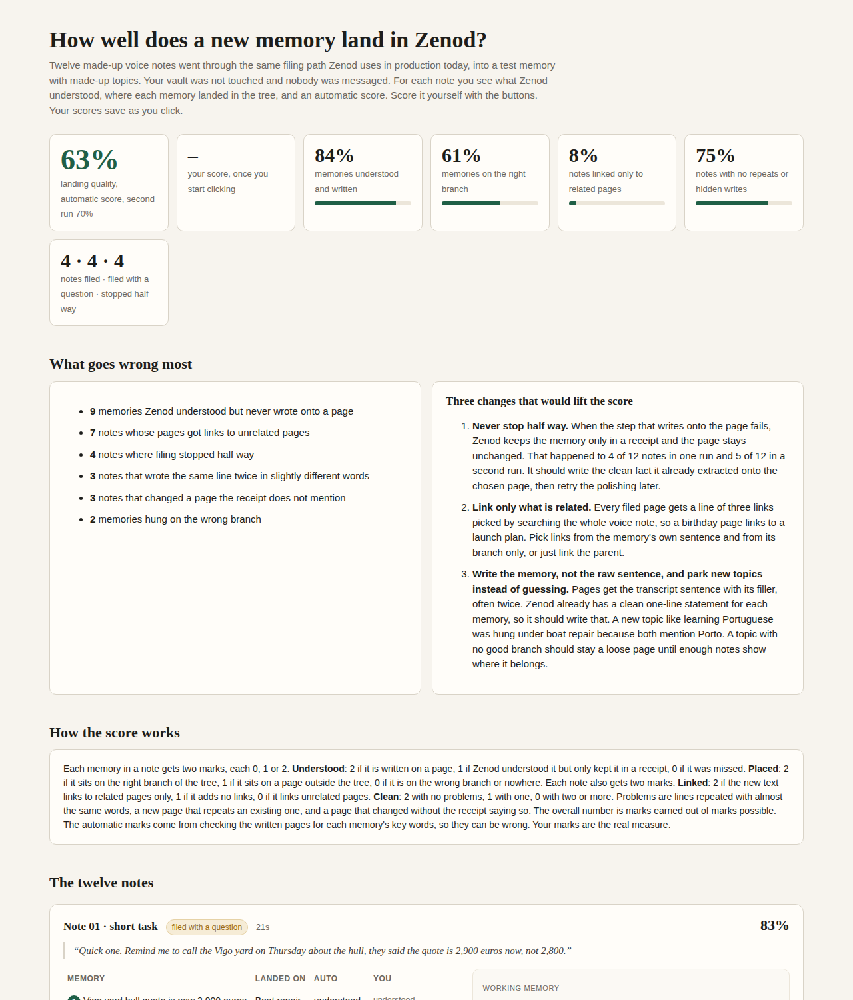

# E12-S6 evidence: how well a new memory lands (2026-11-08)

Row: E12-S6 in [EPIC-12](../zenod-app-chat-first-memory-graph-retrie.md). Source: Jordi's voice note of 2026-11-07 22:19Z ("the goal is what's the quality of storage of a new memory … we need to do different trials of voice notes landing into memory").
Run: run_2f8660b4-dd5c-4f2d-a5b3-e3381a633243.

**Trial page (tailnet, Jordi scores it himself):** http://vps3.taild81fbb.ts.net:8913/

## What was measured

Twelve **made-up** voice-note transcripts went through Zenod's production filing path on an isolated demo vault. Nothing touched Jordi's vault, production, or any chat. No message was sent.

- **Code:** production SHA `67d53e3` (live `cloud.zenod.dev/api/health` at run time), built in a detached worktree.
- **Path:** `engine.captureEvidence` (Log entry) → durable `enrich_memory` job on `TaskJobQueue`, which is the same queue, retry budget and `enrichEvidence` code production runs after a WhatsApp voice note. The transcript is supplied as text, so speech recognition is not measured.
- **Model:** `deepseek/deepseek-v4.1-flash` for classify and compose. This is the organiser model production uses (ZMR spine, Jordi's choice). Any other production-only settings, such as reasoning effort or provider order, were left at defaults.
- **Vault:** the repo's made-up `packages/core/test/fixtures/tree-vault` (9 roots in `Tree.md`: Moss Lantern and Tide Cart launches, boat repair, cabin decision, ventures, ideas, infrastructure, life admin, people), plus 4 made-up child pages. Notes ran one after another in one vault, so a follow-up note sees the earlier one.
- **Notes (12 shapes, 28 memories):** short task, a long multi-topic ramble, a follow-up to an earlier note, names and dates, a new topic with no branch, health with dates, a correction of an existing fact, an idea, an ops note, mixed Spanish and English with filler, people, and a vague reference.
- **Two independent runs** on fresh vaults. Cost: $0.062 and $0.076 (36 and 38 model calls).

## The landing-quality measure

Each **memory** (one point a note makes) gets two marks of 0–2:

| Mark | 2 | 1 | 0 |
|---|---|---|---|
| Understood | written on a meaning page | understood (in the filing receipt) but not on any page | missed |
| Placed | on a page under the right tree root | on a page outside the tree (or a new page for a new topic: 2) | wrong root, or no page |

Each **note** gets two marks of 0–2:

| Mark | 2 | 1 | 0 |
|---|---|---|---|
| Linked | new links point only to related pages | no new links | links to pages under unrelated roots |
| Clean | no problems | one problem | two or more problems (near-duplicate lines, a new page repeating an existing one, a page changed that the receipt does not list) |

Overall % = marks earned / marks possible (4 per memory + 4 per note). The automatic marks check each written page for the memory's key words and compare the page's tree lineage with the expected roots, so they can be wrong. The page lets Jordi give his own 0/1/2 for each mark and saves it on VPS3. His marks are the real measure.

## Results

| | Run 1 (on the page) | Run 2 |
|---|---|---|
| **Overall landing quality** | **63%** (101/160) | **70%** |
| Memories understood and written | 84% | 86% |
| Memories on the right branch | 61% | 71% |
| Notes linked only to related pages | 8% | 12% |
| Notes clean | 75% | 88% |
| Notes filed / filed with a question / stopped half way | 4 / 4 / 4 | 5 / 2 / 5 |

### Failure patterns (both runs)

1. **Filing stops half way** (4 and 5 of 12 notes). The reconcile/compose call fails (`reconciliation_unavailable`, `reconciliation_validation_failed`, once `reconciliation_needs_clarification`). After the single bounded retry, which matches production (`MAX_FILING_RESUME_ATTEMPTS`), the job ends `pending`. The memory then lives only in the Inbox filing receipt and the page is untouched: 9 and 8 memories were understood but never written. Simple notes failed too (a baby's name, a disk alert). In run 2 the classifier also once hit its output length limit on the long ramble (`finishReason: length`) before a retry succeeded.
2. **Links to unrelated pages** (7 and 6 notes). `relevantLinks` picks link hints by searching the whole voice note, and `reconciliation.ts` appends the top 3 whenever the body links none of them. So a birthday line gets links to a launch plan, and a boat-quote page gets links to the VPS disk runbook.
3. **Raw sentences, often twice.** Pages get the transcript span with its filler ("And oh, mum's birthday is…"), and overlapping spans become two near-identical bullets. The classifier already produces a clean one-line `statement` for each fact.
4. **Wrong branch for a new topic.** "Learning Portuguese" became a new page parented under *Boat repair › 2023 Porto quotes*, because both mention Porto. Under EPIC-9 L-1, a new topic should stay a loose page until discovery finds its root.
5. **Receipts that hide writes** (3 and 5 notes). A page changed but `pagesTouched` did not list it, so the "Filed:" line a user sees would be incomplete.
6. Every filing also writes an `Inbox/filing-*` receipt page, including clean ones.

### Three proposed improvements

1. **Never stop half way.** When reconcile fails after its retry, write the classified fact `statement` as a dated bullet on the chosen page, then retry the polishing later. Expected effect: the "understood but never written" memories (about 30%) move to written.
2. **Link only what is related.** Compute link hints from the memory's own passage, limited to its branch (parent and siblings), or link only the parent.
3. **Write the memory, not the raw sentence, and park new topics.** Compose from the fact statement and drop overlapping spans. Parent a new page only when a root's summary matches its meaning, otherwise leave it as a provisional leaf for discovery.

These are proposals for Jordi to weigh after he scores. Nothing was changed in Zenod.

## Notes on the harness

- The harness, the demo notes with their expected memories, and the raw results live on VPS3 in `~/e12-s6/` (`run.mjs`, `trials.json`, `score.py`, `out1/`, `out2/`), outside the repo. The page is served by the user unit `zenod-e12-landing.service` (tailnet IP only, port 8913). Jordi's round 1 scores were saved to `~/e12-s6/site/scores.json` (moved to `~/e12-s6/round1-site/` when round 2 replaced the page).
- A first attempt at run 2 was cut short by VPS3's own global leak-watch git hook. It flagged a fact key in a demo receipt as a possible API key (a false positive on demo text), the commit was blocked, and every later write waited on vault recovery. Production does not run that hook. The rerun turns hooks off inside the throwaway vault only.

## Round 2: Jordi's own voice notes (run_5e42e691, 2026-11-08)

Jordi's feedback on round 1 (E12-A3): scores on made-up notes mean nothing to him; show him his own voice notes, each part of the transcript next to where Zenod put it, and let him agree or disagree.

**Page (tailnet only, his private content stays there):** http://vps3.taild81fbb.ts.net:8913/ (replaces the round 1 page on the same port and user unit).

### Method (read only)

- Listed his voice notes from 2026-09-08 to 2026-11-08 with Zenod's `search_memory` (contentType voice_note) through team-services: 47 notes.
- For each note, read its Log entry and its filing receipt, and found every page line that cites the note, in a read-only clone of his vault kept on VPS3 outside the repo (`/tmp/s6r2/`). Tree places come from the vault's `Tree.md` and each page's `parent:` line.
- Picked 11 notes of different kinds: two short tasks, a post idea, two multi-topic notes, a long work ramble, two very long rambles, two personal notes and a note in Spanish.
- Each note is split into the parts Zenod itself cut it into. Each part shows where it went, with the exact lines written and links to the page in his GitHub vault. A part can also show "meant for page X but never written" or "went nowhere". Every landing has Agree / Disagree buttons and an optional "where should it go?" box, plus my own reading of it.
- Answers are saved on VPS3 in `~/e12-s6/round2/answers.json`, with a copy in the browser and a "copy my answers" button as a fallback. Nothing was written to his vault, nothing was sent to anyone, and Zenod's chat was not touched (L-6).

### Counts

- 11 notes, 61 parts, 63 landings to judge: 29 written to a page, 14 meant for a page but never written, 11 that went nowhere, and 9 one-line summaries on a digest page.
- My reading: 34 landed badly, 9 unsure, 20 look right.
- What I flag most: (1) parts Zenod understood but never wrote. They stay only in the Log, including the most important parts of the personal notes. (2) Topics on an unrelated branch of the tree, either the page they went to or the branch that page hangs under. (3) Raw sentence fragments pasted as they came instead of a one-line point. (4) A line citing his note that he never said.
- Across all 47 notes, Zenod's receipts list 275 topics: 122 written, 97 planned but never written, 56 left uncertain. 34 of 47 notes have at least one unwritten topic, and 25 of 47 left no line on any page. Some of those 25 are test messages, which is fine.

Next: Jordi's answers (E12-A5) decide which fixes S8 does first.

## Round 3: a tree per memory, one question (run_10cd84b4, 2026-11-08)

Jordi's feedback on round 2 (E12-A5): too much to read. He wants the transcript, then a picture of the tree showing where each memory sits, with its parent, neighbours and children, and one clear question per placement.

**Page (tailnet only, his private content stays there):** http://vps3.taild81fbb.ts.net:8913/ (replaces the round 2 page on the same port and user unit).

### Method (read only)

- Reused round 2's notes and landings; no new reads of his notes beyond the round 2 clone of his vault.
- Built the tree from the vault's `Tree.md` (top levels) and each page's `parent:` line (a page with none falls back to its folder's page).
- Per note: the transcript, collapsed behind one tap. Then, for each page a memory landed on, a small drawn tree: the parent, up to two neighbours either side, the landing page in deep green, and under it the memories in pale green (dashed when Zenod meant to write it there but never did) next to the page's existing children.
- One question under each tree: "Is this the right place?" with Yes, No and Not sure. No opens an optional one-line "where should it go?". The deck's paper look, built for a phone.
- Answers save on VPS3 next to the page (round 3's own file; round 2's folder is kept as it was) with a copy in the browser. Nothing was written to his vault, nothing was sent to anyone, and Zenod's chat was not touched (L-6).

### Counts

- 8 notes (a mix of placements we read as right and as wrong), 18 trees to judge, 32 memories shown, 7 of them never written. 4 parts that went nowhere are shown as one line under their note.

Next: Jordi's answers (E12-A7) decide which landing fixes S8 does first.

## Round 4: saving you can see, one feedback store, analysis on demand (run_e95a0fd4, 2026-11-08)

Jordi's feedback on round 3 (E12-A7): the tree per memory is "much much better", but he could not tell whether a "No" with text was submitted, and he wants every answer kept in one place and a way to trigger the analysis of all his feedback into failure modes.

**Page (tailnet only, same port and user unit):** http://vps3.taild81fbb.ts.net:8913/ — the round 3 trees and question, unchanged, plus what follows.

### Saving

- Yes, No and Not sure save the moment they are tapped. The "where should it go?" box saves after a 1.2 second pause in typing and when it loses focus.
- Each card shows its state: "Saving…", "Saved ✓ HH:MM" (the server's time of the save), or "Not saved — tap to retry". Failed saves also retry by themselves every 15 seconds, the counter at the top shows how many are not saved, and leaving the page with unsaved answers asks first.
- A "Submit my feedback" button sits in a bar stuck to the bottom of the screen. It sends anything still pending, then records a submit and shows "Received: N answers, M corrections. Thank you." Answers the round 3 page held only in the phone's browser are picked up and saved.
- Checked in a 390 px phone viewport (headless Chromium): tap No, type, pause → "Saved ✓"; Submit → receipt; Analyse → report; no page errors.

### The feedback store

- One append-only file on VPS3: `~/zenod-feedback/landing-feedback.jsonl` (mode 600, outside the repo). Every save adds a line, nothing is overwritten; the latest line per placement is the current answer. Each answer line has: time, round, note id, placement id, the memories on it, the page Zenod put them on, that page's parent, the page link, whether Zenod actually wrote them, his verdict and his correction. Submits are lines too.
- Seeded once from earlier rounds: round 3's saved answers (1). Round 2 left no saved answers on the server (its page never received one), so nothing came from it.
- Backup: user timer `zenod-feedback-backup.timer` at 03:30 UTC nightly keeps a dated snapshot in `~/zenod-feedback/snapshots/` (60 days) and copies the store and reports to VPS1 `~/backups/zenod-feedback/` (private, mode 700). First run done 2026-11-08.

### Analysis

- `scripts/feedback/analyse-landing-feedback.py <store> [--json] [--round N]` (repo, no private data; test on demo data in `analyse-landing-feedback.test.py`). It counts right, wrong and unsure, groups the corrections into failure modes (never written, unrelated topics on one page or branch, wrong parent, should be its own topic, duplicate, wrong branch, wrong with no reason) and names the top 3 fixes those point to.
- The page's "Analyse my feedback" button runs the same script on the store and shows the report on the page; each run is kept in `~/zenod-feedback/reports/`.
- Run now on rounds 2 and 3 so far: 1 placement judged, 0 right, 1 wrong, 0 unsure, 1 correction. Failure modes: unrelated topics share one branch (1) and wrong parent (1), both from the same correction. Top fixes: split pages that bundle unrelated topics and re-parent their children; check a page's parent against the top-level topics before attaching it. One answer is too few to rank fixes; his round 4 answers decide S8's order.

Nothing was written to his vault, nothing was sent to anyone, and Zenod's chat was not touched (L-6, L-7).

Next: Jordi answers on the page and taps Submit (E12-A8).
