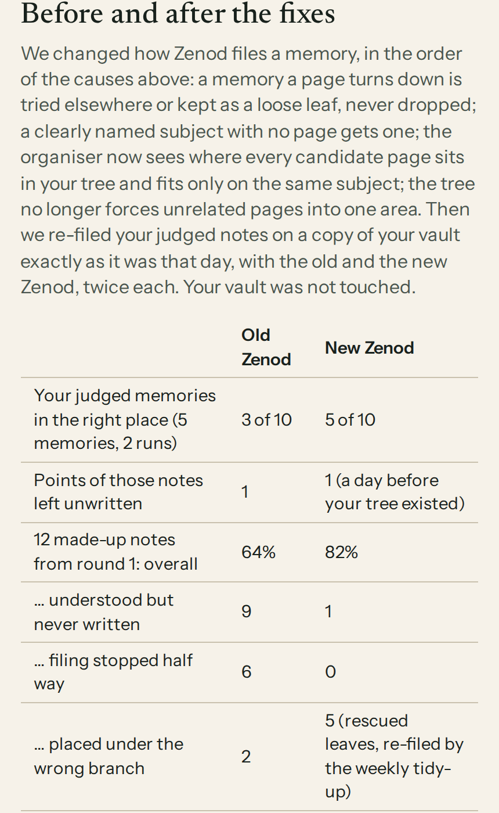

# E12-S8 evidence: where memories land, before and after the fixes (2026-11-08)

Row: E12-S8 in [EPIC-12](../zenod-app-chat-first-memory-graph-retrie.md), approved by Jordi in E12-A9. Run: run_b3b8aa23-c030-4440-bc25-6d8e36786877. Code: [PR #1517](https://github.com/zenod-ai/zenod/pull/1517), merged as `dce775e`; live `cloud.zenod.dev/api/health` sha dce775e (2026-11-08, publish run 42465857545: ci, publish, deploy green).

**Jordi's page (tailnet, private details stay there):** http://vps3.taild81fbb.ts.net:8913/, section "Before and after the fixes", above "Why it went wrong".

## What changed, in the order of S6 round 5's causes

1. **Never drop a rejected memory** (`engine.ts` fileTopicAssignments). When the reconciler rejects the chosen page (needs clarification, incompatible decisions), the topic is classified again without that page and filed where it fits. Failing that, or for a topic the organiser could not place, or one still pending on its last attempt, it becomes a provisional leaf under the best top-level branch. The leaf is cited, listed in the receipt (`reroutedFrom`) and published with the filing. A vault without a Tree.md behaves as before.
2. **A page per clearly named subject.** The classify prompt now creates a new page when no candidate is about the same subject, instead of filing on the nearest page of another product. The host places the new page as a leaf, so roots still emerge from content (EPIC-9 L-1).
3. **The organiser sees the tree.** Each candidate carries its place (`Working › Branch`). The top-level branches go in as a hint, and the branch heads of the strongest candidates join the candidate set. The classify and reconcile prompts say a page fits only when it is about the same subject.
4. **Team-report lines, dry run only.** `zenod tree report-lines` lists lines on meaning pages whose every citation is an agent report. `--apply` moves them word for word to `Archive/Agent reports/Moved report lines.md`, under the page and line each came from, and does not commit. Jordi's vault was not written. Review pages now show the exact line and leave subject-page mention lines out.
5. **No forced long-term area merges** (`treeDiscover.ts`). The default cap of 6 areas is gone, a small area joins another only if it reads like it, and the area similarity floor rose from 0.04 to 0.06.

## How it was measured

- **Judged notes.** The 4 voice notes behind Jordi's 5 misplaced filing items were re-filed through the production `enrich_memory` path (TaskJobQueue, same retry budget). Each ran on a throwaway copy of his vault at the exact revision the organiser saw then, never pushed. Old code is `main` at b83dfbf, new code is the PR. Each note ran twice per version, so 16 runs.
- **Tree item.** Tree discovery ran old against new on a read-only copy of the vault as it is today.
- **Report and mention items.** The new dry run ran on that copy.
- **Demo set.** The S6 round 1 set of 12 made-up notes ran on the demo vault with the same harness and scorer.
- **Model.** `deepseek/deepseek-v4.1-flash`, organiser reasoning effort `low`, identical for old and new. Without a reasoning setting the model used its whole output budget on reasoning and nearly every reconcile call failed. Production receipts show that failure only twice, so `low` is the closer match.
- **Cost:** about $0.76 in model calls.

## Counts

| | Old | New |
|---|---|---|
| Judged filing memories in the right place (5 memories × 2 runs) | 3 of 10 | 5 of 10 |
| Points of those notes left unwritten | 1 | 1 (a vault day before the tree existed) |
| Tree item: the two unrelated projects | one area, 25 pages | two areas, 16 and 9 pages; long-term areas 6 → 8 |
| Team-report lines found on user pages (dry run) | n/a | 372 on 32 pages, all from MCP agent reports, none from voice notes |
| Demo set, overall landing quality | 64% | 82% |
| … understood but never written | 9 | 1 |
| … filing stopped half way | 6 | 0 |
| … placed under the wrong branch | 2 | 5 |

## What did not get better

- Two of the five judged filing memories still land on Zenod pages in both versions. One is the inbox reflection, the other the post idea. On those days the vault had no page for the product they were about, and the organiser still judged a Zenod page relevant. In one run of another note, the organiser made the missing page itself.
- Rescued leaves hang under a top-level branch picked by word overlap. In the demo set, 4 rescued points hang under the wrong branch until the weekly sweep re-files them. Before, those points were never written at all.
- The classifier sometimes hits its 8,192-token output cap, because the model's reasoning shares that budget. This happens with old and new code alike, and it stopped one new run before filing. The cap is a deliberate budget from ZMR-28 and was left unchanged.

Nothing was sent to anyone, and Zenod's chat replies are unchanged (L-6, L-7). The harness and raw results live on VPS3 under `/tmp/s8/` and `~/e12-s6/run-s8.mjs`, outside the repo.

## Follow-up that needs Jordi's OK

Moving the 372 team-report lines off his pages. It is reversible: each line is kept word for word with its page and line. It still changes his vault, so it waits for his yes.
