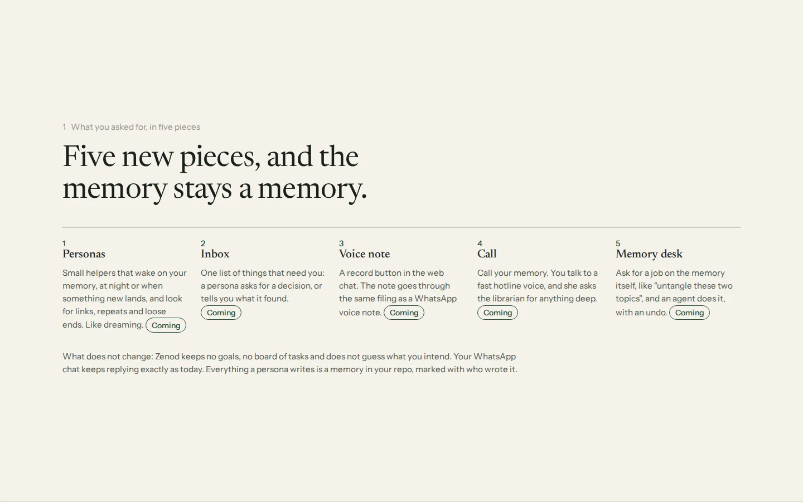
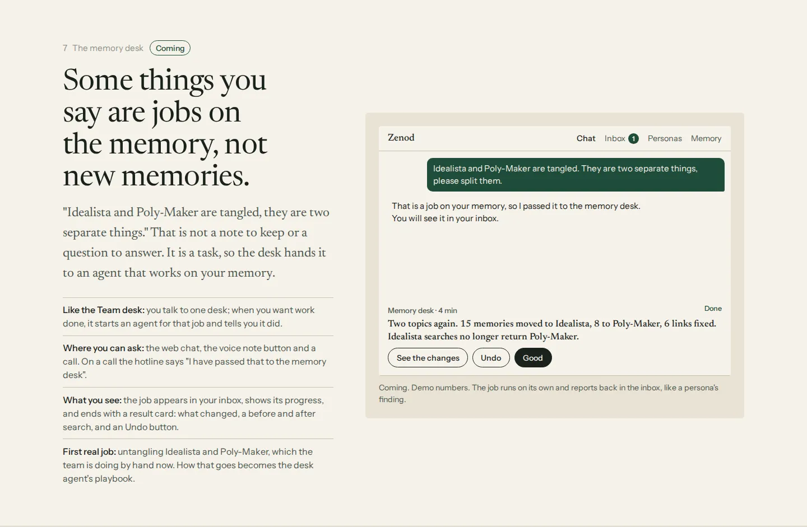
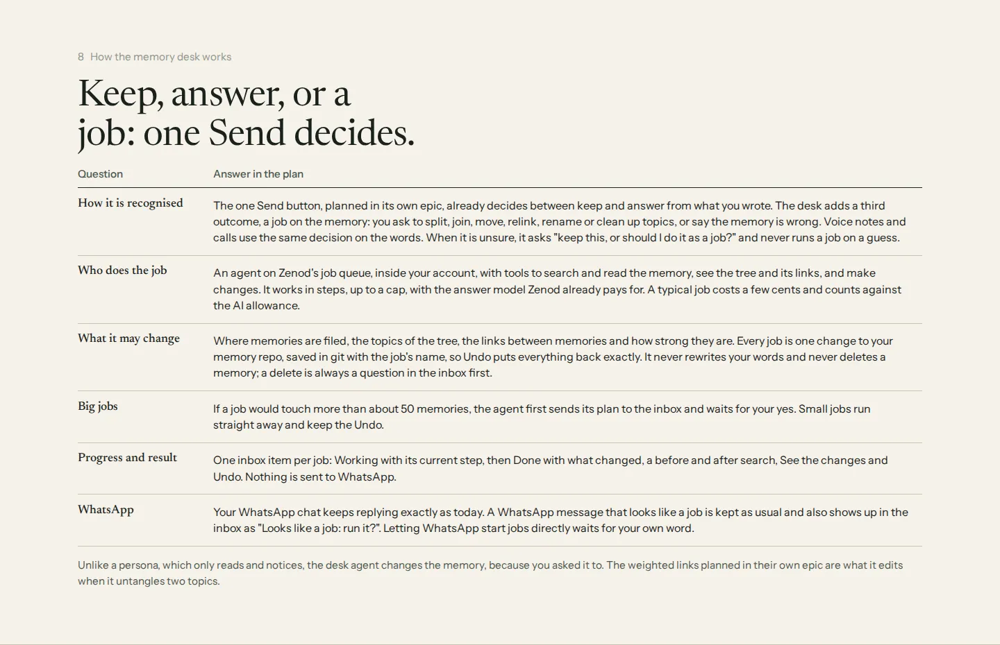
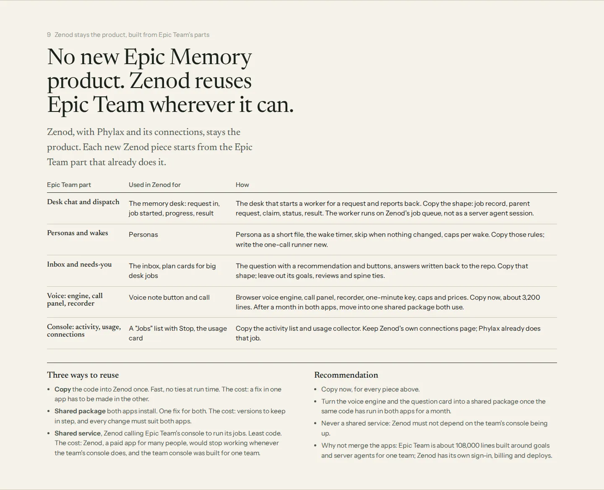
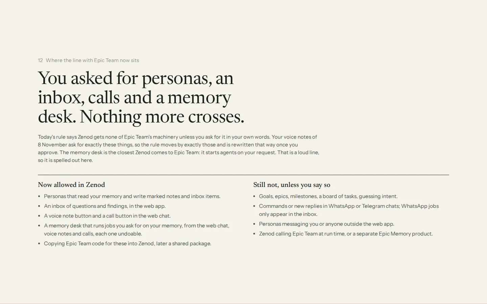
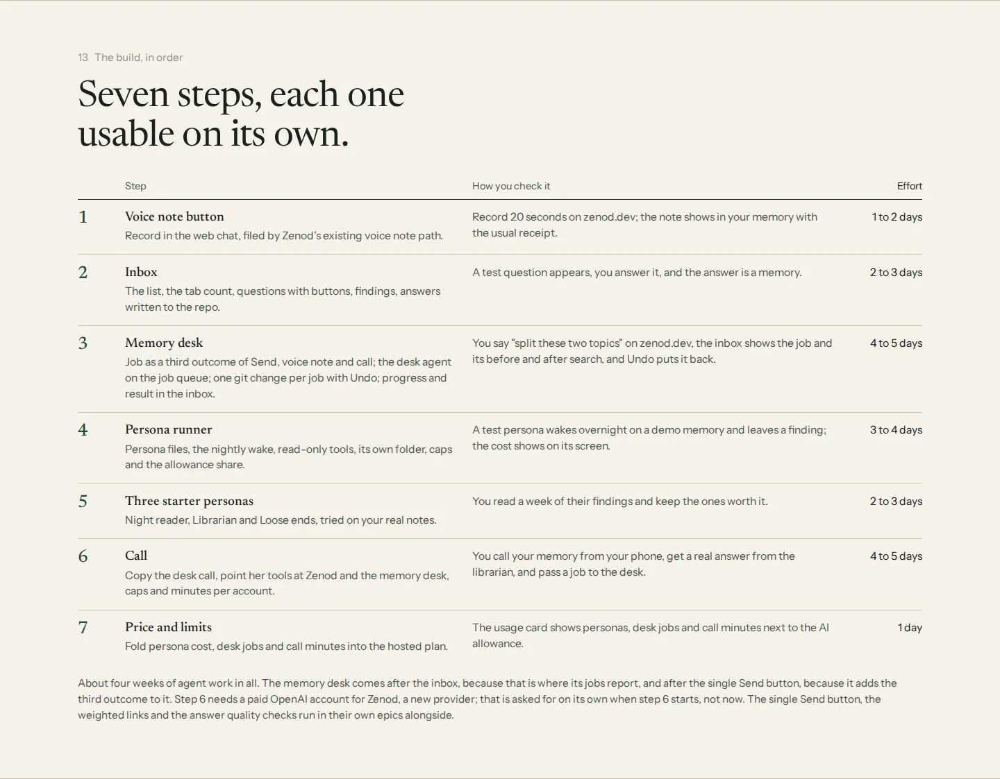
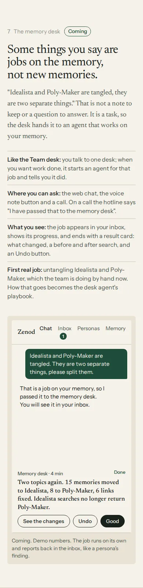

# E14-P1 evidence: the plan for personas, an inbox, voice notes and calls (2026-11-08)

Row: E14-P1 in [EPIC-14](../plan-personas-inbox-voice-and-calls-come.md) · Run: run_7c8bcea2-7110-4e91-8181-a0e620e7d6bf · Plan only, nothing built.

**The plan:** http://vps3.taild81fbb.ts.net:8921/e14-plan/ (tailnet, opens from Jordi's Mac). Source: [docs/epic14/index.html](../epic14/index.html), paper deck style ([DESIGN-LANGUAGE.md](../epic12/DESIGN-LANGUAGE.md), kit copied). `?still` shows final frames.

Asked by: Jordi's voice note 2026-11-08 15:51Z (`Log/2026-11-08.md#^e-7821a0`, read through the zenod MCP; not quoted here, the repo is public).

## What the page answers

| Brief item | Slide | Answer in one line |
|---|---|---|
| What each piece is for a Zenod user, with mockups | 1, 2, 4, 5, 6 | Personas, inbox, voice note button, call button; four mockups with demo data |
| How personas run on a user's memory | 3 | Nightly 02:00–06:00 wake (tree sweep window) or on new filing, skip if nothing new; read memory, write only to its own folder and the inbox; one cheap model call per wake (under 1 cent); a fixed $1 share of the $3 monthly AI allowance plus a per-wake cap; runs inside the tenant on the existing job queue as a new job kind |
| The inbox | 4 | Questions (recommendation first, 2–3 buttons) and findings; answers written to the memory repo; web app only, no WhatsApp pushes (root L-6) |
| Voice note + call, voice stack, cost per minute | 5, 6 | Voice note: browser recorder copied from agent_team, uploaded into Zenod's existing media_ingest path, Voxtral about $0.003/min. Call: OpenAI Realtime small model over WebRTC with a 1-minute minted key (agent_team desk design), tools search / ask the librarian (Zenod's ask engine) / keep on request / hang up; $0.02–0.03/min short Q&A, up to $0.13–0.20/min monologues (agent_team E42-S12 measurements); 10-minute calls, monthly minutes per account |
| Bootstrap vs merge, code that ports | 7 | Bootstrap in Zenod and copy: voice engine + call panel (~1.3k lines web), key mint/caps/prices (~1k server), record button (~0.9k); persona-as-file and ask shape as patterns only. Do not merge: agent_team is ~108k lines coupled to EpicSpine, goals and T3 sessions; revisit after naming and a month of shared voice code |
| What stays separate | 8 | Voice note ingestion stays Zenod's; goals/board stay Epic Team's; the seam stays MCP + `voice_note.captured` webhook, no run-time calls across |
| Does Zenod rest on EpicSpine | 9 | No. Zenod rests on the memory repo; they share "files in git are the truth, the DB is a copy"; personas borrow three habits (wake–do–report, ask with a recommendation, write answers back), not a dependency |
| Root L-7 line | 10 | Allowed now: personas reading memory and writing marked notes and inbox items, the web inbox, the two buttons, a one-time code copy. Still not: goals/epics/board/intent, chat commands or new chat replies, personas messaging anyone, run-time calls or shared code across the seam. L-7 to be rewritten this way on approval |
| Build steps with effort | 11 | 1 voice note button (1–2 d), 2 inbox (2–3 d), 3 persona runner (3–4 d), 4 three starter personas on real notes (2–3 d), 5 call (4–5 d; needs an OpenAI account for Zenod, asked when step 5 starts), 6 price and limits (1 d); about three weeks |

## Sources read

- agent_team: `console/server/src/voice/` (voice.ts caps and tools, prices.ts, notes.ts), `console/web/src/voice/` (engine.ts, CallPanel, VoiceNote.tsx, noteEngine.ts), `docs/status/e42-s12-cheaper-voice.md`, `team/personaRecord.ts`, `cycle/`, `inbox/`, `review/`, `docs/review-cards.md`.
- zenod: `apps/web/src/components/memory-chat.tsx`, `packages/server/src/{memoryChat,taskJobQueue,treeSweepSchedule,subscribers,transcribe,openrouterModels,customerMetering}.ts`, `packages/core/src/llm/aisdk.ts`, root L-6/L-7, EPIC-7 allowance (E7-A2: $3 AI per user per month).

## Screens

Desktop 1440×900, `?still`:

Phone 390 px:

## Next (round 1)

P1 closed `done (fed E14-A1)`: the Delivery Manager raised E14-A1 (approve the plan) in the spine. Nothing is built before that yes (EPIC-14 Non-Goals).

## Round 2 (2026-11-08, run run_476d6c3c-2f58-489f-a7b2-6016bdea14fb)

Asked by: Jordi's voice note 2026-11-08 16:09Z (`Log/2026-11-08.md#^e-6d07aa`, read in full through the zenod MCP; not quoted, the repo is public). E14-A1 was still unanswered. Same URL, re-rendered: http://vps3.taild81fbb.ts.net:8921/e14-plan/ — now 15 slides (cover + 14). Everything from round 1 kept; slides renumbered.

| Brief item | Slide | Answer in one line |
|---|---|---|
| Memory desk: what it is | 1, 7 | A fifth piece. A request that is a job on the memory (split, join, move, relink, rename, clean up, "this is wrong"), not a new memory, is handed to an agent that works on the memory, like the Team desk dispatches personas; mockup uses Jordi's own example (Idealista / Poly-Maker, already public as EPIC-19's title) with demo numbers |
| How it is recognised | 8 | EPIC-16's one Send decides keep / answer; the desk adds a third outcome, **job**. Voice notes and calls use the same decision on the transcript; on a call the hotline says it passed the job on. Unsure → asks "keep, or do it as a job?", never runs a job on a guess |
| Who runs it | 8 | An agent on Zenod's job queue inside the tenant, step-capped tool loop (search, read, tree and links, change), on the answer model Zenod already pays for; a few cents per job, counted in the AI allowance |
| What it may change | 8 | Filing place, tree topics, links and their strengths (ties to EPIC-18 weighted graph). Each job = one git commit on the user's memory repo named after the job; Undo = revert. Never rewrites the user's words, never deletes (delete = inbox question). Over ~50 memories touched → plan card in the inbox first |
| How the user sees progress and result | 7, 8 | One inbox item per job: Working (current step) → Done (what changed, before/after search, See the changes, Undo). Nothing to WhatsApp |
| WhatsApp and root L-6 | 8, 12 | WhatsApp replies stay exactly as today (L-6). A WhatsApp message that looks like a job is kept as usual and also appears in the inbox as "Looks like a job: run it?". Direct WhatsApp jobs wait for Jordi's own word (raised in E14-A2) |
| First real job | 7 | EPIC-19 (untangle Idealista and Poly-Maker) is done by the team by hand now; its log becomes the desk agent's playbook and first test case |
| No Epic Memory product | 9, 12 | Zenod (with Phylax and its connections) stays the product; "a separate Epic Memory product" added to the "still not" list |
| Epic Team modules reused | 9 | agent_team @ `546b15bb`: desk chat + dispatch (`console/server/src/desk/dispatch.ts`, `desk/session.ts`) → memory desk job record (parent request, claim, status, result), worker on Zenod's queue not a T3 session; personas + wakes (`team/personaRecord.ts`, `cycle/wakeGate.ts`, `cycle/skipUnchanged.ts`) → persona files and wake rules, runner new; inbox / needs-Jordi (`inbox/asks.ts`, `inbox/raise.ts`, `inbox/answered.ts`, `inbox/writeClone.ts`) → question card + write-back, minus goals/reviews/spine; voice (`voice/voice.ts`, `voice/notes.ts`, `console/web/src/voice/` engine, CallPanel, VoiceNote, noteEngine; ~3.2k lines) → voice note button and call; console pieces (activity list with Stop, `usage/collector.ts` + `prices.ts`) → a Jobs list and the usage card; Zenod keeps its own connections page (Phylax) |
| How reused, trade-off | 9 | Copy (fast, no run-time tie; cost: fixes made twice) vs shared package (one fix; cost: versions in step, changes must suit both) vs shared service (least code; cost: Zenod, multi-tenant and paid, goes down with the single-team console; breaks L-7's no-run-time-calls seam). Recommend copy now, shared package for voice engine + question card after a month in both, never a shared service, no merge |
| Root L-7 line | 12 | "Now allowed" adds the memory desk (web chat, voice notes, calls, each job undoable); flagged loudly as the closest Zenod comes to Epic Team machinery, since it starts agents on request |
| Build steps | 13 | Seven steps, about four weeks: 1 voice note button, 2 inbox, **3 memory desk (4–5 d)**, 4 persona runner, 5 starter personas, 6 call (now also passes jobs to the desk; OpenAI account asked when it starts), 7 price and limits (adds desk jobs). Desk after the inbox (it reports there) and after EPIC-16's Send (it adds the third outcome) |

Screens, desktop 1440×900 `?still` and phone 390 px:

## Next (round 2)

P1 stays `done (fed E14-A2)`: the Delivery Manager re-posts the ask as E14-A2 (approve the round 2 plan, and say whether WhatsApp may start memory desk jobs directly or only through the inbox). Nothing is built before that yes.
