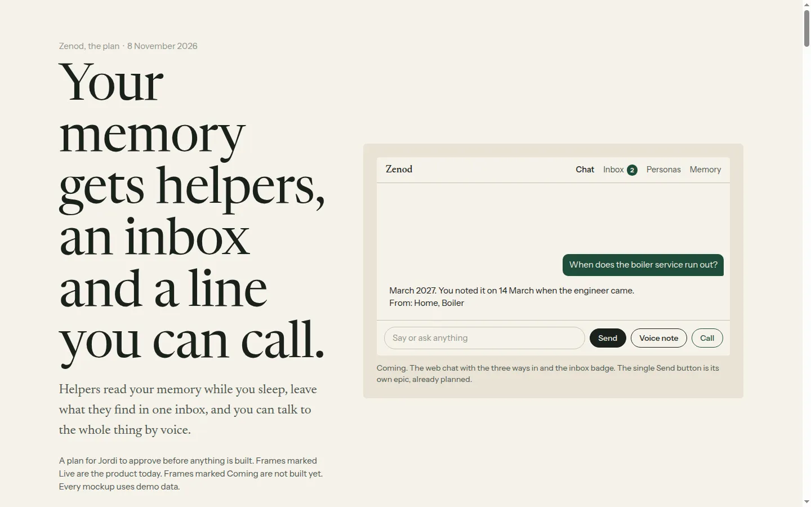
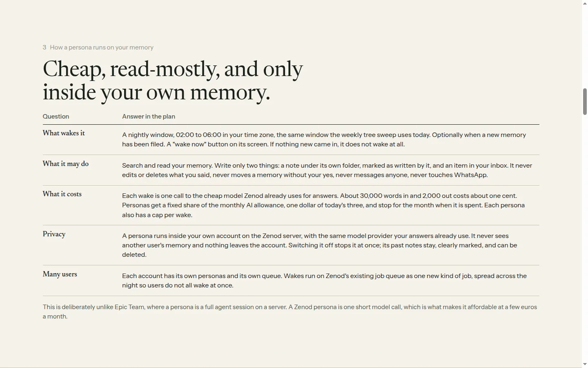
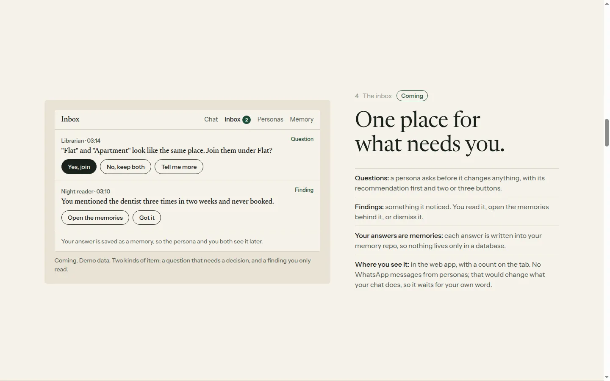
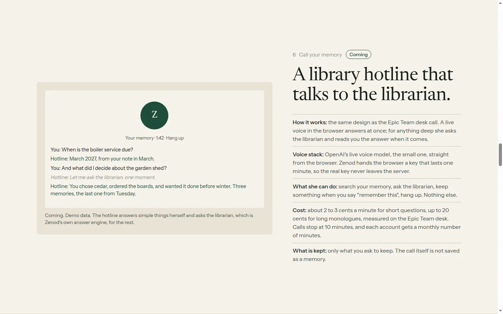
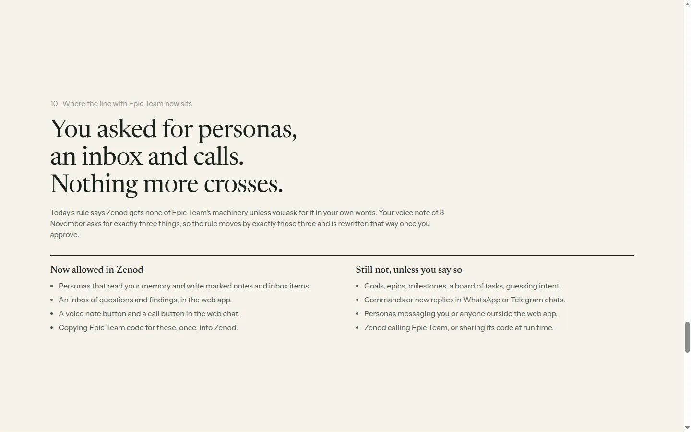
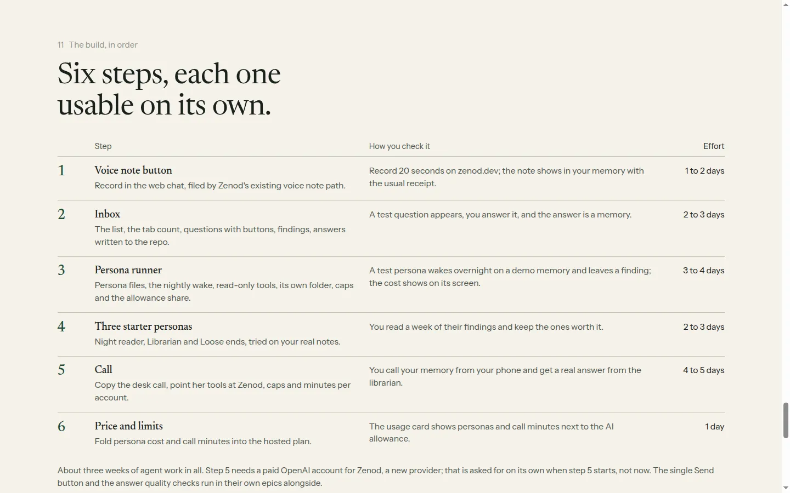
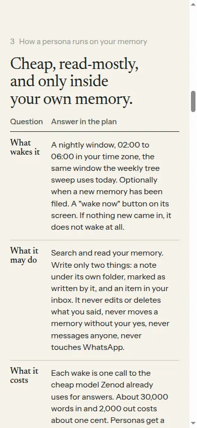

# E14-P1 evidence: the plan for personas, an inbox, voice notes and calls (2026-11-08)

Row: E14-P1 in [EPIC-14](../plan-personas-inbox-voice-and-calls-come.md) · Run: run_7c8bcea2-7110-4e91-8181-a0e620e7d6bf · Plan only, nothing built.

**The plan:** http://vps3.taild81fbb.ts.net:8921/e14-plan/ (tailnet, opens from Jordi's Mac). Source: [docs/epic14/index.html](../epic14/index.html), paper deck style ([DESIGN-LANGUAGE.md](../epic12/DESIGN-LANGUAGE.md), kit copied). `?still` shows final frames.

Asked by: Jordi's voice note 2026-11-08 15:51Z (`Log/2026-11-08.md#^e-7821a0`, read through the zenod MCP; not quoted here, the repo is public).

## What the page answers

| Brief item | Slide | Answer in one line |
|---|---|---|
| What each piece is for a Zenod user, with mockups | 1, 2, 4, 5, 6 | Personas, inbox, voice note button, call button; four mockups with demo data |
| How personas run on a user's memory | 3 | Nightly 02:00–06:00 wake (tree sweep window) or on new filing, skip if nothing new; read memory, write only to its own folder and the inbox; one cheap model call per wake (under 1 cent); a fixed $1 share of the $3 monthly AI allowance plus a per-wake cap; runs inside the tenant on the existing job queue as a new job kind |
| The inbox | 4 | Questions (recommendation first, 2–3 buttons) and findings; answers written to the memory repo; web app only, no WhatsApp pushes (root L-6) |
| Voice note + call, voice stack, cost per minute | 5, 6 | Voice note: browser recorder copied from agent_team, uploaded into Zenod's existing media_ingest path, Voxtral about $0.003/min. Call: OpenAI Realtime small model over WebRTC with a 1-minute minted key (agent_team desk design), tools search / ask the librarian (Zenod's ask engine) / keep on request / hang up; $0.02–0.03/min short Q&A, up to $0.13–0.20/min monologues (agent_team E42-S12 measurements); 10-minute calls, monthly minutes per account |
| Bootstrap vs merge, code that ports | 7 | Bootstrap in Zenod and copy: voice engine + call panel (~1.3k lines web), key mint/caps/prices (~1k server), record button (~0.9k); persona-as-file and ask shape as patterns only. Do not merge: agent_team is ~108k lines coupled to EpicSpine, goals and T3 sessions; revisit after naming and a month of shared voice code |
| What stays separate | 8 | Voice note ingestion stays Zenod's; goals/board stay Epic Team's; the seam stays MCP + `voice_note.captured` webhook, no run-time calls across |
| Does Zenod rest on EpicSpine | 9 | No. Zenod rests on the memory repo; they share "files in git are the truth, the DB is a copy"; personas borrow three habits (wake–do–report, ask with a recommendation, write answers back), not a dependency |
| Root L-7 line | 10 | Allowed now: personas reading memory and writing marked notes and inbox items, the web inbox, the two buttons, a one-time code copy. Still not: goals/epics/board/intent, chat commands or new chat replies, personas messaging anyone, run-time calls or shared code across the seam. L-7 to be rewritten this way on approval |
| Build steps with effort | 11 | 1 voice note button (1–2 d), 2 inbox (2–3 d), 3 persona runner (3–4 d), 4 three starter personas on real notes (2–3 d), 5 call (4–5 d; needs an OpenAI account for Zenod, asked when step 5 starts), 6 price and limits (1 d); about three weeks |

## Sources read

- agent_team: `console/server/src/voice/` (voice.ts caps and tools, prices.ts, notes.ts), `console/web/src/voice/` (engine.ts, CallPanel, VoiceNote.tsx, noteEngine.ts), `docs/status/e42-s12-cheaper-voice.md`, `team/personaRecord.ts`, `cycle/`, `inbox/`, `review/`, `docs/review-cards.md`.
- zenod: `apps/web/src/components/memory-chat.tsx`, `packages/server/src/{memoryChat,taskJobQueue,treeSweepSchedule,subscribers,transcribe,openrouterModels,customerMetering}.ts`, `packages/core/src/llm/aisdk.ts`, root L-6/L-7, EPIC-7 allowance (E7-A2: $3 AI per user per month).

## Screens

Desktop 1440×900, `?still`:

Phone 390 px:

## Next

P1 closes `done (fed E14-A1)`: the Delivery Manager raises E14-A1 (approve the plan) in the spine. Nothing is built before that yes (EPIC-14 Non-Goals).
