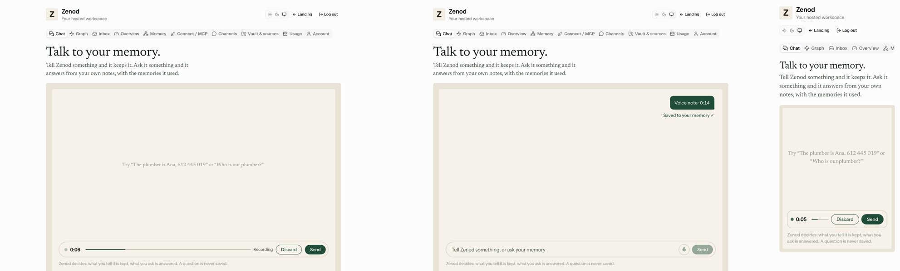

# E14-S1 evidence: a voice note button in the cloud chat (2026-11-08)

**Evidence page (tailnet, no password):** http://vps3.taild81fbb.ts.net:8921/e14-s1/

Row: S1 in [EPIC-14](../plan-personas-inbox-voice-and-calls-come.md). Run: run_7087d0b7-a06b-40b3-b984-64c9fd615bc6. PR [#1523](https://github.com/zenod-ai/zenod/pull/1523), merged as `ded82b7`, live on cloud.zenod.dev. Plan: step 1 of http://vps3.taild81fbb.ts.net:8921/e14-plan/ (approved, E14-A2).

Left to right: desktop while recording (the length, a level line, Discard and Send), the same chat after Send (a "Voice note · 0:14" bubble and "Saved to your memory ✓"), and a 390 px phone while recording (one row, no sideways scroll).

## What was built

- A microphone button in the chat's compose bar, next to the one Send. Tap it to record. The bar then shows the length, a level line, **Discard** and **Send**. Send stops the recording and sends it.
- The audio goes to a new route on the signed-in customer's own tenant. From there it goes into **the same media seam a WhatsApp voice note uses**: the raw audio is archived, Zenod transcribes it, writes a Log entry and files it into the topic pages. The chat shows the usual Keep receipt as the filing goes on.
- Caps and metering work as for any capture. The tenant's AI allowance is checked first (over the allowance the route answers 429 and keeps nothing). The transcription is metered on the tenant's own ledger. A retried upload of the same audio is filed only once. The longest note is 10 minutes (the app stops and sends at that length) and the largest upload is 8 MB.
- Phones and desktops: opus in webm where the browser has it (Chrome, Firefox, Android) and AAC in mp4 otherwise (iPhone Safari). If the microphone is blocked, the chat says how to allow it in the site settings. The screen is kept awake while recording. If the phone locks or another app takes the microphone, what was said is kept and the note waits for Send or Discard. A failed upload keeps the recording, so the user can tap Send again.
- The recorder is adapted from Epic Team's voice note engine (agent_team `console/web/src/voice/noteEngine.ts` @ `546b15bb`). It was copied, as the plan's module-reuse section says, and nothing calls Epic Team at run time (root L-7). The formats, microphone handling, level meter and locked-phone pause come from there. Zenod's media seam takes one file, so a note is one recording, not Epic Team's two-minute parts.
- WhatsApp is unchanged (root L-6). A web voice note's Log entry says `source: web`.

## End-to-end test with a recorded demo clip

The demo clip was a 13 s spoken note made with a local voice (Kokoro). Everything in it is invented: "Note for the boat repair. The yard in Porthaven quoted nine hundred and forty euros for new antifouling, and they can start on the twelfth of December. Ask Marta to compare it with the Westbay quote before Friday."

Setup: the built code of PR #1523 ran on VPS3 localhost as one hosted tenant. It used the real customer-layer routes behind a real customer session, a real tenant `Runtime` (job queue, raw archive, transcription, usage ledger, AI allowance), and a real engine over the made-up demo vault (no real user data). Headless Chromium used the clip as its microphone (`--use-file-for-fake-audio-capture`) and tapped through the chat at 1280×900 and 390×844. Model and transcription calls went to OpenRouter through a relay. Each call ran a one-shot script on VPS1 that took the shared key from `secret run`, so the key never left VPS1 and was never printed. The relay was capped at 60 calls; 14 were used across all runs. It was stopped and removed afterwards.

| Step | Result |
|---|---|
| Browser formats | `audio/webm;codecs=opus,audio/mp4` both supported; webm chosen |
| Recording | bar showed `0:06` at 6 s; level line moving |
| Send | "Voice note · 0:14" bubble 0.1–0.2 s after the tap; "Saved to your memory. Filing it…" |
| Media seam | `media_ingest` job, key `tenant-demo:web-voice:<sha256>`, `contentType: voice_note`, `sourceHint: Zenod app voice note`, duration 14.8 s |
| Raw archive | `…/zenod-app-voice-note-2026-11-08T…webm` plus its sha256 |
| Transcript (openrouter openai/whisper-large-v3-turbo) | "Note for the boat repair. The yard in Porthaven quoted 940 euros for new antifouling, and they can start on the 12th of December. Ask MARTA to compare it with the West Bay quote before Friday." |
| Log entry | `Log/2026-11-08.md#^e-…` "Voice note … ingested through Zenod media seam", `source: web`, `content-type: voice_note` |
| Filing | `enrich_memory` done: `Projects/Boat repair.md`, `Projects/Boat repair/2023 Porto quotes.md` |
| Receipt in the chat | "Saved to your memory ✓" (8 s after Send on the last run) |
| Phone 390 px | recording bar on one row, no sideways scroll; Discard returns to the microphone and sends nothing |

The first runs found two problems, fixed before the final run. A failed note said "Try Keep again", so a voice note now says "Record it again". After the one-Send restyle the Discard button had lost its outline, so it now has its own style.

## Tests

- Server (`packages/server/test/memoryChat.test.ts`, 2 new): sign-in required; non-audio is refused (415); empty audio is refused (400); over 8 MB is refused (413); no account gives 404. The audio goes to `media_ingest` with the voice-note fields, and iPhone mp4 is saved as `.m4a`. A retry files the note once. The receipt is shown only to its owner, and a Keep id is not a voice note. Over the AI allowance the route answers 429 and nothing is kept. 21/21 pass.
- Web (`apps/web/src/components/voice-note-button.test.tsx`, 9 new): length and format; iPhone AAC; a phone lock keeps the audio; stop and send at the cap; too short or Discard sends nothing; the blocked-microphone message; a failed upload is retried with Send; the chat flow from the compose bar to the polled receipt; no microphone in the browser. The full web suite passes 166/166.

## Live

- publish.yml on `ded82b72` ran `ci` (success), then publish, then deploy (success), at about 18:45Z on 2026-11-08.
- `https://cloud.zenod.dev/api/health` reports `"status":"ok"` and `"sha":"ded82b72fc70e5b3b4d2dd47b6d80e02f8cd1d8e"`.
- The live routes exist and need a session: `POST /api/console/voice-note` without a session gives 401, and `GET /api/console/voice-note/<id>` gives 401 (an unknown route would fall through to the app).
- The live app bundle (`/assets/index-Bz366ucB.js`) contains "Record a voice note", "Send voice note" and `/api/console/voice-note`.

## Not proven yet

- **Live use signed in on cloud.zenod.dev.** No hosted test account with a vault exists apart from Jordi's own; one comes with E7-A15 (the agents' Google sign-in). Until then it is proven on a local run of the shipped code, plus the live checks above.
- **A real iPhone.** The mp4/AAC path is covered by tests and by Chromium's format check. It has not been recorded on a real iPhone; Jordi's first try on his phone is that check.
