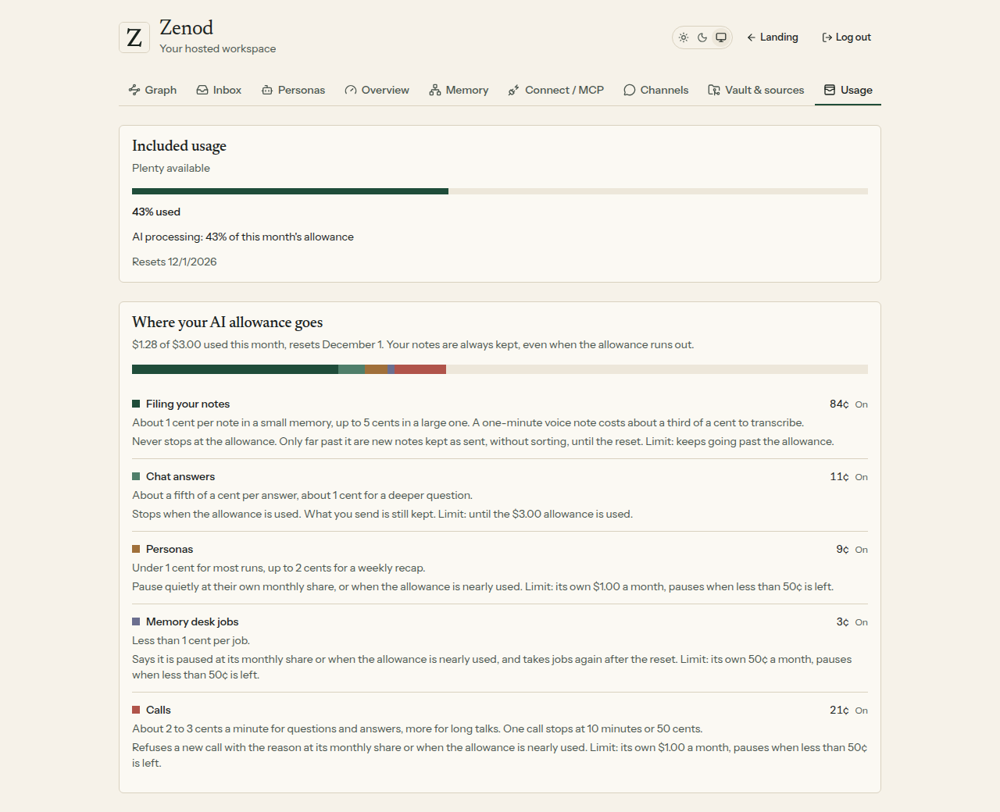
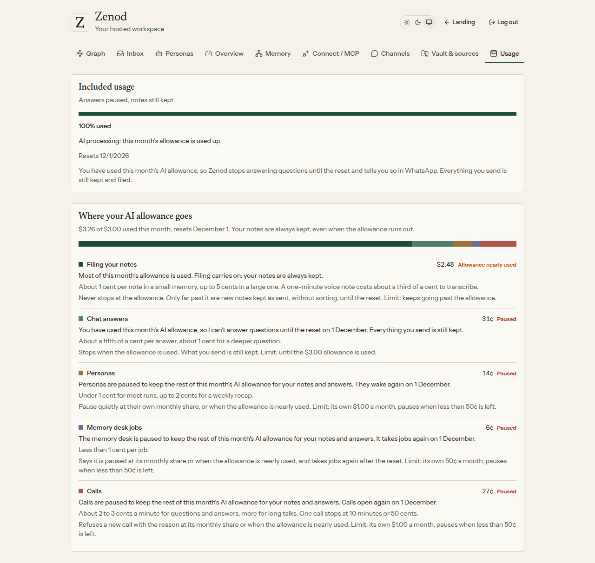

# E14-S10 — Price and limits for personas, calls and desk jobs

Date: 2026-11-09 · Run: run_cb69a26b-5881-45f5-a80f-5ba5c3facaf2 · Epic: EPIC-14 · PR [#1544](https://github.com/zenod-ai/zenod/pull/1544) · No model spend, no Stripe change.

**Bottom line.** Better. The AI allowance now has one set of rules for everything, and your notes are never lost to it. Before, once a user's $3 was used, Zenod stopped everything, filing included, and a WhatsApp note got "It was not saved". Now filing carries on past the $3, to $6. Chat answers stop at $3 and say that everything sent is still kept. Personas, desk jobs and calls each keep their own monthly share ($1, $0.50, $1) and pause when less than $0.50 is left, so the end of the month is kept for notes and answers. The Usage tab shows this month's spend on each, what each costs and what happens at its cap. The admin page shows spend per feature for every tenant. All caps live in one place and change with one setting. **Live on `8c0da539`** (cloud.zenod.dev health, 2026-11-09 01:12 UTC; signed out, `/api/console/usage` answers 401 and `/api/admin/usage` 404, as designed). Nobody has opened the new Usage section in the live app yet, because agents cannot sign in there (that waits on E7-A15). The screens below are the shipped code on a local copy with two recorded months.

**Pricing proposal (for you to decide):** [one page](http://vps3.taild81fbb.ts.net:8921/e14-s10-pricing/). We recommend keeping €9 and including personas, calls and desk jobs within the $3 allowance and these caps: a typical user costs $1.30 to $2.40 of AI a month, a heavy user like you at most $6.

## The rules (limits model)

| Feature | Own share a month | Near the cap | At the cap |
|---|---|---|---|
| Filing your notes | none | from 80% of the allowance it says filing carries on | never stops at $3. Runs to $6 (allowance plus $3). Past $6, text is kept as sent with filing pending and files are archived raw |
| Chat answers | none | from 80% it says answers will stop | stops at $3: "I can't answer questions until 1 December. Everything you send is still kept." A capped WhatsApp or web message is kept as a note |
| Personas | $1 | from 80% of their share, or when the allowance is nearly used | pause quietly at $1, or once less than $0.50 of the allowance is left. The run log says why |
| Desk jobs | $0.50, and 20 a day | same | refuse with a message at $0.50, at 20 a day, or once less than $0.50 is left |
| Calls | $1. One call $0.50 or 10 minutes. All Zenod calls $10 | same | refuse a new call with the reason, or hang up |

Where it lives: `packages/server/src/limits.ts`, overridable with `ZENOD_LIMITS_JSON`; the allowance itself is still `ZENOD_TENANT_MONTHLY_ALLOWANCE_USD` ($3). The usage ledger now records each model call's feature: by its job (filing, chat, desk), by the persona runner, by the call meter, else by its operation. Earlier rows are read by their operation.

## Before and after, for a heavy user past $3

| | Before | After |
|---|---|---|
| A WhatsApp note | "It was not saved" | kept and filed, until $6 |
| A question in the chat | refused, the question lost | refused with the reason, the words kept as a note |
| A voice note from the app or another app | refused | kept and filed |
| An answer to an inbox question | refused | kept |
| Personas, desk, calls | stopped only at $3 | pause at $2.50 or at their own share, with the reason |

The phone view of the same tab: [phone](e14-s10/03-phone.png).

## Checks

- New tests (`limits.test.ts`, 13): config and overrides, operation and job to feature, each feature's near and at-cap point, the usage view, the ledger by feature (explicit, context, operation, old files), the runtime stopping each feature as the month fills, the desk at its own share, a store running while everything else is stopped.
- Changed tests, now pinning the new rules: a capped WhatsApp turn keeps the words under the channel's key; keep, voice note, Send at the cap; the desk and personas stop messages; the admin view only for the owner; the Usage route only shows a user their own spend.
- Server 1,591 tests, web 200 tests, typecheck, Phylax bundle check: all pass. CI green on the PR before merge.
- Local check: the shipped routes behind a real customer session on a real hosted runtime with a $3 allowance. [local-serve.mjs](e14-s10/local-serve.mjs) and [local-shoot.mjs](e14-s10/local-shoot.mjs). The two months are recorded rows on the real usage ledger (typical $1.28, heavy $3.26), no model was called.

## Not proven live

- The Usage section on cloud.zenod.dev, signed in: waits on E7-A15. You can open it yourself: cloud.zenod.dev, tab Usage.
- A real user reaching a cap: nobody is near one this month.
