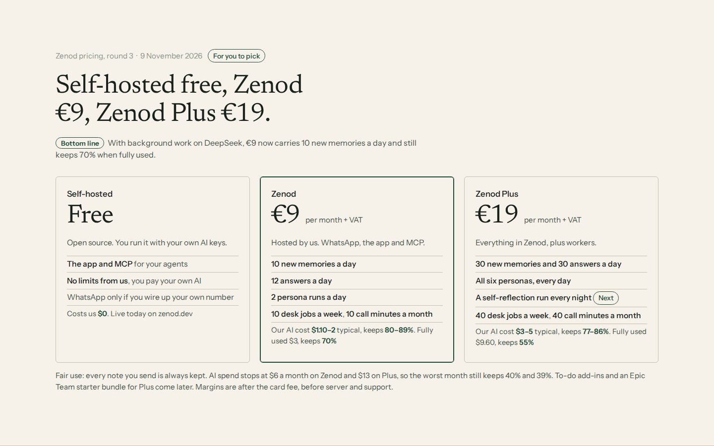
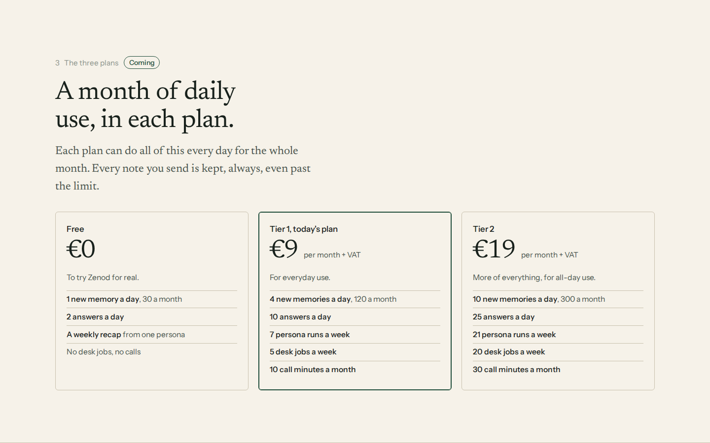
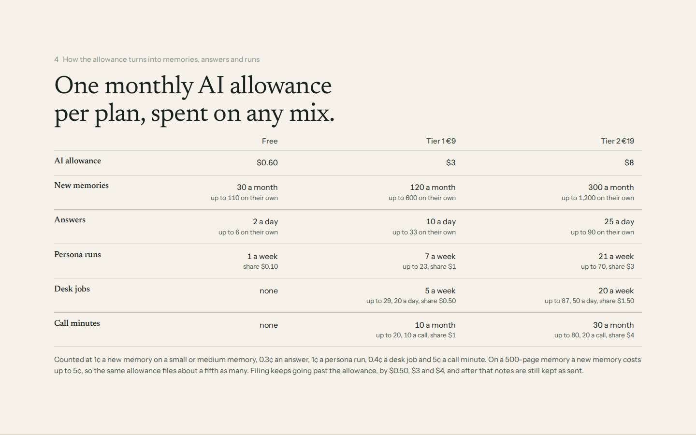

# E14-S10 — Zenod plans: round 3 (self-hosted, Zenod, Zenod Plus) and round 2 below

## Round 3 — the simple landing place, with background work on DeepSeek

Date: 2026-11-09 · Run: run_2777f2ed-ae38-408a-afc6-9bb506b13547 · Epic: EPIC-14 · Presentation only: no price, Stripe product, plan, limit or code was changed, no model was called.

**Deck:** [http://vps3.taild81fbb.ts.net:8921/e14-s10-tiers/](http://vps3.taild81fbb.ts.net:8921/e14-s10-tiers/) (same URL as round 2; round 3 is the first four slides, round 2 follows; source copy in [e14-s10-r3/](e14-s10-r3/index.html)).

**Bottom line.** Self-hosted free, Zenod €9, Zenod Plus €19. With background work on DeepSeek, €9 carries 10 new memories a day and still keeps 70% when fully used.

Jordi's rules (E14-A5 answer and the S10 relaunch, recorded as decision 2026-11-09 "Plans"): free is self-hosted only; every paid plan is hosted and includes WhatsApp; the top plan is about workers and self-reflection; background work runs on DeepSeek; the first version stays simple.

### 1. Re-cost per unit

Today's route: filing on DeepSeek V4.1 Flash through OpenRouter (no cache saving counted, matches measured 0.6¢ and about 5¢ a note), personas and desk jobs on Gemini 3.1 Flash Lite. New route: background (filing, personas, desk jobs, self-reflection) on DeepSeek's own API, V4.1 Flash: $0.15 per million new input tokens, $0.003 for repeated (cached) input, $0.60 output, off-peak; double at peak, weekdays 01–04 and 06–10 UTC (prices as read on 2026-11-08 for [E15-Q0](e15-q0-2026-11-08.md)). Chat answers, deeper questions and calls stay on today's models.

| One of each | Tokens in / out | Today | On DeepSeek | Change | Assumption |
|---|---|---|---|---|---|
| Text note filed, small memory | 30k / 2.1k (3 calls) | 0.58¢ | 0.34¢ | −42% | 80% of input repeated, half at peak price |
| Text note filed, 500-page memory | 280k / 10k | 4.8¢ | 1.6¢ | −66% | 90% repeated, half at peak |
| One-minute voice note | transcription + small filing | 0.88¢ | 0.63¢ | −28% | transcription 0.3¢ unchanged |
| Persona run | 8k / 0.6k | 0.29¢ | 0.07¢ | −75% | 70% repeated, scheduled off-peak |
| Desk job | 12k / 1k | 0.45¢ | 0.20¢ | −55% | 60% repeated, half at peak |
| Self-reflection run, 30 steps (new) | 200k / 15k | 7.3¢ | 1.5¢ | −79% | 80% repeated, scheduled off-peak |
| Chat answer | | 0.2¢ | 0.2¢ | same | today's chat model |
| Deeper question | | 1¢ | 1¢ | same | kept as today |
| Call minute | | 2–3¢ | 2–3¢ | same | OpenAI key, unchanged |

Token sizes are fitted so today's prices reproduce the measured costs; the repeated share is our estimate, to be measured in the first week on the new route. Script: [cost.py](e14-s10-r3/cost.py).

New planning rates (with safety margin): 0.4¢ a new memory, 0.3¢ an answer, 0.2¢ a persona run, 0.2¢ a desk job, 2¢ a self-reflection run, 5¢ a call minute. Round 2's were 1¢, 0.3¢, 1¢, 0.4¢, none, 5¢.

### 2. What it does to the margin ("margins would explode")

| Who | AI today | On DeepSeek | €9 keeps |
|---|---|---|---|
| Light user (2 voice notes, 4 questions a day) | $1.40 | $1.20 | 86% → 88% |
| Jordi (4 notes a day into 540 pages) | about $5 | about $2.50 | 50% → 75% |
| Round 2's €9 plan, fully used | $2.99 | $1.98 | 70% → 80% |
| The new €9 plan, fully used (10 memories, 12 answers a day) | $5.35 | $2.99 | 46% → 70% |

The saving is all in background work: big for heavy savers and large memories, small for light users whose cost is mostly answers. A flat subscription (OpenCode Go: $10 buys $100 of V4.1 Flash use) would cut background about ten times more, but it is sold for coding agents and watched for abuse; we price on the pay-as-you-go API and count the subscription only as upside once its terms are checked.

### 3. The landing place

| | Self-hosted | Zenod | Zenod Plus |
|---|---|---|---|
| Price | free | €9 a month + VAT | €19 a month + VAT |
| Who runs it | you, open source, your own AI keys | hosted by us | hosted by us |
| Includes | the app and MCP; WhatsApp only on your own number | WhatsApp, the app, MCP | everything in Zenod, plus workers |
| New memories | your own AI bill | 10 a day | 30 a day |
| Answers | your own AI bill | 12 a day | 30 a day |
| Personas | yours | 2 runs a day | all six, every day |
| Self-reflection | | | a nightly run (next, after launch) |
| Desk jobs | yours | 10 a week | 40 a week |
| Call minutes | | 10 a month | 40 a month |
| AI allowance (what the units fit) | | $3 (full mix $2.99) | $10 (full mix $9.60) |
| Fair-use ceiling | | $6 a month, notes always kept | $13 a month, notes always kept |
| Our AI cost, typical | $0 | $1.10–2 | $3–5 |
| Keeps after card fee, typical | | 80–89% | 77–86% |
| Keeps, fully used | | 70% | 55% |
| Keeps, worst month at the ceiling | | 40% | 39% |

Card fee 1.5% + €0.25; €1 = $1.156; €9 nets $9.96, €19 nets $21.35. Server and support are not split per user.

### 4. First version now, and later

- **Now:** Self-hosted (already on zenod.dev). Zenod €9: today's plan, price and $3 allowance; moving background to DeepSeek's own API is what turns 4 memories a day into 10 (needs a DeepSeek account and key: Jordi's call, money and a new key). Zenod Plus €19: one new Stripe price, a $10 allowance per Plus account, all six personas on daily, one pricing card, about 2 days via a gated PR.
- **Next:** nightly self-reflection runs for Plus (a multi-step persona run), about 1 to 2 days once Plus exists.
- **Later:** to-do add-ins and an Epic Team starter bundle for Plus. The bundle is a joint offer only; Zenod and Epic Team stay separate products, and any build across that seam goes to Jordi first with its own warning (root L-7).
- **Left out on purpose:** a hosted free plan, an MCP-only entry plan, a middle plan.

### Checks

- Every number recomputed by [cost.py](e14-s10-r3/cost.py) (unit costs, full mixes $2.99 and $9.60, light user $1.42 → $1.20, Jordi $5 → $2.50 scaled from his measured month, margins from net price).
- Deck: `paper_deck.py check` ok (brand paper); HTTP 200 on the tailnet URL; every slide looked at 1440×900 and at 390 px wide (no sideways scroll), [shoot.cjs](e14-s10-r3/shoot.cjs).

---

## Round 2 — E14-S10 round 2 — Free, Tier 1 and Tier 2: costs, what each includes, and a recommendation

Date: 2026-11-09 · Run: run_41138f48-95ad-4483-ba03-af772b3ca909 · Epic: EPIC-14 · Presentation only: no price, Stripe product, plan or limit was changed, no model was called.

**Deck:** [http://vps3.taild81fbb.ts.net:8921/e14-s10-tiers/](http://vps3.taild81fbb.ts.net:8921/e14-s10-tiers/) (tailnet, 9 slides, paper-deck style; source copy in [e14-s10-r2/](e14-s10-r2/index.html)).

**Bottom line.** Better. Three plans: **Free €0, Tier 1 €9 (today's plan, unchanged) and Tier 2 €19.** Every paid plan keeps at least **38%** of its price after the heaviest month the limits allow, and **70 to 83%** in a typical month. A free user costs **$0.20 to $0.40** a month, **$1.10** at most. Today's €9 plan is Tier 1 word for word. Jordi's own use (about $5 a month) fits Tier 2. Recommendation: all three, with €9 kept as it is.

## 1. What one of each costs us

| Unit | Cost | Source |
|---|---|---|
| A text note filed | 0.6¢ on a small memory, up to 5¢ on a 500-page memory | E12-S6 (12 notes $0.07), E12-S8 (about $0.05 a note on his vault), via E15-Q0 round 3 |
| A one-minute voice note | 0.9¢ (0.3¢ transcription + filing) | E15-Q0 round 3 |
| A chat answer | 0.2¢; a deeper question 1¢ | E12-S1b; two live `ask_brain` reads, E15-Q0 round 2 |
| A persona run | under 1¢; weekly recap about 2¢ | S4 runs |
| A desk job | 0.07¢ question, 0.2 to 0.4¢ tidy-up | S3 runs |
| A call minute | 2 to 3¢ back and forth, up to 20¢ long talking | S8 live calls $0.0104 and $0.0103; Epic Team call measurements |
| Storage | about 0¢: his 540-page memory is 11 MB, held in the user's Drive or GitHub | read-only copy at 7f35d26 |
| Card fee | 45¢ on €9, 62¢ on €19 (1.5% + €0.25) | |

Planning rates for the tiers: 1¢ a new memory, 0.3¢ an answer, 1¢ a persona run, 0.4¢ a desk job, 5¢ a call minute (the same rate today's $0.50 per 10-minute call cap implies). €1 = $1.156.

## 2. The three plans

| | Free €0 | Tier 1 €9 | Tier 2 €19 |
|---|---|---|---|
| AI allowance a month | $0.60 | $3 | $8 |
| Filing keeps going to | $1.10 | $6 | $12 |
| New memories, full mix | 1 a day, 30 a month (up to 110 alone) | 4 a day, 120 (up to 600 alone) | 10 a day, 300 (up to 1,200 alone) |
| Answers, full mix | 2 a day (up to 6 alone) | 10 a day (up to 33 alone) | 25 a day (up to 90 alone) |
| Persona runs | 1 a week, share $0.10 | 7 a week (up to 23), share $1 | 21 a week (up to 70), share $3 |
| Desk jobs | none | 5 a week (up to 29), 20 a day, share $0.50 | 20 a week (up to 87), 50 a day, share $1.50 |
| Call minutes | none | 10 a month (up to 20), 10 a call, share $1 | 30 a month (up to 80), 20 a call, share $4 |
| Full mix costs | $0.56 | $2.99 | $7.99 |

"Full mix" is everything at once, every day, for the month, and fits the allowance. On a 500-page memory a new memory costs up to 5¢, so about a fifth as many. Notes are always kept, past every limit.

## 3. Cost and margin

| | Price | After card fee | AI typical | Left typical | AI heaviest | Left heaviest |
|---|---|---|---|---|---|---|
| Free | €0 | $0 | $0.20–0.40 | −$0.20 to −0.40 | $1.10 | −$1.10 |
| Tier 1 €9 | $10.40 | $9.96 | $1.30–2.40 | $7.56–8.66 (73–83%) | $6 | $3.96 (38%) |
| Tier 2 €19 | $21.96 | $21.35 | $4–6 | $15.35–17.35 (70–79%) | $12 | $9.35 (43%) |

Server and support are not split per user (one shared server). One typical Tier 1 user covers about 25 typical free users.

## 4. Pricing-page claims

- **Free:** Try Zenod on your own notes. A new memory a day, a couple of answers a day and a weekly recap. Everything you send is kept.
- **€9 a month:** For everyday use. About 4 new memories and 10 answers a day, a persona every day, desk jobs and 10 minutes of calls a month. Everything you send is kept.
- **€19 a month:** For all-day use. About 10 new memories and 25 answers a day, three persona runs a day, 20 desk jobs a week and 30 minutes of calls a month. Everything you send is kept.

Each claim is the plan's full mix, so it holds when every feature is used. The €9 claim is true to `packages/server/src/limits.ts` as it runs now (`DEFAULT_LIMITS`, $3 allowance). Free and €19 hold once the change below is made. The live zenod.dev pricing today shows Self-hosted free and Hosted €9 + VAT.

## 5. Recommendation (not done)

Free, €9 as today (Tier 1), and €19 (Tier 2). A €5 middle plan was costed: $1.50 allowance, every Tier 1 number halved, $5.40 after fees, $2.40 left after a heavy month; it lowers what today's payers bring in, so we do not recommend it.

If Jordi says yes:
- `limits.ts`: limits per plan (`free`, `tier1`, `tier2`) carrying allowance, `filingOverdraftUsd`, `reserveUsd` and the personas, desk and calls shares above; the tenant's plan read from its Stripe subscription price, no subscription meaning Free; `ZENOD_TENANT_MONTHLY_ALLOWANCE_USD` becomes the Tier 1 default only.
- Stripe: one new €19 monthly price on the existing product (`PRICE_TIER2`), today's €9 price stays as Tier 1, testers' 100% codes untouched; plan change through the customer portal.
- Pricing page and the app's Hosted account view: three cards with the claims above.
- About two to three days of work, via a gated PR.

## Checks

- Every unit count recomputed from the planning rates (full mix $0.56, $2.99, $7.99) and margins from €1 = $1.156 and a 1.5% + €0.25 card fee.
- Deck: `paper_deck.py check` ok (brand paper); HTTP 200 on the tailnet URL; looked at every slide at 1440×900 and at 390 px wide (no sideways scroll), [shoot.cjs](e14-s10-r2/shoot.cjs).
