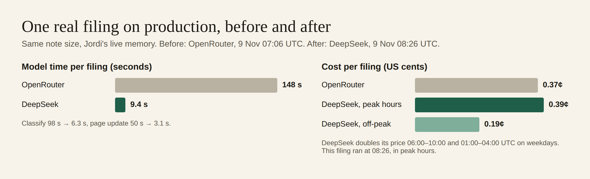
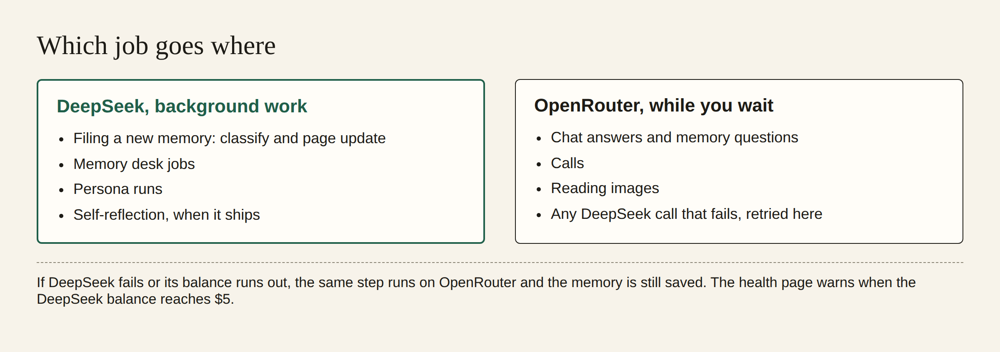

# Background work now runs on DeepSeek in production

Row E14-S11 in [EPIC-14](../plan-personas-inbox-voice-and-calls-come.md) · run run_01e54eba-b044-4293-b9f7-95f30b124670 · 9 November 2026

**Bottom line: better on speed, same on quality, and on cost it depends on the hour.** A real filing on production now takes **9.4 s** of model time on DeepSeek. On OpenRouter it took **148 s**. Cost per filing is **0.19¢ off-peak**, half the **0.37¢** OpenRouter charged. In DeepSeek's peak hours it is **0.39¢**, about the same as OpenRouter. The memory suite's three numbers did not move: on the demo set ingestion was **95.8%**, retrieval **100%** and errors **1.8%**, before and after. On your notes the figures were **93.8%**, **86.8% → 94.3%** and **1.6%**; the retrieval rise came from other changes, not from this one.

Live health: [cloud.zenod.dev/api/health](https://cloud.zenod.dev/api/health), where `background` shows `provider: deepseek`, `state: ok` and the balance. Deployed sha `4fbfdc9` since 2026-11-09 08:26 UTC.

## What we found when we checked real jobs

Health said DeepSeek from 05:45 UTC, but production jobs did not actually use it. Three fixes went out the same morning. Each one was merged after CI passed, and each merge rolled production:

| Found | Fix | Live |
|---|---|---|
| Memory desk jobs called the chat model, which the background route never moves, so they ran on OpenRouter | desk agent calls go to DeepSeek; any failure retries on OpenRouter | [#1554](https://github.com/zenod-ai/zenod/pull/1554) `0ae5ffa`, 07:06 UTC |
| Every DeepSeek filing call failed at once and fell back to OpenRouter: the AI SDK asks for strict JSON schema output, and DeepSeek takes JSON mode only | ask DeepSeek for JSON mode and put the schema in the prompt | [#1557](https://github.com/zenod-ai/zenod/pull/1557) `772c20b`, 07:49 UTC |
| The page-update step still failed: in JSON mode DeepSeek leaves out keys whose value is null, and the schema requires them | put back each missing key whose schema allows null; any other mismatch still falls back | [#1559](https://github.com/zenod-ai/zenod/pull/1559) `4fbfdc9`, 08:26 UTC |

#1554 also added provider, feature, status, real charge and latency to the usage ledger, and to an opt-in log line. It is switched on for production (`ZENOD_LLM_COST_LOG=1`). The line carries no content and no tenant. That line is how the problems above were seen.

## Per-provider records since the key landed

These are production log lines from the three real notes we saved to check the path. The notes are true statements about this change, saved through the team's memory connection. That connection writes to your vault, so all three are now in it.

| Time UTC | Code | Step | Provider | Result | Charge | Latency |
|---|---|---|---|---|---|---|
| 07:06 | 0ae5ffa | classify | DeepSeek | failed at once (JSON schema refused) | 0 | – |
| 07:08 | 0ae5ffa | classify | OpenRouter `deepseek/deepseek-chat` | ok | $0.002606 | 98.0 s |
| 07:08 | 0ae5ffa | page update | DeepSeek | failed at once | 0 | – |
| 07:09 | 0ae5ffa | page update | OpenRouter | ok | $0.001077 | 50.2 s |
| 07:50 | 772c20b | classify | DeepSeek `deepseek-flash` | ok | $0.004129 (peak) | 11.3 s |
| 07:50 | 772c20b | page update | DeepSeek | reply failed the schema (null keys) | $0.001712 | 4.4 s |
| 07:50 | 772c20b | page update | OpenRouter | ok | $0.000930 | 29.9 s |
| **08:26** | **4fbfdc9** | **classify** | **DeepSeek** | **ok** | **$0.002775 (peak)** | **6.3 s** |
| **08:26** | **4fbfdc9** | **page update** | **DeepSeek** | **ok** | **$0.001093 (peak)** | **3.1 s** |
| 08:27 | 4fbfdc9 | chat answer | OpenRouter `gpt-5.6-luna` | ok | $0.002803 | 4.6 s |

Counts since the key landed: 7 DeepSeek calls, of which 3 failed before the fixes and 4 succeeded; 4 OpenRouter filing calls, all fallbacks from those failures; chat answers on OpenRouter as designed. Every save was kept. Filing results: the OpenRouter-only note went to the Inbox as pending, and the two notes classified on DeepSeek were filed onto pages. That is too few notes to judge quality, so the suite numbers below carry the quality claim.

Desk jobs and persona runs have no production record yet: nobody ran a desk job this morning, and personas run at night. The same log line will show `feature=desk provider=deepseek` and `feature=personas provider=deepseek` when they run. Tests cover their routing and fallback today.

## Fallback: a DeepSeek failure never loses a save

- **In production, unplanned.** At 07:06 every DeepSeek filing call failed. The note was still saved: evidence went into the Log, then OpenRouter classified it and updated the page. No save was lost on any of the three notes.
- **In tests, with stubs and no spend:** `packages/core/test/backgroundFallbackFiling.test.ts`. A filing whose DeepSeek calls fail with 402 (no balance) or 503 (outage) finishes on OpenRouter. The Log entry and page are written, git is clean and lint passes. A 402 parks DeepSeek for 10 minutes. Desk agent fallback and a 400 with its status are in `aisdk-deepseek-background.test.ts`.
- **Low balance at $5:** `packages/server/test/backgroundRoute.test.ts` gives $10.00 → ok, $5.01 → ok, $5.00 → `low` with one `[background] ALERT deepseek balance low` line. Health today shows `state: ok`, `balanceUsd: 10`.

## Quality: the memory suite, before and after

From the [memory test dashboard](http://vps3.taild81fbb.ts.net:8921/memory-tests/). It uses the free stand-in model, so it measures Zenod's own code (what is offered, kept, linked and saved), not the model:

| Dataset | Before: 468ee50, key just in | After: 4fbfdc9 | Change |
|---|---|---|---|
| Demo set: ingestion / retrieval / errors | 95.8% / 100% / 1.8% | 95.8% / 100% / 1.8% | same |
| Your notes: ingestion / retrieval / errors | 93.8% / 86.8% / 1.6% | 93.8% / 94.3% / 1.6% | same, retrieval up from another change |

The model itself did not change much. Before, filing used DeepSeek's chat model through OpenRouter. Now it uses DeepSeek V4.1 Flash direct, the same model the E12-S8 live filing trial measured at 82% landing quality through OpenRouter. A live side-by-side on the 12 demo notes still needs the DeepSeek key to be readable by team test runs. The key is per-app, so only production can use it today. That is a follow-up ask.

Also fixed: the dashboard had stopped recording after each roll. Under systemd the suite ran on Node 18, which has no built-in SQLite, and every run failed silently. A user drop-in now points it at Node 22. Runs for 741737f, 0ae5ffa, 772c20b and 4fbfdc9 recorded.

## Spend for this row

- DeepSeek: **$0.0097** across the three notes, under the $0.50 cap.
- OpenRouter: **$0.0046**. These were the fallbacks for two of my test notes while the JSON-schema bug was live. That breaks the zero-OpenRouter rule, and the same fallbacks hit every real filing until 08:26. Chat answers are not counted here.
