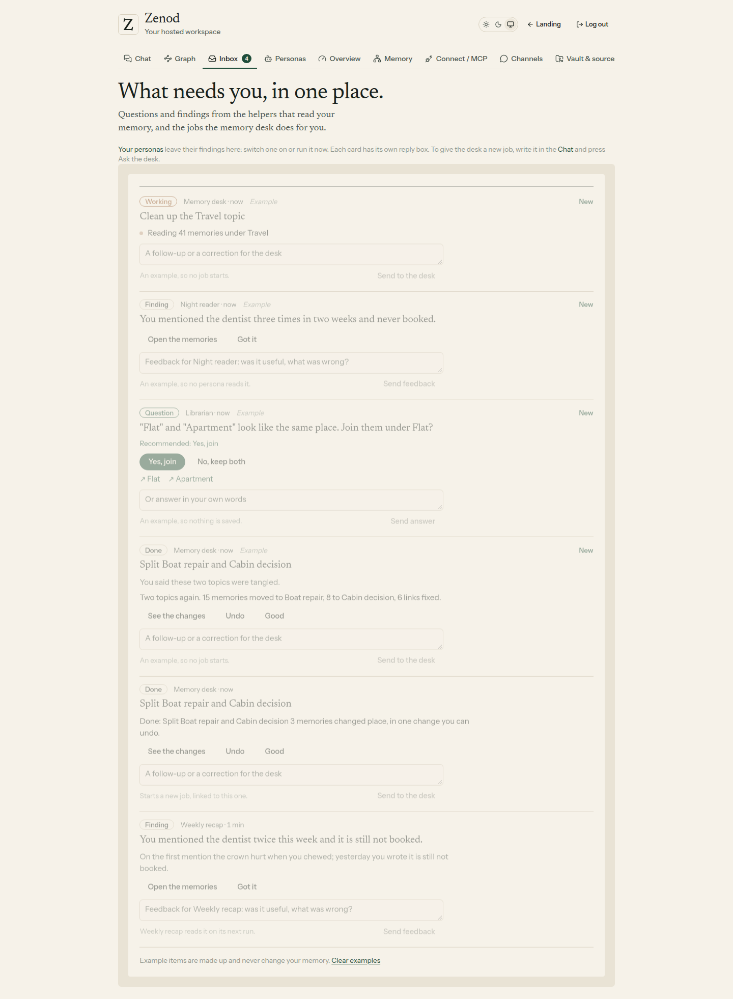
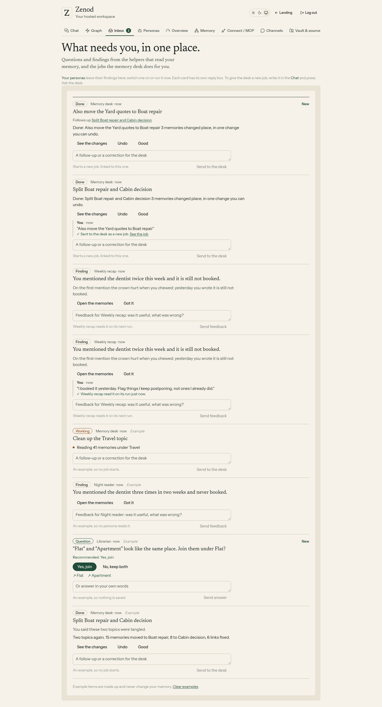
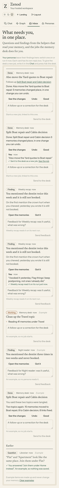
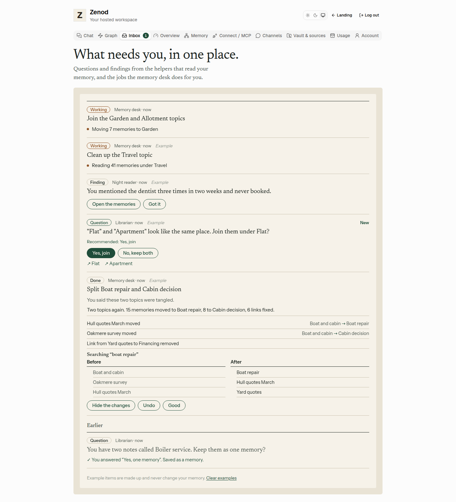
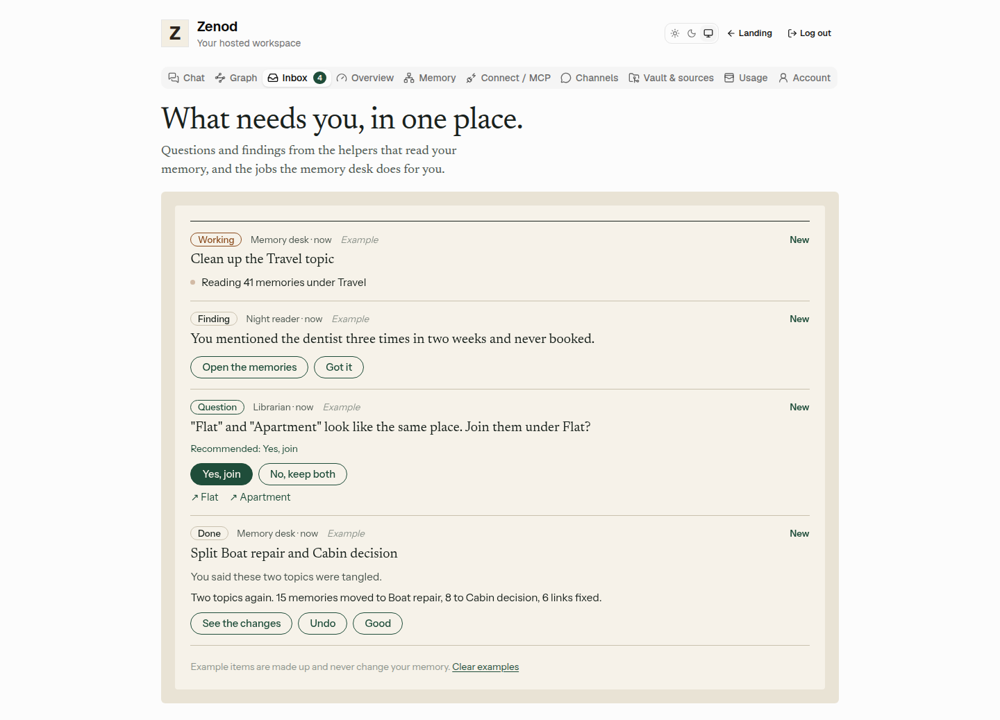
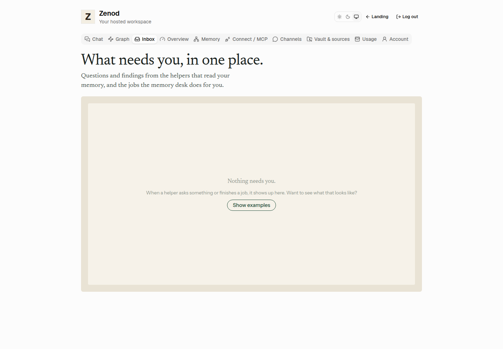
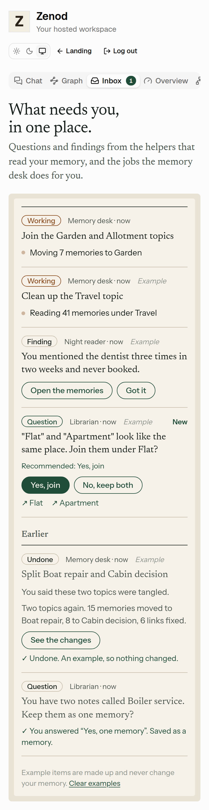

# E14-S2 evidence: one chat, and a reply box on every Inbox card (round 3, 2026-11-08)

**Bottom line:** there is now one chat. The Inbox's own "Ask the desk" box is gone, so a job for the desk is written in the Chat tab, whose Send box already has Ask the desk. The Inbox is a list of cards, and every card has a reply box like Epic Team's: it answers a question in your words, sends feedback to the persona that wrote a finding, or sends a follow-up to the desk as a new linked job. Live on cloud.zenod.dev: health reports `f9d0e878` (2026-11-08 22:19Z) and the live app bundle has the reply boxes and no inbox "Ask the desk" box. ✗ Not yet opened signed in on production (waits on E7-A15): the screens are the shipped code run locally with demo data.

Row: S2 round 3 in [EPIC-14](../plan-personas-inbox-voice-and-calls-come.md) · Run: run_0d0dd716-10e6-4d15-86ab-4a432f9d4ce0 · PR [#1539](https://github.com/zenod-ai/zenod/pull/1539), merged as `f9d0e878`. Jordi's relaunch: "what is the difference between chat and the inbox chat? shouldn't we have "1 chat"? and inbox each card we can respond with feedback boxes like in agent team?"

## What changed

| Card | The reply box | What happens |
|---|---|---|
| A persona's question | "Or answer in your own words", Send answer | Answered in your words and filed into your memory through the same store job a button answer uses |
| A finding | "Feedback for <persona>: was it useful, what was wrong?", Send feedback | Kept on the card as "You: …". The persona gets it in its next run's instructions; the card then says "<persona> read it on its run …". New feedback also counts as something new, so a nightly persona does not skip that night |
| A desk job | "A follow-up or a correction for the desk", Send to the desk | A new desk job, linked: it says "Follows up <first job>", and the first card says "Sent to the desk as a new job. See the job" |
| The desk's own question (a plan card, "run it?") | "Something else? Tell the desk what to do instead" | Answers Not now, so the plan does not run, and starts the follow-up job instead |
| An example card | the same box | Words are kept on the card; nothing is saved, read or started |

- One chat: the Inbox head now says "To give the desk a new job, write it in the Chat and press Ask the desk", with a link to the Chat tab. The reply boxes are square and small, so they read as notes on a card, not a second chat.
- API: `POST /api/console/inbox/:id/reply {text}` (1 to 1,000 characters). The tenant comes from the session; another tenant's card is not found. Desk and answer logic are unchanged: the route calls the desk's own start and Not now.

## Checks

- Server: new tests in `inbox.test.ts` (replies, words answer filed once, feedback kept, examples start nothing, 400/404/409), `memoryDesk.test.ts` (a follow-up is a new linked job with the first job named in its request; on a plan card it answers Not now and the first job ends with nothing changed), `personas.test.ts` (feedback is in the next run's model instructions once, marked read, new feedback wakes a nightly persona, then it sleeps again). Server 1559 pass, web 191 pass, build ok, CI green on #1539.
- Zero model spend: tests and the local run use a stub model and a stub desk queue.

## Local run of the shipped code, demo data

The built tree on VPS3 localhost: the real customer-layer routes and the real persona runner on a made-up vault, a recorded stub model reply, a stub desk queue that finishes a job with a made-up result ([local-serve.mjs](e14-s2/r3/local-serve.mjs), [local-shoot.mjs](e14-s2/r3/local-shoot.mjs), headless Chromium).

| Step | Result |
|---|---|
| Inbox with a Weekly recap finding, a desk job and the examples | 6 cards, 6 reply boxes, 0 "Ask the desk" boxes |
| Feedback on the finding: "I booked it yesterday. Flag things I keep postponing, not ones I already did." | "Sent. Weekly recap reads it on its next run." |
| Weekly recap's next run | its model instructions held: On "You mentioned the dentist twice this week and it is still not booked.": I booked it yesterday… ; the card then said "Weekly recap read it on its run just now." |
| Follow-up on the finished desk job: "Also move the Yard quotes to Boat repair" | a new job at the top, "Follows up Split Boat repair and Cabin decision", Working, then Done |
| Example question answered in words | "You answered “Join them under Home instead”. An example, so nothing was saved." |

---

# E14-S2 evidence: the Inbox in the cloud app (2026-11-08)

Row: S2 in [EPIC-14](../plan-personas-inbox-voice-and-calls-come.md) · Run: run_75a1580a-30fc-42e9-befd-b6c245eef751 · PR [#1520](https://github.com/zenod-ai/zenod/pull/1520), merged as `ceca56f`.

## What was built

A new **Inbox** tab beside Chat and Graph, with a count of what needs you. Three kinds of item, as in the approved plan (slides 4 and 7):

| Kind | What you see | What you can do |
|---|---|---|
| Question (from a persona) | The question, "Recommended: …", two or three buttons with the recommendation first (Epic Team's needs-you card shape) | Answer. The answer is filed into your memory repo through the same durable store job the chat's Keep uses, once per question |
| Finding (from a persona) | What it noticed | Open the memories behind it, Got it |
| Memory desk job | **Working** with its current step (the list refreshes every 5 s while a job works), then **Done** with what changed | See the changes (each change, before and after, and the same search before and after), Undo (asks once more), Good |

- **Data model:** one `inbox.sqlite` per tenant, next to the tenant's other stores, so items cannot cross tenants. Item: kind, status, sender, title, body, choices and recommendation, answer (with the store job id), memory links, job step, job result, example flag, poster's key (one item per key), created, updated, seen.
- **API:** `/api/console/inbox` (list), `/count`, `/seen`, `/:id/answer`, `/:id/dismiss`, `/:id/undo`, `/examples` (POST shows, DELETE clears). The tenant comes from the signed-in session only; another tenant's id is not found.
- **Count:** open questions plus anything new you have not seen; a finished job comes back as new. Polled every minute.
- **Internal API for later steps:** `inboxFor(runtime).post({ kind: "question" | "finding" | "job", … })`, `.updateJob(id, { status: "working", step } | { status: "done", result } | { status: "failed", step })`, `.setUndo(fn)` (the memory desk, S3, sets how a job is undone, for example reverting its commit). In process, no new port.
- **Examples:** an empty inbox offers "Show examples": one question, one finding, one working job and one finished job, all made up, marked Example, never written to the memory; "Clear examples" removes them.
- Nothing is sent to WhatsApp or any chat (root L-6). No run-time call to Epic Team (root L-7); the card shape was copied as a pattern.

## Checks

- Server `inbox.test.ts`: store (recommendation first, answered once, count, sourceKey, job Working → Done → Undo, unsafe links and URLs dropped) and routes with two tenants (401 / 404, Bob cannot see or answer Ada's item, the answer enqueues one store job in Ada's tenant only, examples never enqueue). Web `memory-inbox.test.tsx`: answer, finding links and seen, job changes and confirmed Undo, examples, tab count.
- Locally: typecheck, build, Phylax bundle verified, web 160 pass, server 1504 pass, scripts 263 pass. CI green on PR #1520.

## Local run of the shipped code, demo data

The built tree ran on VPS3 localhost: the real customer-layer routes behind a real customer session, serving the built web app, with a made-up tenant ([local-serve.mjs](e14-s2/local-serve.mjs), [local-shoot.mjs](e14-s2/local-shoot.mjs), headless Chromium). A persona question and a desk job were posted through `inboxFor(runtime)`, as S3 and S4 will.

| Step | Result |
|---|---|
| Empty inbox | "Nothing needs you." and Show examples |
| Show examples | 4 items, tab count 4 |
| A persona question and a desk job posted through the internal API | tab count 6 |
| Desk job moved to a new step | the screen showed "Moving 7 memories to Garden" without a reload |
| Answered the question | one store job enqueued: "You have two notes called Boiler service… My answer: Yes, one memory (Answered in the Zenod inbox, asked by Librarian.)" |
| Undo on the finished example job | Undone, nothing changed; tab count 1 at the end |

## Live

Merged as `ceca56f`; publish.yml ran ci, publish and deploy, all green ([run 42502780481](https://github.com/zenod-ai/zenod/actions/runs/42502780481)). Checked 2026-11-08:

- `https://cloud.zenod.dev/api/health`: `ok`, sha `ceca56f12f3096886fea818a27c92ef118c23135`.
- `https://cloud.zenod.dev/api/console/inbox/count` without a session: 401 (the route is live and needs a sign-in).
- The live app bundle carries the Inbox screen ("What needs you, in one place.").

## Not proven yet

- Signed-in production check: waits on E7-A15 (the agents' Google sign-in), so the screens above are from the local run, not from cloud.zenod.dev.
- No real persona or desk job posts yet: those are S3 and S4. Until then the inbox shows only examples.
