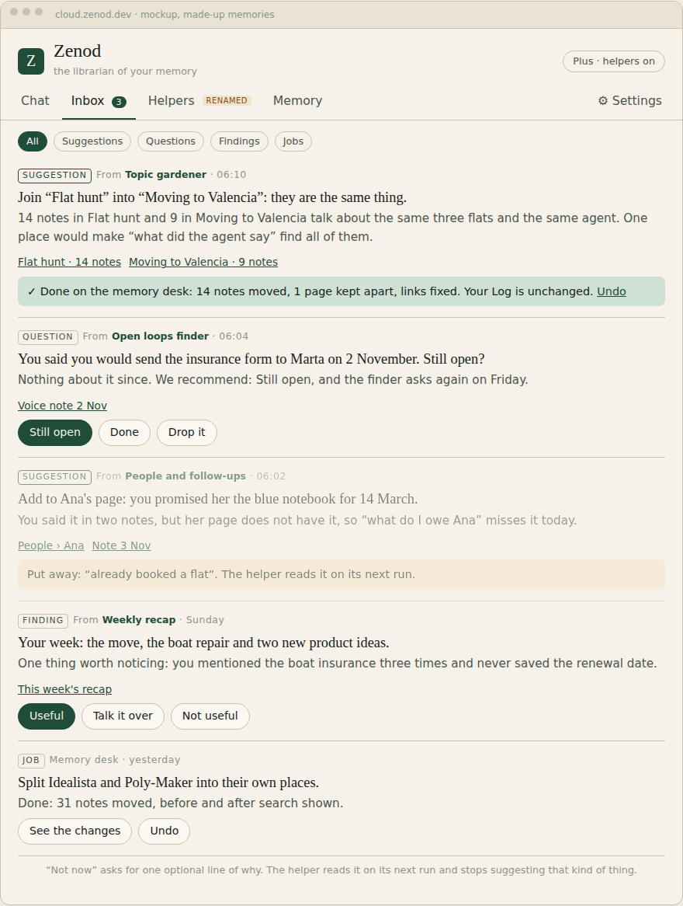

# E14-S24: helpers, one inbox and a quick index, plan round (2026-11-09)

Row: S24 in [EPIC-14](../plan-personas-inbox-voice-and-calls-come.md) · Run: run_ed7f6917-caf8-4d2d-91ba-5cbd97a5f21d · Page: http://vps3.taild81fbb.ts.net:8921/e14-s24/ (tailnet, no password; copy in [e14-s24/page.html](e14-s24/page.html))

Asked by: Jordi's WhatsApp voice note 2026-11-09 20:39Z (`Log/2026-11-09.md#^e-527d7c`, read in full through the zenod MCP; not quoted, the repo is public). The Zenod part of the note: call personas "helpers", their suggestions and actions go into one inbox, memory at the centre and standing on its own, a quick index or summarizer so Zenod knows what he is talking about, and how far "EpicSpine with a memory skin" holds. The rest of the note (email sending, the organisation as a wheel, hosted execution environments, Epic Team pricing) belongs to other repos and is left to the Delivery Manager.

**Bottom line.** Plan round only, nothing built. The page leads with what changes for him: helpers (the six personas renamed) offer one-tap **suggestions** (Do it, Change, Not now, Talk it over; Do it is one undoable desk job) in the one inbox; a **quick index** (places, people, nicknames, this week) sits in front of the web chat, calls and MCP answers, with a "Read as" line he can correct. Cost on DeepSeek V4.1 Flash: about 0.3 cent a day for a typical user, 1 to 2 cents for him, first build 2 to 9 cents. Six build steps, about 9 days, drafted as S25 to S30. It feeds the new ask E14-A9.

## What the page shows

- Bottom line, three "what changes for you" boxes, a small diagram (memory at the centre, helpers read, suggestions to the inbox, Do it goes through the desk, the index in front of chat).
- A clickable mockup on the live app's look (fa68fce palette and header, made-up memories): Inbox with a filter row and five card kinds, the renamed Helpers tab with what each may suggest, Chat with the "Read as" line, Memory with "What Zenod knows you mean". Screens: [inbox](e14-s24/desktop-inbox.png), [after acting](e14-s24/desktop-inbox-acted.png), [helpers](e14-s24/desktop-helpers.png), [chat](e14-s24/desktop-chat.png), [index](e14-s24/desktop-index.png), [phone](e14-s24/phone-inbox.png), [whole page](e14-s24/page-full.png).
- The helper table, the card actions table, the quick index (what, how built, how chat uses it, cost), the EpicSpine section, the six build steps, the recommendation.

## Facts the plan rests on (read from main)

- Six personas exist (`packages/server/src/personaCatalog.ts`): Weekly recap, Open loops finder, People and follow-ups, Topic gardener, Ideas digest, Health of your memory. Topic gardener already offers a "Run it / Not now" question; the new Suggestion card generalises that with Change and a Not now reason.
- The inbox has three kinds today, question, finding and job (`packages/server/src/inboxStore.ts`), with reply boxes (S2 round 3) and Undo on desk jobs (S3).
- The memory tree already keeps a one-line summary per place (`packages/core/src/vault/tree.ts`, node format `name | kind | [[page]] | summary`). The index adds nicknames, counts, last touched and a "this week" list.
- DeepSeek V4.1 Flash: $0.15 in (cache miss), $0.60 out per million tokens off-peak, double at peak ([S10 round 4 evidence](e14-s10-go-2026-11-09.md)). A helper run measured about $0.001 ([S5 round 2](e14-s5-r2-2026-11-09.md)).
- Cost sums: per note 1,500 tokens in and 150 out = $0.000315; 5 notes a day = 0.16 cent, 30 a day = 0.95 cent (1.9 at peak); nightly 8,000 in and 500 out = 0.15 cent; first build up to about 250 places at 2,000 in and 100 out = up to 9 cents. Chat side: about 3,000 extra input tokens on the chat model, about 0.03 cent a question.

## Root learnings weighed

- L-6: the index changes how web chat, calls and MCP answers understand a question, which Jordi asked for in his own words in this note. WhatsApp and Telegram replies stay as they are; Keep is unchanged.
- L-7: the inbox copies Epic Team's review-card idea inside Zenod; no shared code, no EpicSpine machinery in Zenod, the seam stays MCP. The EpicSpine section says this plainly.

## Spend

$0. No model calls, nothing triggered in his account.
