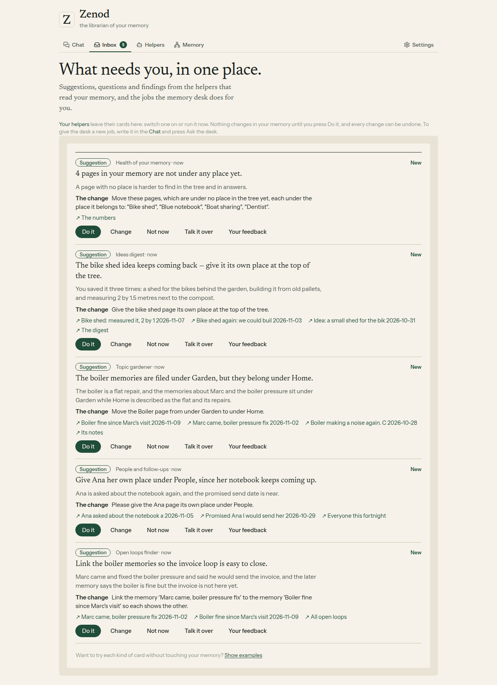
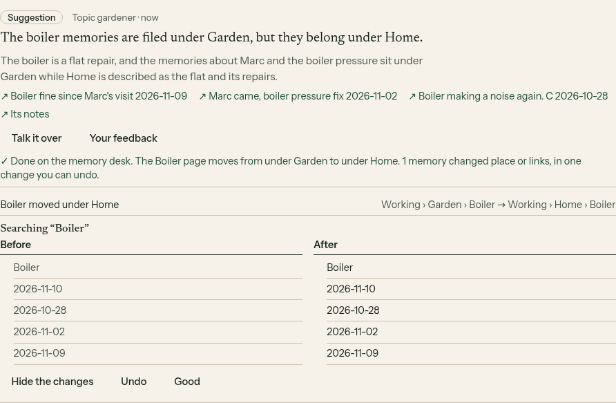
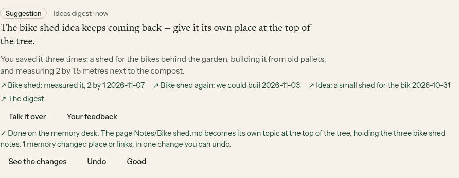
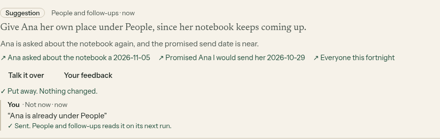
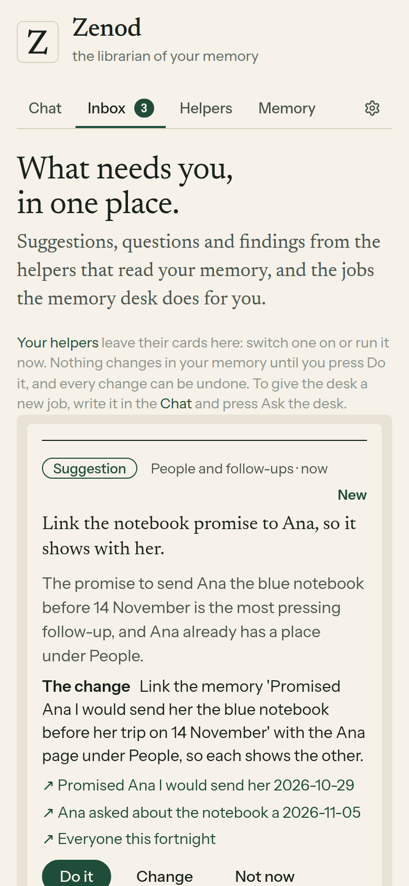

# E14-S27: helpers suggest one change a run (2026-11-10)

Row: S27 in [EPIC-14](../plan-personas-inbox-voice-and-calls-come.md), S31 folded in. Run: run_7c3f7e8f-60da-4dc4-b239-1253de41a1d3. PRs [#1573](https://github.com/zenod-ai/zenod/pull/1573) (merged as `b355b4e`) and [#1576](https://github.com/zenod-ai/zenod/pull/1576) (merged as `d70f440`). Page (tailnet, no password): http://vps3.taild81fbb.ts.net:8921/e14-s27/

**Bottom line.** The five helpers now offer you one change at a time. Open loops finder, People and follow-ups, Topic gardener, Ideas digest and Health of your memory each leave at most one suggestion card a run, the card S26 built: Do it, Change, Not now, Talk it over, Your feedback. Every suggestion is a change the memory desk can really make and undo, because the helper now sees your places and the desk's short list of changes before it suggests. On a made-up memory all five suggested something sensible on DeepSeek V4.1 Flash for about half a cent of OpenRouter each, two Do its ran as real desk jobs with Undo, and a Not now reason reached the helper's next run. Your three memory numbers did not move. It is live on `d70f440` since 2026-11-10 02:25 UTC. In your account the five are still switched off, so none of them suggested tonight: open https://cloud.zenod.dev/#helpers, switch on the ones you want and press Run now, and each leaves at most one suggestion in your Inbox.

## What changed for you

- **One suggestion a run, at most.** A helper that tries a second one in the same run is stopped. A change that is still waiting on a card is never posted again.
- **Only changes the desk can make.** The helpers read your tree (the places and their one-line summaries, two levels down) and are told what the desk can do: move a page under another place, give a page its own place, rename a place, link two memories, unlink them. It never writes new words, never creates or deletes a page and never touches what you said. So Do it does not fail on something impossible.
- **What each one suggests.**
  - Open loops finder, every night: link a promise to the later note that settles it, or to the place it belongs, so the loop is easy to close.
  - People and follow-ups, every night: link the most pressing follow-up to that person's page, or give someone who keeps coming up their own place.
  - Topic gardener, every 3 days: one tidy-up, like a page under the wrong place moved where it belongs.
  - Ideas digest, weekly: give an idea you keep coming back to its own place.
  - Health of your memory, weekly, no AI and no cost: when 3 or more pages are under no place, it names up to six of them and suggests filing them.
- **They listen.** Before each run a helper reads its last eight suggestions and what became of each: still waiting, done, or Not now with your reason. It is told never to repeat one and to stop suggesting that kind of change after a Not now. The Not now reasons and Your feedback notes also go into its instructions, as since S26.
- **When there is nothing to change**, or your memory has no tree yet, a helper leaves the same card it left before (a question, or a finding), still one card a run. Weekly recap is unchanged: it only tells you things.
- **Revised.** Each of the five wakes once more as soon as this is live, if it is switched on, so you see what it does the same night.

## On a made-up memory (local run of the shipped code)

The built code of PR #1573 ran on VPS3 localhost as one account: the real helper runner, inbox, desk and usage ledger behind a real customer session, and the real memory engine on a made-up vault in a local git repo. The vault: four places (Home, Garden, People, Boat), a boiler page filed under Garden by mistake, Ana and Marc under People, four pages under no place (Bike shed, Blue notebook, Boat sharing, Dentist), and 12 made-up voice notes over two weeks. The model was DeepSeek V4.1 Flash on OpenRouter with thinking off, as production sends it to DeepSeek. Each call went through a relay that ran it on VPS1 inside `secret run`, so the key never left VPS1 and was never printed. Harness: [serve.mjs](e14-s27/harness/serve.mjs), [relay.mjs](e14-s27/harness/relay.mjs), [shoot.mjs](e14-s27/harness/shoot.mjs).

| Helper | Run | Its suggestion (the change, as the desk runs it) | Tokens in / out | Cost |
|---|---|---|---|---|
| Open loops finder | 5 loops found | Link the memory "Marc came, boiler pressure fix" to the memory "Boiler fine since Marc's visit" so each shows the other | 769 / 224 | $0.00053 |
| People and follow-ups | 3 people | Please give the Ana page its own place under People | 773 / 205 | $0.00052 |
| Topic gardener | | Move the Boiler page from under Garden to under Home | 748 / 114 | $0.00043 |
| Ideas digest | 5 ideas | Give the bike shed page its own place at the top of the tree | 772 / 245 | $0.00055 |
| Health of your memory | 12 memories, 4 loose pages | Move these pages, which are under no place in the tree yet, each under the place it belongs to: "Bike shed", "Blue notebook", "Boat sharing", "Dentist" | no model | $0 |

Costs are OpenRouter's. On DeepSeek's own API, which production uses, the same call costs less (see production below).

What a person would make of them: Topic gardener found the planted mistake exactly. Ideas digest picked the idea said three times. Health named all four loose pages. Open loops finder's link is reasonable but small. People and follow-ups asked for something already true (Ana is already under People): the kind of miss a Not now teaches it, shown next. Which helper earns its place on real notes is S30's judgement.

**Do it, Undo.** Topic gardener's Do it ran the real desk on the same model: one commit, `memory desk: Move Boiler under Home`, the boiler page's parent went from Garden to Home, and the card showed the move with before and after. Undo made one more commit, `memory desk: undo Move Boiler under Home`, and the parent was Garden again. Ideas digest's Do it made `memory desk: Bike shed as its own topic`.

**Not now with a reason, then its next run.** Not now on People and follow-ups with "Ana is already under People". Its next run had the reason in its instructions (the card's reply was marked read by that run) and the earlier suggestion in its prompt as `not now (Ana is already under People)`. It suggested something else: link the notebook promise to Ana's page.

No script errors. Nothing scrolls sideways on a phone.

## Your three memory numbers

The memory test suite (EPIC-15 Q2), demo dataset, stand-in model:

| | Ingestion success | Retrieval efficiency | Error rate |
|---|---|---|---|
| Before, production `bdf3228` | 95.8% | 100% (MRR 0.97) | 1.8% |
| After, this branch | 95.8% | 100% (MRR 0.97) | 1.8% |

Unchanged, as expected: filing, search and retrieval code did not change. The one core change is an option that lets a helper list pages under no place; the Memory tab's tree is built exactly as before. The nightly run on a copy of your own notes (private dataset) runs after this roll and lands on the [memory tests dashboard](http://vps3.taild81fbb.ts.net:8921/memory-tests/); the last one, on `bdf3228`, was 93.8%, 96.2% and 1.6%.

## Production

- **Live.** `b355b4e` rolled at 01:20 UTC (publish run passed `ci`, published and deployed Zenod only); cloud.zenod.dev health ok on it. `d70f440` (the fix below) rolled at 02:25 UTC, health ok on `d70f440`.
- **A gap found on the way, and fixed.** A tenant's schedules (helpers, the weekly tree sweep, the quick index) start only when its part of Zenod is loaded, and after a roll it loaded only on that tenant's next request. After the 01:20 roll there was none, so nothing would have woken tonight. [#1576](https://github.com/zenod-ai/zenod/pull/1576) loads every active hosted account 30 seconds after start. Production log after the 02:25 roll: `[warm] 3 tenants loaded, their schedules running` at 02:25:41, then at 02:30:40 the weekly tree sweep queued for the week of 8 November (it had not run this week) and Weekly recap woke and skipped, nothing new since its last run.
- **Tonight in your account.** Only Weekly recap woke. Open loops finder, People and follow-ups, Topic gardener, Ideas digest and Health of your memory did not, because they are switched off in your account (your Run now presses on 9 November ran them once each without switching them on). So no real suggestion reached your Inbox tonight, and there is no cost to report per run. Switched on, each runs in the night window (02:00 to 06:00 UTC) on its schedule; Run now runs it at once.
- **Cost a run on DeepSeek.** On your notes the prompt is about 3,100 tokens of memories plus about 1,000 of places; at DeepSeek V4.1 Flash list price that is about a tenth of a cent a run, inside each helper's 2 cent cap a run and 10 cents a month.

## Tests

Server: the helper tests (27), new ones for Topic gardener's suggestion with and without a tree, one suggestion a run, no repeat of a waiting change, earlier suggestions and a Not now reason in the next run, People and Ideas suggestions, and Health naming loose pages with no model call; the tree outline lists loose pages only when asked. The full server suite passed apart from two tests that timed out under load and pass alone. CI on the PR: green (`ci`, 13 minutes).

## What was not done

- **Pressed on production by a person.** Agents cannot sign in to cloud.zenod.dev, and nothing may touch your memory, so Do it was pressed on the made-up memory only.
- **WhatsApp and Telegram.** Unchanged (root L-6).

## Spend

Local check: 6 helper calls about $0.003, two desk jobs about 19 calls under a cent, two earlier trial calls $0.0015, all OpenRouter. No DeepSeek spend by this run; tonight's helper runs in your account are their normal metered runs.
