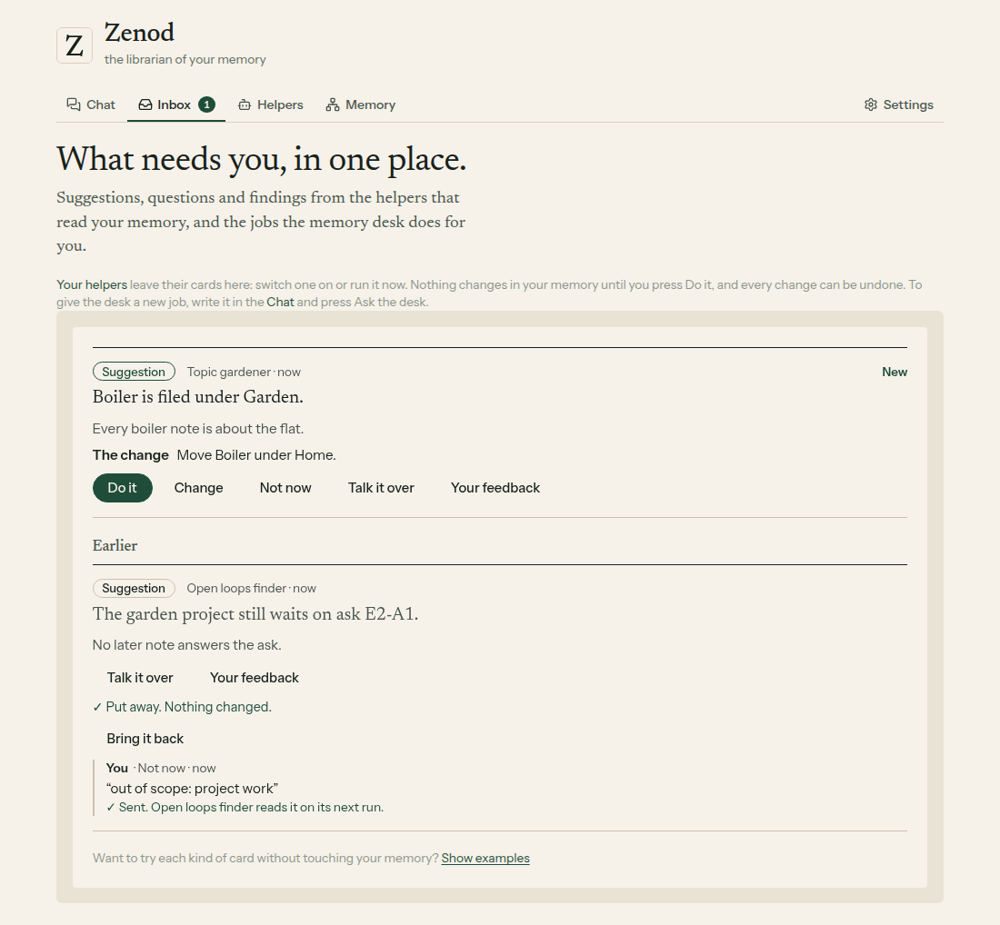
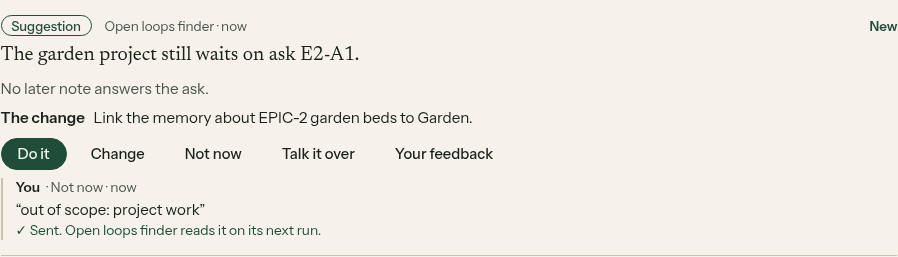
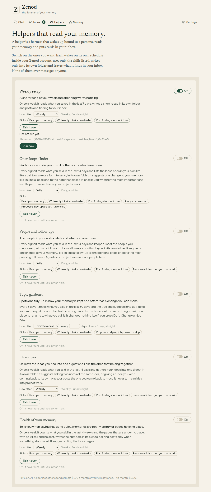

# E14-S27 round 2: helpers keep to his memory, never project work (2026-11-10)

Row: S27 in [EPIC-14](../plan-personas-inbox-voice-and-calls-come.md), E14-S1 folded in. Run: run_0f4a8b75-08d6-4e13-ae43-cfbd32c1c9ef. PR [#1583](https://github.com/zenod-ai/zenod/pull/1583), merged as `0fdd18c`. Private before and after page (tailnet, his own notes): http://vps3.taild81fbb.ts.net:8921/e14-s27r2/

**Bottom line.** Jordi asked whether the helpers were doing a delivery manager's job across his repos. They were reading it that way by accident: most recent captures in his Zenod are short work records the team's agents save after each task (row codes, asks, run ids), and the helpers took every open ask in them for his to-do. Now the helpers leave those records out, are told they work on his memory only and are not project managers, and drop any card about project work before it is posted. The project suggestion already in his inbox is put away once as Not now, reason "out of scope: project work", and a new Bring it back button reverses it. Live on `0fdd18c` since 05:00 UTC; the switched-on helpers ran again on his memory at 05:07 UTC and their loose ends are now about his own life, their suggestions about how his memory is kept. Spend: $0.00235 for three AI calls. His three memory numbers did not move (no filing, search or retrieval code changed).

## What changed

- **What the helpers read.** `isTeamRecord` leaves out a capture typed in over MCP or the CLI that carries a work code (EPIC-n, E14-S27, ZAL-A13, run ids, PR numbers, `agent_team`). Voice notes, chat messages and files always count, also the voice notes he records on EpicTeam cards: they are his words. Health of your memory now counts only what he said.
- **What they are told.** Every helper's model gets: works on the person's memory only, not a project manager, never a next step in a project, a task, a ticket, an epic, a repository, a release or a deploy; a project is only something the notes are about. Briefs rewritten: loose ends in his own life, real people and personal follow-ups (agents and project roles are not people), a note filed in the wrong place, two notes about the same thing linked, ideas linked. Do it stays one undoable memory desk job.
- **What they may post.** A suggestion with a work code, or with project-management words in what he reads first, is dropped; so is a Weekly recap finding, and a list line in the notes. The run summary says "left out one suggestion about project work".
- **His inbox.** Once per start, open helper suggestions from before 04:15 UTC on 10 November that are about project work are put away as Not now with the reason above. A put-away suggestion has Bring it back; one brought back is never put away again.
- **Cost on the note.** Each helper note ends with its run's AI calls, tokens and cost.
- **Revised.** All six wake once more at once if switched on.

## On production, in his account

Before (01:40 UTC) Open loops finder listed five items, all team asks or project status, and suggested a link justified by an open team ask. After (05:07 UTC, new code) it listed five decisions and errands from his own life and suggested linking two of his own notes about the same decision. Topic gardener suggested a filing move both times (memory work). Weekly recap wrote five lines about his week in his words. People and follow-ups and Ideas digest are switched off in his account, so they did not run. Details, with his notes, on the private page only.

| Helper | Run at 05:07 UTC | Tokens in / out | Cost |
|---|---|---|---|
| Weekly recap | recap, no finding | 3,168 / 306 | $0.00066 |
| Open loops finder | five loose ends, one link suggested | 5,064 / 250 | $0.00091 |
| Topic gardener | one filing move suggested | 4,782 / 107 | $0.00078 |
| Health of your memory | counts, nothing stands out | no model | $0 |

The put-away runs on start and logs only a count; agents cannot sign in to his account or read its inbox, so the put-away is shown on a made-up memory with the shipped code ([harness](e14-s27r2/harness/serve.mjs), [shoot](e14-s27r2/harness/shoot.mjs)): seeded with one project suggestion and one memory suggestion, it put away exactly one, and Bring it back opened it again.

## Asking the Team desk

Not built. Zenod's only seams to agent_team are MCP (an agent pulls a memory) and the new-voice-note webhook (root L-7); there is no read-only way for a helper to ask the Team desk how things connect. Drafted as its own row for Jordi's yes, since it crosses the seam. Merging two notes and updating a stale fact need the desk to write words, which it cannot today: drafted as a second row.

## Tests

personas (30, three new: team records left out and memory-only words, a project suggestion and a project recap finding dropped, put-away once and Bring it back), memoryDesk (10, the bring-back route), web memory-inbox (11, the Bring it back button). CI green on the PR; publish ran `ci`, published and deployed Zenod only.

## Your three memory numbers

Not rerun: filing, search and retrieval code is unchanged (`packages/core` untouched). Last numbers: demo 95.8% ingestion, 100% retrieval, 1.8% errors; private copy 93.8%, 96.2%, 1.6%.

## Not changed

WhatsApp and Telegram replies (root L-6). No call to the team console (root L-7).
