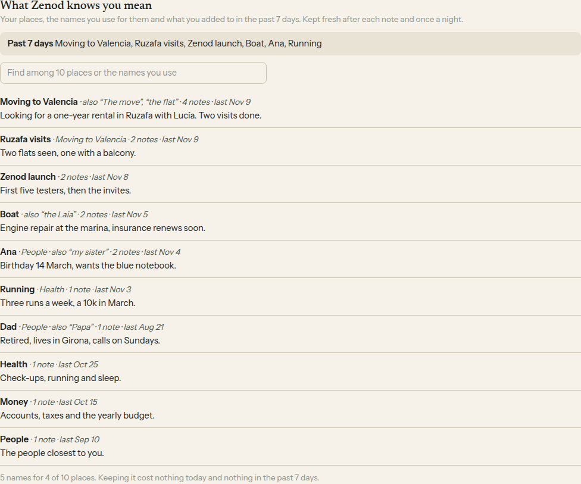

# E14-S28: the quick index, "What Zenod knows you mean" (2026-11-10)

Row: S28 in [EPIC-14](../plan-personas-inbox-voice-and-calls-come.md), from Jordi's yes on E14-A9. Run: run_35785b6c-3fb4-437c-b547-176b8543e7a4. Code [#1571](https://github.com/zenod-ai/zenod/pull/1571), merged as `bdf3228`.

## Bottom line

**The quick index is live on production `bdf3228` (health ok from 00:13 UTC on 10 November) and built itself on his memory at 00:28 UTC: 311 places, 33 of them with names he uses (40 names), 12 places he added to in the past 7 days. The first build took 14 DeepSeek calls and cost 1.6 cents, under the plan's 2 to 9 cents. His three memory numbers are unchanged: ingestion success 93.8%, retrieval efficiency 96.2%, error rate 1.6%, the same as before.** It shows in Memory › At a glance as "What Zenod knows you mean". Chat, calls and connected AI apps do not read it yet (that is S29); WhatsApp and Telegram replies are unchanged (root L-6).

The image is the shipped panel on a made-up memory (every name invented), because his places and nicknames are private. His own index as the app draws it is on the private page: http://vps3.taild81fbb.ts.net:8921/e14-s28-private/

## What was built

| Part | What it does |
|---|---|
| The places | Every page in his memory tree, with the one-line summary the tree already keeps (the page's own summary, else the root's line in the tree, cut to one sentence), the page's own aliases a person would say (file names and ids left by merges are dropped), how many of his own notes it cites (agent reports never count), when he last added to it, and what he added to in the past 7 days. No model call. |
| The names | One small DeepSeek call finds the other names he uses for a place, such as "the flat": once over everything (first build, 20 places a call), after each filing for the places it touched, and once a night between 04:00 and 06:00 UTC (DeepSeek off-peak) over the past 7 days. A name is kept only when it is written word for word in what he said on that page, is short, is not generic and is new for that place. |
| Cost | Every call's tokens and cost are kept per tenant and in the usage ledger as filing, so they count in his AI allowance. Spend stops at 5 cents a day, and 15 cents for a first build. With no DeepSeek route there are no new names and no OpenRouter spend. |
| The screen | Memory › At a glance: the past 7 days, a find box over places and names, each place with "also …", notes and last date and its summary, and one line of what keeping it cost today and in the past 7 days. |

## Proof on production

| Check | Result |
|---|---|
| Production version | `cloud.zenod.dev/api/health` sha `bdf3228`, status ok, background route DeepSeek ok, from 00:13 UTC |
| First build on his tenant (production log, counts only), 00:28:12 UTC | `first: calls=14 names+30 usd=0.01611 places=311 named=33 names=40 week=12` |
| Before the build | 10 places carried aliases on their pages (16 aliases, 6 of them file ids now dropped); after it, 33 places carry 40 names |
| Same code on a copy of his vault (`8eb0f07`), no model | 295 places, 293 with a summary, 262 with his own notes, built in about 1 second |

His runtime starts its clock at the first request after a restart; a read through the team's Zenod connection woke it at 00:23 UTC and the first build ran on the next tick.

## Cost per day

| | Cost |
|---|---|
| First build, once, 14 calls over 311 places | 1.6 cents (plan: 2 to 9 cents) |
| One call over 20 places, measured average | 0.12 cent |
| A filing call (only the new note's places, at most 10) | under a first-build call; read from the log as his notes arrive |
| Day cap after the first build | 5 cents |

Agent reports never trigger a call, only his own notes do, so a quiet night costs only the nightly pass. The plan's estimate stays: about 0.3 cent a day for a typical user, 1 to 2 cents for him.

## His three numbers

From the memory test suite (EPIC-15 Q2, [dashboard](http://vps3.taild81fbb.ts.net:8921/memory-tests/)), his real notes, run by the suite after each production roll.

| Production | Ingestion success | Retrieval efficiency | Error rate |
|---|---|---|---|
| `aa46d5e`, before, 21:57 UTC 9 Nov | 93.8% | 96.2% | 1.6% |
| `bdf3228`, with the quick index, 00:29 UTC 10 Nov | 93.8% | 96.2% | 1.6% |

Demo suite: 95.8%, 100%, 1.8% before and after. The run on `4803335` in between (S25 and S26, rolled at 23:58 UTC) read 43.8%, 81.1%, 14.8% because all 8 of its agent save checks failed; the run on `bdf3228`, which carries that same code, passed all 8, so it was a one-off in that run, not a change in Zenod.

## Tests

Core `quickIndex.test.ts` (places, summaries, aliases, counts, the past 7 days, one-line cuts, file-id aliases), server `quickIndex.test.ts` (the three passes, the word-for-word rule, the day cap, the allowance stop, a failed call, the view never carrying his words, the store) and web `quick-index.test.tsx` (the panel, find, show all, cents). CI green on #1571.

## Not done, and follow-ups

- The summaries of his top places are often counts ("Your own captures that name … : 6 in the last 30 days") because that is what the tree keeps for them. The index reuses them, as planned; better one-line summaries for root places are a follow-up.
- Chat, calls and MCP answers reading the index, with the "Read as" line: S29.
- Nightly and per-filing costs are logged from tonight; the week's real cost per day goes into S30.
