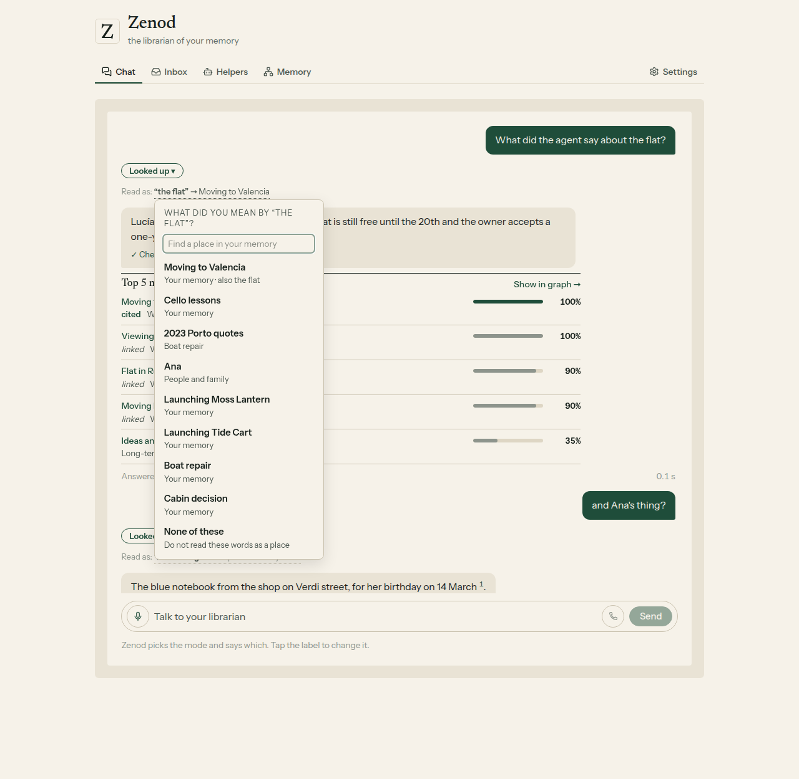
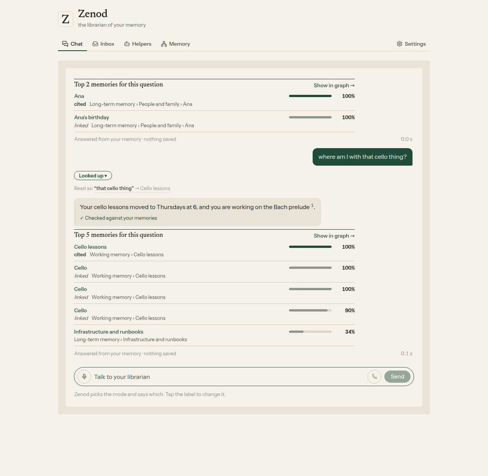
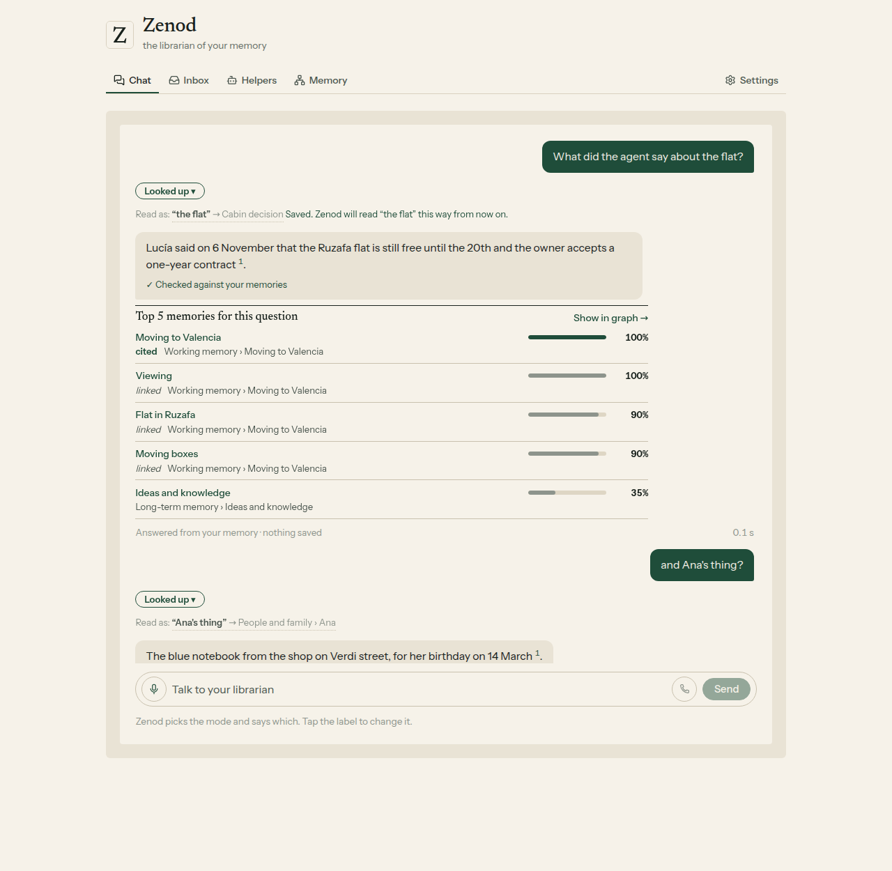
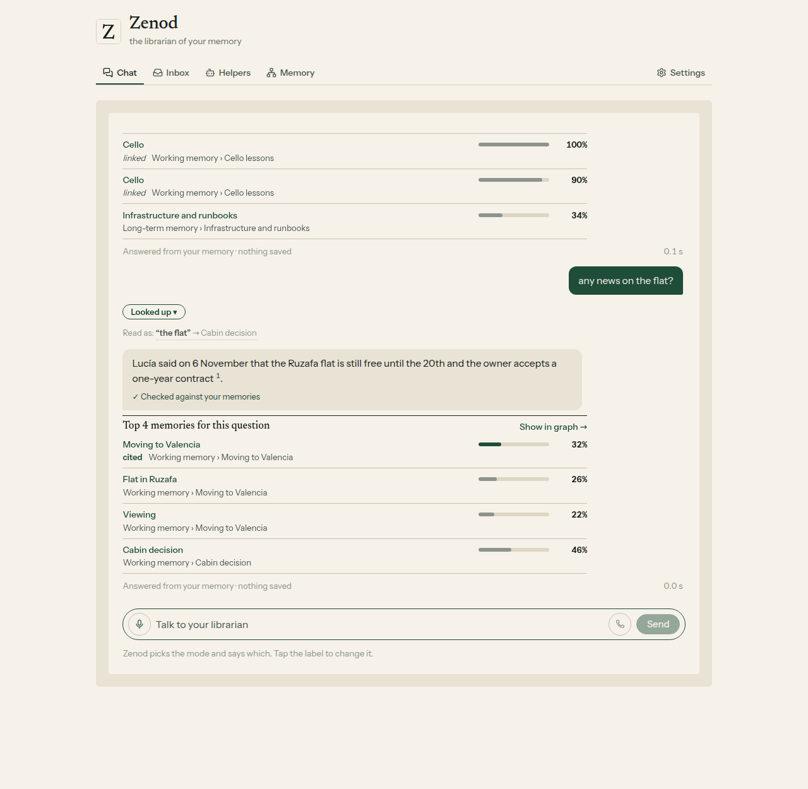

# E14-S29: chat reads the quick index, with a "Read as" line you can correct (2026-11-10)

Row: S29 in [EPIC-14](../plan-personas-inbox-voice-and-calls-come.md) (S32 folded in), from Jordi's yes on E14-A9. Run: run_2ced5379-1287-4545-8225-5d60df6f3e71. Code [#1575](https://github.com/zenod-ai/zenod/pull/1575) (merged `d4ec5e5`), then [#1577](https://github.com/zenod-ai/zenod/pull/1577) (`24a9f34`, the hosted connection for AI apps) and [#1578](https://github.com/zenod-ai/zenod/pull/1578) (`8faad1a`, a place keeps its own name, live with `d94ef24`), both from the live check.

## Bottom line

**Look up, Talk it over, a call's lookups and the answers connected AI apps get now read vague words like "the flat", "Ana's thing" or "that cello thing" through the quick index first, and the reply shows a grey "Read as" line. Tap it, pick the place you meant or "None of these", and Zenod keeps it: the place learns the name and the next message reads it your way. Live on production `d4ec5e5` from 02:05 UTC on 10 November (health ok), the AI-app connection from `24a9f34` at 02:50 UTC, and the last fix rolled with `d94ef24` at 03:57 UTC. Nothing got worse on his memory: on 20 vague questions built from his own voice notes the right memory was in the top 5 for 16 before and 16 after, and among what the answer reads for 18 and 18; on his 45 real questions 28 and 28, 34 and 34. The mode pick stays 71 of 72. His three memory numbers are unchanged: ingestion success 93.8%, retrieval efficiency 100%, error rate 1.6%, before and after.** WhatsApp and Telegram replies are unchanged (root L-6): their path never asks the index.

The screens are the shipped routes and app on a made-up memory (every name invented), because his places are private. His 20 questions and what each was read as are on the private page: http://vps3.taild81fbb.ts.net:8921/e14-s29-private/

## What was built

| Part | What it does |
|---|---|
| Reading the words | Before a search, the message is read against the quick index with no model call: the names he uses for a place (the page's aliases and the nicknames DeepSeek found in his own words), his corrections, a place's own name ("Ana's thing" reads Ana), and "that X thing" when X names one place he keeps adding to. At most three readings, one per place, longest and surest first. |
| Finding the memory | The question's own top 8 matches keep their places. After them, the search with each place's name is mixed in, and the place's own page is kept among the 16 memories the answer reads. The answer model is told what the words were read as. |
| Where it runs | Look up and the one Send box, Talk it over, the call's ask tool (the voice says what it took the words to mean), and `ask_brain` for connected AI apps (a "Read as:" line before the answer). WhatsApp and Telegram never call it. |
| The "Read as" line | Grey, under the reply's label. A tap opens "What did you mean by …?" with a find box over his places and "None of these". The choice is saved in his quick index, the place shows the name in Memory › At a glance, and the next message reads it that way. |
| Summaries | The 40 places with the most of his notes whose tree line is only counts ("1 page; 6 of your captures…") get a one-line summary from his own words on DeepSeek, 10 places a call, inside the index's 5 cent day cap; a failed one waits a day. |

## Measured on his memory

On a copy of his vault from 10 November (`15b4a85`), same code, the index's model-free part (place names and page aliases; the 30 nicknames DeepSeek found live only in his production index, so this is the floor). Before is plain search, after is search with the readings.

| Set | Right memory in the top 5 | Among what the answer reads | Search time, median |
|---|---|---|---|
| 20 vague questions from his voice notes | 16 → 16 | 18 → 18 | 35 → 41 ms |
| His 45 real questions | 28 → 28 | 34 → 34 | 49 → 52 ms |
| Mode pick, 72 fixed messages | 71 → 71 | | |

What it shows: his vague words are mostly words he also wrote, so plain search already finds those notes; the index adds the place page without pushing any right memory out. A first try that added the place name to the search pushed one right memory from 4th to 14th, so the shipped version keeps the question's own top 8 in place. 6 of the 20 vague questions got a reading from the model-free part; with his live nicknames more will.

## Live check

Through the team's Zenod connection, the same way a connected AI app asks, on production with his own index and its nicknames:

| Asked | Read as | Note |
|---|---|---|
| a question with "the house thing", on `d4ec5e5` | nothing | the hosted connection did not pass the index yet: fixed in `24a9f34` |
| a question with a word his places do not use, on `24a9f34` | nothing | right: no place is named that way, so nothing is guessed |
| "that poly-maker thing", on `24a9f34` | a runbook page under Poly-Maker | a name the index had learned for that page took words that are the place Poly-Maker's own name: fixed in `8faad1a`, a place's own name now wins |

Each answer came back with its sources and the readings in `readAs`; the answers themselves are not quoted here (private).

## His three numbers

From the memory test suite (EPIC-15 Q2, [dashboard](http://vps3.taild81fbb.ts.net:8921/memory-tests/)), his real notes, run after each production roll. The suite searches without the index, so a change here would mean the code around it moved.

| Production | Ingestion success | Retrieval efficiency | Error rate |
|---|---|---|---|
| `b355b4e`, 01:29 UTC 10 Nov | 93.8% | 96.2% | 1.6% |
| `30034ff`, the roll just before, 01:58 UTC | 93.8% | 100% | 1.6% |
| `d4ec5e5`, with this change, 02:28 UTC | 93.8% | 100% | 1.6% |

## Screens

Harness: [seed.py](e14-s29/harness/seed.py), [serve.mjs](e14-s29/harness/serve.mjs), [shoot.mjs](e14-s29/harness/shoot.mjs). No script errors, nothing scrolls sideways at 390 px.

## Tests

Server `quickIndexRead.test.ts` (names, possessives, "that X thing", corrections, one reading per place, the merge that keeps the top 8, the answer and the talk carrying Read as, nothing without readAs), web `read-as.test.tsx` (the line, picking a place, None of these). CI green on #1575.

## Not done, and follow-ups

- Summaries: on his vault only 2 of his 40 biggest places still have a line that is only counts (Agent Team and Epic Team), so the pass is one small call. ✗ Not seen yet: production logged no quick-index call in the 10 minutes after `d94ef24` rolled (03:57 to 04:08 UTC). The index logs only when it makes a call, so either its tick had not run for his memory yet or the call was skipped; S30, which watches the index for a week, checks that these two lines appear in Memory › At a glance.
- How often the readings are right on his live nicknames over a week goes into S30.
