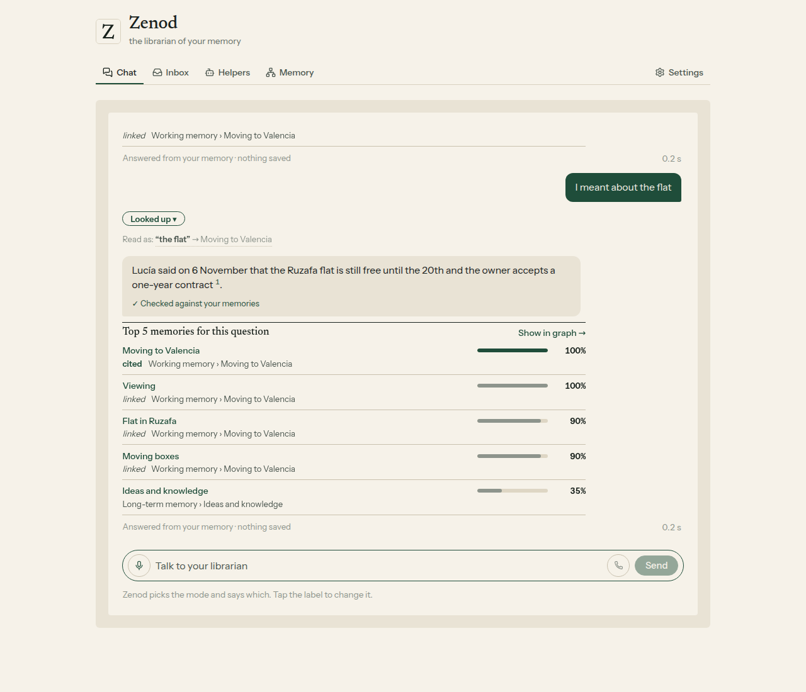

# E14-S29 round 2: why the chat failed on 10 November, and the fix (2026-11-10)

Row: S29 in [EPIC-14](../plan-personas-inbox-voice-and-calls-come.md) (E15-S3 folded in), relaunched by Jordi after his chat on cloud.zenod.dev from 04:03 to 04:06 UTC. Run: run_a7b8c0dc-cfd3-4ea9-a15a-d3051dc7cf04. Code [#1585](https://github.com/zenod-ai/zenod/pull/1585), merged as `5036564`. It went live with `1f1ebae` at 05:22 UTC on 10 November (health ok).

## Bottom line

**Yes, the failure mode is understood.** The chat read each message on its own. When Jordi corrected his question ("I meant …"), the routing model took the correction for a request to re-file his memory. The app asked "keep it, or do it as a job?", the memory desk got the job, and it refused because there was nothing to re-file. That was the handover to what looked like a persona. The answers before it were wrong for a second reason: the search matches whole words only. So "preferences" pulled in unrelated notes that use that word, and the word he used for the place he meant never reached the pages about it. One of his sends also failed with a 502, because the server ran out of memory and restarted. That crash belongs to EPIC-24 M3 and is not touched here.

**Fixed live.** The app now sends the question the last reply answered. A correction ("I meant", "no, I meant", "me refería") is answered as that question, corrected. It is never kept, never sent to the desk and never turned into a talk. A job that only the model sees, in words naming no topic, page or note, is dropped, so a plain question is answered. A word in the same family as a one-word place name (for example "houses" or "household" for a place called Housing) now reads as that place on the grey Read as line, where one tap corrects it. Weak word matches no longer push those pages out of what the answer reads.

**Measured on his memory, nothing got worse.** 20 vague questions: right memory in the top 5 went 16 → 16, and among what the answer reads 18 → 18. His 45 real questions: 30 → 30 and 35 → 35. Mode pick on the 72 fixed messages: 71 → 71, now run through the new app step too. His three memory numbers are in the table below. WhatsApp and Telegram replies are unchanged (root L-6): they keep the shared decision and never read the index.

His messages, the old and new answers, and the timeline are on the private page: http://vps3.taild81fbb.ts.net:8921/e14-s29r2-private/

## What happened, from the logs

Sources: the container logs and the proxy access log on VPS1, plus the desk job's own record, read through the team's Zenod connection. The app does not keep the text of a question. That is why only the correction is known word for word: the desk job carried it.

| UTC | Request | Result |
|---|---|---|
| 04:03:31 | Send, question 1 | answered in 11 s, from notes matching "preferences" |
| 04:04:33 | | the server ran out of memory and restarted |
| 04:04:41 | Send, question 2 | 502, the server was restarting |
| 04:04:55 | Send, question 2 again | answered in 10 s |
| 04:06:02 | Send, the correction | routed as "unsure": "keep it, or do it as a job?" |
| 04:06:07 | Do it as a job | the desk refused: nothing to re-file |

Earlier in the same visit (03:58 to 04:00), two helper suggestions got Do it. One ran. The other was refused as project work, which is EPIC-14 S27 round 2. A feedback note sent at 04:00:49 failed during the first restart.

## Replay, before and after

The three messages were replayed as one chat on a copy of his memory from 10 November, with the chat model production uses (Gemini 3.1 Flash Lite through OpenRouter). Before ran production's previous build `d94ef24`; after ran the merged code. Before, the correction got the keep-or-job question, exactly as on production. After, it was answered from the right pages, with the Read as line. The answers are on the private page.

This is not a replay through production itself: the app's Send needs his sign-in, and minting one would widen access. On production, the served app sends the earlier question with each message (checked in the live bundle), and every Send now logs one line with its route and who decided it, never the words. His next try shows up as `route=answer by=rules follow-up` in that log.

## His three numbers

From the memory test suite (EPIC-15 Q2, [dashboard](http://vps3.taild81fbb.ts.net:8921/memory-tests/)), on his real notes, run after each production roll.

| Production | Ingestion success | Retrieval efficiency | Error rate |
|---|---|---|---|
| `d94ef24`, before, 04:11 UTC | 93.8% | 100% | 1.6% |
| `1f1ebae`, with this change, 05:32 UTC | 93.8% | 100% | 1.6% |

## Tests

Server: `appSendRoute.test.ts` covers the correction shapes, no-job-without-memory-words, the family reading and its limits. `memoryDesk.test.ts` checks that Send with a previous question is answered, makes no routing call and posts no desk job. `quickIndexRead.test.ts` covers the merge with weak and strong matches. Web: `memory-send-previous.test.ts` checks the earlier question is sent. Every test uses made-up words. CI green on #1585.

Screens: the round 1 harness ([seed.py](e14-s29/harness/seed.py), [serve.mjs](e14-s29/harness/serve.mjs)) on a made-up memory, shot with [shoot.mjs](e14-s29r2/shoot.mjs) at desktop and [phone](e14-s29r2/phone-follow-up.png) widths: no script errors, nothing scrolls sideways, no desk line.

## Not done

- A broad question on its own ("what are my preferences?") still gets every kind of preference he wrote down. Nothing in it points at one area. Correcting it straight after now works.
- The out-of-memory restarts that dropped one send are EPIC-24 M3 (another worker).
