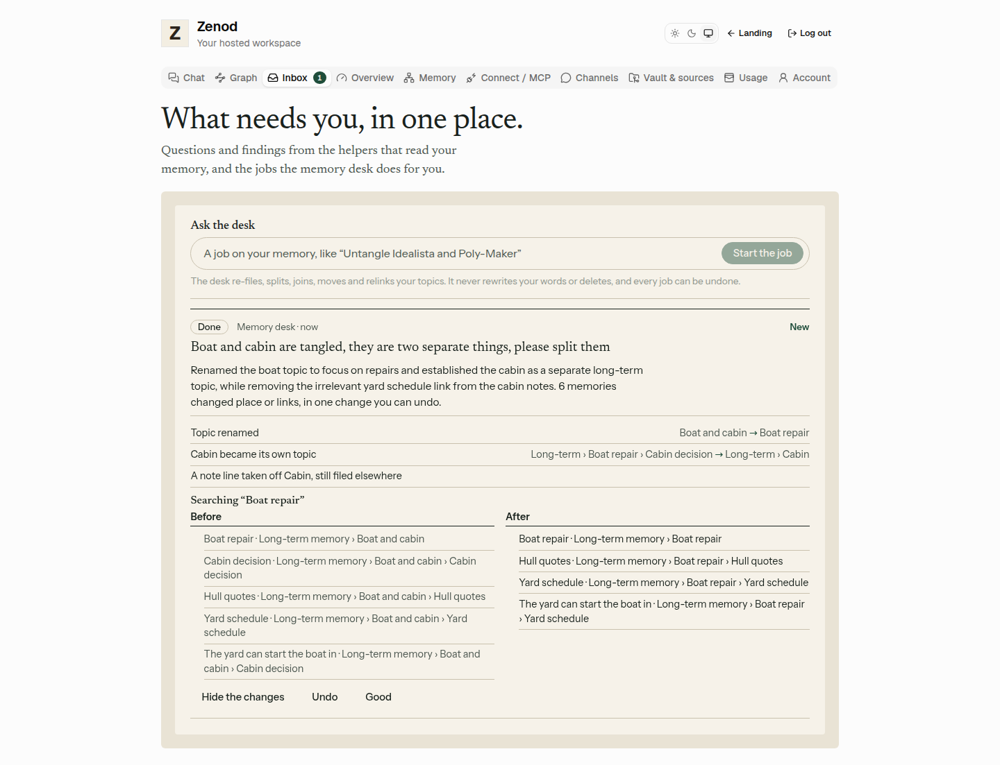
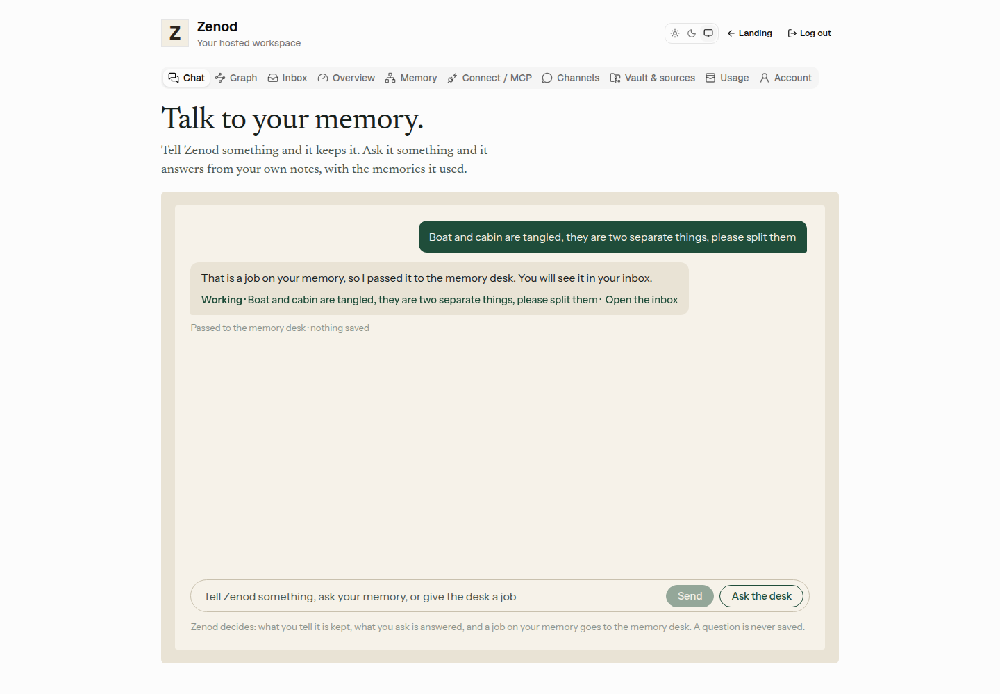
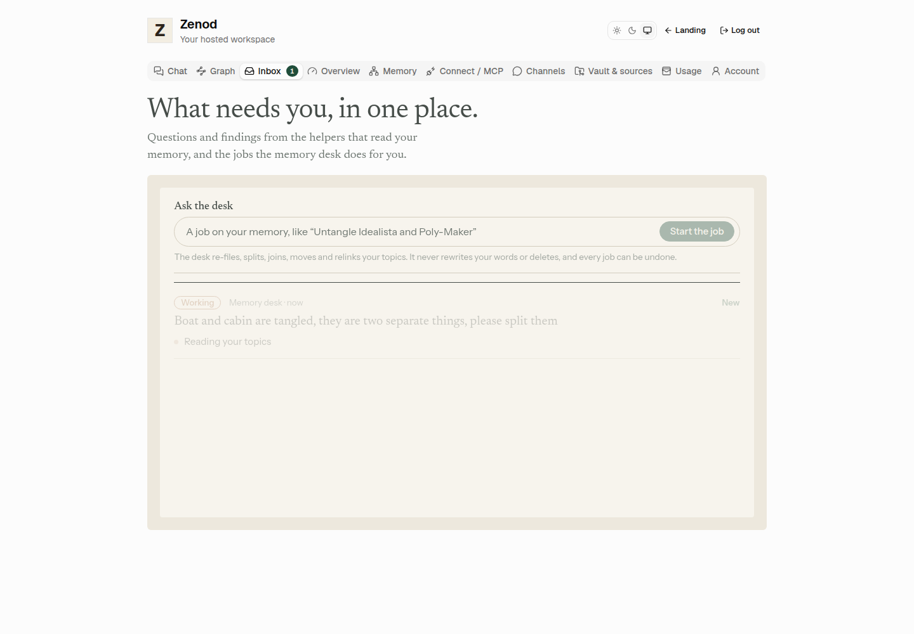
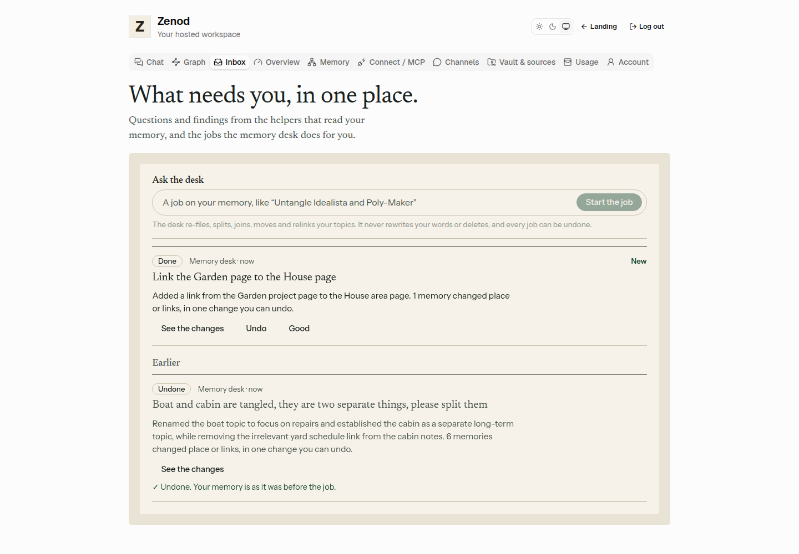
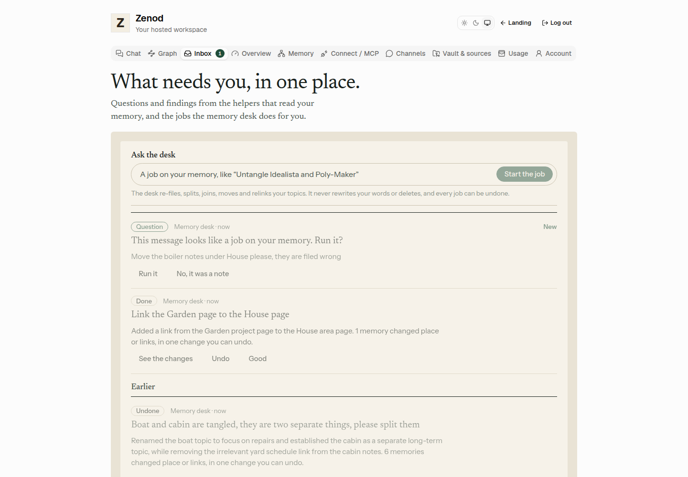
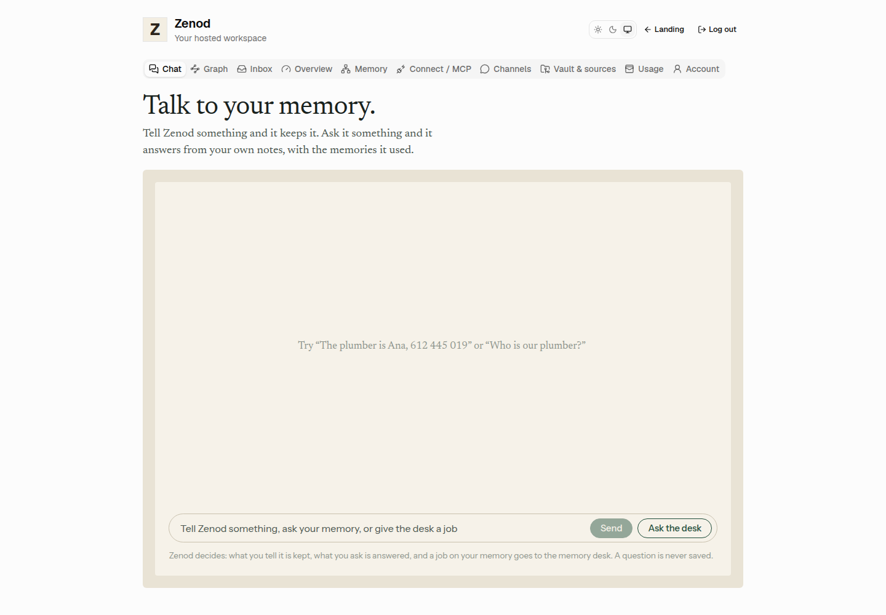
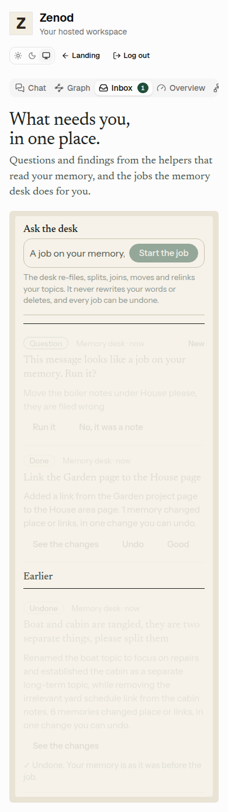

# E14-S3 evidence: the memory desk (2026-11-08)

**Evidence page (tailnet, no password):** http://vps3.taild81fbb.ts.net:8921/e14-s3/

Row: S3 in [EPIC-14](../plan-personas-inbox-voice-and-calls-come.md), from the approved plan (E14-A2, slides 7–8) and the Delivery Manager's addition after Jordi's words on S2 ("no way to launch a worker?"). Run: run_b01f1e70-bd63-4c67-aece-c0bf32207e11. PR [#1531](https://github.com/zenod-ai/zenod/pull/1531), merged as `7cf333f`.

## What it does

- **A job is a third Send outcome.** The one Send box now recognises a job on the memory (split, join, move, rename, relink, "filed wrong") next to keep and answer. A job runs only when Zenod's chat model and the plain rules agree. If only one of them reads a job, the chat asks "Keep this as a memory, or should the memory desk do it as a job?" with **Keep it** and **Do it as a job**. It never runs a job on a guess. The 80 keep/answer test messages of EPIC-16 still decide as before.
- **Ask the desk.** A button beside Send, and a box at the top of the Inbox, start a job from a short description without the decision. The job is in the Inbox at once as **Working**. This is the visible way to launch a worker on your memory.
- **Who does it.** An agent on the tenant's own job queue, in the same serial lane as filings and the weekly sweep, on Zenod's cheap chat model (`google/gemini-3.1-flash-lite`). It only reads, through five tools (topics, search, read a page, what is under a page, its links), and works in steps:
  - limits: at most 8 model calls and about 40k input tokens a job, 20 jobs a day per account; every call is metered in the account's AI allowance, and a used-up allowance stops the job with its reason;
  - before it hands back a plan, a read-only check tells it what does not fit (a page that does not exist, a move under itself, a topic name that does not match its page), and it fixes the plan.
- **What it may change.** Zenod applies the plan, never the model, from a closed list: move a page with everything under it, make a page its own topic, rename a topic or fix its one-line summary, add a link, and take off a link line or a note line copied onto the wrong page when the same note is still filed elsewhere. Before anything is committed, a check on the files themselves refuses the job if:
  - a file under Log/ changed, or a file was created or deleted;
  - any word of a page changed apart from whole link lines;
  - front matter changed beyond `parent` and `memory`;
  - the tree has more problems than before.
- **One commit per job**, named `memory desk: <job>`. The job's exact edits are kept, so **Undo** puts each one back as one more commit and leaves alone only a line someone changed since.
- **Big jobs ask first.** A job that would change more than 50 memories is put back unapplied and posts a plan card in the Inbox: "…this would change N memories. Run it?" **Run it** carries on the same Inbox item with that plan. **Not now** ends it with nothing changed.
- **In the Inbox** (S2): Working with the current step ("Reading your topics", "Looking under Boat repair", "Making 3 changes"), then Done with what changed (before and after each move), the same search before and after, **See the changes**, **Undo** and **Good**. A refusal or failure says why ("Deleting is always a question in your inbox first", "The desk stopped before changing anything. Your memory is as it was"). A job cut off by a restart is marked failed when the Inbox opens.
- **WhatsApp and Telegram are unchanged** (root L-6). Their replies are exactly as before. A message the plain rules read as a job (no model call) is kept as always, and it also shows in the Inbox as "This message looks like a job on your memory. Run it?" with **Run it** and **No, it was a note**. Nothing is ever sent to a chat.
- **Seams** (root L-7): Zenod's own code on its own queue, no run-time call to Epic Team. The Inbox card shapes are S2's.

## The EPIC-19 untangle, re-run as a desk job on a copy

EPIC-19 untangled Idealista and Poly-Maker in Jordi's vault by hand ([evidence](e19-u1-2026-11-08.md)). The same request was given to the desk on a private copy of his vault as it was before that change: "Idealista and Poly-Maker are tangled, they are two separate things, please split them". It ran on VPS3 only, never on his vault, and no private text is shown here.

- **First try (before the plan check):** the cheap model put the name "Idealista" on the Poly-Maker page, the wrong way round. That led to the plan check, a richer topics view, and the EPIC-19 playbook in the agent's instructions.
- **After those:** 7 model calls, 21 s, $0.0037, one commit. The shared topic, which sits on the Poly-Maker page, was renamed to fit that page, and the Idealista page became its own long-term topic, so the 26 pages are two topics again, as in the hand fix. It did not take off the 6 copied note lines that the hand fix also removed. The topic names it chose are longer than the hand fix's ("Poly-Maker Campaign July 2026", "Idealista Data Relationship").

EPIC-19's own 16 questions, scored the same way (top 10 each, Zenod's index search):

| | Before | By hand (EPIC-19) | Desk job |
|---|---|---|---|
| Idealista questions: Poly-Maker results in top 3 | 1 | 0 | 0 |
| Idealista questions: Poly-Maker results in top 10 | 4 | 3 | 3 |
| Poly-Maker questions: Idealista results in top 3 | 3 | 0 | 0 |
| Poly-Maker questions: Idealista results in top 10 | 7 | 2 | 3 |
| Results placed under the shared topic | 134 | 0 | 0 |
| Results about the asked subject (of 160) | 122 | 131 | 131 |

**Undo** on the copy: 3 edits put back, 0 skipped, one commit; the vault was byte for byte as before the job.

## Local run of the shipped code, demo vault

The built code ran on VPS3 localhost ([local-desk.mjs](e14-s3/local-desk.mjs), [local-shoot.mjs](e14-s3/local-shoot.mjs), headless Chromium):

- the real core engine on a local git vault of made-up notes (a "Boat and cabin" knot), the tenant's real job queue with the desk hooks, and the Inbox;
- the real customer routes behind a real customer session, and the built web app;
- Zenod's chat model reached through a capped relay that holds the key on VPS1 (at most 60 calls, model fixed).

| Step | Result |
|---|---|
| Sent "Boat and cabin are tangled, they are two separate things, please split them" | "That is a job on your memory, so I passed it to the memory desk. You will see it in your inbox." · Passed to the memory desk · nothing saved |
| Open the inbox | Working, "Reading your topics" |
| Done | Topic renamed Boat and cabin → Boat repair; Cabin became its own topic; a note line taken off Cabin, still filed elsewhere. Searching "Boat repair": before, 5 results under "Boat and cabin" including two cabin pages; after, only boat pages under "Boat repair". One commit `memory desk: Split Boat and Cabin` |
| Ask the desk in the inbox: "Link the Garden page to the House page" | in the list at once as Working, then Done, one commit `memory desk: Link Garden to House` |
| Undo on the first job | "Undone. Your memory is as it was before the job." One commit `memory desk: undo Split Boat and Cabin` |
| A WhatsApp-style message "Move the boiler notes under House please, they are filed wrong" | Inbox: "This message looks like a job on your memory. Run it?" |

Headless demo job: [demo-job-result.json](e14-s3/demo-job-result.json), 8 calls, $0.0021. Every real-model call for this row cost $0.017 in total (52 calls).

## Checks

- Core `memoryDesk.test.ts` (9 tests):
  - the knot untangled as ONE commit, with Log untouched and nothing deleted or rewritten;
  - Undo exact, even after a later filing;
  - the plan-first cap;
  - a plan that does not fit goes back to the model;
  - step, budget and refusal stops;
  - the guard;
  - `sendRoute.test.ts` (10), including job, unsure and chores that are not jobs.
- Server `memoryDesk.test.ts` (6 tests, two tenants):
  - Ask the desk; plan card, then Run it on the same item, and Not now;
  - refusal and failure messages; allowance and daily cap;
  - the Send stream; WhatsApp "run it?".
- Web: the chat's job reply, unsure with both choices and Ask the desk; the Inbox's Ask the desk.
- Totals:
  - web 188;
  - server: inbox, persona and chat suites 45;
  - typecheck clean, Phylax bundle verified;
  - CI green on #1531.
- Slow-host notes: the full core suite on VPS3 has 3 tests that time out at 5 s (`filingPublication`, `engine`); `filingPublication` times out the same way on `main` on this host. CI runs them green.

## Live

Merged as `7cf333f`; publish.yml ran ci, publish and deploy, all green ([run 42516363253](https://github.com/zenod-ai/zenod/actions/runs/42516363253)). Checked 2026-11-08:

- `https://cloud.zenod.dev/api/health`: `ok`, sha `7cf333f114f0707c196bf299322db53aa440b9c4`.
- `POST https://cloud.zenod.dev/api/console/memory-desk/jobs` without a session: 401 (the route is live and needs a sign-in).
- The live app bundle (`/assets/index-ClRZu5ys.js`) carries "Ask the desk", the desk route and the chat's "passed it to the memory desk" reply.

## Not proven yet

- ✗ Signed-in production check: waits on E7-A15 (the agents' Google sign-in), so the screens are from the local run with demo data.
- ✗ No desk job has run on Jordi's vault: by design for this row. He starts the first one himself from Ask the desk.
- The plan card for big jobs is proven by tests only; the demo vault is too small to need one.
